# Plan de Implementación Integral — Sprint 5 Consolidado SGD-AVEIT

> **Proyecto:** Sistema de Gestión del Tribunal de Disciplina y Premiaciones de A.V.E.I.T. (SGD-AVEIT)  
> **Período de Ejecución:** Sprint 5 (Cierre unificado del sistema)  
> **Metodología:** Spec-Driven Development (SDD) & Test-Driven Development (TDD)  
> **Directiva del PO:** Consolidación total de actividades en el Sprint 5 ("hay que terminar para este sprint").

---

## 1. Descripción del Objetivo

El presente plan establece la hoja de ruta técnica y de gestión para consolidar en una única iteración (Sprint 5) la totalidad del alcance pendiente del proyecto:
1. **Core Transaccional de Puntos y Resoluciones (S5):** Cierre de firma colegiada (`SCRUM-57`), emisión oficial (`SCRUM-58`), libro mayor inmutable (`SCRUM-59`), portal 'Mis Expedientes' (`SCRUM-60`) y publicación oficial protegida (`SCRUM-61`).
2. **Arrastre de Sprint 4:** Integración y cierre de valoración de descargos extraordinarios con antecedentes y sana crítica (`SCRUM-53`).
3. **Remanente de Backlog y Sprint 6:** Balances cuatrimestrales (`SCRUM-64`), jurisprudencia (`SCRUM-65`), migración de datos legados (`SCRUM-66`), hardening/E2E (`SCRUM-67`), homologación (`SCRUM-68`) y casos internos (`PB-01`).
4. **Listado de Mejoras y Errores Específicos:**
   - **N-01:** Rediseño colaborativo de la pantalla de generación de eventos institucionalmente con el PO.
   - **N-02:** Optimización transversal de rendimiento (RAM y CPU) con paginación server-side, `OnPush`, `trackBy` y eliminación de consultas N+1 en BD.
   - **N-03:** Corrección definitiva de persistencia del puntaje final en Gestionar Expedientes.
   - **N-04:** Exclusión fundada de involucrados exclusiva para rol TD con motivo obligatorio, aviso por email y resolución automática "sin efecto" si es el último involucrado.
   - **N-05:** Enmienda de expedientes emitidos con resolución versionada, contra-asientos transaccionales en libro mayor y nueva firma colegiada de los 3 grupos activos.
   - **N-06:** Embellecimiento estético y ergonómico de Gestionar Expedientes (selectores de urgencia, categoría y armonización con `DESIGN.md`).
   - **N-07:** Pantalla de administración para rol Administrador: parámetros del sistema (umbrales, plazos, emails y límites de adjuntos) y panel de gestión de miembros del Tribunal de Disciplina (tabla de usuarios con rol TD, buscador reactivo para alta y acción de revocación).
   - **N-08:** Detalle y formalización de la matriz de permisos por rol (RBAC) con sincronización en backend/frontend y tests automatizados.
   - **N-09:** Sustitución transversal del término "legajo" por "número de socio" en toda la interfaz de usuario, resoluciones y notificaciones (preservando el esquema legacy de BD).
   - **N-10:** Corrección del identificador de expediente en Solicitar Puntos (eliminación de hashes `<yyyy><hash>` por el formato canónico `EXP-NNNN/YYYY`).
   - **N-11:** Auditoría de tablas del sistema para asegurar celdas con información estrictamente atómica.
   - **N-12:** Verificación y validación universal del motor de despacho de correos electrónicos vía `EmailOutbox`.
   - **N-13:** Elaboración del Manual de Usuario Final modular por roles institucionales.

---

## 2. Acuerdos y Decisiones Clave Validadas con el PO

> [!IMPORTANT]
> **Decisiones rectoras tomadas durante el proceso de refinamiento (`/grill-me`):**
> 1. **Exclusión de Involucrados (N-04):** Se permite en cualquier estado antes de `Emitido` (`creado`, `justificando`, `revision_resolucion`, `pendiente_firma`). El socio queda marcado con estado "Excluido" (tachado visualmente con motivo visible en el expediente), no se le computan puntos ni descargo y no figura en la resolución final. Si se excluye al último involucrado, el expediente transiciona automáticamente a `Emitido` con una resolución de "Sin efecto / Causa archivada". Se notifica por correo electrónico tanto al socio excluido como al creador/solicitante del expediente.
> 2. **Enmienda de Resoluciones (N-05):** Permite rectificar el puntaje final aplicado a los socios y/o la fundamentación/artículos dispositivos. Genera automáticamente una nueva resolución enlazada (`EXP-NNNN/YYYY-ENM-1`), un contra-asiento de puntos en el libro mayor (`TransaccionPuntos`, cero `UPDATE`) y requiere la firma colegiada digital de los 3 representantes de los grupos activos (4.º, 5.º y 6.º año).
> 3. **Identificación Institucional (N-09):** En AVEIT la identidad se rige por **Número de Socio** y no por "legajo". Se reemplaza el término en toda la UI, mensajes y resoluciones oficiales. La columna en BD se mantiene para no vulnerar la Regla Innegociable 6.
> 4. **Solicitar Puntos y Número de Expediente (N-10):** Crear una solicitud es formalmente crear un expediente; debe mostrar inmediatamente su identificador canónico (`<num>/<YYYY>`), eliminando el hash hexadecimal temporal `T01-<yyyy>-<hash>`.
> 5. **Pantalla de Administración (N-07):** Acceso restringido exclusivamente al rol **Administrador (Admin)** para: a) gestionar plazos, umbrales de puntos, emails institucionales y límites de comprobantes con auditoría inmutable de cambios; b) visualizar en una tabla dedicada a todos los usuarios con rol TD, permitiendo asignar el rol a un socio mediante búsqueda reactiva (Select2) y revocarlo cuando corresponda.
> 6. **Pantalla de Generación de Eventos (N-01):** El prototipo y diseño se formula interactivamente en conjunto con el PO en esta misma sesión previa a la codificación.
> 7. **Tablas Atómicas (N-11):** Auditoría exhaustiva en todas las pantallas del sistema para que cada columna exhiba un único dato sin concatenaciones.
> 8. **Manual de Usuario (N-13):** Documento modular en `docs/manual-usuario/` con secciones diferenciadas por rol institucional.

---

## 3. Estructura de las 8 Macro-Actividades en Jira (Sprint 39)

El tablero de Jira del Sprint 5 Consolidado exhibe únicamente **8 Macro-Historias**, cada una con sus respectivas subtareas (Subtasks) anidadas y con el criterio de aceptación innegociable de consulta previa con el PO:

> **Criterio de Aceptación N° 1 transversal y obligatorio:**  
> `[ ] Reunión y visto bueno explícito del PO antes de comenzar a codear.`

| ID Macro | Clave Jira | SP | Macro-Historia en Jira | Subtareas Anidadas (Subtasks) |
| :---: | :---: | :---: | :--- | :--- |
| **MACRO-01** | `SCRUM-89` | 15 | **Circuito Resolutivo Oficial, Exclusión Fundada, Corrección de Puntaje Final y Enmiendas Trazables** | • `SCRUM-99`: Firma colegiada por año social (4.º, 5.º y 6.º)<br>• `SCRUM-100`: Emisión oficial de resolución y despacho sin duplicados<br>• `SCRUM-101`: Corrección de bug de persistencia del puntaje final<br>• `SCRUM-102`: Exclusión fundada de involucrados por rol TD<br>• `SCRUM-103`: Enmienda trazable de resoluciones emitidas y contra-asiento |
| **MACRO-02** | `SCRUM-59` | 10 | **Sumatoria Inmutable de Puntos (Libro Mayor), Portal 'Mis Expedientes' y Publicación Oficial Protegida** | • `SCRUM-104`: Transacción inmutable de libro mayor con regla 3:1<br>• `SCRUM-105`: Portal 'Mis Expedientes' con aislamiento por socio<br>• `SCRUM-106`: Publicación protegida de resoluciones oficiales |
| **MACRO-03** | `SCRUM-91` | 8 | **Panel de Administración: Parámetros del Sistema y Gestión de Miembros con Rol TD** | • `SCRUM-107`: Backend REST y modelo inmutable de parámetros del sistema<br>• `SCRUM-108`: Pantalla Angular de administración de parámetros para ADMIN<br>• `SCRUM-109`: Tabla y gestión de altas/bajas de usuarios con rol TD |
| **MACRO-04** | `SCRUM-86` | 5 | **Rediseño Integral de Pantalla de Eventos y Reuniones Institucionales (Prototipo PO)** | • `SCRUM-110`: Validación de prototipo interactivo con el PO<br>• `SCRUM-111`: Formulario de creación de eventos y coordenadas físicas<br>• `SCRUM-112`: Convocatoria reactiva con Select2<br>• `SCRUM-113`: Captura de asistencia y apercibimientos automáticos |
| **MACRO-05** | `SCRUM-93` | 10 | **Estandarización de Número de Socio, Celdas Atómicas y Embellecimiento de Gestionar Expedientes** | • `SCRUM-114`: Reemplazo global de 'legajo' por 'número de socio'<br>• `SCRUM-115`: Identificador canónico EXP-NNNN/YYYY en Solicitar Puntos<br>• `SCRUM-116`: Auditoría y atomización de celdas en todas las tablas<br>• `SCRUM-117`: Embellecimiento de selectores en Gestionar Expedientes |
| **MACRO-06** | `SCRUM-87` | 8 | **Optimización Integral de Rendimiento de la Plataforma (RAM, CPU y Base de Datos)** | • `SCRUM-118`: Paginación server-side en Backend y Frontend<br>• `SCRUM-119`: Optimización Angular OnPush y trackBy<br>• `SCRUM-120`: Optimización Django ORM y eliminación de N+1 |
| **MACRO-07** | `SCRUM-92` | 6 | **Matriz Formal de Permisos RBAC y Verificación Universal de Notificaciones por Email** | • `SCRUM-121`: Matriz formal de permisos RBAC en docs/<br>• `SCRUM-122`: Blindaje y tests automatizados de permisos DRF/Angular<br>• `SCRUM-123`: Verificación y testing de matriz universal de emails |
| **MACRO-08** | `SCRUM-97` | 17 | **Balances Cuatrimestrales, Jurisprudencia, Casos Internos, Staging y Manual de Usuario Final** | • `SCRUM-124`: Exportación de balance cuatrimestral en PDF<br>• `SCRUM-125`: Repositorio de jurisprudencia histórica<br>• `SCRUM-126`: Migración de datos legados y reconciliación<br>• `SCRUM-127`: Homologación y verificación en Staging<br>• `SCRUM-128`: Promoción de casos internos a T01<br>• `SCRUM-129`: Manual de Usuario Final modular por roles |

---

## 3.1. Arquitectura y Paquetes de Trabajo

```mermaid
flowchart TD
    subgraph WP1["PAQUETE 1: Correcciones Críticas de Datos y UI Core"]
        N03["N-03 Persistencia Puntaje Final"]
        N10["N-10 N° Expediente Canónico en Solicitudes"]
        N09["N-09 Sustitución Legajo por N° Socio"]
        N11["N-11 Atomicidad de Tablas"]
    end

    subgraph WP2["PAQUETE 2: Ciclo Procesal y Resoluciones"]
        S53["SCRUM-53 Valorar T03 Antecedentes"]
        N04["N-04 Exclusión Fundada TD"]
        S57["SCRUM-57 Firma Colegiada 3 Grupos"]
        S58["SCRUM-58 Emisión e Idempotencia"]
        N05["N-05 Enmienda de Expedientes Emitidos"]
        N06["N-06 Embellecimiento Gestionar Expedientes"]
    end

    subgraph WP3["PAQUETE 3: Transaccionalidad de Puntos y Notificaciones"]
        S59["SCRUM-59 Libro Mayor Inmutable (Cero UPDATE)"]
        S60["SCRUM-60 Mis Expedientes y Privacidad"]
        S61["SCRUM-61 Publicación Protegida"]
        N12["N-12 Verificación Universal Emails"]
    end

    subgraph WP4["PAQUETE 4: Gobernanza, Parámetros y Rendimiento"]
        N07["N-07 Admin Parámetros Hardcodeados"]
        N08["N-08 Matriz RBAC y Permisos DRF"]
        N02["N-02 Optimización RAM/CPU (Paginación + OnPush)"]
        N01["N-01 Rediseño Eventos (Prototipo PO)"]
    end

    subgraph WP5["PAQUETE 5: Cierre Institucional, Homologación y Manuales"]
        S64["SCRUM-64 Balances en PDF"]
        S65["SCRUM-65 Jurisprudencia Histórica"]
        S66["SCRUM-66 Migración y Rollback"]
        S67["SCRUM-67 Hardening y E2E"]
        S68["SCRUM-68 Homologación y Staging"]
        PB01["PB-01 Casos Internos a T01"]
        N13["N-13 Manual de Usuario Final"]
    end

    WP1 --> WP2
    WP2 --> WP3
    WP3 --> WP4
    WP4 --> WP5
```



---

## 4. Cambios Propuestos por Componente

### 4.1. Paquete 1: Correcciones Críticas de Datos y UI Core

#### [MODIFY] `backend/expedientes/models.py`
- Agregar campo `puntaje_ratificado = models.CharField(max_length=20, null=True, blank=True)` en `DescargoExpediente` para persistir formalmente el puntaje asignado tras la evaluación del TD sin depender de snapshots anidados.
- Agregar en `DescargoExpediente` o en entidad de involucrados el soporte para registrar la exclusión: `esta_excluido = models.BooleanField(default=False)`, `motivo_exclusion = models.TextField(blank=True)`, `excluido_por = models.ForeignKey(settings.AUTH_USER_MODEL, null=True, blank=True, on_delete=models.PROTECT)`, `excluido_at = models.DateTimeField(null=True, blank=True)`.

#### [MODIFY] `backend/expedientes/serializers/__init__.py` & `backend/expedientes/services/causal_resolution_service.py`
- En `CausalResolutionService.decide`: persistir `descargo.puntaje_ratificado = final_snapshot_val; descargo.save(update_fields=['puntaje_ratificado'])`.
- En `SolicitudT01CreateSerializer`: eliminar el prefijo provisorio con hash `T01-{solicitud.issued_at:%Y}-{solicitud.id.hex[:12].upper()}` y generar/asociar inmediatamente el `Expediente` con su correlativo anual `ExpedienteNumberSequence.next_value(year)`.
- Exponer `puntaje_ratificado` en `DescargoDetalleSerializer` y `ExpedienteDetalleSerializer`.

#### [MODIFY] `frontend/src/app/gestionar-expedientes/gestionar-expedientes.component.ts` & `html`
- Corregir `getPuntajeFinalInvolucrado`: leer prioritariamente `fila.descargo?.puntaje_ratificado` o `fila.descargo?.decisiones_causal?.[0]?.descargo_snapshot?.puntaje_final`.
- En la tabla de involucrados: separar celdas en información atómica:
  - Columna 1: `N° Socio`
  - Columna 2: `Apellido`
  - Columna 3: `Nombre`
  - Columna 4: `Grupo / Año Social`
  - Columna 5: `Estado de Descargo`
  - Columna 6: `Puntaje Final Asignado`
  - Columna 7: `Acciones`
- Reemplazar todas las etiquetas visibles de "Legajo" por "N° de Socio" o "Número de Socio".
- Botón "Excluir Socio" visible únicamente para rol `TD` en el menú de acciones del involucrado (abre modal de confirmación con motivo obligatorio).

#### [MODIFY] `frontend/src/app/solicitar-puntos/solicitar-puntos.component.html` & `ts`
- Actualizar el formato visual para mostrar siempre `<num>/<YYYY>` en las tablas de solicitudes y en los modales de detalle.
- Reemplazar "Legajo" por "Número de Socio".
- Separar en columnas atómicas la lista de involucrados y solicitudes.

---

### 4.2. Paquete 2: Ciclo Procesal, Exclusión y Enmiendas

#### [NEW] `backend/expedientes/models/enmienda.py` (o en `models.py`)
- Modelo `EnmiendaResolucion(models.Model)`:
  - `resolucion_anterior = models.ForeignKey(Resolucion, on_delete=models.PROTECT, related_name='enmiendas')`
  - `resolucion_nueva = models.OneToOneField(Resolucion, on_delete=models.PROTECT, related_name='origen_enmienda')`
  - `motivo_enmienda = models.TextField()`
  - `solicitado_por = models.ForeignKey(settings.AUTH_USER_MODEL, on_delete=models.PROTECT)`
  - `creado_at = models.DateTimeField(auto_now_add=True)`

#### [NEW] `backend/expedientes/services/enmienda_service.py`
- Lógica de enmienda de resolución emitida:
  - Validación de estado `emitido`.
  - Creación de nuevo borrador de resolución vinculado con numeración de enmienda o correlativa.
  - Al emitirse la resolución enmendada y firmarse por los 3 representantes de grupos activos:
    - Se computa el contra-asiento en `TransaccionPuntos` (delta = nuevo puntaje - puntaje anterior).
    - Despacho de notificaciones oficiales vía `EmailOutbox`.

#### [MODIFY] `backend/expedientes/views/enmienda_views.py` & `urls.py`
- Endpoint `POST /api/v1/expedientes/<id>/enmendar/` restringido a `IsTribunal`.
- Endpoint `POST /api/v1/expedientes/<id>/involucrados/<socio_id>/excluir/` restringido a `IsTribunal`.

#### [MODIFY] `frontend/src/app/gestionar-expedientes/gestionar-expedientes.component.ts` & `html`
- Diálogo y flujo de "Enmendar Resolución" en expedientes en estado `Emitido`.
- Estilización de selectores de Urgencia y Categoría con clases semánticas de `DESIGN.md`.

---

### 4.3. Paquete 3: Libro Mayor Inmutable y Verificación de Emails

#### [MODIFY] `backend/ranking/services.py` & `models.py`
- Cierre formal de `SCRUM-59`:
  - `TransaccionPuntos` con campos inmutables: `socio`, `puntos`, `tipo`, `resolucion`, `created_at`, `hash_transaccion`.
  - Tratamiento estricto de Felicitaciones y Llamados de Atención (categorías separadas, acumulación 3:1).
  - Cero sentencias `UPDATE` o `DELETE` (Regla Innegociable 3).
- Cierre de `SCRUM-60` (Mis Expedientes) y `SCRUM-61` (Publicación oficial con censura médica).

#### [NEW] `backend/core/services/email_verification_service.py`
- Auditoría exhaustiva de los 10 disparadores de correo electrónico.
- Verificación de codificación estricta UTF-8 y ausencia de mojibakes.
- Suite de pruebas de integración para el despacho por `EmailOutbox`.

---

### 4.4. Paquete 4: Parámetros del Sistema, Permisos RBAC y Rendimiento

#### [NEW] `backend/core/models/parametros.py` & Endpoints de Administración de Roles TD
- Modelo `ParametroSistema(models.Model)` con versionado sólo-inserción (`InsertOnlyModel`):
  - `clave = models.CharField(max_length=50, unique=True)`
  - `valor = models.JSONField()`
  - `descripcion = models.CharField(max_length=255)`
  - `modificado_por = models.ForeignKey(settings.AUTH_USER_MODEL, on_delete=models.PROTECT)`
  - `modificado_at = models.DateTimeField(auto_now=True)`
- Sembrado inicial con: plazos de descargo (5), plazo apelación (5), umbrales (-10, -7), emails institucionales y tamaño max adjuntos (5 MB).
- Endpoints REST para gestión de rol TD (exclusivos `ADMIN`):
  - `GET /api/v1/admin/usuarios-td/`: lista paginada de todos los socios con `role = Role.TD`.
  - `POST /api/v1/admin/usuarios-td/`: asigna `role = Role.TD` a un socio seleccionado (`socio_id`).
  - `DELETE /api/v1/admin/usuarios-td/<socio_id>/`: revoca el rol TD del socio devolviéndolo a `Role.SOCIO`.

#### [NEW] `frontend/src/app/pages/admin/parametros/` (Componente y Diálogos)
- Pantalla dedicada con pestañas / tarjetas temáticas para el rol `ADMIN`:
  1. *Parámetros del Sistema:* plazos, umbrales, correos y adjuntos.
  2. *Miembros del Tribunal de Disciplina (TD):* tabla con N° de Socio, Apellido, Nombre, Grupo y Email de todos los usuarios con rol TD, botón para revocar el rol TD a un usuario y diálogo con Select2 reactivo para asignar el rol TD a un nuevo socio.
- Integración en `admin-layout.routing.ts` protegida con `AdminGuard`.

#### [NEW] `docs/gestion-proyecto/MATRIZ_DE_PERMISOS_RBAC.md`
- Matriz completa de roles x pantallas x acciones x endpoints REST.
- Tests unitarios DRF en `backend/tests/test_rbac_permissions.py` validando respuestas 403 Forbidden para accesos no autorizados.

#### [MODIFY] Optimización de Rendimiento Frontend & Backend
- Backend: Configurar `PageNumberPagination` estándar en viewsets de ranking, expedientes, solicitudes y eventos.
- Frontend: Incorporar `MatPaginator` con carga reactiva paginada, `ChangeDetectionStrategy.OnPush`, `trackBy: trackById` y desuscripción con `Subject`/`takeUntil`.
- Backend ORM: Asegurar `select_related` y `prefetch_related` en todas las consultas de listados para 0 consultas N+1.

---

### 4.5. Paquete 5: Documentación, Prototipo PO de Eventos y Manual de Usuario

#### [NEW] Prototipo y Rediseño de Pantalla de Eventos (N-01)
- Prototipado conjunto en Markdown / Generative UI con el PO:
  - Categorías canónicas de reunión y actividad.
  - Selector de modalidad (Presencial, Virtual, Híbrida).
  - Campo específico de lugar institucional exacto.
  - Convocatoria reactiva con Select2 (individual o por grupo/subcomisión).
  - Captura y validación de asistencia.
- Implementación de la vista mejorada en `frontend/src/app/pages/eventos/`.

#### [NEW] `docs/manual-usuario/MANUAL_DE_USUARIO_SGD_AVEIT.md` (N-13)
- Manual modular exhaustivo estructurado en 6 capítulos:
  - Cap. 1: Introducción, Roles y Conceptos Clave.
  - Cap. 2: Guía del Socio (Ranking, Mis Expedientes, Descargos T02/T03, Apelación T01, Eventos).
  - Cap. 3: Guía del Tribunal de Disciplina (Tablero, Visor de Evidencias, Exclusión, Sustanciación, Firma Colegiada, Enmiendas).
  - Cap. 4: Guía de Comisión Directiva y Fiscalizadora (Solicitudes T01, Alertas Críticas 7/10 pts, Reportes).
  - Cap. 5: Guía de Subcomisiones (Creación de Solicitudes, Convocatorias y Asistencia a Eventos).
  - Cap. 6: Guía del Administrador de Cómputos (Parámetros del Sistema, Respaldos y Auditoría).

---

## 5. Plan de Verificación y Criterios de Aceptación (DoD)

### 5.1. Pruebas Automatizadas
1. **Backend (`pytest`):**
   ```bash
   docker compose exec backend pytest -q
   ```
   - Tests de persistencia de puntaje final (`test_causal_resolution.py`).
   - Tests de exclusión de involucrados y transición a emitido sin efecto (`test_exclusion_involucrado.py`).
   - Tests de enmienda de resolución y contra-asientos (`test_enmienda_resolucion.py`).
   - Tests de permisos RBAC transversales (`test_rbac_permissions.py`).
   - Tests de parámetros del sistema (`test_parametros_admin.py`).
   - Cobertura completa sin regresiones en suites de ranking, outbox y expedientes.
2. **Frontend (`npm test`):**
   ```bash
   cd frontend && npm test -- --watch=false --browsers=ChromeHeadless
   ```
   - Tests unitarios de `GestionarExpedientesComponent` (persistencia de puntaje, exclusión, enmienda).
   - Tests de `SolicitarPuntosComponent` (número de expediente canónico).
   - Tests de `AdminParametrosComponent`.
   - Tests de rendimiento y paginación.
3. **Linting y Formato:**
   ```bash
   docker compose exec backend ruff check .
   cd frontend && npm run lint
   ```
4. **Build de Producción:**
   ```bash
   cd frontend && npm run build
   ```

### 5.2. Verificación Manual y Validación PO
1. **Verificación de Puntaje Final:** Abrir un expediente en revisión, calificar un descargo modificando el puntaje, guardar, recargar la pantalla completa y corroborar que el puntaje persista exactamente igual en el listado y en la resolución.
2. **Verificación de Exclusión:** Entrar como TD, excluir a un socio con motivo de prueba, validar que el socio quede tachado en la tabla, verificar que reciba el correo de notificación y que el creador también lo reciba. Probar excluir al único involucrado y verificar la resolución automática "sin efecto".
3. **Verificación de Enmienda:** Entrar a un expediente emitido, pulsar "Enmendar", ajustar el puntaje, verificar generación de nueva resolución versionada, firmar con los 3 grupos y verificar el saldo en el ranking con el contra-asiento.
4. **Verificación de Parámetros:** Entrar como Admin a `/admin/parametros`, modificar el plazo de apelación a 7 días, guardar y verificar que el Calendario y los cálculos de plazo tomen el nuevo valor.
5. **Verificación Visual:** Comprobar que en ninguna pantalla se mencione "Legajo" sino "Número de Socio", que todas las tablas muestren celdas atómicas y que los expedientes muestren el formato canónico `<n>/<YYYY>`.

---

## 6. Secuencia de Ejecución Táctica

1. **Fase 1 (Inmediata):** Prototipar colaborativamente en este chat la pantalla de Eventos con el PO (N-01).
2. **Fase 2:** Corregir los bugs de datos e identificadores: Puntaje final (N-03) y N° de Expediente en solicitudes (N-10).
3. **Fase 3:** Implementar Exclusión de Involucrados (N-04) y Enmienda de Resoluciones (N-05).
4. **Fase 4:** Cerrar el core de firma, emisión, libro mayor y Mis Expedientes (SCRUM-53, 57, 58, 59, 60, 61).
5. **Fase 5:** Implementar Pantalla de Parámetros Admin (N-07) y Matriz RBAC (N-08).
6. **Fase 6:** Refactorizar terminología ("Número de Socio", N-09), atomicidad de tablas (N-11) y optimización de rendimiento RAM/CPU (N-02).
7. **Fase 7:** Verificar universalmente el envío de correos (N-12) y redactar el Manual de Usuario Final (N-13).
8. **Fase 8:** Integrar remanente de balances, migración y homologación final (SCRUM-64 a 68, PB-01).
