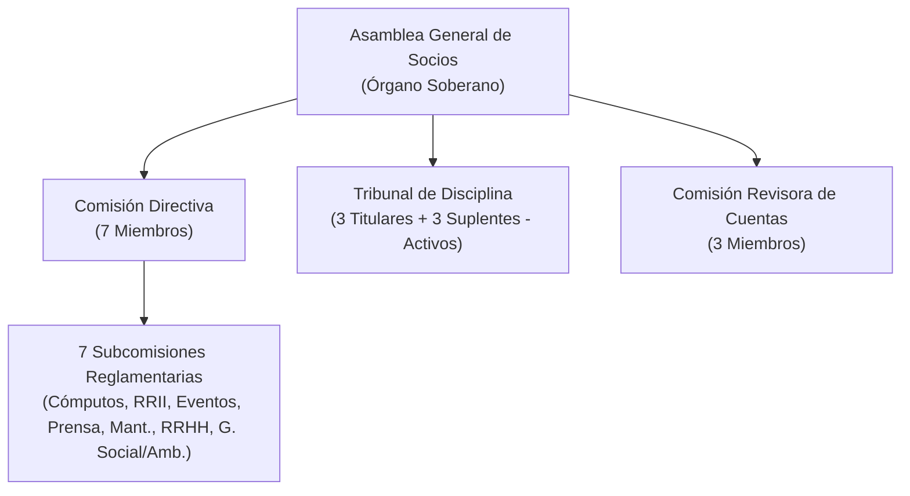
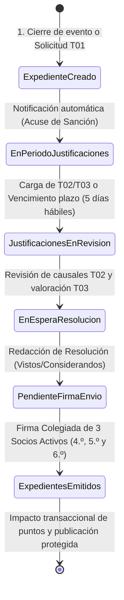

# SGD-AVEIT — Sistema de Gestión del Tribunal de Disciplina y Premiaciones

<div align="center">

[](https://www.frc.utn.edu.ar/)
[](#-contexto-institucional-aveit)
[](#-metodología-de-trabajo)
[](#-arquitectura-y-stack-tecnológico)
[](#-arquitectura-y-stack-tecnológico)
[](#-arquitectura-y-stack-tecnológico)
[](LICENSE)

**Trabajo Práctico Integrador — Cátedra de Seminario Integrador**  
*Carrera de Analista Desarrollador Universitario de Sistemas de Información*  
**Universidad Tecnológica Nacional — Facultad Regional Córdoba (UTN FRC)**

</div>

---

## 📋 Tabla de Contenidos

- [Descripción General](#-descripción-general)
- [Contexto Institucional (A.V.E.I.T.)](#-contexto-institucional-aveit)
- [Objetivos del Sistema](#-objetivos-del-sistema)
- [Funcionalidades Principales](#-funcionalidades-principales)
- [Flujo Procesal del Expediente](#-flujo-procesal-del-expediente)
- [Formularios y Competencias Administrativas](#-formularios-y-competencias-administrativas)
- [Régimen Disciplinario y Sistema de Puntos](#-régimen-disciplinario-y-sistema-de-puntos)
- [Arquitectura y Stack Tecnológico](#-arquitectura-y-stack-tecnológico)
- [Estructura del Repositorio e Índice de Carpetas](#-estructura-del-repositorio-e-índice-de-carpetas)
- [Equipo de Desarrollo](#-equipo-de-desarrollo)
- [Metodología de Trabajo](#-metodología-de-trabajo)
- [Licencia](#-licencia)

---

## 📖 Descripción General

**SGD-AVEIT** es una plataforma de software **100% Web y Responsive Mobile** orientada a sistematizar, auditar y transparentar la gestión integral de expedientes disciplinarios y reconocimientos al mérito de la **Asociación Vocacional de Estudiantes e Ingenieros Tecnológicos (A.V.E.I.T.)** en la UTN FRC.

El sistema reemplaza el uso fragmentado de planillas de cálculo y la manipulación manual de registros, automatizando:
- La tramitación digital de expedientes según el **Reglamento Procesal Disciplinario 2026**.
- La gestión de descargos y justificaciones tipificadas (**Formularios T01, T02 y T03**) con adjuntos digitales.
- El control automático de plazos preclusivos (**5 días hábiles**).
- La redacción unificada de resoluciones con **firma colegiada** de 3 Socios Activos (4.º, 5.º y 6.º año social), sin votación nominal individual.
- El cómputo transaccional inmutable de saldos de puntos (+/-) mediante libro mayor (`AsientoLibroMayor` y `PuntajeAplicado`), prohibiendo modificaciones no auditadas.
- Las alertas escalonadas por umbrales (`-7` preventivo y `-10` crítico) y por acumulación 3:1: motor de dominio implementado, integración productiva **trasladada al Sprint 6** (ver [`auditoria/traspaso-sprint6.md`](auditoria/traspaso-sprint6.md)).
- Los **Reportes y Balances Cuatrimestrales** (Art. 137): vistas analíticas y exportación CSV implementadas; exportación a PDF y cierre RBAC en 6 vistas **trasladada al Sprint 6** (ver [`auditoria/traspaso-sprint6.md`](auditoria/traspaso-sprint6.md)).

---

## 🏛 Contexto Institucional (A.V.E.I.T.)

Fundada en **1965**, la **Asociación Vocacional de Estudiantes e Ingenieros Tecnológicos** es una asociación civil autogestionada de la UTN FRC con más de 500 socios con membresía vigente. Su programa formativo complementa la instrucción técnica con competencias blandas, liderazgo y trabajo en equipo, teniendo como eje pedagógico cumbre un **Viaje Técnico-Cultural de tres meses por centros industriales y científicos de Europa**.

### Estructura Orgánica y Masa Societaria



- **Segmentación Estatutaria de Socios:**
  - **Socios Pasivos (1º, 2º y 3º año social):** Etapa formativa y de integración institucional.
  - **Socios Activos (4º a 6º año social):** Conducción operativa en subcomisiones, elegibilidad para órganos estatutarios (TD/CD) y preparación al Viaje Final de Estudios.
- **Equivalencias históricas:** `Junior = Pasivo` y `Senior = Activo`. La vigencia de la membresía se expresa como vigente/no vigente y no modifica la categoría social.
- **Tribunal de Disciplina (TD):** Órgano jurisdiccional independiente de 6 miembros (3 titulares, 3 suplentes) electos por Asamblea entre los Socios Activos, responsable de velar por la convivencia, juzgar infracciones y otorgar premios.

---

## 🎯 Objetivos del Sistema

1. **Garantizar la Integridad y Transaccionalidad:** Eliminar sentencias `UPDATE` directas sobre la base de datos MySQL y la dispersión en Google Sheets, registrando pistas de auditoría inalterables en cada operación.
2. **Promover la Transparencia Pública:** Proveer un portal web accesible desde smartphones y ordenadores para que los socios consulten su historial de puntos, sanciones y resoluciones fundamentadas.
3. **Optimizar el Cumplimiento de Plazos:** Automatizar el cómputo de plazos procesales improrrogables (5 días hábiles) con sellado de tiempo y despacho automático de notificaciones por email.
4. **Facilitar el Trabajo Remoto / Mobile del TD:** Dotar al Tribunal de herramientas para sustanciar sesiones virtuales, valorar descargos T02/T03 y formalizar resoluciones con firma colegiada digital (sin votación nominal).
5. **Cumplir con el Marco Estatutario:** Proveer reportes analíticos y bases del balance cuatrimestral de auditoría (Art. 137) por socio, subcomisión y grupo social (exportación PDF trasladada al Sprint 6, ver [`auditoria/traspaso-sprint6.md`](auditoria/traspaso-sprint6.md)).

---

## ⚙️ Funcionalidades Principales

| Módulo / Función | Descripción |
| :--- | :--- |
| 📱 **Portal "Mis Expedientes" (`/mis-expedientes`)** | Consulta de saldo propio, expedientes en curso, presentación/edición/retiro de descargos T02/T03 con evidencia, apelación T01 y resoluciones publicadas con censura médica. |
| 📝 **Crear Expediente T01 (`/solicitar-puntos`)** | Inicio formal de solicitudes multi-socio con Anexo, validación de competencias (`opening_policy.py`), número canónico y vista "Mis Solicitudes". |
| 🏛️ **Gestionar Expedientes TD (`/gestionar-expedientes`)** | Tablero de 6 estados, Visor Autorizado Unificado con auditoría de consultas, resolución causal T02, valoración T03 con antecedentes, apartamiento/suplencias (`IsNotInvolvedInExpediente`), exclusión fundada, editor de resolución con preview PDF, firma colegiada (4.º/5.º/6.º) y enmiendas trazables. |
| 🧮 **Libro Mayor Inmutable y Ranking (`/ranking-socios`)** | Asientos inmutables (`AsientoLibroMayor` + `PuntajeAplicado`), regla 3:1, ranking paginado y Legajo Integral del socio. |
| 📅 **Calendario Institucional (`/calendario-institucional`)** | Feriados institucionales, cálculo de plazos de 5 días hábiles y parametrización del plazo de apelación T01. |
| 🗓️ **Eventos y Asistencia (`/eventos-asistencia`)** | Gestión de reuniones y actividades, patrón Strategy de asistencia y consolidación 3:1 de apercibimientos (aviso preventivo trasladado al Sprint 6). |
| 📚 **Reglamentos (`/reglamentos`)** | Consulta y ABM de artículos reglamentarios con auditoría inmutable. |
| ⚙️ **Administración (`/admin/parametros`)** | Gestión auditada de parámetros del sistema y altas/bajas del rol `TD` (`ADMIN`). |
| 📊 **Reportes & Balance (`/reportes`)** | Vistas T01, Reuniones, Subcomisiones e Histórico con CSV (exportación PDF Art. 137 y cierre RBAC en 6 vistas **trasladada al Sprint 6**, ver [`auditoria/traspaso-sprint6.md`](auditoria/traspaso-sprint6.md)). |
| 🚨 **Alertas por Umbrales (`-7` / `-10`)** | Motor de dominio implementado; integración en flujo productivo **trasladada al Sprint 6** (ver [`auditoria/traspaso-sprint6.md`](auditoria/traspaso-sprint6.md)). |

---

## 🔄 Flujo Procesal del Expediente

El sistema implementa de forma estricta los **seis (6) estados oficiales del expediente** definidos en el Reglamento Procesal Disciplinario 2026 (Art. 12):



---

## 📑 Formularios y Competencias Administrativas

### Catálogo de Formularios Oficiales
* **Formulario T01 + Anexo:** Solicitud formal de sanción o premiación elevada por una autoridad habilitada.
* **Formulario T02 (Justificación Tipificada):** Descargo basado en causales reglamentarias (enfermedad con certificado, exámenes, viajes de fuerza mayor con pasajes).
* **Formulario T03 (Descargo Extraordinario):** Exposición de circunstancias extraordinarias sujetas a la sana crítica del TD y jurisprudencia interna.
* **Circular 001/2026:** Baremos y pautas normativas de graduación de puntos fijadas por el TD.

### Mapa de Competencias de Inicio (Arts. 21 a 26)
* **Comisión Directiva:** Sobre cualquier socio con membresía vigente, de categoría Pasivo o Activo, o equipo, excepto miembros de su propio cuerpo.
* **Comisión Fiscalizadora:** Sobre socios con membresía vigente, CD, Comisión Revisora y miembros del TD.
* **Tribunal de Disciplina:** Actuación de oficio o rectificación (con abstención de juzgamiento del solicitante).
* **Presidentes de Subcomisión:** Sobre miembros ordinarios o voluntarios a su cargo.
* **Jefes de Equipos Temporales:** Sobre los integrantes directos de su grupo de trabajo.

---

## ⚖️ Régimen Disciplinario y Sistema de Puntos

- **Escala de Premios (Puntos Positivos):**
  - Leve: +0.5 a +1 pto
  - Media: +1 a +2 ptos
  - Sobresaliente: +2 a +4 ptos
- **Escala de Sanciones (Puntos Negativos):**
  - Inasistencia injustificada a Reunión Obligatoria: **-1.0 pto**
  - Inasistencia injustificada a Asamblea: **-2.0 ptos**
  - Omisión de tareas de Mantenimiento / Limpieza: **-2.0 ptos**
  - Omisión / Incumplimiento de Tareas Asignadas en Subcomisión: **Llamado de atención hasta -2.0 ptos**
  - Llegadas tarde / retiros anticipados: **Llamado de atención o -0.5 ptos**
- **Límite Crítico Estatutario (Art. 93 Reglamento Interno):**  
  > ⚠️ **Pérdida Automática de la Condición de Socio:** Todo socio que alcance o supere **diez (10) puntos negativos netos** pierde automáticamente su pertenencia a AVEIT.

---

## 💻 Arquitectura y Stack Tecnológico

La solución se concibe como una extensión modular e integrada al ecosistema informático institucional preexistente de AVEIT:

```
+─────────────────────────────────────────────────────────+
|                  CLIENTE / FRONTEND                     |
|      100% Web & Responsive Mobile (Desktop / Mobile)    |
+────────────────────────────┬────────────────────────────+
                             │ HTTPS / REST API
+────────────────────────────v────────────────────────────+
|                  BACKEND INSTITUCIONAL                  |
|          Servicios Web & Lógica de Negocio (Python)      |
+────────────────────────────┬────────────────────────────+
                             │ ORM / Conector SQL
+────────────────────────────v────────────────────────────+
|                   BASE DE DATOS                         |
|             Base de Datos Relacional (MySQL)            |
|       Integridad Referencial y Auditoría Transaccional  |
+─────────────────────────────────────────────────────────+
```

- **Plataforma:** Aplicación Web Responsive (Mobile-First) apta para navegación fluida en smartphones Android/iOS y navegadores desktop.
- **Backend:** Python (Integración con servicios centrales institucionales).
- **Base de Datos:** MySQL (Servidor central AVEIT, almacenamiento transaccional y padrón de socios).
- **Infraestructura:** Servidor Central ubicado en la Sede Social AVEIT (Red UTN FRC) con soporte para acceso remoto seguro.

---

## 📂 Estructura del Repositorio e Índice de Carpetas

```text
seminario-integrador/
├── .github/                                     # Gobernanza y plantillas de issues
│   └── ISSUE_TEMPLATE/
├── auditoria/                                   # Registro canónico, traspaso Sprint 6, decisiones y archivados
├── backend/                                     # API REST en Python 3.12 / Django 4.2 LTS / DRF (114 archivos de tests)
├── frontend/                                    # SPA en Angular 14.2+ + Material Dashboard PRO (55 archivos *.spec.ts)
├── prototipos/                                  # Prototipos interactivos HTML5/CSS/JS iniciales
├── docs/                                        # Documentación funcional, técnica, formal y normativa
│   ├── adr/                                     # Decisiones de arquitectura (ADR-001)
│   ├── analisis-proceso-actual/                 # Reglamentos oficiales AVEIT, BPMN y sistema legado
│   │   ├── reglamentos-aveit/                   # Estatuto y Reglamentos oficiales de A.V.E.I.T.
│   │   ├── sistema-actual/                      # descripcion-sistema-actual-legado.md y esquema SQL
│   │   └── BPMN_Proceso_Operativo_Tribunal.md
│   ├── configuracion/                           # Guías operativas (Gmail SMTP, TD Ad-Hoc)
│   ├── especificaciones/                        # ERS-SGD-AVEIT.md, MODELO_DOMINIO_SGD_AVEIT.md, RBAC-SGD-AVEIT.md
│   ├── formales/                                # Estudio_Inicial.docx y Plan_de_Proyecto.docx + assets/
│   ├── gestion-proyecto/                        # Seguimiento de Proyecto.md, notasPO.md, GUIA_PULL_REQUESTS.md
│   ├── manual-usuario/                          # Manual de Usuario modular (9 capítulos HTML + PDFs)
│   └── constitution.md                          # Principios innegociables del proyecto
├── specs/                                       # Especificaciones SDD (001 a 012)
├── AGENTS.md                                    # Guía operativa para agentes de IA y desarrolladores
├── DESIGN.md                                    # Sistema de diseño institucional
├── TASK.md                                      # Seguimiento granular de tareas
├── docker-compose.yml                           # Orquestación de contenedores (MySQL 8.0, Django, Angular)
├── LICENSE                                      # Licencia Apache 2.0 (plantilla base frontend bajo MIT en frontend/LICENSE.md)
├── NOTICE                                       # Atribución y derechos de autor del equipo
└── README.md                                    # Presentación y guía principal del repositorio
```

### ▶️ Ejecución Rápida
- Levantar entorno completo: `docker compose up -d`
- Tests backend: `docker compose exec backend pytest -q`
- Tests frontend: `cd frontend && npm test -- --watch=false --browsers=ChromeHeadless`

### 📑 Guía de Documentos Clave

* 📘 **Estudio Inicial y Plan de Proyecto:** [`docs/formales/Estudio_Inicial.docx`](docs/formales/Estudio_Inicial.docx) · [`docs/formales/Plan_de_Proyecto.docx`](docs/formales/Plan_de_Proyecto.docx)
* 📋 **Seguimiento y Manual de Usuario:** [`docs/gestion-proyecto/Seguimiento de Proyecto.md`](docs/gestion-proyecto/Seguimiento%20de%20Proyecto.md) · [`docs/manual-usuario/pdfs/Manual_Usuario_SGD_AVEIT_Completo.pdf`](docs/manual-usuario/pdfs/Manual_Usuario_SGD_AVEIT_Completo.pdf)
* 📐 **Especificaciones y RBAC:** [`docs/especificaciones/ERS-SGD-AVEIT.md`](docs/especificaciones/ERS-SGD-AVEIT.md) · [`docs/especificaciones/MODELO_DOMINIO_SGD_AVEIT.md`](docs/especificaciones/MODELO_DOMINIO_SGD_AVEIT.md) · [`docs/especificaciones/RBAC-SGD-AVEIT.md`](docs/especificaciones/RBAC-SGD-AVEIT.md)
* ⚖️ **[Reglamentos Oficiales de AVEIT](docs/analisis-proceso-actual/reglamentos-aveit/)** (`docs/analisis-proceso-actual/reglamentos-aveit/`):
  * `NOR_Estatuto_AVEIT_Reforma_2026.pdf`: Estatuto Social general y categorías estatutarias (Pasivos y Activos).
  * `NOR_Reglamento_Interno_Disciplina_AVEIT_2026.pdf`: Régimen disciplinario, tipificación de faltas y límite de 10 puntos negativos (Art. 93).
  * `NOR_REGLAMENTO PROCESAL DISCIPLINARIO (version 2026).pdf`: Procedimiento procesal del Tribunal de Disciplina, plazos de 5 días hábiles, descargos T02/T03 y resoluciones colegiadas.
  * `NOR_REGLAMENTO PROCESAL DISCIPLINARIO (version 2018).pdf`: Versión previa del reglamento procesal disciplinario.

---

## 👥 Equipo de Desarrollo

| Integrante | Legajo | Email / Contacto |
| :--- | :---: | :--- |
| **Sanchez, Diego Gabriel** | 87414 | diegogabriel.stm@gmail.com |
| **Guillén, Lucas Martín** | 85194 | — |
| **Rosales, Nicolás** | 408917 | — |
| **Gastiaburu, Lucas** | 74907 | — |
| **Villegas, Axel Rene** | 403655 | — |
| **Urviola, Luis** | 409953 | — |
| **Quiroz, Tomas Augusto** | 415327 | — |

- **Cátedra:** Seminario Integrador — Ciclo Lectivo 2026
- **Curso:** 3K2
- **Institución:** Universidad Tecnológica Nacional — Facultad Regional Córdoba (UTN FRC)

---

## 🚀 Metodología de Trabajo

El proyecto se desarrolla bajo el marco **Scrumban** y **Spec-Driven Development (SDD)**:
- **Sprints e Incrementos Iterativos:** Ciclos de desarrollo orientados a entregar módulos funcionales testeados.
- **Gestión de Versiones:** Flujo de trabajo basado en Git y control de versiones semántico.
- **Trazabilidad de Requerimientos:** Alineación continua con los requerimientos de la cátedra de Seminario Integrador y las autoridades del Tribunal de Disciplina de AVEIT.

---

## 📄 Licencia

Este proyecto se distribuye bajo los términos de la licencia [Apache 2.0](LICENSE) (la plantilla base en `frontend/` conserva su aviso obligatorio MIT en [frontend/LICENSE.md](frontend/LICENSE.md)).  
Copyright © 2026 Integrantes del Grupo de Desarrollo (Curso 3K2 — UTN FRC). Para más detalles y atribuciones, consultar el archivo [NOTICE](NOTICE).
