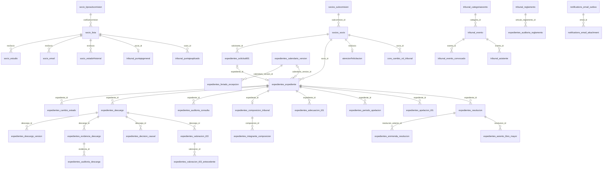
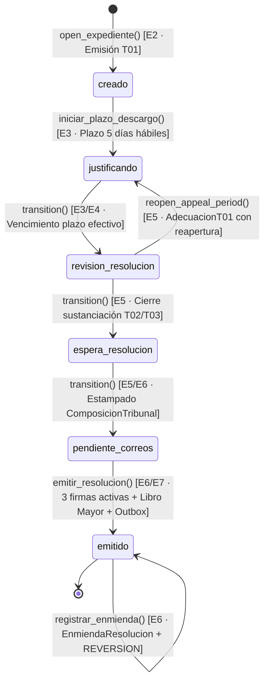
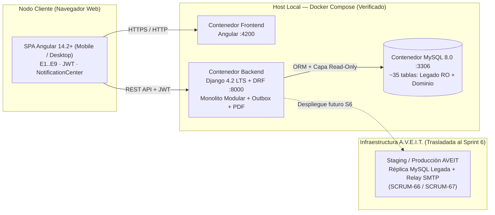

# Diagramas — Definición del Producto / Solución (`SGD-AVEIT`)

> **Fecha:** 28/11/2026  
> **Entregable destino:** `C:\Users\terza\Desktop\workshop\Seminario\Documentación Actual Humana\Entregables\04_Definicion_del_Producto_SGD_AVEIT.html`  
> **Instrucción de uso:** Cada marcador `[DIAGRAMA: ...]` en el HTML debe reemplazarse por la imagen exportada (PNG/SVG a 300 DPI) generada a partir de las fuentes Mermaid provistas a continuación. Todos los diagramas fueron derivados directamente del código vigente (`backend/socios/models.py`, `backend/expedientes/models.py`, `backend/ranking/models.py`, `backend/notifications/models.py`, `backend/core/models.py`, `backend/padron/models.py` y `backend/expedientes/services/workflow_service.py`), sin votación nominal.

---

## 1. `[DIAGRAMA: Diagrama de Clases de Dominio SGD-AVEIT]`

- **Ubicación en entregable:** Página 14, Sección 8 (*Diagrama de Clases y Catálogo de Entidades de Dominio*).
- **Fuente técnica:** Modelos y servicios reales de `socios`, `padron`, `ranking`, `expedientes`, `notifications` y `core`.

```mermaid
classDiagram
    direction TB

    class Socio {
      +int id
      +int numero_socio
      +str legajo
      +int social_year
      +SocialCategory category
      +Role role
      +bool is_enabled
      +category_for_social_year(social_year) str
    }

    class Subcomision {
      +int id
      +str name
    }

    class SolicitudT01 {
      +UUID id
      +Estado estado
      +TipoAccion tipo_accion
      +Decimal puntos
      +PuntajeEspecial puntaje_especial
      +str numero_expediente
      +clean()
    }

    class Expediente {
      +int id
      +str numero
      +EstadoExpedienteEnum estado
      +UrgenciaExpedienteEnum urgencia
      +ConceptoExpedienteEnum concepto
      +Decimal puntos
      +datetime plazo_inicio_at
      +datetime plazo_limite_at
      +iniciar_plazo_descargo(fecha_hora_inicio, dias_habiles) datetime
      +esta_en_plazo(ahora) bool
    }

    class DescargoExpediente {
      +int id
      +TipoDescargoEnum tipo
      +bool es_vigente
      +str puntaje_ratificado
      +bool esta_excluido
      +str motivo_exclusion
    }

    class DescargoVersion {
      +int numero
      +OperacionDescargoEnum operacion
      +str actor
    }

    class EvidenciaDescargo {
      +UUID id
      +bytes contenido_blob
      +str mime_type
      +str sha256_hash
    }

    class DecisionCausalDescargo {
      +int version
      +DecisionCausalEnum decision
      +bool se_aparta_de_regla
    }

    class ValoracionT03 {
      +int version
      +ResultadoValoracionT03Enum resultado
      +str fundamento
      +CondicionMiembroTribunalEnum autor_condicion
    }

    class ComposicionTribunal {
      +int id
      +list apartados
    }

    class IntegranteComposicion {
      +int anio_social
      +CondicionIntegranteEnum condicion
      +int nro_socio
      +str firma
    }

    class AdecuacionT01 {
      +int version
      +Decimal puntos_anteriores
      +Decimal puntos_nuevos
      +bool reabre_plazo
    }

    class Resolucion {
      +int version
      +EstadoResolucionEnum estado
      +Decimal puntos_finales
      +list firmantes
      +str contenido_hash
    }

    class EnmiendaResolucion {
      +str motivo_enmienda
    }

    class AsientoLibroMayor {
      +TipoAsientoLibroMayorEnum tipo
      +Decimal puntos
      +str hash_anterior
      +str hash_transaccion
    }

    class PuntajeAplicado {
      +int idPuntajeAplicado
      +Decimal puntajeAplicado
      +registrar_movimiento(nro_socio, puntos, expediente_id)
    }

    class EventoInstitucional {
      +int idEvento
      +CategoriaEventoEnum categoria
      +EstadoEventoEnum estado
      +bool es_sancionable
    }

    class EmailOutbox {
      +UUID id
      +EmailOutboxStatus status
      +int retry_count
      +str idempotency_key
    }

    Subcomision "1" -- "0..*" Socio
    Socio "1" -- "0..*" SolicitudT01 : solicita
    SolicitudT01 "0..1" -- "0..1" Expediente : origina
    Socio "1..*" -- "0..*" Expediente : involucrado
    Expediente "1" *-- "0..*" DescargoExpediente
    DescargoExpediente "1" *-- "1..*" DescargoVersion
    DescargoExpediente "1" -- "0..*" EvidenciaDescargo
    DescargoExpediente "1" -- "0..*" DecisionCausalDescargo
    DescargoExpediente "1" -- "0..*" ValoracionT03
    Expediente "1" *-- "0..1" ComposicionTribunal
    ComposicionTribunal "1" *-- "3" IntegranteComposicion : 4to/5to/6to
    Expediente "1" *-- "0..*" AdecuacionT01
    Expediente "1" *-- "0..*" Resolucion
    Resolucion "1" -- "0..*" EnmiendaResolucion
    Resolucion "1" -- "0..*" AsientoLibroMayor : impacta
    AsientoLibroMayor ..> PuntajeAplicado : sincroniza
    EventoInstitucional "1" -- "0..*" Expediente : consolida 3:1
    Expediente ..> EmailOutbox : encola acuses
```

---

## 2. `[DIAGRAMA: Diagrama Entidad-Relación (DER) Físico SGD-AVEIT]`

- **Ubicación en entregable:** Página 15, Sección 9 (*DER — Diagrama Entidad-Relación y Diccionario Físico*).
- **Fuente técnica:** ~35 tablas físicas reales en MySQL 8.0 (esquema legado Read-Only + tablas propias de dominio).



*(Nota: Las tablas auxiliares independientes `expedientes_institutional_holiday`, `expedientes_numero_secuencia`, `expedientes_parametro_plazo_apelacion` y `core_parametro_sistema` se incluyen con detalle completo en el Diccionario Físico de las páginas 15–19.)*

---

## 3. `[DIAGRAMA: Diagrama de Transición de Estados del Expediente Disciplinario]`

- **Ubicación en entregable:** Página 20, Sección 10 (*Diagramas y Tabla de Transición de Estados*).
- **Fuente técnica:** `EstadoExpedienteEnum`, `ExpedienteWorkflowService`, `T01AppealService` y `EnmiendaResolucion`.



---

## 4. `[DIAGRAMA: Diagrama de Despliegue — Contenedores Docker Compose y Nodos]`

- **Ubicación en entregable:** Página 21, Sección 11.2 (*Diagrama de Despliegue y Distribución de Épicas por Nodo*).
- **Fuente técnica:** `docker-compose.yml` local y alcance formal de `auditoria/traspaso-sprint6.md`.



---

## 5. `[DIAGRAMA: Lay-Out de Equipamiento — Topología de Despliegue]`

- **Ubicación en entregable:** Página 21, Sección 11.3 (*Lay-Out de Equipamiento*).
- **Estado:** `[DATO FALTANTE]` — El servidor central de A.V.E.I.T. / UTN FRC y su entorno Staging (`SCRUM-66`) fueron formalmente **trasladados al Sprint 6**. Cuando la Subcomisión de Cómputos aporte la especificación física/cloud definitiva, se incorporará el plano correspondiente en esta sección.
