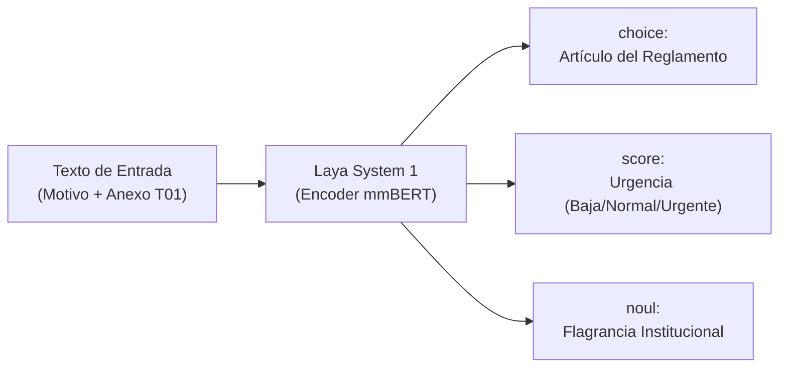
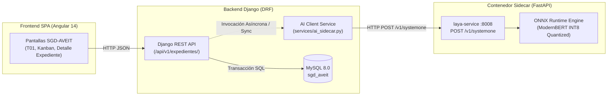

# Implementación de IA en SGD-AVEIT — Documento 01: Escenarios y Casos de Uso

**Código de Tarea:** SCRUM-76 (Investigación I+D para PO — Clasificación y Asistencia de IA)  
**Referencia Rector:** [`docs/gestion-proyecto/notasPO.md`](docs/gestion-proyecto/notasPO.md) (Sección 2, Líneas 144–148)  
**Fecha:** Octubre 2026  
**Estado:** Propuesta Técnica y Arquitectura de Integración  

---

## 1. Introducción y Fundamentos de Arquitectura System 1

En el marco del Sistema de Gestión Disciplinaria de la Asociación Vocacional de Estudiantes e Ingenieros Tecnológicos (**SGD-AVEIT**), los procesos disciplinarios y el cómputo de sanciones exigen un nivel crítico de **determinismo, trazabilidad jurídica y ausencia total de alucinaciones**.

Frente a los Modelos de Lenguaje Grandes (LLMs) convencionales de naturaleza autorregresiva (que generan texto palabra por palabra con variabilidad estocástica y latencias de varios segundos), se investiga la adopción de **Laya**, un motor de inferencia de tipo **System 1** (de respuesta rápida, intuitiva y discriminativa) compatible como reemplazo directo (*drop-in replacement*) de **TypeSafe Jev**.

### 1.1. Principios Técnicos de Laya
* **Arquitectura de Red:** Codificador bidireccional compacto (*encoder-only* basado en arquitecturas tipo ModernBERT-large de 421M parámetros o mmBERT-base multilingüe de 322M parámetros).
* **Mecanismo de Inferencia:** Ejecución en un único paso hacia adelante (*single forward pass*) sin bucles generativos de autoregresión.
* **Latencia Operativa:** 
  * En GPU (CUDA): ~20 a 35 ms por evaluación.
  * En CPU estándar de oficina (Intel Core i5/i7 o AMD Ryzen con AVX2 / ONNX Runtime): ~40 a 85 ms.
* **Primitivas de Decisión Tipadas:**
  1. `choice`: Selección categórica unívoca sobre un conjunto finito de opciones textuales (`criteria`), entregando una distribución de probabilidades continua y calibrada.
  2. `score`: Calificación en una escala ordinal calibrada (ej. urgencia 0 a 2 o niveles de gravedad).
  3. `noul`: Juicio de verosimilitud booleana condicional (`true` / `false`), que estima la probabilidad exacta de que una condición fáctica se cumpla en el texto.



---

## 2. Casos de Uso Funcionales en SGD-AVEIT

Alineado estrictamente a las necesidades operativas fijadas por el Product Owner en [`notasPO.md`](docs/gestion-proyecto/notasPO.md), se identifican cuatro casos de uso prioritarios:

### Caso de Uso 1: Clasificador y Sugerencia de Grado de Urgencia (`score`)

* **Ubicación en el Sistema:** Formulario T01 (Creación de Expediente) y Tablero Kanban del Tribunal de Disciplina.
* **Problema que Resuelve:** Al ingresar una denuncia o solicitud formal, el Tribunal debe priorizar qué causas requieren atención inmediata (por riesgo de prescripción procesal según Art. 12 del Reglamento Procesal 2026, gravedad institucional o riesgo inminente de conflicto en sede social).
* **Entrada del Modelo (`state`):** Concatenación estructurada del campo `Motivo` y la `Hoja de Anexo Circunstanciada` (Lugar o Evento del hecho, Relato de los hechos, Testigos presenciales y cómo se involucraron).
* **Primitiva y Configuración:**
  ```python
  questions = {
      "urgencia": {
          "type": "score",
          "instructions": "Evaluar la urgencia procesal de la causa a partir del relato circunstanciado.",
          "criteria": [
              "Baja: Hechos menores, discusiones de pasillo, demoras administrativas leves sin daño patrimonial",
              "Normal: Infracciones disciplinarias típicas, incumplimiento de turnos de guardia, faltas a reglamentos internos",
              "Urgente: Agresiones físicas, riesgo de integridad física de socios, daño patrimonial grave a la sede, prescripción inminente"
          ]
      }
  }
  ```
* **Comportamiento en UI:** En la pantalla de creación T01 y en la tarjeta del tablero Kanban, el sistema muestra una sugerencia visual sutil (`Urgencia sugerida: Normal (Certeza: 88%)`), permitiendo al usuario u operador confirmar el valor o alterarlo manualmente.

---

### Caso de Uso 2: Sugerencia no Vinculante de Artículos Reglamentarios (`choice`)

* **Ubicación en el Sistema:** Sala del Tribunal de Disciplina (Etapa de Apertura y Redacción Preliminar de Acusación).
* **Problema que Resuelve:** Los instructores del Tribunal deben asociar los hechos denunciados con los artículos tipificados en el *Reglamento Interno de Disciplina 2026* o el *Estatuto Social AVEIT*. A menudo se presentan denuncias sin fundamentación jurídica clara, demandando tiempo de búsqueda reglamentaria.
* **Entrada del Modelo (`state`):** Hechos expuestos, lugar, tipología de conducta e involucrados.
* **Primitiva y Configuración:**
  ```python
  questions = {
      "articulo_aplicable": {
          "type": "choice",
          "instructions": "Determinar qué artículo del Reglamento Interno de Disciplina 2026 tipifica con mayor precisión la conducta denunciada.",
          "criteria": {
              "art_08_falta_respeto": "Falta de respeto, altercados verbales o conductas inapropiadas entre consocios en dependencias sociales",
              "art_12_custodia_bienes": "Negligencia o daño material a bienes, instalaciones, laboratorios o patrimonio de AVEIT",
              "art_15_guardias_turnos": "Abandono sin aviso de turnos de guardia, tareas comunitarias asignadas o comisiones obligatorias",
              "art_22_conducta_grave": "Falsificación de instrumentos, agresiones físicas, retención indebida de fondos o infracciones al Estatuto"
          }
      }
  }
  ```
* **Comportamiento en UI:** Al abrir el expediente para dictamen, se ofrece un panel de autocompletado en el selector de artículos que destaca en primer término el artículo sugerido con su probabilidad (`Art. 12 (79% de coincidencia)`), facilitando al Tribunal fundamentar la resolución con un clic.

---

### Caso de Uso 3: Validación de Consistencia Forense en Descargos T02/T03 (`noul`)

* **Ubicación en el Sistema:** Módulo de Recepción y Evaluación de Descargos del Socio Imputado.
* **Problema que Resuelve:** Al recibir un descargo formal (Formulario T02 o T03), el Tribunal debe verificar rápidamente si el socio reconoce los hechos, si introduce contradicciones directas con las declaraciones de testigos consignadas en la Hoja de Anexo, o si aporta una coartada comprobable.
* **Entrada del Modelo (`state`):** Comparación estructurada entre el relato del Anexo acusatorio y el texto de fundamentación presentado por el imputado en su descargo.
* **Primitiva y Configuración:**
  ```python
  questions = {
      "reconoce_falta": {
          "type": "noul",
          "instructions": "¿El socio imputado admite o reconoce explícitamente haber participado en la acción descrita en la denuncia?"
      },
      "aporta_prueba_excluyente": {
          "type": "noul",
          "instructions": "¿El descargo presenta constancias, testigos o justificaciones documentadas de fuerza mayor?"
      }
  }
  ```
* **Comportamiento en UI:** Semáforo de consistencia forense visible exclusivamente para los miembros titulares del Tribunal, destacando indicadores de contradicción o admisión espontánea.

---

### Caso de Uso 4: Detección Temprana de Flagrancia y Riesgo Institucional (`noul`)

* **Ubicación en el Sistema:** Pipeline de entrada en segundo plano al guardar un nuevo expediente.
* **Problema que Resuelve:** Casos extremos que ameritan medidas cautelares urgentes (como suspensión preventiva de acceso a la sede social, según potestades estatutarias de Comisión Directiva) deben ser detectados de forma inmediata sin esperar la reunión semanal del Tribunal.
* **Primitiva y Configuración:**
  ```python
  questions = {
      "riesgo_institucional_critico": {
          "type": "noul",
          "instructions": "¿El incidente denunciado compromete la seguridad física de personas, la integridad edilicia o la responsabilidad legal inmediata de la Asociación?"
      }
  }
  ```
* **Comportamiento en UI:** Disparo de notificación transaccional prioritaria con acuse de recibo a los correos institucionales de los miembros de Comisión Directiva y Tribunal de Disciplina.

---

## 3. Arquitectura Técnica de Integración (Sidecar Container)

Para salvaguardar la arquitectura de SGD-AVEIT (Python 3.12 / Django 4.2 LTS + Angular 14.2) y evitar la contaminación del monolito con dependencias pesadas de Machine Learning (`torch`, `transformers`, `onnxruntime`, `tokenizers`), se adopta el patrón de **Contenedor Sidecar**.

### 3.1. Topología del Sistema
El microservicio `laya-service` corre en un contenedor Docker ligero optimizado (basado en `python:3.12-slim`), exponiendo una interfaz REST en el puerto interno `8008` consumible por la red interna de Docker Compose.



### 3.2. Configuración en `docker-compose.yml`
```yaml
services:
  # ... servicios existentes: db, backend, frontend ...

  laya-service:
    build:
      context: ./ai-service
      dockerfile: Dockerfile
    container_name: sgd_laya_service
    restart: unless-stopped
    environment:
      - MODEL_PATH=/models/laya-multilingual-onnx-int8
      - WORKERS=2
      - THREADS_PER_WORKER=2
    volumes:
      - ./ai-service/models:/models:ro
    networks:
      - sgd_network
    expose:
      - "8008"
    healthcheck:
      test: ["CMD", "curl", "-f", "http://localhost:8008/health"]
      interval: 30s
      timeout: 5s
      retries: 3
```

### 3.3. Contrato de API (`POST /v1/systemone`)
* **Request Payload (Django -> Sidecar):**
  ```json
  {
    "state": "El socio Juan Pérez se negó a entregar la llave del laboratorio tras finalizar su turno de guardia...",
    "questions": {
      "urgencia": {
        "type": "score",
        "instructions": "Determinar grado de urgencia procesal.",
        "criteria": ["Baja", "Normal", "Urgente"]
      },
      "articulo": {
        "type": "choice",
        "instructions": "Identificar el artículo infringido.",
        "criteria": {
          "art_12": "custodia de bienes y llaves",
          "art_15": "guardias y turnos"
        }
      }
    }
  }
  ```
* **Response Payload (Sidecar -> Django):**
  ```json
  {
    "latency_ms": 38.4,
    "answers": {
      "urgencia": {
        "score": 1,
        "label": "Normal",
        "probabilities": [0.08, 0.84, 0.08]
      },
      "articulo": {
        "choice": "art_12",
        "confidence": 0.892,
        "probabilities": {
          "art_12": 0.892,
          "art_15": 0.108
        }
      }
    }
  }
  ```

---

## 4. Política y Gobernanza Ética Institucional

Conforme a las directivas innegociables de [`notasPO.md`](docs/gestion-proyecto/notasPO.md) y [`docs/constitution.md`](docs/constitution.md):

1. **Carácter Estrictamente No Vinculante:** Todas las predicciones de urgencia, tipificación o consistencia son meras **asistencias consultivas**. El modelo no dicta sentencias ni computa puntos automáticamente.
2. **Principio de Soberanía Colegiada (Human-in-the-Loop):** La decisión de tipificación, juzgamiento y ponderación de puntos corresponde exclusivamente a los miembros titulares o suplentes del Tribunal de Disciplina y a las autoridades de Comisión Directiva.
3. **Inmutabilidad del Libro Mayor:** Queda terminantemente prohibido que una llamada al modelo de IA altere de forma directa o indirecta las tablas transaccionales de saldos de puntos o genere registros de resoluciones sin la firma de los miembros habilitados.
4. **Auditoría Transparente:** Toda sugerencia provista por el motor de IA se registra en una tabla de auditoría técnica (`ai_inference_logs`) indicando el hash del texto evaluado, versión del modelo, tiempo de respuesta y probabilidades arrojadas, garantizando total transparencia ante cualquier requerimiento de los Revisores de Cuentas.
