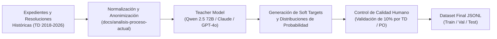

# Implementación de IA en SGD-AVEIT — Documento 02: Entrenamiento, Datos y Hardware

**Código de Tarea:** SCRUM-76 (Investigación I+D para PO — Clasificación y Asistencia de IA)  
**Referencia Rector:** [`docs/gestion-proyecto/notasPO.md`](docs/gestion-proyecto/notasPO.md) (Sección 2, Líneas 144–148)  
**Fecha:** Octubre 2026  
**Estado:** Guía Metodológica de Curaduría, Entrenamiento y Requisitos de Infraestructura  

---

## 1. Estructura y Esquema Canónico del Dataset

El entrenamiento de **Laya** para la resolución de decisiones tipadas en el dominio disciplinario de AVEIT requiere un archivo en formato **JSON Lines (JSONL)** donde cada línea representa una unidad decisional autocontenida compuesta por:
1. `state`: El texto narrativo forense (motivo, Hoja de Anexo, descargo o testimonio).
2. `questions`: Diccionario de preguntas tipadas (`choice`, `score`, `noul`) con sus respectivas instrucciones operativas y criterios de desempate.
3. `gold`: Valores objetivo (*ground truth*), que admiten tanto etiquetas discretas (*hard labels*) como distribuciones continuas de probabilidad calibradas (*soft targets*).

### 1.1. Ejemplo Real Adaptado a SGD-AVEIT (JSONL)

```json
{
  "state": "Expediente EXP-2026-0042. Lugar: Laboratorio de Cómputos Central. En fecha 12/03/2026 durante el turno nocturno, el socio imputado se retiró antes del cierre de guardia dejando el acceso sin llave y equipos encendidos, lo cual provocó el ingreso no autorizado de personas ajenas y daño al cableado de red.",
  "questions": {
    "urgencia_procesal": {
      "type": "score",
      "instructions": "Clasificar la urgencia procesal según gravedad material e institucional.",
      "criteria": [
        "Baja: Infracciones formales sin afectación patrimonial ni procesal.",
        "Normal: Incumplimiento reglamentario estándar susceptible de apercibimiento.",
        "Urgente: Afectación de seguridad de instalaciones o riesgo procesal inminente."
      ]
    },
    "articulo_reglamentario": {
      "type": "choice",
      "instructions": "¿Qué artículo del Reglamento Interno tipifica primariamente la falta?",
      "criteria": {
        "art_12_custodia_patrimonio": "Negligencia grave en la custodia de bienes, laboratorios o llaves.",
        "art_15_abandono_guardia": "Abandono injustificado de guardias o tareas asignadas.",
        "art_08_falta_conducta": "Infracciones de convivencia general."
      }
    },
    "hubo_admision_hechos": {
      "type": "noul",
      "instructions": "¿El relato contiene admisión explícita de culpabilidad por parte del involucrado?"
    }
  },
  "gold": {
    "urgencia_procesal": {
      "label": 2,
      "probabilities": [0.03, 0.12, 0.85]
    },
    "articulo_reglamentario": {
      "label": "art_12_custodia_patrimonio",
      "probabilities": {
        "art_12_custodia_patrimonio": 0.78,
        "art_15_abandono_guardia": 0.20,
        "art_08_falta_conducta": 0.02
      }
    },
    "hubo_admision_hechos": {
      "label": false,
      "probabilities": {
        "false": 0.94,
        "true": 0.06
      }
    }
  }
}
```

> [!TIP]
> **Importancia de las Distribuciones Suaves (*Soft Targets*):**
> En el derecho disciplinario institucional existen zonas grises (ej. una falta que linda entre *abandono de guardia* y *negligencia de custodia*). El uso de `probabilities` en lugar de una etiqueta binaria única permite que la función de pérdida preserve la incertidumbre jurídica legítima, logrando un modelo calibrado que no sobreestima su certeza.

---

## 2. Metodología de Curaduría y Síntesis de Datos

Para que el modelo aprenda la doctrina y jurisprudencia real de la Asociación sin requerir miles de horas de carga manual por parte del Tribunal de Disciplina, se establece un pipeline de **Destilación de Profesor (Teacher Distillation)** y aumento sintético controlado:



### 2.1. Fases del Pipeline
1. **Relevamiento y Desanonimización:**
   - Se toman resoluciones emitidas por el Tribunal de Disciplina y actas históricas.
   - Se anonimizan nombres de personas y números de legajo/DNI mediante máscaras deterministas (`[SOCIO_01]`, `[TESTIGO_A]`).
2. **Generación Asistida de Distribuciones (Teacher Distillation):**
   - Un modelo de gran escala actúa como profesor estructurado evaluando cada hecho frente al texto completo del Reglamento Interno de Disciplina 2026 y asignando probabilidades a las opciones.
3. **Muestreo Negativo y Casos Límite (*Edge Cases*):**
   - Para las preguntas de tipo `noul`, se agregan intencionalmente ejemplos donde la terminología parezca grave pero el hecho no constituya infracción (ej. "el socio solicitó autorización formal previa"), evitando que el modelo aprenda atajos espurios por palabras clave.
4. **Estratificación y Partición del Conjunto de Datos:**
   - **Train (70%):** Utilizado para el ajuste de pesos.
   - **Validation (15%):** Monitoreo continuo de pérdida y parada temprana (*early stopping*).
   - **Test (15%):** Conjunto ciego para reporte de métricas oficiales de evaluación.

---

## 3. Algoritmo de Fine-Tuning y Calibración

Laya emplea un esquema de optimización basado en **RLCD (Reinforcement Learning from Constitutional/AI Feedback)** adaptado a cabezales de decisión tipada:

* **Función de Pérdida Combinada:**
  $$\mathcal{L}_{total} = \alpha \mathcal{L}_{choice} + \beta \mathcal{L}_{score} + \gamma \mathcal{L}_{noul}$$
  donde cada subpérdida computa la divergencia de Kullback-Leibler (KL) contra las probabilidades del *gold*, penalizando severamente las respuestas sobreconfiadas incorrectas.
* **Hiperparámetros de Entrenamiento Recomendados:**
  * **Modelo Base:** `convaiinnovations/laya-multilingual` (mmBERT-base, 322M parámetros, soporte nativo de español y contexto hasta 8.192 tokens).
  * **Learning Rate:** $3 \times 10^{-5}$ con decaimiento por coseno (*cosine decay*) y calentamiento (*warmup*) del 10% de los pasos totales.
  * **Épocas:** 3 a 5 épocas (suficiente para convergencia sin sobreajuste).
  * **Micro-batch Size:** 4 a 8 muestras por dispositivo.
  * **Gradient Accumulation Steps:** 4 a 8 (para simular un *effective batch size* de 32 a 64).
  * **Shuffle Options:** Activado para evitar sesgos posicionales en la presentación de criterios de opción múltiple.

### 3.1. Métricas de Aprobación y Calibración
Antes de promover un modelo a producción, debe superar los umbrales exigidos en [`laya-evals`](../laya/docs/evals.md):
* **Choice Accuracy:** $\ge 75\%$ sobre el conjunto de test.
* **Score Accuracy (MAE $\le 0.25$):** $\ge 80\%$.
* **Expected Calibration Error (ECE):** $\le 0.10$. (Garantiza que si el modelo dice "80% de certeza", la probabilidad empírica real de acierto sea efectivamente del 80%).
* **Brier Score:** $\le 0.15$.

---

## 4. Perfil Agnóstico de Requerimientos de Hardware

Para garantizar la viabilidad del proyecto tanto en etapas de investigación y desarrollo como en su puesta en régimen productivo dentro de la infraestructura de AVEIT, se definen los umbrales cuantitativos de hardware separando **Entrenamiento** de **Inferencia**:

### 4.1. Requerimientos para Fase de Entrenamiento (Training / Fine-Tuning)

El entrenamiento actualiza los gradientes de los 322M de parámetros del codificador, demandando aceleración por hardware o tiempo prolongado de cómputo:

| Componente | Requisito Mínimo (Entorno Básico / CPU) | Requisito Recomendado (Estación de Trabajo GPU) | Alternativa Cloud Gratuita |
| :--- | :--- | :--- | :--- |
| **Procesador (CPU)** | x86-64 8 núcleos (Intel Core i7 10ma gen o AMD Ryzen 7) | x86-64 8–16 núcleos modernos (AVX2/AVX-512) | 2–4 vCPUs Cloud |
| **Acelerador (GPU)** | *Sin GPU dedicada* (Modo `--device cpu`) | GPU NVIDIA con núcleos Tensor (Compute $\ge 7.5$) | NVIDIA Tesla T4 (16 GB VRAM) |
| **Memoria VRAM** | N/A | **8 GB a 16 GB VRAM** (ideal 12–16 GB) | 16 GB VRAM (Google Colab / Kaggle) |
| **Memoria RAM** | 16 GB DDR4/DDR5 | 32 GB DDR4/DDR5 | 12 GB a 16 GB RAM |
| **Almacenamiento** | 10 GB de espacio libre (SSD NVMe) | 20 GB de espacio libre (SSD NVMe) | 20 GB temporales |
| **Tiempo de Entrenamiento** | **4 a 8 horas** (1.000 a 3.000 ejemplos) | **10 a 25 minutos** (1.000 a 3.000 ejemplos) | **15 a 30 minutos** |

> [!NOTE]
> Con una GPU de 16 GB de VRAM, el consumo de memoria durante el fine-tuning de Laya-multilingual oscila entre **6.5 GB y 9.5 GB de VRAM** utilizando precisión FP16 o BF16, permitiendo ejecutar el proceso de forma holgada en segundo plano sin colapsar el sistema.

---

### 4.2. Requerimientos para Fase de Inferencia en Producción (Serving)

La inferencia opera en un único forward pass por consulta y se integra dentro del contenedor sidecar `laya-service`:

| Componente | Requisito Mínimo (PC de Oficina / Servidor AVEIT) | Requisito Recomendado (Servidor de Producción) |
| :--- | :--- | :--- |
| **Acelerador (GPU)** | **No requerida (Cero dependencia de GPU)** | GPU básica opcional (NVIDIA T400 / GTX 1650) |
| **Procesador (CPU)** | 2 núcleos x86-64 (Intel Core i3/i5 o AMD Ryzen 3/5) | 4 núcleos x86-64 |
| **Memoria RAM Libre** | **1.0 GB a 1.5 GB de RAM** exclusiva para el proceso | 2.0 GB de RAM |
| **Espacio en Disco** | 500 MB (Pesos exportados en ONNX INT8) | 1 GB |
| **Latencia por Inferencia** | **~40 ms a 85 ms** (CPU pura con ONNX Runtime) | **~15 ms a 30 ms** (GPU o CPU multi-hilo) |

---

## 5. Pipeline Operativo Reproducible (Comandos CLI)

### 5.1. Ejecución del Entrenamiento
```powershell
# Invocación del entrenamiento utilizando aceleración CUDA
python -m laya.train_cli `
  --data ./data/dataset_aveit_train.jsonl `
  --val-data ./data/dataset_aveit_val.jsonl `
  --base convaiinnovations/laya-multilingual `
  --out ./checkpoints/laya-aveit-v1 `
  --epochs 4 `
  --micro-batch 8 `
  --grad-accum 4 `
  --learning-rate 3e-5 `
  --device cuda `
  --shuffle-options
```

### 5.2. Evaluación Rigurosa del Checkpoint
```powershell
python -m laya.evals_cli run ./data/dataset_aveit_test.jsonl `
  --model ./checkpoints/laya-aveit-v1 `
  --min-accuracy 0.75 `
  --max-ece 0.10 `
  --json ./reports/eval_report.json `
  --markdown ./reports/eval_report.md
```

### 5.3. Exportación y Cuantización a ONNX para Producción
Para trasladar el modelo entrenado al servidor de producción de AVEIT y correrlo en CPU pura:
```powershell
# Exportación de PyTorch a grafo ONNX y cuantización estática a INT8
python -m laya.export_onnx `
  --model ./checkpoints/laya-aveit-v1 `
  --out ./dist/laya-aveit-onnx-int8 `
  --quantize int8
```

El artefacto resultante (`model.onnx` de ~160 MB) queda listo para ser empaquetado dentro de la imagen de Docker del contenedor sidecar sin requerir CUDA ni librerías pesadas de NVIDIA.
