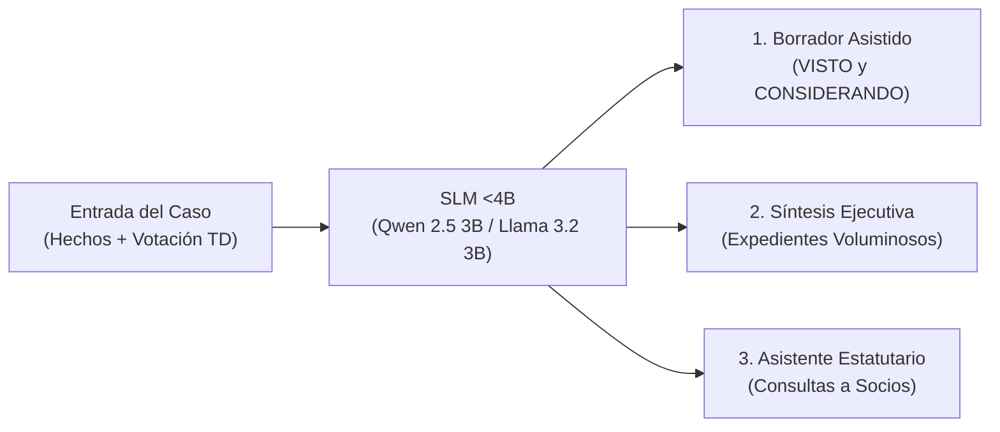
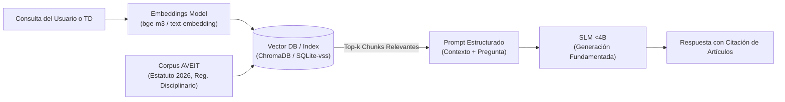
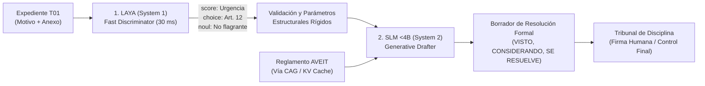

# Implementación de IA en SGD-AVEIT — Documento 03: Evaluación de SLMs (<4B), RAG, CAG y MAG

**Código de Tarea:** SCRUM-76 (Investigación I+D para PO — Clasificación y Asistencia de IA)  
**Referencia Rector:** [`docs/gestion-proyecto/notasPO.md`](docs/gestion-proyecto/notasPO.md) y [`docs/constitution.md`](docs/constitution.md)  
**Fecha:** Octubre 2026  
**Estado:** Dictamen Técnico sobre Modelos Autorregresivos Compactos y Paradigmas de Aumento Contextual  

---

## 1. Introducción y Planteo del Problema

Mientras que **Laya** (System 1) se enfoca exclusivamente en decisiones tipadas de clasificación y predicción probabilística de baja latencia (30 ms), surge el interrogante técnico:

> *¿Agregan valor real los Modelos de Lenguaje Pequeños tradicionales (**SLMs < 4B parámetros**) en alguna parte de SGD-AVEIT, y qué ventajas ofrecen los paradigmas de aumentación contextual **RAG**, **CAG** y **MAG**?*

Este documento analiza la viabilidad técnica, arquitectónica y operativa de incorporar modelos autorregresivos compactos en el ecosistema de la Asociación, evaluando el equilibrio entre **riqueza expresiva en lenguaje natural** y **soberanía, determinismo y costo computacional**.

---

## 2. Panorama de SLMs Modernos (< 4B Parámetros)

En los últimos años, la frontera de eficiencia en modelos autorregresivos (*decoder-only*) ha avanzado radicalmente. Modelos con menos de 4.000 millones de parámetros alcanzan capacidades de razonamiento y síntesis textual en español que anteriormente requerían modelos de 70B:

| Modelo | Parámetros | Ventana de Contexto | Memoria RAM/VRAM (FP16) | Memoria RAM/VRAM (Cuantizado 4-bit GGUF/AWQ) | Fortalezas Principales en SGD-AVEIT |
| :--- | :--- | :--- | :--- | :--- | :--- |
| **Qwen 2.5 (1.5B / 3B)** | 1.54B / 3.09B | Hasta 32k / 128k tokens | 3.2 GB / 6.4 GB | **1.1 GB / 2.1 GB** | Extraordinario seguimiento de instrucciones estructuradas (JSON), excelente redacción formal en español. |
| **Llama 3.2 (1B / 3B)** | 1.23B / 3.21B | 128k tokens | 2.6 GB / 6.6 GB | **0.9 GB / 2.2 GB** | Optimizado para dispositivos de borde (*edge devices*) y baja latencia de generación por token. |
| **Phi-3.5-mini** | 3.82B | 128k tokens | 7.8 GB | **2.6 GB** | Fuerte capacidad de razonamiento lógico y descomposición de reglas paso a paso. |
| **Gemma 2 (2B)** | 2.61B | 8k tokens | 5.4 GB | **1.8 GB** | Alta fidelidad sintáctica y bajo índice de alucinación factual en contextos acotados. |

---

## 3. Matriz Comparativa: Laya (System 1) vs. SLMs <4B (System 2)

Es crucial no confundir ni solapar las responsabilidades de ambos tipos de modelos dentro de SGD-AVEIT:

| Dimensión Técnica | Laya (System 1 — Encoder ModernBERT/mmBERT) | SLM Tradicional <4B (System 2 — Autorregresivo) |
| :--- | :--- | :--- |
| **Naturaleza Operativa** | Clasificación, discriminación y scoring tipado en espacio latente. | Generación de texto secuencial token por token en lenguaje natural. |
| **Latencia Típica** | **20 a 40 ms** (GPU) / **50 a 85 ms** (CPU). | **800 ms a 3.500 ms** (según longitud del texto y hardware). |
| **Riesgo de Alucinación** | **0% (Inexistente).** Devuelve solo probabilidades sobre clases fijas. | **Medio a Alto.** Puede inventar antecedentes o tergiversar artículos si no está acotado. |
| **Consumo de Memoria** | ~150 MB (ONNX INT8) a 700 MB (PyTorch). | ~1.2 GB a 2.8 GB (Cuantizado a 4 bits) + KV-Cache. |
| **Consumo de CPU/GPU** | Despreciable; corre en cualquier PC de oficina. | Demanda aceleración SIMD/AVX2 intensiva o GPU para mantener interactividad fluida (>15 tokens/seg). |
| **Rol en SGD-AVEIT** | Triage de urgencia, tipificación de artículos, alertas de flagrancia. | Redacción asistida de considerandos, síntesis de descargos, consultas estatutarias. |

---

## 4. Casos de Uso Viables para SLMs en SGD-AVEIT

Los modelos generativos <4B **sí agregan un valor sustancial**, pero restringidos a tres áreas donde se requiere redacción o síntesis en lenguaje natural bajo supervisión del Tribunal:

### 4.1. Borrador Asistido de Resoluciones Colegiadas (VISTO y CONSIDERANDO)
* **Contexto:** Según el formato oficial del TD ([`notasPO.md`](docs/gestion-proyecto/notasPO.md), Ref. Imagen 3), toda resolución emitida exige una estructura jurídica formal:
  - **VISTO:** El número de expediente, los socios imputados y las denuncias acumuladas.
  - **CONSIDERANDO:** Los hechos acreditados, la valoración de las pruebas y testimonios, y los artículos reglamentarios violados.
  - **SE RESUELVE:** La sanción individualizada y el cómputo neto de puntos.
* **Aporte del SLM:** Una vez que el Tribunal votó y fijó el puntaje en la Sala, el SLM redacta en 2 segundos el borrador de los considerandos con redacción jurídica institucional impecable, ahorrando redacción manual repetitiva. El Tribunal edita y aprueba el texto final antes de firmar.

### 4.2. Síntesis Ejecutiva de Expedientes Complejos
* **Contexto:** Causas con múltiples involucrados, declaraciones testimoniales extensas y descargos cruzados (T01 + T02 + T03 + Hoja de Anexo).
* **Aporte del SLM:** Genera un resumen ejecutivo de 5 puntos clave (Quién denuncia, Quiénes son imputados, Cuál es el hecho central, Qué descargos se presentaron, Qué contradicciones existen), desplegable en el diálogo de detalle del expediente.

### 4.3. Asistente Consultivo del Estatuto y Reglamentos para el Socio
* **Contexto:** Los socios de AVEIT con frecuencia desconocen las disposiciones sobre permanencia, deberes en guardias comunitarias o plazos de prescripción.
* **Aporte del SLM:** Un asistente interactivo en la SPA de socios que responde dudas cotidianas ("*¿Cuántas inasistencias a turnos de guardia provocan un llamado de atención?*"), citando el artículo y párrafo exacto del Reglamento Interno de Disciplina 2026.

---

## 5. Paradigmas de Aumento Contextual: RAG, CAG y MAG

Para que un modelo de lenguaje pequeño opere con máxima precisión jurídica en AVEIT sin alucinar, debe alimentarse con el contexto normativo oficial mediante técnicas avanzadas de aumentación:

### 5.1. RAG (Retrieval-Augmented Generation)

El paradigma **RAG** desacopla el conocimiento normativo de los pesos del modelo:

* **Pipeline Técnico en SGD-AVEIT:**
  1. *Segmentación del Corpus:* Los documentos en [`docs/analisis-proceso-actual/reglamentos-aveit/`](docs/analisis-proceso-actual/reglamentos-aveit/) se dividen en fragmentos lógicos respetando la jerarquía de Títulos, Capítulos y Artículos.
  2. *Indexación Híbrida:* Búsqueda semántica densa (embeddings) combinada con búsqueda léxica BM25 (para capturar números exactos de artículos como "Art. 12 Inc. b").
  3. *Inyección en Prompt:* Solo se inyectan al SLM los 3 o 4 artículos relevantes para responder la consulta, eliminando la posibilidad de invocar normativas inexistentes.

---

### 5.2. CAG (Cache-Augmented Generation)

**CAG** es un paradigma emergente que supera las limitaciones de búsqueda de RAG cuando el corpus normativo es estático y de tamaño moderado:

* **Concepto Clave:** El *Estatuto AVEIT* y el *Reglamento de Disciplina 2026* suman conjuntamente ~40 páginas (~25.000 tokens). En lugar de fragmentar y buscar por similitud (*retrieval*), **se carga el corpus normativo completo dentro del contexto del SLM y se congela su estado en la memoria KV (KV Cache)**.
* **Mecanismo Operativo:**
  * Motores modernos como **vLLM**, **llama.cpp** u **Ollama** soportan *Prompt Caching* o *Prefix Caching*.
  * Al iniciar el servicio, el sistema procesa una sola vez los 25.000 tokens de los reglamentos y guarda los tensores de clave/valor (KV Cache) en RAM/VRAM.
  * Cuando ingresa una solicitud de redacción o consulta, el modelo salta directamente a computar los tokens nuevos del expediente.
* **Ventajas en SGD-AVEIT:**
  * **Latencia Cero en Ingestión:** Se elimina el tiempo de cálculo de 25.000 tokens en cada consulta.
  * **Atención Holística:** El SLM "ve" el reglamento completo en su totalidad, comprendiendo la interacción armónica entre distintos artículos sin perder fragmentos por sesgos del algoritmo de búsqueda vectorial.

---

### 5.3. MAG (Memory, Multi-Agent & Model-Augmented Generation)

Bajo las siglas **MAG**, se identifican tres vertientes complementarias de alto impacto para la madurez tecnológica de SGD-AVEIT:

#### Vertiente A: Memory-Augmented Generation (Memoria Jurisprudencial a Largo Plazo)
* Permite al sistema mantener una memoria episódica estructurada sobre:
  - Antecedentes procesales del socio involucrado (reincidencias previas, sanciones cumplidas).
  - Precedentes históricos del Tribunal ante hechos idénticos (ej. fallos anteriores sobre rotura de instrumental en laboratorio).
* Garantiza el **principio de igualdad procesal**: asegura que dos causas con iguales agravantes y atenuantes reciban propuestas de fundamentación y sanciones comparables a lo largo del tiempo.

#### Vertiente B: Multi-Agent Generation (Simulación Colegiada de Debate)
* El Tribunal de Disciplina de AVEIT es un órgano colegiado (compuesto por miembros titulares y suplentes). Un SLM puede configurarse con roles diferenciados que debaten internamente en una secuencia antes de emitir el borrador:
  1. *Agente Instructor/Acusador:* Analiza los hechos y fundamenta la transgresión estatutaria.
  2. *Agente Defensor:* Analiza el descargo del socio (T02/T03), rescata atenuantes (buena conducta previa, falta de dolo, colaboración) y propone desestimación o sanción mínima.
  3. *Agente Relator del TD:* Pondera ambos dictámenes y redacta el borrador equilibrado de resolución para consideración de los miembros humanos.

#### Vertiente C: Model-Augmented Generation (Arquitectura Híbrida Recomendada: System 1 + System 2)
Esta es la arquitectura de mayor robustez para SGD-AVEIT, combinando **Laya** y un **SLM <4B**:

1. **Paso 1 (Laya):** En 30 ms y con 0% de alucinación, Laya clasifica el grado de urgencia y fija los artículos específicos aplicables (`art_12_custodia_patrimonio`).
2. **Paso 2 (Inyección Estricta):** El sistema toma la predicción de Laya y construye un prompt restringido para el SLM: *"Redacta los considerandos imputando exclusivamente el Artículo 12. No menciones otros artículos"*.
3. **Paso 3 (SLM):** El SLM redacta el texto formal en 1.5 segundos, constrained por la decisión de Laya y fundamentado por el texto reglamentario provisto por CAG.

---

## 6. Dictamen y Hoja de Ruta de Adopción

### 6.1. Dictamen Técnico
* **Para el MVP y Corto Plazo (Sprint 3 / Actual):** La prioridad absoluta debe ser **Laya (System 1)**. Resuelve los requerimientos inmediatos del Product Owner ([`notasPO.md`](docs/gestion-proyecto/notasPO.md)) sobre urgencia y tipificación no vinculante, con cero sobrecarga de infraestructura y sin riesgos de alucinación.
* **Para Etapas Posteriores (Mediano y Largo Plazo):** La incorporación de un SLM <4B (preferentemente **Qwen 2.5 3B** o **Llama 3.2 3B**) bajo la arquitectura híbrida **Model-Augmented Generation** combinada con **CAG** representa el camino de mayor valor agregado para automatizar la confección de proyectos de resolución colegiada.

### 6.2. Hoja de Ruta Propuesta
1. **Fase 1 (MVP — Actual):** Despliegue del contenedor sidecar `laya-service` con modelo fine-tuneado para clasificación de urgencia (`score`) y tipificación reglamentaria (`choice`).
2. **Fase 2 (CAG Normativo):** Precarga de los reglamentos en caché KV en un motor local cuantizado para responder consultas normativas a los socios.
3. **Fase 3 (Model-Augmented Generation):** Integración del pipeline híbrido Laya + SLM en la Sala del Tribunal para asistir en la redacción preliminar de resoluciones.
