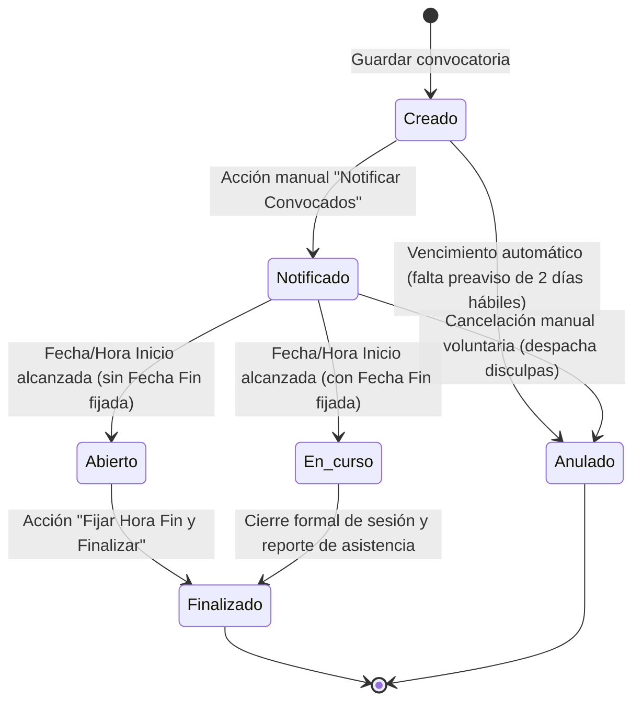

# Especificación Funcional y Técnica: Rediseño de Eventos y Asistencias

**Módulo:** Gestión de Convocatorias, Asistencia y Disciplina Institucional  
**Historia de Usuario:** SCRUM-50 / S3-06  
**Fecha:** Octubre 2026  
**Estado:** Aprobado / En Implementación  

---

## 1. Propósito y Alcance

El presente documento formaliza el rediseño integral de la interfaz y la lógica de negocio del módulo de **Eventos y Asistencia** de la plataforma SGD-AVEIT. El objetivo es estructurar la experiencia de usuario en torno a dos pestañas operativas (`Generar Evento` y `Mis Eventos`), ampliar el ciclo de vida del evento a 6 estados reglamentarios, diferenciar sustantivamente las **Reuniones** de las **Actividades**, incorporar convocatorias por **Estado Social (Juniors y Seniors)**, y permitir la personalización de puntajes de sanción en actividades operativas, todo ello garantizando la inmutabilidad de los saldos de puntos mediante el libro mayor transaccional de AVEIT.

---

## 2. Arquitectura de Navegación y UX (Dos Pestañas)

Inspirado en el patrón de diseño de `solicitar-puntos` (Card Nav-Tabs institucional Teal de AVEIT):

```
+---------------------------------------------------------------------------------------+
|  [CALENDARIO / PLAZOS]                             SGD-AVEIT - Eventos & Asistencia   |
+---------------------------------------------------------------------------------------+
|  [ EDIT_CALENDAR: GENERAR EVENTO ]    [ FORMAT_LIST_BULLETED: MIS EVENTOS (N) ]       |
+---------------------------------------------------------------------------------------+
|                                                                                       |
|  PESTAÑA 1: GENERAR EVENTO                                                            |
|  - Selección de Categoría: [ Reunión ] vs [ Actividad ]                               |
|  - Título / Denominación de la convocatoria                                          |
|  - Subtipo reglamentario (Ordinaria, Extraordinaria, Asamblea // Mantenimiento, etc.) |
|  - Detalle de la Tarea Asignada (Obligatorio sólo para Actividades)                   |
|  - Puntaje de Sanción (Configurable para Actividades, fijo reglamentario para Reunión)|
|  - Modalidad: Presencial en Sede / Presencial Externa / Virtual (Meet/Zoom)           |
|  - Fecha y Hora de Inicio (Obligatorio)                                               |
|  - Fecha y Hora de Fin (Opcional; si se omite, derivará a estado ABIERTO)             |
|  - Modo de Convocatoria: Por Grupo / Por Subcomisión / Por Estado Social / Personaliz.|
|  - Botón: "Guardar Convocatoria" -> Pasa a estado CREADO                              |
|                                                                                       |
|  PESTAÑA 2: MIS EVENTOS                                                               |
|  - Listado de eventos convocados por el usuario logueado (`responsable`)              |
|  - Columnas: Título | Categoría | Fecha Inicio | Fecha Fin | Estado | Acciones        |
|  - Badges semánticos para los 6 estados                                               |
|  - Acciones contextuales:                                                             |
|    * "Ver detalle" (Icono visibility): Conmuta a la Planilla Nominal de Asistencia.   |
|    * "Notificar" (Icono send, para Creado): Despacha emails y pasa a Notificado.      |
|    * "Fijar Fin" (Icono timer_off, para Abierto): Modal rápido para hora fin.         |
|    * "Anular" (Icono cancel, para Creado/Notificado): Cancelación formal y disculpas. |
|                                                                                       |
|  SUBVISTA DETALLE (Planilla Nominal de Asistencia):                                   |
|  - Botón destacado: "<- Volver al listado de eventos"                                 |
|  - Tarjetas métricas: Convocados | Presentes | Tardanzas (3:1) | Ausentes              |
|  - Selector de Estrategia: Modo Manual vs Modo Biométrico                             |
|  - Tabla nominal: Socio | Estado Asistencia | Motivo Circunstanciado | Registro       |
|  - Botón: "Cerrar Evento y Aplicar Sanciones" (Genera expedientes y llamados 3:1)     |
+---------------------------------------------------------------------------------------+
```

---

## 3. Ciclo de Vida y Máquina de Estados (6 Estados)



### Definición Canónica de Estados

1. **`CREADO`:** El evento fue registrado por el responsable pero aún no se notificó oficialmente a los citados. No genera obligación disciplinaria hasta su publicación formal.
2. **`NOTIFICADO`:** El responsable ejecutó la acción "Notificar Convocados". Se despacharon los correos formales a la casilla de cada convocado vía `notifications_email_outbox`, registrando la fecha de publicación estatutaria (Art. 95).
3. **`EN_CURSO`:** Se alcanzó la `fechaHoraInicio` y el evento tenía fijada una `fechaHoraFin`. La sesión está en desarrollo y se admite la toma de asistencia activa.
4. **`ABIERTO`:** Se alcanzó la `fechaHoraInicio` pero NO se colocó una `fechaHoraFin` al crear. El sistema exhibe un badge de alerta y un botón prioritario para que el responsable cargue la fecha y hora de cierre efectiva una vez finalizada la actividad o reunión.
5. **`FINALIZADO`:** El evento cuenta con hora de finalización confirmada y/o su planilla de asistencia fue cerrada formalmente con elevación del reporte disciplinario a Comisión Directiva.
6. **`ANULADO`:** El evento quedó sin efecto reglamentario.
   - **Anulación Automática:** Si el evento permaneció en `CREADO` y el tiempo restante hasta la hora de inicio es menor al preaviso reglamentario de 2 días hábiles (CA1 / Art. 95), el sistema lo anula automáticamente impidiendo citaciones extemporáneas no notificadas.
   - **Anulación Manual:** Si un evento ya `NOTIFICADO` debe cancelarse, el responsable ejecuta "Anular Convocatoria" ingresando un motivo opcional. El sistema despacha inmediatamente un correo institucional formal a todos los citados pidiendo disculpas e informando la cancelación.

---

## 4. Diferenciación: Reunión vs Actividad

| Atributo / Criterio | Reunión Institucional | Actividad Operativa / Voluntariado |
| :--- | :--- | :--- |
| **Naturaleza** | Exposición, tratamiento de temario, debate colegiado y toma de decisiones. | Ejecución de una labor o tarea asignada de soporte, infraestructura o logística. |
| **Subtipos** | Ordinaria, Extraordinaria, Asamblea General, Plenario. | Mantenimiento, Voluntariado, Jornada de Trabajo, Evento Social, Guardia Técnica. |
| **Detalle de Tarea** | Opcional (temario / orden del día). | **Estrictamente Obligatorio** (instrucciones concretas de lo que cada socio debe realizar). |
| **Puntaje de Sanción** | **Fijo Reglamentario:** Ordinaria (`-1.00`), Extraordinaria (`-1.50`), Asamblea (`-2.00`). | **Personalizable al crear:** El responsable puede definir el puntaje de inasistencia (default `-1.00`). |
| **Tardanzas Leves** | Aplica acumulación 3:1 (`atencionFelicitacion`). | Aplica acumulación 3:1 (`atencionFelicitacion`). |

---

## 5. Modos de Convocatoria y Padrón

1. **Por Grupo Social:** Cohortes del padrón histórico (`G55`, `G57`, `G58`, `G59`, `G60`).
2. **Por Subcomisión:** Las 7 subcomisiones estatutarias de AVEIT (`Cómputos e Informática`, `Recursos Humanos`, `Mantenimiento e Infraestructura`, etc.).
3. **Por Estado Social (Juniors y Seniors):**
   - **`JUNIORS`:** Socios de 1° a 3° año social (socios pasivos / adherentes según Art. 8 Estatuto).
   - **`SENIORS`:** Socios de 4° a 6° año social (socios activos plenos con derechos de comisión).
4. **Lista Personalizada:** Selección individual reactiva de socios mediante componente autocompletado tipo Select2.

---

## 6. Integridad Transaccional y Regla 3:1 (Inmutabilidad de Saldos)

1. **Cero sentencias `UPDATE`/`DELETE` manuales en MySQL sobre saldos de socios.**
2. Las inasistencias injustificadas generan expedientes disciplinarios en estado `CREADO` con tipificación procesal `INASISTENCIA_REUNION` o `INCUMPLIMIENTO_ACTIVIDAD`.
3. Las tardanzas leves (15 a 30 min) y retiros anticipados leves incrementan transaccionalmente el contador `llamadosAtencion` en la tabla `atencionFelicitacion` mediante bloqueo pesimista `select_for_update()`.
4. Al acumular 3 llamados de atención, se descuentan 3 llamados y se abre automáticamente un expediente de oficio por `-1.00` pt.
5. Al acumular 3 felicitaciones, se descuentan 3 felicitaciones y se genera una propuesta de mérito por `+1.00` pt.
