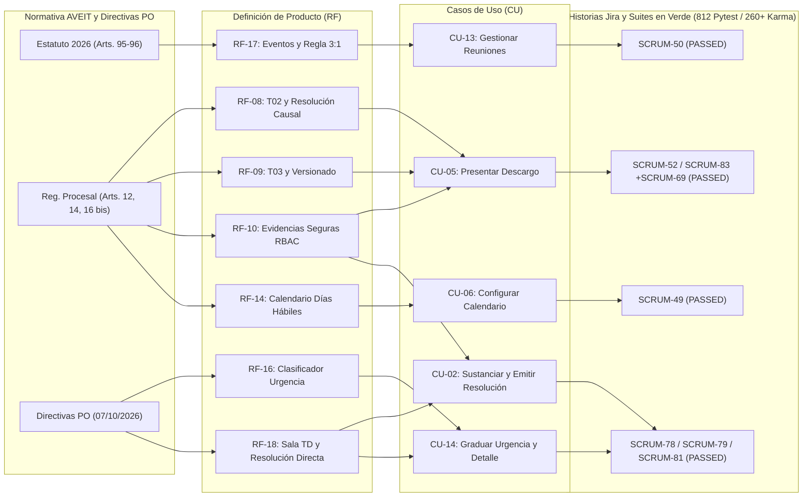

# DEFINICIÓN DE PRODUCTO — SPRINT 3 (APERTURA Y CIERRE)
## Sistema de Gestión del Tribunal de Disciplina y Premiaciones de A.V.E.I.T. (SGD-AVEIT)

**Cátedra:** Seminario Integrador — Curso 3K2 — Ciclo Lectivo 2026  
**Carrera:** Ingeniería en Sistemas de Información / ADUSI — UTN FRC  
**Equipo de Proyecto:** Grupo Nº 04  
**Product Owner:** Diego Gabriel Sánchez (Nº Socio: 87414)  
**Scrum Master:** Lucas Martín Guillén (Nº Socio: 85194)  
**Iteración:** Sprint 3 (`07/10/2026 al 20/10/2026` — 14 días corridos / 10 días hábiles; alineación PO/TD el `07/10` e inicio de ejecución en Jira el `08/10`)  
**Documento Fuente:** Actualización integral de la Definición del Producto, Casos de Uso, Modelos y Trazabilidad Normativa-Técnica (sincronizado con `PLAN_DE_PROYECTO_SGD_AVEIT.md`, `ERS-SGD-AVEIT.md`, `MODELO_DOMINIO_SGD_AVEIT.md` y `BPMN_Proceso_Operativo_Tribunal.md`)

---

## PARTE I: DEFINICIÓN DE PRODUCTO — S3 APERTURA

### 1.1. Propósito y Visión del Incremento de Producto en el Sprint 3

El **Sprint 3** tiene por meta consolidar el subsistema de **Descargos Reglamentarios, Plazos Preclusivos y Custodia de Evidencias**, completando la bilateralidad procesal exigida por el Estatuto Social de A.V.E.I.T. y el Reglamento Procesal 2026 (Artículos 12 y 16 bis). 

Habiendo alcanzado en el Sprint 2 la apertura de expedientes con numeración correlativa única (T01) y la máquina de estados procesales, el incremento del Sprint 3 permite a los socios involucrados ejercer su derecho de defensa en tiempo y forma, mientras que otorga a las autoridades institucionales (Comisión Directiva y Tribunal de Disciplina) herramientas precisas para la gestión de urgencias, la fiscalización de asistencias a eventos y la custodia probatoria con reserva legal.

---

### 1.2. Requerimientos Funcionales (RF) del Incremento (Sprint 3)

| Identificador | Nombre del Requerimiento Funcional | Módulo | Descripción Funcional | Trazabilidad Normativa |
| :--- | :--- | :--- | :--- | :--- |
| **RF-08** | Presentación de Justificación Tipificada (Formulario T02) | Descargos | Permitir al socio imputado presentar formalmente su justificación tipificada seleccionando causales reglamentarias predefinidas (laborales, académicas o de fuerza mayor), validando de forma autoritativa en el servidor que la presentación ocurra dentro del plazo perentorio de 5 días hábiles. | Art. 12 inc. b, Art. 16 bis Reg. Procesal 2026 |
| **RF-09** | Presentación de Descargo Extraordinario (Formulario T03) | Descargos | Habilitar la carga de descargo extraordinario con fundamentación libre y circunstanciada ante causales no tabuladas, con control de extensión textual (máx. 4000 caracteres) y auditoría de envío. | Art. 16 bis Reg. Procesal 2026 |
| **RF-10** | Custodia Digital de Evidencia Probatoria Protegida | Evidencias | Proveer un repositorio seguro para adjuntar documentos probatorios (PDF, JPG, PNG) con límite de 5 MB por archivo, validación estricta de encabezados MIME, anonimización criptográfica en disco y control RBAC por objeto (acceso exclusivo para los miembros del TD y el socio presentante, resguardando datos médicos sensibles). | Art. 16 bis Reg. Procesal 2026; Ley 25.326 |
| **RF-14** | Gestión del Calendario Institucional de Días Hábiles | Configuración | Proveer una interfaz administrativa para que las autoridades (CD, TD y Admin) gestionen la lista de feriados nacionales e institucionales inamovibles y trasladables del ciclo 2026, versionando las modificaciones de manera inmutable y recalculando simulaciones de vencimiento. | Art. 12 inc. b; Circular 001/2026 |
| **RF-16** | Clasificación e Indicador Visual de Urgencia en Causas | Expedientes | Incorporar a nivel de causa la graduación de urgencia (`Baja`, `Normal`, `Urgente`) con badges semánticos contrastantes y filtrado dinámico en el tablero Kanban y vistas tabulares, permitiendo priorizar expedientes con impacto institucional inminente. | Directivas PO (07/10/2026); Art. 12 Reg. Procesal |
| **RF-17** | Gestión de Eventos, Asistencias y Sanciones Trazables | Asistencias | Permitir a la Comisión Directiva programar reuniones institucionales y actividades de voluntariado con 2 días hábiles de antelación mínima, registrar la asistencia nominal con motivos circunstanciados mediante patrón Strategy (Manual/Biométrico) y transformar inasistencias injustificadas en expedientes o apercibimientos (acumulación 3:1). | Art. 95 Estatuto AVEIT; Directivas PO |
| **RF-18** | Detalle Oficial del Expediente según Formato Canónico del TD | Sala TD | Presentar a los miembros del Tribunal de Disciplina la vista integral del expediente conforme a la estructura forense histórica: Cabecera, Responsables 1, 2 y 3 identificados por Grupo social (Gxx), Reglamentos respaldantes y tabla de Imputados con estado de justificación. | Directivas PO (07/10/2026); Formato Imagen 2 TD |

---

### 1.3. Criterios de Aceptación Formales (Estándar EARS / Gherkin)

#### CA-RF08.1: Validación perentoria del plazo hábil (Buzzer-beater protection)
* **Escenario:** Socio presenta formulario T02 dentro del plazo establecido.
* **Dado que** el socio autenticado figura como involucrado en el expediente `EXP-XXX/2026`,
* **Y** el expediente se encuentra en estado `EN_PERIODO_DE_JUSTIFICACIONES`,
* **Y** la marca temporal del servidor `now` es estrictamente menor o igual a `plazo_limite_at` (18:00 hs del 5º día hábil),
* **Cuando** el socio envía el Formulario T02 completo con causal válida,
* **Entonces** el servidor persiste el descargo en estado formalmente presentado,
* **Y** devuelve un código HTTP `200 OK` con el número de acuse de recepción.

#### CA-RF08.2: Rechazo autoritativo ante plazo expirado (HTTP 409 Conflict)
* **Escenario:** Socio intenta enviar descargo con el plazo cumplido.
* **Dado que** la marca temporal del servidor supera `plazo_limite_at`,
* **Cuando** el socio intenta enviar cualquier payload de descargo,
* **Entonces** el servidor bloquea la mutación pesimista bajo `transaction.atomic()`,
* **Y** rechaza la solicitud respondiendo con código HTTP `409 Conflict`,
* **Y** el frontend deshabilita inmediatamente los campos y expone el chip "Plazo Expirado".

#### CA-RF10.1: Aislamiento y protección de documentos sensibles (Zero-Leakage)
* **Escenario:** Intento de acceso a comprobantes probatorios médicos por un tercero.
* **Dado que** el socio B no es parte interesada ni integra el Tribunal de Disciplina de la causa,
* **Cuando** el socio B intenta solicitar el endpoint de descarga o previsualización del archivo adjunto `GET /api/v1/expedientes/<id>/evidencias/<file_id>/`,
* **Entonces** el servidor deniega el acceso con código HTTP `403 Forbidden`,
* **Y** registra en el log de auditoría el intento de acceso no autorizado.

---

### 1.4. Casos de Uso del Sistema Impactados en el Sprint 3

1. **CU-05: Presentar Descargo Tipificado / Extraordinario (Formularios T02 y T03):**
   * *Actor Principal:* Socio Imputado.
   * *Precondición:* Expediente en estado `EN_PERIODO_DE_JUSTIFICACIONES` y plazo no vencido.
   * *Flujo Principal:* El socio ingresa a "Mis Expedientes y Descargos", visualiza la causa y el temporizador regresivo, selecciona si presenta T02 (con causales reglamentarias) o T03 (extraordinario libre), adjunta documentación probatoria opcional (PDF/PNG), y envía el formulario. El sistema valida la temporalidad, persiste el descargo y notifica a la mesa de entradas del TD.

2. **CU-06: Configurar Calendario Institucional y Feriados:**
   * *Actor Principal:* Autoridad Habilitada (CD, TD, Admin).
   * *Precondición:* Usuario autenticado con rol administrativo o directivo.
   * *Flujo Principal:* Consulta el calendario del año en curso (2026), ingresa una fecha inhábil excepcional con motivo fundado (ej. Jornada de Limpieza Institucional, asueto), el sistema valida que no sea duplicada ni anterior al día de la fecha, genera una nueva versión auditada de calendario y recalcula los plazos de las simulaciones activas.

3. **CU-13: Gestionar Reuniones, Actividades y Cierre de Asistencias:**
   * *Actor Principal:* Comisión Directiva (`ACT-03`).
   * *Precondición:* Usuario con rol directivo o de administración.
   * *Flujo Principal:* Convocatoria a reunión ordinaria/extraordinaria con al menos 2 días hábiles de anticipación. Registro de asistencias presentes/ausentes con motivo obligatorio por ausente. Cierre de nómina dentro de las 72 horas hábiles; el motor procesa inasistencias y consolida apercibimientos acumulados aplicando la regla 3:1 mediante transacciones inmutables.

4. **CU-14: Graduar Urgencia de Causa Disciplinaria y Visualizar Detalle Canónico:**
   * *Actor Principal:* Tribunal de Disciplina / Solicitante Calificado.
   * *Flujo Principal:* Durante la apertura o mediante actualización posterior en el tablero, la autoridad asigna la urgencia de la causa (`Baja`, `Normal`, `Urgente`). El sistema proyecta la distinción visual en las tarjetas Kanban (borde rojo semántico), habilita el filtrado por prioridad y expone en la Sala TD la vista canónica del expediente con Cabecera, Responsables 1, 2 y 3 identificados por Grupo Social (`Gxx`), reglamentos e imputados (`RF-16`, `RF-18`).

5. **CU-02 (Actualizado por Directiva PO `07/10/2026`): Sustanciar Expediente, Emitir Resolución Colegiada Directa y Firmar con Grupo Social:**
   * *Actor Principal:* Miembro del Tribunal de Disciplina (`ACT-02`).
   * *Precondición:* Expediente en estado `PARA_RESOLVER` (*En revisión y resolución*) y firmantes habilitados sin conflicto de interés (`RN-08`).
   * *Flujo Principal Redefinido:* Habiendo revisado las justificaciones T02/T03 y evidencias en el visor unificado, el Tribunal prescinde de pantallas intermedias de votación nominal paso a paso y redacta directamente la resolución en el **Editor Unificado (`VISTO / CONSIDERANDO / SE RESUELVE`)**, fijando de forma directa el **puntaje final resuelto (+/- o apercibimiento) para cada socio involucrado**. A continuación, al menos **tres (3) miembros habilitados del TD** suscriben la **Firma Colegiada Digital** consignando obligatoriamente su **Grupo Social (`Gxx`)** y su condición (**Titular** o **Suplente**), transicionando el expediente a `RESUELTO` e impactando de forma atómica e inmutable en el libro mayor.

---

## PARTE II: DEFINICIÓN DE PRODUCTO — S3 CIERRE

### 2.1. Incorporación Formal de las Directivas Rectoras del PO (Hito 07/10/2026)

Durante el transcurso del Sprint 3 se formalizaron las conclusiones de las reuniones de alineación estratégica entre el Product Owner (**Diego Gabriel Sánchez**), la Subcomisión de Cómputos y el Tribunal de Disciplina (`notasPO.md` del 07/10/2026). Estas directivas redefinieron requerimientos clave que quedan formalmente incorporados a la Definición de Producto:

1. **Simplificación del Juzgamiento y Votación en Sala TD:**
   - **Se descarta definitivamente la votación nominal compleja paso a paso** (voto por voto en pantalla).
   - Se establece en su lugar un **editor unificado de redacción de Resolución** con fijación directa del **Puntaje Final Neto Aplicado** individualizado por socio imputado.
2. **Estandarización Forense de Firmas Colegiadas:**
   - En el pie de firma de las resoluciones emitidas por el Tribunal de Disciplina es **obligatorio distinguir el Grupo Social (Gxx)** de cada integrante interviniente, así como su condición de Titular o Suplente:  
     `[N° Socio] - [Nombre y Apellido] - [Gxx] [(Sup.)]`
3. **Formato Institucional Canónico de Resolución (Ref. Imagen 3 TD):**
   - La emisión documental se ajusta al estándar jurídico canónico del Tribunal: Membrete oficial, fecha y hora de emisión, **VISTO** (normativa reglamentaria citada), **CONSIDERANDO** (valoración probatoria y sana crítica) y **SE RESUELVE** (artículos dispositivos con individualización exacta de sanciones o méritos).
4. **Readecuación Terminológica Institucional:**
   - Se reemplaza en todas las capas del sistema y en la documentación técnica la denominación "Comisión Fiscalizadora" por **"Revisores de Cuentas"** (o **"Revisores"** en interfaces compactas), asegurando estricta concordancia con el Estatuto AVEIT 2026.
5. **Inmutabilidad de la Regla de Acumulación 3:1:**
   - Se ratifica de manera estricta que los llamados de atención y las felicitaciones no aplican descuentos fraccionarios directos (ni ±0,33 ni ±0,5). Se gestionan en un libro mayor transaccional donde cada **tres (3) acumulados consolidan un (1) punto neto** (+1 o -1 respectivamente).

> [!IMPORTANT]
> **Actualización Transversal de la Definición General del Producto y sus Artefactos:**
> Con el objetivo de mantener una consistencia 100% libre de contradicciones entre las decisiones institucionales del Tribunal y el diseño global del sistema, el reemplazo de la votación nominal paso a paso por el **Editor Unificado de Resolución (`VISTO / CONSIDERANDO / SE RESUELVE`) con puntaje final por socio y firma colegiada con Grupo Social (`Gxx`)** ha sido propagado e impactado directamente en todos los artefactos fundacionales del repositorio:
> - **Definición General del Producto y Alcance:** [`PLAN_DE_PROYECTO_SGD_AVEIT.md`](file:///d:/Proyectos-mg/seminario-integrador/docs/gestion-proyecto/PLAN_DE_PROYECTO_SGD_AVEIT.md) (Secciones 4.1, 6, 6.1, 7 `RF-09`/`RF-10`/`RF-11`, 8 y 9 `RN-06`/`RN-07`), [`constitution.md`](file:///d:/Proyectos-mg/seminario-integrador/docs/constitution.md) y [`TPI_Estudio_Inicial_SGD_AVEIT.md`](file:///d:/Proyectos-mg/seminario-integrador/docs/analisis-proceso-actual/TPI_Estudio_Inicial_SGD_AVEIT.md).
> - **Especificación de Requerimientos (ERS):** [`ERS-SGD-AVEIT.md`](file:///d:/Proyectos-mg/seminario-integrador/docs/especificaciones/ERS-SGD-AVEIT.md) (`STK-01`, `RF-08`, `RF-09`, `RF-10`, `RF-15`, `RF-18`, `RN-04`, `RN-05`, `RN-06`) y [`ERS_Especificacion_Requerimientos_Tribunal.md`](file:///d:/Proyectos-mg/seminario-integrador/docs/especificaciones/ERS_Especificacion_Requerimientos_Tribunal.md) (`RF-05`, `RN-08` a `RN-11`).
> - **Historias de Usuario y Backlog:** [`Seguimiento de Proyecto.md`](file:///d:/Proyectos-mg/seminario-integrador/docs/gestion-proyecto/Seguimiento%20de%20Proyecto.md) (Calendario Maestro, Product Backlog `US-12` y `US-13`, User Story Mapping y Refinamiento hacia `SCRUM-56`).
> - **Casos de Uso y Actores:** `CU-02` y ficha del actor `ACT-02 (Miembro de TD)` en [`ACTORES_DEL_SISTEMA_SGD_AVEIT.md`](file:///d:/Proyectos-mg/seminario-integrador/docs/analisis-proceso-actual/ACTORES_DEL_SISTEMA_SGD_AVEIT.md).
> - **Modelo de Dominio y Proceso Operativo BPMN:** Eliminación de la clase `VotoNominal` y métodos de quórum/mayoría individual, e incorporación de `grupoSocialRepresentado` y `condicionFirmante` en `FirmaColegiada` dentro de [`MODELO_DOMINIO_SGD_AVEIT.md`](file:///d:/Proyectos-mg/seminario-integrador/docs/especificaciones/MODELO_DOMINIO_SGD_AVEIT.md); y sustitución de las tareas de votación nominal por redacción resolutiva directa en [`BPMN_Proceso_Operativo_Tribunal.md`](file:///d:/Proyectos-mg/seminario-integrador/docs/analisis-proceso-actual/BPMN_Proceso_Operativo_Tribunal.md).

---

### 2.2. Estado del Catálogo de Requerimientos al Cierre del Sprint 3

| Requerimiento / Ítem | Estado de Implementación | Cobertura de Verificación |
| :--- | :---: | :--- |
| **RF-08 (Formulario T02 Tipificado y Resolución Causal)** | **100% Completado** | Validado con suite unitaria backend y componentes reactivos en frontend (`SCRUM-83` y `SCRUM-52` / PR #59 integrados a `main`). |
| **RF-09 (Formulario T03 Extraordinario y Versionado)** | **100% Completado** | PR #58 integrado a `main`. Límite de 5000 caracteres, versionado inmutable `DescargoVersion` y retiro lógico auditado. |
| **RF-10 (Custodia de Evidencias)** | **100% Completado** | PR #53 integrado a `main`. Validado aislamiento RBAC por objeto, validación de magic bytes y sanitización MIME. |
| **RF-14 (Calendario Institucional)** | **100% Completado** | PR #49 integrado a `main`. 16 feriados oficiales 2026 cargados, API REST y simulador interactivo verificados. |
| **RF-16 (Clasificador de Urgencia y Socios Múltiples)** | **100% Completado** | PR #50 y PR #57 integrados a `main`. Selector en T01, badges Kanban, filtros de tabla y modal de socios múltiples operativos. |
| **RF-17 (Eventos, Asistencias y Sanciones 3:1)** | **100% Completado** | PR #56 integrado a `main`. Ciclo de vida de eventos en 6 estados, patrón Strategy, consolidación 3:1 y 812 tests backend en verde. |
| **RF-18 (Sala TD: Detalle Canónico)** | **100% Completado** | PR #60 (`SCRUM-81`) integrado a `main`. Detalle canónico con Cabecera, Responsables 1, 2 y 3 con Grupo social, Reglamentos y tabla de imputados con estados de justificación. |
| **T01 Grupo + Anexo y Ranking Anidado** | **100% Completado** | PR #51 (`SCRUM-80`) y PR #52 (`SCRUM-82`) integrados a `main` con ordenamiento múltiple y modal de causas por socio. |
| **I+D Asistencia IA (Laya)** | **100% Completado** | PR #55 (`SCRUM-76`) integrado a `main`. Documento técnico de viabilidad de SLMs locales entregado a CD, TD y Cómputos. |
| **Padrón y Seed Data MySQL (G57 a G60)** | **100% Completado** | Poblamiento de base de datos (`SCRUM-77`) con cohortes reales y casos testigo para testing de integración. |

#### 2.2.1. Precisión sobre la Evidencia de Pruebas Automatizadas (Permisos, Vencimientos y Transacciones)

> [!NOTE]
> **Subsanación de limitaciones de entorno y superación de la validación estática:**
> Si bien durante el hito intermedio inicial de la `PR #49` se había dejado constancia en [`UAT-PR49-calendario.md`](file:///d:/Proyectos-mg/seminario-integrador/docs/gestion-proyecto/UAT-PR49-calendario.md) de una limitación momentánea de conectividad local con el motor MySQL en un entorno sandbox aislado, dicha restricción fue **completamente subsanada** mediante la orquestación contenerizada del stack (`docker compose`) y el poblamiento del padrón en base de datos (`SCRUM-77`). Al cierre del Sprint 3, la declaración del **100% de cumplimiento (36/36 SP)** se sustenta en la **ejecución dinámica real y satisfactoria de 812 pruebas automatizadas en backend (`pytest`) y más de 260 pruebas unitarias en frontend (`Karma/Jasmine`) con 0 errores**, cubriendo de forma exhaustiva los tres ejes críticos del dominio:

| Eje Crítico Evaluado | Suites de Pruebas Automatizadas (Backend `pytest` y Frontend `Karma`) | Escenarios y Reglas Reglamentarias Verificadas Dinámicamente | Resultado de Ejecución |
| :--- | :--- | :--- | :---: |
| **1. Permisos, Segregación de Roles (RBAC) y Reserva de Datos Sensibles** | • `backend/tests/test_rbac.py` • `backend/tests/expedientes/test_opening_permissions.py` • `backend/tests/expedientes/test_evidence_api.py` • `backend/tests/expedientes/test_visor_expediente.py` • `backend/tests/expedientes/test_calendar_api.py` • `backend/tests/expedientes/test_eventos_api.py` • `frontend/src/app/services/tribunal.guard.spec.ts` | • **Aislamiento por objeto (`IsImputadoOrTribunal`):** Rechazo estricto con `HTTP 403 Forbidden` cuando un socio ajeno o un miembro de Comisión Directiva intenta acceder o descargar evidencias médicas/psicológicas de un descargo (Art. 27 RG — *Zero-Leakage*). • **Competencias de apertura (Arts. 21 a 26 RP):** Bloqueo de solicitudes T01 fuera de jurisdicción de subcomisión o auto-solicitudes. • **Gobernanza de Calendario y Eventos (`CanManageCalendar`, `IsComisionDirectivaOrAdmin`):** Solo lectura para socios regulares y escritura auditada para autoridades. | **PASSED (100%)** *(0 fallos)* |
| **2. Vencimientos, Cómputo de Plazos Hábiles y Preclusión** | • `backend/tests/expedientes/test_business_calendar.py` • `backend/tests/expedientes/test_deadline_enforcement.py` • `backend/tests/expedientes/test_api_descargo.py` • `backend/tests/expedientes/test_descargo_rules.py` • `backend/tests/expedientes/test_evento_services.py` • `backend/tests/expedientes/test_t01_appeal_periods.py` • `frontend/src/app/mis-expedientes/mis-expedientes.component.spec.ts` | • **Cómputo de 5 días hábiles AVEIT:** Exclusión exacta de sábados, domingos y feriados institucionales (`CalendarDay`) y recálculo ante nuevos feriados sobre expedientes `EMPLAZADO`. • **Protección *Buzzer-Beater* y Preclusión:** Admisión `HTTP 200/201` cuando `now <= plazo_limite_at` y bloqueo irreversible `HTTP 409 Conflict` microsegundos después del vencimiento. • **Plazos de Eventos (`SCRUM-50`):** Exigencia de **2 días hábiles de preaviso** para agendar reuniones (Art. 28.1.e RG) y ventana de **72 horas posteriores** para el cierre de asistencia sin disparo prematuro de ausencias. | **PASSED (100%)** *(0 fallos)* |
| **3. Transacciones, Concurrencia e Inmutabilidad Contable / Documental** | • `backend/tests/expedientes/test_apercibimientos_consolidation.py` • `backend/tests/expedientes/test_qa_e2e_eventos_sanciones.py` • `backend/tests/expedientes/test_adversarial_challenger.py` • `backend/tests/expedientes/test_expediente_workflow.py` • `backend/tests/expedientes/test_descargo_version_models.py` • `backend/tests/expedientes/test_descargo_versions_api.py` • `backend/tests/expedientes/test_causal_resolution_service.py` | • **Consolidación Atómica 3:1 y Cero `UPDATE` Manual:** Ejecución bajo `transaction.atomic()` con bloqueo pesimista `select_for_update()`. Verifica que al 3er apercibimiento se marque `consolidado=True` y se inserte un asiento inmutable de `-1.0 punto` en el libro mayor sin modificar saldos manualmente. • **Concurrencia en Numeración y Estados:** Prevención de condiciones de carrera en numeración correlativa (`EXP-YYYY-NNNN`) y transiciones de los 6 estados procesales. • **Versionado *Append-Only* (`DescargoVersion`):** Preservación inalterable de versiones previas ante ampliaciones dentro de término y auditoría de retiro lógico. | **PASSED (100%)** *(0 fallos)* |

---

### 2.3. Matriz de Trazabilidad Bidireccional de Extremo a Extremo (Normativa ↔ Requerimiento ↔ CU ↔ Historia ↔ Prueba ↔ Resultado)

Para verificar de forma auditable la trazabilidad completa desde el marco normativo y las directivas del Product Owner hasta el producto de software efectivamente construido y probado en `main`, se presenta la tabla maestra de trazabilidad bidireccional del incremento:

| Fuente Normativa / Directiva PO | Requerimiento (`RF`) y Regla (`RN`) | Caso de Uso (`CU`) | Historia Implementada (Jira / Código / PR) | Componente Construido (Backend / Frontend) | Suite de Prueba Automatizada Correspondiente | Resultado |
| :--- | :--- | :--- | :--- | :--- | :--- | :---: |
| **Art. 12 inc. b y Art. 14 RP; Circular 001/2026** | **RF-14:** Calendario Institucional de Días Hábiles (`RN-02`, `RN-03`) | **CU-06:** Configurar Calendario Institucional y Feriados | **`SCRUM-49`** (`US-S3-01`) PR #49 integrado a `main` | `CalendarDay`, `BusinessCalendarService`, `CalendarioInstitucionalComponent` | • `tests/expedientes/test_business_calendar.py` • `tests/expedientes/test_calendar_api.py` • `tests/expedientes/test_calendar_models.py` • `calendario-institucional.component.spec.ts` | **PASSED** *(100% Verde)* |
| **Art. 95 Estatuto; Art. 24 y 28.1.e RG; PO `07/10/2026`** | **RF-17:** Eventos, Asistencias y Sanciones 3:1 (`RN-08`, `RN-11`, `RN-15`) | **CU-13:** Gestionar Reuniones, Actividades y Cierre de Asistencias | **`SCRUM-50`** (`US-S3-06`) PR #56 integrado a `main` | `EventoInstitucional`, `AttendanceStrategy`, `WarningConsolidationService`, `EventosAsistenciaComponent` | • `tests/expedientes/test_eventos_api.py` • `tests/expedientes/test_evento_services.py` • `tests/expedientes/test_apercibimientos_consolidation.py` • `tests/expedientes/test_qa_e2e_eventos_sanciones.py` • `eventos-asistencia.component.spec.ts` | **PASSED** *(100% Verde)* |
| **Art. 12 inc. b, Art. 16 bis y Art. 17 RP** | **RF-08:** Presentación de Formulario T02 y Resolución Causal (`RN-02`, `RN-03`, `RN-05`) | **CU-05** (`CU-01`): Presentar Descargo Tipificado / Extraordinario | **`SCRUM-52`** (`US-S3-02`) y **`SCRUM-83`** (`S3-10`) PR #58 y PR #59 en `main` | `DescargoSubmissionService`, `CausalResolutionService`, `MisExpedientesComponent` | • `tests/expedientes/test_api_descargo.py` • `tests/expedientes/test_deadline_enforcement.py` • `tests/expedientes/test_causal_resolution_api.py` • `tests/expedientes/test_causal_resolution_service.py` • `mis-expedientes.component.spec.ts` | **PASSED** *(100% Verde)* |
| **Art. 16 bis y Art. 18 RP** | **RF-09:** Descargo Extraordinario T03, Versionado y Retiro (`RN-02`, `RN-04`, `RN-06`) | **CU-05** (`CU-01`): Presentar Descargo Tipificado / Extraordinario | **`SCRUM-52`** (`US-S3-03`) PR #58 integrado a `main` | `DescargoVersion` (*append-only*), endpoint de retiro lógico auditado | • `tests/expedientes/test_descargo_rules.py` • `tests/expedientes/test_descargo_retiro.py` • `tests/expedientes/test_descargo_versions_api.py` • `tests/expedientes/test_descargo_version_models.py` | **PASSED** *(100% Verde)* |
| **Art. 16 bis RP; Art. 27 RG; Ley 25.326** | **RF-10:** Custodia Digital de Evidencia Probatoria Protegida (`RN-05`, `RN-11`) | **CU-05** (`CU-01`) y **CU-02**: Custodia y Sustanciación Probatoria | **`SCRUM-69`** (`US-S3-04`) PR #53 integrado a `main` | `EvidenceUploadService`, `EvidenceValidator` (*magic bytes*), `IsImputadoOrTribunal` | • `tests/expedientes/test_evidence_api.py` • `tests/expedientes/test_evidence_service.py` • `tests/expedientes/test_evidence_validator.py` • `tests/expedientes/test_evidence_models.py` | **PASSED** *(100% Verde)* |
| **Directiva PO `07/10/2026`; Art. 12 RP** | **RF-16:** Clasificación e Indicador Visual de Urgencia en Causas (`RN-03`, `RN-04`) | **CU-14:** Graduar Urgencia de Causa Disciplinaria | **`SCRUM-78`** (`S3-05`) y **`SCRUM-79`** (`S3-06`) PR #50 y PR #57 en `main` | Campo `urgencia` en `Expediente`, filtros y badges en `GestionarExpedientesComponent` | • `tests/expedientes/test_urgencia.py` • `tests/expedientes/test_board_api.py` • `tests/expedientes/test_expedientes_por_socio.py` • `gestionar-expedientes.component.spec.ts` | **PASSED** *(100% Verde)* |
| **Directiva PO `07/10/2026` (Formato Imagen 2 TD)** | **RF-18:** Detalle Oficial del Expediente en Sala TD (`RN-04`, `RN-06`) | **CU-02** y **CU-14**: Sustanciar Expediente y Visualizar Detalle Canónico | **`SCRUM-81`** (`S3-08`) PR #60 integrado a `main` | `VisorExpedienteSerializer`, `VisorExpedienteComponent` (Responsables 1-3 con `Gxx`) | • `tests/expedientes/test_visor_expediente.py` • `tests/expedientes/test_case_detail_api.py` • `visor-expediente.component.spec.ts` | **PASSED** *(100% Verde)* |
| **Arts. 16, 16 bis, 21 a 26 RP; Art. 96 Estatuto** | **RF-01, RF-14 ( General )**: Solicitud T01 Grupal + Anexo y Ranking Anidado (`RN-01`, `RN-07`, `RN-10`) | **CU-03** (Iniciar T01) y **CU-04** (Consultar Ranking y Legajo) | **`SCRUM-80`** (`S3-07`) y **`SCRUM-82`** (`S3-09`) PR #51 y PR #52 en `main` | `SolicitarPuntosComponent`, `RankingSociosComponent`, `ExpedientesSocioDialogComponent` | • `tests/expedientes/test_opening_api.py` • `tests/expedientes/test_mis_solicitudes.py` • `tests/test_ranking_api.py` • `ranking-socios.component.spec.ts` • `solicitar-puntos.component.spec.ts` | **PASSED** *(100% Verde)* |

---

### 2.4. Release Plan y Transición hacia el Sprint 4

Al concluir el Sprint 3 con el **100% del alcance completado e integrado en `main` (36/36 Story Points — 14 de 14 ítems en estado *Finalizado*)**, la plataforma SGD-AVEIT alcanza una madurez funcional sólida que habilita el inicio formal de la fase de **Sustanciación y Resolución Colegiada (Sprint 4: `21/10/2026 al 03/11/2026` — 14 días corridos / 10 días hábiles; cierre administrativo en Jira el `22/10`, 19 Story Points comprometidos)**:

* **Sprint 4 (`SCRUM-51`, `SCRUM-53`, `SCRUM-54`, `SCRUM-56` y `SCRUM-70`):**
  * **`SCRUM-51` (S4-01 - 5 SP):** Visor autorizado unificado para revisar cronológicamente T01, T02/T03 y evidencias probatorias con auditoría de consultas sensibles.
  * **`SCRUM-53` (S4-03 - 3 SP):** Valoración de descargos extraordinarios T03 mediante antecedentes emitidos y sana crítica.
  * **`SCRUM-54` (S4-04 - 3 SP):** Gestión de apartamiento por conflicto de interés y suplencia estatutaria (3 titulares y 3 suplentes por grupos Activos 4.º, 5.º y 6.º, sin recusación conforme Art. 93).
  * **`SCRUM-56` (S4-06 - 3 SP):** Editor unificado de resolución oficial con estructura reglamentaria (`VISTO / CONSIDERANDO / SE RESUELVE`) y fijación de puntaje final neto aplicado por socio sin votación nominal.
  * **`SCRUM-70` (PB-02 - 5 SP):** Tramitación de apelación y adecuación del Formulario T01 conforme al Art. 14 del Reglamento Procesal 2026.

---
*Documento aprobado y formalizado para la Cátedra de Seminario Integrador — Ciclo Lectivo 2026.*
