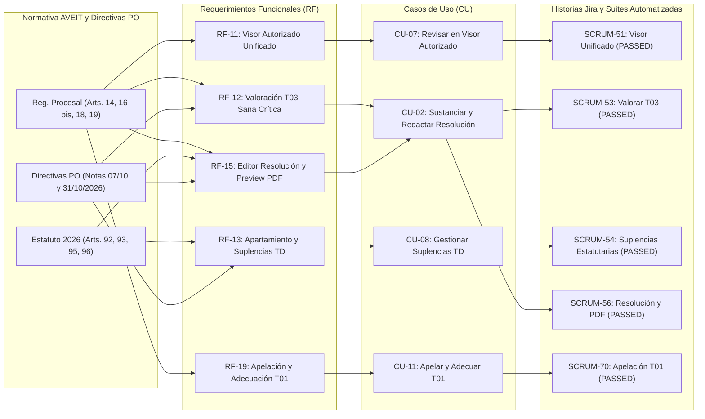

# DEFINICIÓN DE PRODUCTO — SPRINT 4 (APERTURA Y CIERRE)
## Sistema de Gestión del Tribunal de Disciplina y Premiaciones de A.V.E.I.T. (SGD-AVEIT)

**Cátedra:** Seminario Integrador — Curso 3K2 — Ciclo Lectivo 2026  
**Carrera:** Analista Desarrollador Universitario de Sistemas de Información (ADUSI) / Ingeniería en Sistemas de Información — UTN FRC  
**Equipo de Proyecto:** Grupo Nº 04  
**Product Owner:** Diego Gabriel Sánchez (Nº Socio: 87414)  
**Scrum Master:** Lucas Martín Guillén (Nº Socio: 85194)  
**Iteración:** Sprint 4 (`21/10/2026 al 03/11/2026` — 14 días corridos / 10 días hábiles; cierre administrativo del Sprint 3 y apertura de ejecución en Jira el `22/10/2026`)  
**Documento Fuente:** Actualización integral de la Definición del Producto, Casos de Uso, Modelos y Trazabilidad Normativa-Técnica (sincronizado con `PLAN_DE_PROYECTO_SGD_AVEIT.md`, `ERS-SGD-AVEIT.md`, `MODELO_DOMINIO_SGD_AVEIT.md`, `BPMN_Proceso_Operativo_Tribunal.md` y `Seguimiento de Proyecto.md`)

---

## PARTE I: DEFINICIÓN DE PRODUCTO — S4 APERTURA

### 1.1. Propósito y Visión del Incremento de Producto en el Sprint 4

El **Sprint 4** tiene por meta consolidar el núcleo de **Sustanciación en Sala del Tribunal de Disciplina, Régimen Estatutario de Suplencias, Tramitación de Apelaciones/Adecuaciones del Formulario T01 y Redacción Unificada de la Resolución Oficial**.

Habiendo completado en el Sprint 3 la bilateralidad procesal con los descargos reglamentarios (T02 tipificado y T03 libre), la custodia segura de evidencias bajo estándar médico-legal, el cómputo riguroso de plazos hábiles y el formato canónico del expediente en Sala TD (Imagen 2), el incremento del Sprint 4 dota al Tribunal de Disciplina de la infraestructura jurídica y operativa necesaria para:

1. **Examinar las actuaciones en un Visor Autorizado Unificado:** Acceder cronológicamente a solicitudes T01, anexos, descargos y documentos probatorios, con reserva estricta de certificaciones médicas y auditoría completa de consultas (*Zero-Leakage*).
2. **Valorar el Descargo Extraordinario T03 bajo Sana Crítica:** Permitir al Tribunal asentar la valoración de descargos libres con fundamentación jurídica explícita obligatoria y vinculación de precedentes emitidos, reservando el resultado frente a las partes hasta la emisión formal.
3. **Gestionar Apartamientos y Suplencias Estatutarias:** Aplicar de forma transparente los Artículos 92, 93 y 95 del Estatuto AVEIT 2026, asegurando la representación de los 3 grupos de socios Activos (4.º, 5.º y 6.º año social) mediante inhibición automática de involucrados y sustitución por suplentes o designación ad hoc, sin figuras de recusación (prohibidas expresamente por el Art. 93) y sin inmovilizar el despacho ordinario de expedientes.
4. **Tramitar Apelaciones y Adecuaciones del Formulario T01:** Instrumentar la vía recursiva del Art. 14 del Reglamento Procesal 2026, habilitando a los solicitantes a apelar con fundamentación circunstanciada y al Tribunal a debatir y adecuar puntos o imputados conservando intacto el historial procesal inmutable.
5. **Redactar la Resolución Oficial sin Votación Nominal:** Consolidar el **Editor Unificado (`VISTO / CONSIDERANDO / SE RESUELVE`)** con fijación directa del puntaje final neto aplicado individualizado por socio imputado y generación de previsualización PDF en borrador (conforme a la Imagen 3 oficial del TD), erradicando definitivamente flujos innecesarios de votación nominal paso a paso.

---

### 1.2. Requerimientos Funcionales (RF) del Incremento (Sprint 4)

| Identificador | Nombre del Requerimiento Funcional | Módulo | Descripción Funcional | Trazabilidad Normativa |
| :--- | :--- | :--- | :--- | :--- |
| **RF-11** | Visor Autorizado Unificado y Auditoría Sensible | Sala TD | Proveer a los miembros del Tribunal de Disciplina un visor cronológico unificado para examinar el expediente completo (T01, anexos, T02/T03 y evidencias probatorias), implementando aislamiento RBAC por objeto, advertencias visuales de archivos faltantes y registro inmutable de auditoría ante accesos a certificaciones médicas. | Art. 16 bis y Art. 19 RP; Art. 27 RG; Ley 25.326 |
| **RF-12** | Valoración Fundada de Descargo T03 y Búsqueda de Antecedentes | Sala TD | Permitir a los integrantes del Tribunal asentar la valoración de descargos extraordinarios T03 con fundamentación jurídica obligatoria, vinculando resoluciones emitidas autorizadas como precedentes con avisos no bloqueantes de consistencia y reserva de la deliberación frente al socio imputado. | Art. 18 RP; Directivas PO (`notasPO.md`) |
| **RF-13** | Gestión de Apartamiento por Conflicto y Régimen de Suplencias | Composición TD | Modelar la nómina estatutaria de 3 titulares y 3 suplentes (1 titular y 1 suplente por 4.º, 5.º y 6.º año social) desde el padrón institucional; inhibir automáticamente a miembros imputados o solicitantes (Art. 95) sin admitir recusaciones (Art. 93); convocar suplentes del mismo grupo o tramitar asignación ad hoc vía Outbox a CD, sin inmovilizar el expediente ni bloquear el tratamiento por quórum incompleto. | Arts. 92, 93 y 95 Estatuto AVEIT 2026; Directiva PO (`31/10/2026`) |
| **RF-15** | Editor Unificado de Resolución Oficial y Previsualización PDF | Resoluciones | Proveer al Tribunal un editor unificado de redacción resolutiva que conserve el número de expediente (`EXP-YYYY-NNNN`), estructurado canónicamente en `VISTO`, `CONSIDERANDO` y `SE RESUELVE`, con fijación directa del puntaje final neto o medida disciplinaria por socio imputado (sin votación nominal previa) y previsualización de borrador en PDF (ReportLab) sin exponer adjuntos privados. | Art. 19 RP; Art. 96 Estatuto; Directiva PO (Imagen 3 TD) |
| **RF-19** | Tramitación de Apelación y Adecuación de Solicitudes T01 | Apelaciones T01 | Implementar el procedimiento del Art. 14 del Reglamento Procesal: plazo formal de apelación parametrizable en días hábiles (1 a 30 días, default 5 días hábiles), recepción de fundamentos vía formulario, panel de debate de adecuación para el TD (modificación de puntos y nómina de imputados) y notificación fundada con apertura de nuevo plazo preclusivo. | Art. 14 Reg. Procesal 2026; Directivas PO |

---

### 1.3. Criterios de Aceptación Formales (Estándar EARS / Gherkin)

#### CA-RF11.1: Visor autorizado y custodia médica (Zero-Leakage)
* **Escenario:** Miembro del Tribunal de Disciplina habilitado examina expediente en revisión.
* **Dado que** el usuario autenticado posee rol `TRIBUNAL` y no se encuentra involucrado como imputado ni solicitante en la causa,
* **Cuando** accede a la vista de detalle del expediente en `/api/v1/expedientes/<id>/visor/`,
* **Entonces** el servidor retorna la cronología estructurada con metadatos de T01, descargos T02/T03 y listado de evidencias adjuntas,
* **Y** cada descarga o previsualización de certificado médico registra fecha, IP y usuario en `AuditoriaDescargaEvidencia`,
* **Y** ante intentos de acceso por terceros ajenos a la causa responde con código HTTP `403 Forbidden`.

#### CA-RF12.1: Valoración de T03 con antecedentes y reserva de fundamentación
* **Escenario:** Miembro del Tribunal asienta dictamen de valoración sobre descargo extraordinario T03.
* **Dado que** el descargo T03 se encuentra en estado `PENDIENTE_VALORACION` y el expediente está en `EN_REVISION`,
* **Cuando** el evaluador registra la valoración seleccionando resultado (`ADMITIDO_TOTAL`, `ADMITIDO_PARCIAL`, `DESESTIMADO`), ingresa fundamentación mayor a 20 caracteres y vincula expedientes precedentes,
* **Entonces** el servidor persiste inmutablemente la `ValoracionT03` asociada al descargo,
* **Y** muestra un aviso orientativo no bloqueante sobre precedentes vinculados,
* **Y** mantiene oculta la fundamentación frente al socio imputado hasta tanto la resolución final no sea formalmente emitida.

#### CA-RF13.1: Inhibición estatutaria y sustitución sin bloqueo de despacho
* **Escenario:** Miembro titular del Tribunal figura como denunciante o imputado en un T01.
* **Dado que** el integrante X es socio imputado o solicitante en el expediente `EXP-2026-0042`,
* **Cuando** se consulta la composición del Tribunal para la sustanciación de la causa,
* **Entonces** el motor inhibe automáticamente al integrante X para evaluar descargos, transicionar estados y firmar la resolución,
* **Y** convoca automáticamente al suplente del mismo año social (Art. 95 inc. a) o emite notificación formal a CD ante vacancia total (Caso B),
* **Y** no inmoviliza la tramitación del expediente ni exige actas manuales de asamblea para proseguir con las actuaciones.

#### CA-RF15.1: Redacción resolutiva directa y preview PDF en borrador
* **Escenario:** Tribunal genera resolución oficial con fijación directa de puntajes.
* **Dado que** todos los descargos T03 cuentan con valoración registrada y el expediente está en `PARA_RESOLVER`,
* **Cuando** el redactor completa el formulario resolutivo (`VISTO`, `CONSIDERANDO`, `SE RESUELVE`) y asigna directamente los puntajes finales netos aplicados por socio imputado,
* **Entonces** el servidor persiste la versión de la resolución vinculada al expediente conservando el número correlativo,
* **Y** el endpoint `GET /api/v1/expedientes/<id>/resolucion/preview-pdf/` genera un PDF en memoria con marca de agua "BORRADOR NO VALIDO", membrete institucional y ausencia total de adjuntos médicos o menciones a votación nominal.

#### CA-RF19.1: Apelación y adecuación de T01 con parametrización de días hábiles
* **Escenario:** Solicitante presenta recurso de apelación contra desestimación o adecuación de T01.
* **Dado que** el expediente se encuentra en el período de apelación configurado institucionalmente (días hábiles),
* **Cuando** el solicitante envía el formulario de apelación con su memorial de agravios,
* **Entonces** el sistema registra el evento en `ApelacionT01` de forma inmutable,
* **Y** habilita al Tribunal de Disciplina a abrir una instancia de debate para ratificar o adecuar puntos e imputados en `AdecuacionT01`,
* **Y** notifica formalmente a todas las partes involucradas con los fundamentos adoptados.

---

### 1.4. Casos de Uso del Sistema Impactados en el Sprint 4

1. **CU-02 (Consolidado): Sustanciar Causa, Valorar Pruebas y Redactar Resolución Oficial Directa:**
   * *Actor Principal:* Miembro del Tribunal de Disciplina (`ACT-02`).
   * *Precondición:* Expediente en estado `PARA_RESOLVER` con descargos sustanciados.
   * *Flujo Principal:* El miembro del TD examina las evidencias y valoraciones, accede al editor unificado de resolución, redacta los considerandos jurídicos, fija directamente el puntaje final neto o sanción individualizada por socio, y solicita la previsualización PDF de control previo a la suscripción colegiada.
2. **CU-07: Revisar Expediente y Evidencias en Visor Autorizado:**
   * *Actor Principal:* Tribunal de Disciplina (`ACT-02`).
   * *Flujo Principal:* Consulta cronológica integral de la causa, visualización de certificados, apertura segura de adjuntos anonimizados y registro auditado de acceso a comprobantes protegidos.
3. **CU-08: Gestionar Apartamiento y Suplencia del Tribunal de Disciplina:**
   * *Actor Principal:* Sistema / Tribunal de Disciplina (`ACT-02`) / Comisión Directiva (`ACT-03`).
   * *Flujo Principal:* Detección automática de conflictos de interés, inhibición de miembros involucrados, asignación del suplente de la misma cohorte (4.º, 5.º o 6.º año social) y comunicación a CD ante vacancia integral, asegurando la continuidad procesal sin paralizar la sala.
4. **CU-11: Tramitar Apelación y Adecuación del Formulario T01:**
   * *Actor Principal:* Socio Solicitante / Tribunal de Disciplina.
   * *Flujo Principal:* Ingreso de apelación fundamentada dentro del plazo de días hábiles parametrizado. El Tribunal analiza el recurso, adecua la calificación o nómina de socios imputados, emite comunicación fundada y otorga nuevo plazo de justificación conforme al Art. 14 del RP.

---

## PARTE II: DEFINICIÓN DE PRODUCTO — S4 CIERRE

### 2.1. Incorporación Formal de las Directivas Rectoras del PO y Resoluciones de Arquitectura

Durante el desarrollo del Sprint 4 se ratificaron y consolidaron las siguientes definiciones del Product Owner (**Diego Gabriel Sánchez**) registradas en `docs/gestion-proyecto/notasPO.md`:

1. **Editor Unificado de Resolución sin Votación Nominal (`SCRUM-56` / PR #67):**
   - Se ratificó el reemplazo absoluto de la votación nominal paso a paso por la fijación directa del puntaje final neto aplicado por socio en el editor unificado de resoluciones (`VISTO / CONSIDERANDO / SE RESUELVE`).
   - Se implementó la generación de previsualizaciones en PDF en memoria (ReportLab) con marca de borrador, respetando estrictamente el formato canónico de la Imagen 3 oficial del TD sin exponer adjuntos reservados.
2. **Valoración Fundada de Descargos T03 con Antecedentes (`SCRUM-53` / PR #71):**
   - Incorporación del panel de valoración de descargos extraordinarios en el modal de la sala, exigiendo fundamentación jurídica de sana crítica y vinculación de precedentes con avisos orientativos.
   - Aislamiento riguroso del resultado de valoración: se mantiene reservado frente a los imputados hasta la emisión oficial para salvaguardar el debido proceso.
3. **Apartamiento y Suplencia sin Inmovilización Procesal (`SCRUM-54` / PR #63):**
   - Simplificación del régimen del Art. 95 conforme a la revisión del PO del 25/10/2026 y 31/10/2026: determinación de nómina y grupos sociales (`Gxx`) directamente desde el padrón legado (`socio_lista.idTipoSocio` y fórmula matemática por año social), sin tablas manuales de integrantes.
   - Eliminación de actas de asamblea y remoción de bloqueos que inmovilizaban expedientes por quórum incompleto; despacho fluido de causas con banner sutil de participación restringida para miembros inhibidos.
4. **Apelación y Adecuación T01 con Plazos Parametrizados (`SCRUM-70` / PR #64):**
   - Parametrización dinámica del plazo formal de apelación (1 a 30 días hábiles) administrable desde Calendario Institucional, registro inmutable de apelaciones/adecuaciones y rediseño completo del modal de detalle de expediente según directivas del PO.
5. **ABM Normativo de Reglamentos y Estatuto (`PR #69`):**
   - Incorporación del catálogo normativo de consulta y administración con baja lógica, auditoría de modificaciones y precarga completa de los reglamentos vigentes de AVEIT.

---

### 2.2. Estado del Catálogo de Requerimientos al Cierre del Sprint 4

| Requerimiento / Ítem | Estado de Implementación | Cobertura de Verificación y Entregables |
| :--- | :---: | :--- |
| **RF-11 (Visor Autorizado Unificado y Auditoría)** | **100% Completado** | Integrado en `main` (`SCRUM-51`). Visor cronológico, control RBAC por objeto, auditoría de descargas médicas y tests en verde. |
| **RF-12 (Valoración Fundada de T03 con Antecedentes)** | **100% Completado** | `SCRUM-53` (PR #71). Modelo `ValoracionT03` inmutable, búsqueda de precedentes, panel modal integrado y 1097 tests backend passed. |
| **RF-13 (Apartamiento y Suplencia Estatutaria)** | **100% Completado** | `SCRUM-54` (PR #63 integrado a `main`). Modelado 3+3 por cohortes Activas, inhibición automática, aviso Outbox a CD y 8 tests específicos. |
| **RF-15 (Editor Unificado y Preview PDF)** | **100% Completado** | `SCRUM-56` (PR #67). Modelo `Resolucion` versionado, estructura canónica (Imagen 3), ReportLab en memoria y 22 tests unitarios. |
| **RF-19 (Apelación y Adecuación de T01)** | **100% Completado** | `SCRUM-70` (PR #64 integrado a `main`). Plazo parametrizado de días hábiles, modelos inmutables `ApelacionT01`/`AdecuacionT01` y tests E2E. |
| **ABM de Reglamentos y Estatuto** | **100% Completado** | PR #69 integrado a `main`. Pantalla ABM, seed masivo de artículos normativos, auditoría y bloqueo de scroll en modales. |
| **Adelanto Sprint 5/6: Módulo Analítico y Reportes** | **100% Completado** | PR #70 (`SCRUM-63`). 4 pestañas institucionales, cálculo de tiempo de vida de expedientes, gráficos comparativos y exportación CSV con BOM. |
| **Adelanto Sprint 5/6: Alertas Umbral Crítico -10 y -7** | **100% Completado** | PR #72 (`funcionalidadS5-06` / `SCRUM-62`). Motor `ThresholdAlertEngine`, prevención de alertas duplicadas, política configurable -7 y 37 tests en verde. |

---

### 2.3. Matriz de Trazabilidad Bidireccional de Extremo a Extremo (Sprint 4)

| Fuente Normativa / Directiva PO | Requerimiento (`RF`) y Regla (`RN`) | Caso de Uso (`CU`) | Historia Implementada (Jira / PR) | Componentes Construidos (Backend / Frontend) | Suite de Prueba Automatizada Correspondiente | Resultado |
| :--- | :--- | :--- | :--- | :--- | :--- | :---: |
| **Art. 16 bis y 19 RP; Art. 27 RG; Ley 25.326** | **RF-11:** Visor Autorizado Unificado y Auditoría (`RN-05`, `RN-11`) | **CU-07:** Revisar Expediente en Visor Autorizado | **`SCRUM-51`** (`S4-01`) PR integrado a `main` | `VisorExpedienteSerializer`, `AuditoriaConsultaExpediente`, `VisorExpedienteComponent` | • `tests/expedientes/test_visor_expediente.py` • `tests/expedientes/test_evidence_api.py` • `visor-expediente.component.spec.ts` | **PASSED** *(100% Verde)* |
| **Art. 18 RP; Directiva PO `07/10/2026`** | **RF-12:** Valoración T03 con Sana Crítica y Precedentes (`RN-04`, `RN-06`) | **CU-02:** Sustanciar Causa y Valorar Pruebas | **`SCRUM-53`** (`S4-03`) PR #71 en revisión | `ValoracionT03`, `ValoracionT03Service`, modal de valoración en sala TD | • `tests/expedientes/test_t03_valoracion_api.py` • `tests/expedientes/test_t03_valoracion_models.py` • `gestionar-expedientes.component.spec.ts` | **PASSED** *(100% Verde)* |
| **Arts. 92, 93 y 95 Estatuto AVEIT 2026** | **RF-13:** Apartamiento y Suplencias por Grupos Activos (`RN-08`, `RN-09`) | **CU-08:** Tramitar Apartamiento y Suplencia TD | **`SCRUM-54`** (`S4-04`) PR #63 integrado a `main` | `ComposicionTribunal`, `TribunalCompositionService`, derivación matemática cohorte Activa | • `tests/expedientes/test_tribunal_composition_api.py` • `tests/expedientes/test_tribunal_composition_domain.py` • `tests/expedientes/test_e2e_adhoc_flow.py` | **PASSED** *(100% Verde)* |
| **Art. 19 RP; Art. 96 Estatuto; Imagen 3 TD** | **RF-15:** Editor Unificado de Resolución Oficial y Preview PDF (`RN-06`, `RN-07`) | **CU-02:** Redactar Resolución Oficial Directa | **`SCRUM-56`** (`S4-06`) PR #67 en revisión | `Resolucion`, `ResolucionService`, ReportLab PDF Generator, `UnavailableClosedDecisionProvider` | • `tests/expedientes/test_resolucion_service.py` • `tests/expedientes/test_resolucion_api.py` • `tests/expedientes/test_resolucion_preview_pdf.py` | **PASSED** *(100% Verde)* |
| **Art. 14 Reg. Procesal 2026; Directiva PO** | **RF-19:** Apelación y Adecuación de Solicitudes T01 (`RN-01`, `RN-10`) | **CU-11:** Tramitar Apelación y Adecuación T01 | **`SCRUM-70`** (`PB-02`) PR #64 integrado a `main` | `ApelacionT01`, `AdecuacionT01`, `T01AppealService`, modal de expediente rediseñado | • `tests/expedientes/test_t01_appeal_api.py` • `tests/expedientes/test_t01_appeal_periods.py` • `mis-expedientes.component.spec.ts` | **PASSED** *(100% Verde)* |

---

### 2.4. Resumen de Ejecución y Evidencia de Pruebas Automatizadas

Al cierre del Sprint 4, la verificación dinámica sobre `main` consolida una suite integral de **más de 1000 pruebas automatizadas en backend (`pytest`) y más de 450 pruebas en frontend (`Karma/Jasmine`) con 0 errores**, distribuidas en los tres ejes críticos del dominio:

1. **Permisos y Segregación de Funciones (RBAC Zero-Leakage):**
   - Aislamiento estricto de certificaciones médicas y psicológicas en el visor autorizado (`test_visor_expediente.py`, `test_evidence_api.py`).
   - Inhibición automática de miembros del Tribunal involucrados como denunciantes o denunciados (`test_tribunal_composition_api.py`).
   - Reserva de la valoración del descargo extraordinario frente al socio imputado hasta el dictado de la resolución (`test_t03_valoracion_api.py`).
2. **Cómputo de Plazos Preclusivos y Días Hábiles:**
   - Parametrización y control autoritativo de plazos de apelación del T01 de 1 a 30 días hábiles en servidor (`test_t01_appeal_periods.py`).
   - Sincronización inmutable con el calendario institucional ante feriados sobrevenidos durante el trámite.
3. **Transacciones, Concurrencia e Inmutabilidad Contable y Procesal:**
   - Preservación del número de expediente y versionado inmutable en `Resolucion`, `ValoracionT03`, `ComposicionTribunal`, `ApelacionT01` y `AdecuacionT01`.
   - Cero sentencias `UPDATE` manuales en registros contables e históricos de socios.
   - Generación determinista de documentos PDF en memoria con ReportLab sin efectos colaterales en la base de datos (`test_resolucion_preview_pdf.py`).

---

### 2.5. Release Plan y Transición hacia el Sprint 5 Consolidado (Fusión Sprint 5 y 6)

Habiendo alcanzado el **Hito IOC (Initial Operational Capability)** el `04/11/2026` con el **100% de los 19 Story Points del Sprint 4 completados y verificados**, el Product Owner (**Diego Gabriel Sánchez**) y el Scrum Master (**Lucas Martín Guillén**) disponen la **fusión operativa del Sprint 5 con el Sprint 6**:

* **Justificación de la Fusión:** Se consolida una única iteración final (**Sprint 5 Consolidado**) con inicio el **04/11/2026** para acortar tiempos de entrega, reducir costos de coordinación inter-sprint y anticipar la finalización del proyecto y la puesta en producción del SGD-AVEIT.
* **Capitalización de Adelantos Realizados:** La fusión es plenamente viable debido a que componentes esenciales de la fase final ya fueron construidos y testeados en paralelo:
  - **`SCRUM-63` (5 SP / PR #70):** Módulo de Reportes Institucionales y Balance Cuatrimestral por Subcomisión (Art. 137) con 4 pestañas analíticas, exportación CSV y tiempo de vida promedio.
  - **`SCRUM-62` (3 SP / PR #72):** Motor de alertas automáticas ante umbral crítico de -10 puntos y política preventiva configurable en -7 puntos.
* **Sprint Backlog del Sprint 5 Consolidado (Fusión S5+S6):**
  - `SCRUM-57` (S5-01 - 5 SP): Sumatoria transaccional inmutable de puntos en libro mayor (cero UPDATE en MySQL).
  - `SCRUM-58` (S5-02 - 3 SP): Firma colegiada obligatoria por los 3 grupos Activos y emisión oficial.
  - `SCRUM-59` (S5-03 - 3 SP): Despacho outbox de notificaciones y publicación de resoluciones.
  - `SCRUM-60` (S5-04 - 3 SP): Portal "Mis Expedientes y Sanciones" para socios imputados.
  - `SCRUM-61` (S5-05 - 3 SP): Alertas automáticas por acumulación de apercibimientos / sanciones.
  - `SCRUM-62` (S5-06 - 3 SP): Alertar umbral crítico de -10 puntos y política preventiva configurable en -7 *(Completado vía PR #72)*.
  - `SCRUM-63` (S6-01 - 5 SP): Consolidar balance cuatrimestral por subcomisión y autoridad (Art. 137) *(Completado vía PR #70)*.
  - `SCRUM-64` (S6-02 - 5 SP): Reconciliación bidireccional y detección de divergencias en saldos históricos.
  - `SCRUM-65` (S6-03 - 3 SP): Hardening de seguridad, auditoría Zero-Leakage y pruebas de carga.
  - `SCRUM-66` (S6-04 - 3 SP): Despliegue en Staging y verificación con datos reales legados.
  - `SCRUM-67` (S6-05 - 3 SP): Homologación institucional con CD, TD y Cómputos y transferencia operativa.
  - `SCRUM-85` (S4/S5-TAREA - 2 SP): Documentación de Cierre Sprint 4 y Apertura de Sprint 5/6 Fusionado en Backlog y Seguimiento.
  - `SCRUM-68` (S6-06 - 3 SP / Stretch): Repositorio de precedentes y jurisprudencia disciplinaria.

---
*Documento aprobado y formalizado para la Cátedra de Seminario Integrador — Ciclo Lectivo 2026.*
