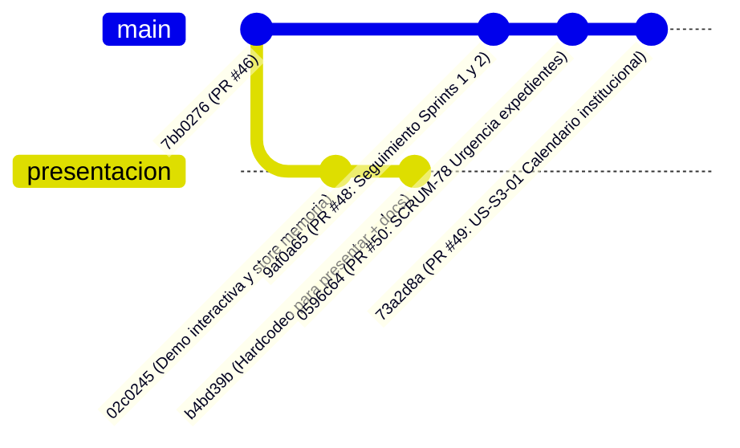

# Informe Técnico de Investigación: Divergencia entre Ramas `main` y `presentacion`

**Proyecto:** SGD-AVEIT — Plataforma Disciplinaria y Gestión de Puntos  
**Fecha de Emisión:** 14 de octubre de 2026  
**Tipo de Documento:** Informe de Diagnóstico y Análisis Forense de Control de Versiones (Git)  
**Estado:** Informativo / Sin modificaciones sobre el repositorio  

---

## 1. Resumen Ejecutivo

A partir de la inquietud planteada sobre por qué la rama `presentacion` aparenta estar más avanzada que `main` y por qué `main` no contiene los mismos commits, se realizó una auditoría forense del historial de Git (`git log`, `git diff`, `git merge-base` y topología de grafos).

### Conclusión Principal
1. **La rama `presentacion` no es una evolución lineal de `main`, sino una bifurcación divergente (*branch split*) creada con fines demostrativos específicos.**
2. En Git, `presentacion` figura como **2 commits por delante (*ahead*)** y **21 commits por detrás (*behind*)** respecto a `origin/main`.
3. Los 2 commits exclusivos de `presentacion` (`02c0245` y `b4bd39b`) introdujeron **mocks reactivos en memoria en el frontend, un selector visual de roles en el Navbar y datos hardcodeados** para sortear dependencias de backend durante la presentación oral y ejecutiva del proyecto frente a la cátedra/evaluadores.
4. `main` **no tiene ni debe tener esos commits** debido a que incorporarían código tipificado textualmente como *"Hardcodeo para presentar"*, rompiendo la arquitectura real de persistencia en MySQL, las suites de pruebas automatizadas (`pytest` y `npm test`) y las reglas de gobernanza innegociables de [AGENTS.md](file:///d:/Proyectos-mg/seminario-integrador/AGENTS.md).

---

## 2. Topología y Cronología Forense de Git

### 2.1 Punto de Bifurcación (Merge Base)
Ambas ramas compartieron su último ancestro común el **miércoles 7 de octubre de 2026**:

- **Commit SHA:** `7bb027691afb888060ac55cfba0778bfc7387198`
- **Mensaje:** `Merge pull request #46 from MartinG94/funcionalidadS2-05`
- **Fecha:** Miércoles 7 de octubre de 2026, 11:27:00 -0300
- **Autor/Mergeador:** Diego Sánchez
- **Estado:** En este instante exacto, `main` y la base sobre la que se originó `presentacion` eran idénticas.

---

### 2.2 Diagrama de Divergencia

---

### 2.3 Los 2 Commits Exclusivos de `presentacion`

| Commit SHA | Fecha | Autor | Mensaje | Impacto / Contenido |
| :--- | :--- | :--- | :--- | :--- |
| `02c0245` | 08/10/2026 10:37 | Diego | `feat(demo): demo interactiva completa y sincronizacion reactiva de expedientes y roles` | Modificó 13 archivos (+516, -44 líneas). Creó un store en memoria dentro de `TribunalDataService`, agregó selector de roles en `NavbarComponent` y puenteó emisiones directas a arrays locales sin pasar por endpoints reales. |
| `b4bd39b` | 09/10/2026 19:43 | Diego | `Hardcodeo para presentar` | Modificó 4 archivos (+1.641 líneas). Incorporó el comando `seed_expedientes.py` (243 líneas) y la documentación de la presentación: `GUION_ORATORIA_PNL.md`, `PRESENTACION_EJECUTIVA.md` y `deck_batch.json`. |

---

### 2.4 La Evolución de `origin/main` en el Mismo Período (21 Commits)

Mientras `presentacion` se utilizaba para la preparación de la oratoria y la demo visual, el desarrollo formal en `main` continuó rigurosamente bajo el flujo de **Spec-Driven Development (SDD)** mediante Pull Requests revisados, aprobados y validados por CI:

1. **Pull Request #48** (`9af0a65`, 08/10/2026 12:27):
   - Registro formal de Sprints 1 y 2, incorporación de feedback del PO con Cómputos y Tribunal de Disciplina, y blindaje de gobernanza en [AGENTS.md](file:///d:/Proyectos-mg/seminario-integrador/AGENTS.md).
2. **Pull Request #50** (`0596c64`, 10/10/2026 16:41):
   - Implementación de SCRUM-78: Clasificador e indicador visual de urgencia en expedientes (modelos Django, migración `0007_expediente_urgencia.py`, serializers, servicios y componentes Kanban en Angular).
3. **Pull Request #49** (`73a2d8a`, 11/10/2026 03:18):
   - Implementación de US-S3-01: Calendario institucional de días hábiles (modelos, migraciones `0009`, `0010`, `0011`, backend endpoints, simulación de plazos procesales en modal y centralización del servicio de notificaciones accesible en Angular).

En total, `main` incorporó **+6.581 líneas y 97 archivos modificados** que **no existen en la rama `presentacion`**.

---

## 3. Respuestas a las Preguntas Planteadas

### ¿Por qué la rama `presentacion` figura más avanzada que `main`?
Existen dos motivos complementarios:
1. **En la métrica técnica de GitHub ("Ahead by 2"):**  
   GitHub compara cualquier rama secundaria contra `main`. Al tener 2 commits (`02c0245` y `b4bd39b`) que no existen en el árbol de `main`, el panel de GitHub reporta que la rama está *adelantada* en esos 2 registros. Esto no significa que contenga todo lo de `main` más cosas nuevas; de hecho, está **atrasada en 21 commits** respecto a la producción real.
2. **En la percepción visual y funcional:**  
   Al ejecutar la rama `presentacion`, la interfaz gráfica incluye elementos inmediatos que simulan funcionalidad terminada (el selector de rol en la barra superior para cambiar entre Socio y Tribunal en un clic, datos precargados a medida para la demo y actualización reactiva instantánea en memoria). Para un usuario o evaluador, esto daba la impresión de estar "más completo" que una rama en desarrollo que requería autenticación formal y base de datos activa.

### ¿Por qué `main` no tiene los mismos commits que `presentacion`?
`main` no tiene esos commits por tres razones fundamentales de ingeniería y gobernanza:
1. **Naturaleza provisional del código:**  
   El commit `b4bd39b` declara explícitamente su propósito: *"Hardcodeo para presentar"*. Dicho código alteraba `seed_expedientes.py` con IDs fijos e inyectaba estados en memoria en `TribunalDataService.ts`, puenteando la autenticación real y las reglas transaccionales de la base de datos MySQL.
2. **Ausencia deliberada de Pull Request a `main`:**  
   Nunca se abrió un PR desde `presentacion` hacia `main`. Integrar un commit con hardcodeo directo a `main` hubiese violado los criterios de aceptación y las políticas de calidad del proyecto.
3. **Preservación de la arquitectura de producción:**  
   Si `presentacion` se hubiese mergeado directamente a `main`, el frontend habría dejado de consumir la API REST real de Django, provocando regresiones masivas en las pruebas automatizadas de integración y desacoplando el frontend de la base de datos MySQL 8.0 del padrón oficial.

---

## 4. Trazabilidad Posterior: ¿Qué pasó con `presentacion` después?

Los cambios de `presentacion` no se perdieron en el olvido:
- El **martes 13 de octubre de 2026 a las 10:09:48 -0300**, durante la preparación del entorno de demostración técnica unificado con la base de datos MySQL real (tarea SCRUM-77 / PR #54):
  - Se creó la rama `demo-tecnica`.
  - En el commit `4db33b0a74d74868ecde56121a75e6d9618941aa`, Martín Guillén fusionó la rama `presentacion` (`b4bd39b`) con la rama de base de datos `feature/US-S3-PO2-mysql-seed-g57-g60` (`8fcabd0`).
  - Esto permitió rescatar los documentos de oratoria y la presentación ejecutiva (`docs/presentacion/`), y compatibilizar las vistas en un entorno controlado (`demo-tecnica`), manteniendo la rama `main` limpia y libre de hardcodeos.

---

## 5. Cuadro Comparativo de Ramas

| Característica / Criterio | Rama `main` (`origin/main`) | Rama `presentacion` (`origin/presentacion`) |
| :--- | :--- | :--- |
| **Commit cabecera** | `73a2d8a` (PR #49) | `b4bd39b` ("Hardcodeo para presentar") |
| **Fecha de último commit** | 11/10/2026 | 09/10/2026 |
| **Manejo de Datos** | Persistencia real en MySQL 8.0, auditoría inmutable | Store reactivo simulado en memoria (`TribunalDataService`) |
| **Autenticación y Roles** | JWT, backend RBAC, permisos en API REST | Selector visual en Navbar con roles simulados |
| **Calendario Institucional (US-S3-01)** | Sí (modelos, migraciones, modal, endpoints y tests) | No (bifurcada antes de esta feature) |
| **Clasificador Urgencia (SCRUM-78)** | Sí (backend models, cálculo de urgencia, Kanban badges) | No (bifurcada antes de esta feature) |
| **Documentación Oratoria / Slides** | No presente | Sí (`docs/presentacion/GUION_ORATORIA_PNL.md`, etc.) |
| **Apta para Producción / CI** | 100% (todos los tests pasan, alineado a SDD) | No (diseñada exclusivamente como sandbox de presentación) |

---

## 6. Dictamen Final

La diferencia entre ambas ramas es **esperada, justificada y coherente con el ciclo de vida de un proyecto de software profesional**:
- `presentacion` cumplió su cometido como rama de contingencia visual para una demostración oral frente a la audiencia académica/institucional.
- `main` resguardó la integridad del código fuente, la trazabilidad formal de los requisitos y la arquitectura de producción.
- En caso de requerirse en `main` algún contenido específico de `presentacion` (por ejemplo, los archivos de documentación ejecutiva de `docs/presentacion/`), el camino adecuado no es fusionar la rama completa, sino extraer exclusivamente dichos archivos documentales mediante un Pull Request específico, sin arrastrar los componentes ni los servicios con mocks de código.
