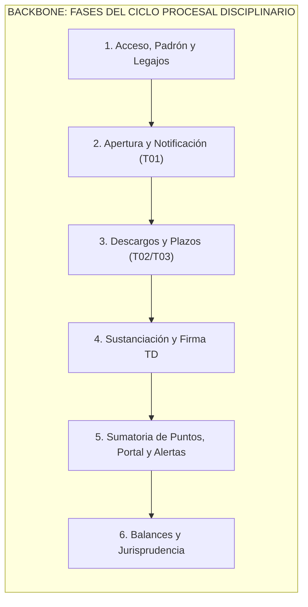

# UNIVERSIDAD TECNOLÓGICA NACIONAL
## FACULTAD REGIONAL CÓRDOBA
### Carrera: Analista Desarrollador Universitario de Sistemas de Información / Ingeniería en Sistemas de Información
### Cátedra: Seminario Integrador
**Ciclo Lectivo:** 2026  
**Curso:** 3K2 (Turno Tarde)  
**Equipo Docente:** Ing. Silvina Arenas, Ing. María Irene Mac William, Ing. Fernando Sanabria  

---

# SEGUIMIENTO DE PROYECTO
## Sistema de Gestión del Tribunal de Disciplina y Premiaciones de A.V.E.I.T. (SGD-AVEIT)

---

### DATOS DEL PROYECTO Y EQUIPO DE TRABAJO

| Campo | Detalle |
| :--- | :--- |
| **Organización de Aplicación** | Asociación Vocacional de Estudiantes e Ingenieros Tecnológicos (A.V.E.I.T.) - UTN FRC |
| **Nombre del Sistema** | SGD-AVEIT (Sistema de Gestión del Tribunal de Disciplina y Premiaciones de AVEIT) |
| **Documento** | Seguimiento de Proyecto y Marco Metodológico Ágil (Sprint 0 a Sprint N) |
| **Metodología Adoptada** | Marco Ágil Adaptativo Scrum / Scrumban |
| **Integrantes del Equipo** | • **Sanchez, Diego Gabriel** (Número de Socio: 87414) - Product Owner<br>• **Guillén, Lucas Martín** (Número de Socio: 85194) - Scrum Master<br>• **Rosales, Nicolás** (Número de Socio: 408917) - Equipo de Desarrollo<br>• **Gastiaburu, Lucas** (Número de Socio: 74907) - Equipo de Desarrollo<br>• **Villegas, Axel Rene** (Número de Socio: 403655) - Equipo de Desarrollo<br>• **Urviola, Luis** (Número de Socio: 409953) - Equipo de Desarrollo<br>• **Quiroz, Tomas Augusto** (Número de Socio: 415327) - Equipo de Desarrollo |

---

## HISTORIA DE REVISIÓN

| Versión | Fecha | Autor / Responsable | Descripción de Modificaciones |
| :---: | :---: | :--- | :--- |
| **1.0.0** | 01/09/2026 | Equipo de Proyecto SGD-AVEIT | Creación inicial del documento, bosquejo de acuerdos de trabajo, estimación horaria inicial y definición preliminar de roles. |
| **1.1.0** | 02/09/2026 | Equipo de Proyecto SGD-AVEIT | Formalización integral del **Sprint 0** conforme a la Guía de Documentación de la UTN FRC: calendario de sprints (14 días, finalización en diciembre 2026), ceremonias híbridas, acuerdos de trabajo (DoD y DoR), capacidad semanal del equipo (77 hs/sem), catálogo de herramientas, tecnologías y gobernanza de Inteligencia Artificial para pair programming, Product Backlog completo inicial (US-01 a US-19), User Story Map bidimensional, banco de consultas para la reunión de tutoría docente y estructura de seguimiento para Sprints 1 a N. |
| **1.2.0** | 07/10/2026 | Equipo de Proyecto SGD-AVEIT | Incorporación de la ejecución, métricas, incremento demostrable y retrospectiva del **Sprint 1** (Walking Skeleton e Integración Legada) y del **Sprint 2** (Apertura T01, Ciclo Procesal de 6 Estados, Notificaciones y Monitoreo SCRUM-75). Formalización del hito de revisión intermedia y feedback del Product Owner del 27/09/2026 (`notasPO.md`), documentando sus impactos de diseño y replanificación ágil. |
| **1.3.0** | 22/10/2026 | Equipo de Proyecto SGD-AVEIT | Incorporación de la alineación técnica con Cómputos y el TD (07/10/2026), cierre definitivo del **Sprint 3** con el 100% del alcance completado (36/36 SP integrados en `main` — Descargos T02/T03, Custodia de Evidencias, Calendario de Días Hábiles, Clasificador de Urgencia, Eventos y Asistencias con acumulación 3:1 y Detalle Canónico de Causa en Sala TD) y apertura formal de la planificación del **Sprint 4** (19 SP comprometidos). |

---

## TABLA DE CONTENIDO (ÍNDICE)

1. [Propósito del Documento](#propósito-del-documento)
2. [Gestión por Iteración o por Sprint (Metodología Ágil - Scrum)](#gestión-por-iteración-o-por-sprint)
   - 2.1. [Sprint 0 (Definiciones Generales del Proyecto)](#sprint-0-definiciones-generales-del-proyecto)
     - 2.1.1. [Working Agreement (Acuerdos de Trabajo del Equipo)](#211-working-agreement-acuerdos-de-trabajo-del-equipo)
       - A. Definición de Sprints y Calendario Maestro
       - B. Eventos y Ceremonias Ágiles (Duración, Modalidad, Mecánica y Herramientas)
       - C. Acuerdos de Comunicación, Convivencia y Gestión de Bloqueos
       - D. Criterios de Calidad: Definition of Ready (DoR) y Definition of Done (DoD)
     - 2.1.2. [Capacidad del Equipo](#212-capacidad-del-equipo)
     - 2.1.3. [Definición de Roles del Equipo y Matriz RACI](#213-definición-de-roles-del-equipo)
     - 2.1.4. [Herramientas para la Gestión de Proyecto](#214-herramientas-para-la-gestión-de-proyecto)
     - 2.1.5. [Tecnologías para el Desarrollo del Producto y Política de Tratamiento de IA](#215-tecnologías-para-el-desarrollo-del-producto-y-política-de-ia)
     - 2.1.6. [Product Backlog (Completo Inicial)](#216-product-backlog-completo-inicial)
     - 2.1.7. [Story Map (User Story Mapping)](#217-story-map-user-story-mapping)
   - 2.2. [Sprint 1 (Walking Skeleton: Integración, Padrón y Ranking)](#22-sprint-1-walking-skeleton-integración-padrón-y-ranking)
     - 2.2.1. [Planificación y Sprint Backlog](#221-planificación-y-sprint-backlog)
     - 2.2.2. [Resultado Final del Sprint e Incremento](#222-resultado-final-del-sprint-e-incremento)
     - 2.2.3. [Retrospectiva y Mejora Continua](#223-retrospectiva-y-mejora-continua)
   - 2.3. [Hito de Revisión Intermedia con el Product Owner y Refinamiento (27/09/2026)](#23-hito-de-revisión-intermedia-con-el-product-owner-y-refinamiento-27092026)
     - 2.3.1. [Síntesis del Feedback y Nuevas Consideraciones del PO (`notasPO.md`)](#231-síntesis-del-feedback-y-nuevas-consideraciones-del-po-notaspomd)
     - 2.3.2. [Impacto en el Modelo de Datos, UI y Arquitectura](#232-impacto-en-el-modelo-de-datos-ui-y-arquitectura)
     - 2.3.3. [Replanificación Ágil del Backlog y Estrategia de Entrega](#233-replanificación-ágil-del-backlog-y-estrategia-de-entrega)
   - 2.4. [Sprint 2 (Apertura T01, Ciclo Procesal, Notificaciones y Monitoreo)](#24-sprint-2-apertura-t01-ciclo-procesal-notificaciones-y-monitoreo)
     - 2.4.1. [Planificación y Sprint Backlog](#241-planificación-y-sprint-backlog)
     - 2.4.2. [Resultado Final del Sprint e Incremento](#242-resultado-final-del-sprint-e-incremento)
     - 2.4.3. [Retrospectiva y Mejora Continua](#243-retrospectiva-y-mejora-continua)
   - 2.5. [Hito de Alineación con Cómputos, Tribunal de Disciplina y Directivas del PO (07/10/2026)](#25-hito-de-alineación-con-cómputos-tribunal-de-disciplina-y-directivas-del-po-07102026)
     - 2.5.1. [Síntesis de Acuerdos Técnicos con la Subcomisión de Cómputos](#251-síntesis-de-acuerdos-técnicos-con-la-subcomisión-de-cómputos)
     - 2.5.2. [Síntesis del Feedback Funcional del TD y PO (`notasPO.md` 07/10/2026)](#252-síntesis-del-feedback-funcional-del-td-y-po-notaspomd-07102026)
     - 2.5.3. [Impacto en el Backlog del Sprint 3 y Próximas Iteraciones](#253-impacto-en-el-backlog-del-sprint-3-y-próximas-iteraciones)
   - 2.6. [Sprint 3 (Descargos T02/T03, Evidencias, Calendario, Urgencia y Asistencias)](#26-sprint-3-descargos-t02t03-evidencias-calendario-urgencia-y-asistencias)
     - 2.6.1. [Planificación y Sprint Backlog](#261-planificación-y-sprint-backlog)
     - 2.6.2. [Resultado Final del Sprint e Incremento](#262-resultado-final-del-sprint-e-incremento)
     - 2.6.3. [Retrospectiva y Mejora Continua](#263-retrospectiva-y-mejora-continua)
   - 2.7. [Sprint 4 (Sustanciación en Sala TD, Suplencias, Apelación T01 y Redacción de Resolución Oficial)](#27-sprint-4-sustanciación-en-sala-td-suplencias-apelación-t01-y-redacción-de-resolución-oficial)
     - 2.7.1. [Planificación y Sprint Backlog (S4 Apertura)](#271-planificación-y-sprint-backlog-s4-apertura)
   - 2.8. [Estructura de Seguimiento para Cierre de Sprint 4 y Sprints Subsiguientes (Sprints 5 y 6)](#28-estructura-de-seguimiento-para-cierre-de-sprint-4-y-sprints-subsiguientes-sprints-5-y-6)
     - 2.8.1. [Plantilla de Planificación y Sprint Backlog](#281-plantilla-de-planificación-y-sprint-backlog)
     - 2.8.2. [Plantilla de Resultado Final del Sprint](#282-plantilla-de-resultado-final-del-sprint)
     - 2.8.3. [Plantilla de Retrospectiva](#283-plantilla-de-retrospectiva)

---

## PROPÓSITO DEL DOCUMENTO

El presente documento de **Seguimiento de Proyecto** constituye el instrumento central de gobernanza y control metodológico para el desarrollo del **Sistema de Gestión del Tribunal de Disciplina y Premiaciones de A.V.E.I.T. (SGD-AVEIT)**, formalizado en el marco de la cátedra de Seminario Integrador de la carrera de Ingeniería en Sistemas de Información (UTN FRC).

Su propósito esencial radica en:
1. Establecer y documentar los consensos operativos, disciplinarios y metodológicos del equipo (**Working Agreement**).
2. Servir de bitácora continua para registrar la planificación, ejecución, métricas de velocidad, resultados tangibles y aprendizajes derivados de cada iteración (**Sprint Backlog, Incrementos y Retrospectivas**).
3. Asegurar la transparencia absoluta y la trazabilidad de los compromisos ante la Cátedra y los beneficiarios de la organización (**A.V.E.I.T.**), garantizando el cumplimiento de los plazos preclusivos y la entrega de un producto de software 100% funcional y probado al concluir el ciclo lectivo.

---

## GESTIÓN POR ITERACIÓN O POR SPRINT

### SPRINT 0 (Definiciones Generales del Proyecto)

El **Sprint 0** constituye la fase preparatoria y de cimentación técnica y organizativa del proyecto. A diferencia de los sprints de desarrollo posteriores, el Sprint 0 no tiene como objetivo central generar un incremento de software para producción, sino establecer las condiciones óptimas de viabilidad, arquitectura, alineación de requerimientos, configuración de entornos y consensos operativos que garanticen el flujo ininterrumpido en los sprints subsiguientes.

---

#### 2.1.1. Working Agreement (Acuerdos de Trabajo del Equipo)

El equipo de proyecto formaliza los siguientes acuerdos vinculantes de trabajo colaborativo:

##### A. Definición de Sprints y Calendario Maestro
* **Duración Estándar de Sprint:** **Catorce (14) días corridos (2 semanas)** por iteración. Este ciclo provee una cadencia óptima para articular las revisiones semanales de cursada con períodos de desarrollo continuo y pruebas funcionales.
* **Sprint 0 (Fundacional):** Desde el **18/08/2026** hasta el **08/09/2026** (3 semanas: relevamiento, formulación de Estudio Inicial, anteproyecto, especificación de requerimientos, acuerdos de equipo, backlog inicial y prototipado UX preliminar).
* **Fecha de Finalización y Entrega del Producto:** Se planifican **6 Sprints regulares de 14 días** tras el Sprint 0, proyectando finalizar el desarrollo y tener el producto **100% funcional y validado en los primeros días de diciembre de 2026**.

```
[Sprint 0: 18/08 al 08/09] -> Fundacional: Relevamiento, Backlog, DoD/DoR, Prototipo UX
     │
[Sprint 1: 09/09 al 22/09] -> Walking Skeleton: Auth, Roles RBAC, Ranking de Puntos y Legajos
     │
[Sprint 2: 23/09 al 06/10] -> Solicitud Formulario T01 con Anexo, Notificaciones y Tablero 6 Estados
     │
[Sprint 3: 07/10 al 20/10] -> Descargos T02/T03, Adjuntos Digitales y Temporizador 5 Días Hábiles
     │
[Sprint 4: 21/10 al 03/11] -> Módulo Justificaciones, Deliberación Virtual, Votación y Firma Colegiada
     │
[Sprint 5: 04/11 al 17/11] -> Sumatoria Transaccional Inmutable de Puntos, Publicación Transparente y Alertas 7/10 pts
     │
[Sprint 6: 18/11 al 01/12] -> Balances Cuatrimestrales Art. 137, Jurisprudencia, Homologación y Cierre
     │
[Diciembre 2026: Entrega 100% Funcional y Presentación Final]
```

##### B. Eventos y Ceremonias Ágiles (Duración, Modalidad, Mecánica y Herramientas)

Se adopta un esquema **híbrido optimizado**, compatibilizando los encuentros obligatorios de cursada con el trabajo asíncrono y la coordinación técnica:

| Ceremonia | Frecuencia y Momento | Duración | Modalidad / Herramienta | Participantes | Objetivo, Entradas y Salidas |
| :--- | :--- | :---: | :--- | :--- | :--- |
| **Daily Scrum (Día de Cursada)** | Martes y Miércoles al inicio de clase (14:55 hs) | 15 min | Presencial (Martes en aula UTN) / Virtual (Miércoles en Meet) | Todo el Equipo | **Objetivo:** Sincronización táctica del día y alineación con la cátedra.<br>**Entrada:** Tablero de Sprint en Jira.<br>**Salida:** Tareas priorizadas para la jornada y plan de consultas al tutor. |
| **Daily Scrum (Asíncrona)** | Lunes, Jueves y Sábados (antes de las 13:00 hs) | 5 min por miembro | Asíncrona (Canal dedicado en Discord / WhatsApp) | Todo el Equipo | **Objetivo:** Informar avance y destrabar bloqueos en días sin cursada.<br>**Mecánica:** Cada miembro reporta las 3 preguntas clásicas: *1) ¿Qué completé ayer? 2) ¿Qué haré hoy? 3) ¿Tengo algún impedimento?* |
| **Sprint Planning** | Primer Miércoles de cada Sprint (16:30 hs) | 90 min | Mixta / Virtual (Discord y Jira) | Product Owner, Scrum Master y Dev Team | **Objetivo:** Comprometer el Sprint Backlog y definir el Sprint Goal.<br>**Entrada:** Product Backlog refinado y priorizado por el PO con DoR cumplido.<br>**Salida:** Sprint Backlog comprometido, desglose de tareas técnicas y Sprint Goal formal. |
| **Jornada de Trabajo Colaborativo** | Todos los Viernes a las 15:00 hs | 180 min | Híbrida / Presencial flexible (Coworking sede AVEIT / Discord) | Dev Team y Scrum Master | **Objetivo:** Desarrollo conjunto, pair programming en componentes complejos, integración de módulos y resolución colaborativa de incidencias. |
| **Sprint Review (Demostración)** | Último Viernes de cada Sprint (17:30 hs) y validación los Miércoles de cursada | 60 min | Virtual (Discord / Google Meet con stakeholders) | Equipo Completo + Tutores / Autoridades AVEIT | **Objetivo:** Inspeccionar el Incremento potencialmente desplegable frente al Product Owner y tutores docentes.<br>**Entrada:** Incremento desplegado en Staging cumpliendo DoD.<br>**Salida:** Feedback registrado en Jira y ajuste del Product Backlog. |
| **Sprint Retrospective** | Último Viernes de cada Sprint (18:30 hs, tras la Review) | 45 min | Virtual (Miro / EasyRetro) | Scrum Master y Dev Team (PO invitado) | **Objetivo:** Inspeccionar el proceso, relaciones y herramientas; definir al menos 2 acciones concretas de mejora para el siguiente sprint.<br>**Dinámica:** *¿Qué funcionó bien? ¿Qué se puede mejorar? ¿Qué compromisos asumimos?* |

##### C. Acuerdos de Comunicación, Convivencia y Gestión de Bloqueos
1. **Canales Oficiales:**
   * **Discord:** Canal de comunicación técnica principal, salas de voz para pair programming y canal `#bloqueos` para alertas inmediatas.
   * **WhatsApp:** Canal para avisos institucionales urgentes, recordatorios de inicio de ceremonias y coordinación logística rápida.
   * **Jira Software:** Fuente única de la verdad para el estado de requerimientos, tareas, asignaciones e impedimentos.
   * **Google Drive:** Repositorio documental exclusivo para versiones presentables, normativas y actas.
2. **SLA de Respuesta Interna:** Máximo 4 horas en días de semana para responder consultas en Discord/WhatsApp vinculadas a tareas bloqueantes.
3. **Gestión Proactiva de Impedimentos:** Si un miembro se encuentra bloqueado por más de 2 horas en una tarea, debe notificarlo de inmediato en el canal `#bloqueos` de Discord etiquetando al Scrum Master para coordinar asistencia.
4. **Puntualidad en Ceremonias:** Tolerancia de 5 minutos para el inicio de las sesiones síncronas.

##### D. Criterios de Calidad: Definition of Ready (DoR) y Definition of Done (DoD)

###### Definition of Ready (DoR) — Criterios para ingresar una Historia de Usuario al Sprint:
* [ ] La Historia de Usuario está redactada bajo el estándar canónico: *"Como [rol], quiero [acción] para [beneficio]"*.
* [ ] Contiene al menos tres (3) **Criterios de Aceptación (UAT)** redactados bajo el formato *Given-When-Then* o checklist verificable.
* [ ] Las dependencias técnicas y normativas (reglamento de AVEIT aplicable) están identificadas y resueltas.
* [ ] Se dispone del diseño visual de interfaz o mockup de pantalla responsive validado.
* [ ] Ha sido estimada por el equipo de desarrollo en Story Points (escala Fibonacci).
* [ ] El alcance es realizable dentro del timebox de un único sprint de 14 días.

###### Definition of Done (DoD) — Criterios exhaustivos para considerar "Terminada" una Historia de Usuario:
* [ ] **Control de Versiones:** Código desarrollado en una rama específica (`feature/US-xx`) y mergeado a `develop` mediante Pull Request (PR).
* [ ] **Revisión por Pares (Peer Review):** PR revisado y aprobado por al menos un (1) integrante del equipo distinto del autor.
* [ ] **Pruebas Automatizadas:** Suite de pruebas unitarias e integración en Python (`pytest`) pasando exitosamente con una cobertura de código >= 80% sobre la lógica de negocio.
* [ ] **Responsive Mobile Check:** Interfaz verificada satisfactoriamente en viewports móviles estándar (360px a 414px) y desktop, validando que formularios y tablas no requieran scroll horizontal forzado.
* [ ] **Despliegue en Staging:** Funcionalidad desplegada y operativa en el entorno de pruebas independiente del equipo.
* [ ] **Validación de Criterios de Aceptación (UAT):** Demostración exitosa y aprobación formal del Product Owner (**Diego Sánchez**).
* [ ] **Documentación Técnica:** Bitácora de cambios actualizada, endpoints documentados (OpenAPI/Swagger) y comentarios de código significativos incorporados.

---

#### 2.1.2. Capacidad del Equipo

El dimensionamiento de la capacidad productiva del equipo se calcula con base en la dedicación formal de cada uno de sus siete (7) integrantes:

* **Dedicación por Miembro:** **11 horas semanales** distribuidas en:
  * **6 horas de cursada presencial/virtual:** Martes y Miércoles (14:55 a 18:05 hs).
  * **5 horas asíncronas / autónomas:** Viernes de trabajo colaborativo (3 hs) + 2 horas distribuidas entre desarrollo, testing y revisión de pares.
* **Capacidad Semanal Total del Equipo:**  
  $$7 \text{ miembros} \times 11 \text{ horas/semana} = \mathbf{77 \text{ horas/semana}}$$
* **Capacidad Nominal por Sprint (14 días / 2 semanas):**  
  $$77 \text{ horas/semana} \times 2 \text{ semanas} = \mathbf{154 \text{ horas-hombre / Sprint}}$$
* **Factor de Enfoque (Focus Factor):** Se adopta un factor de enfoque prudencial del **75%** para absorber contingencias académicas (exámenes parciales) y gestiones de cátedra:
  $$\text{Capacidad Efectiva de Desarrollo} = 154 \text{ hs} \times 0.75 \approx \mathbf{115.5 \text{ horas netas / Sprint}}$$

##### Distribución Nominal de Integrantes:

| Integrante | Número de Socio | Rol Principal | Horas Cursada | Horas Asíncronas | Total Semanal | Total Sprint (14 d) |
| :--- | :---: | :--- | :---: | :---: | :---: | :---: |
| **Sanchez, Diego Gabriel** | 87414 | Product Owner / Dev Backend | 6 hs | 5 hs | 11 hs | 22 hs |
| **Guillén, Lucas Martín** | 85194 | Scrum Master / Dev Fullstack | 6 hs | 5 hs | 11 hs | 22 hs |
| **Rosales, Nicolás** | 408917 | Dev Team / Frontend Responsive | 6 hs | 5 hs | 11 hs | 22 hs |
| **Gastiaburu, Lucas** | 74907 | Dev Team / Backend & Database | 6 hs | 5 hs | 11 hs | 22 hs |
| **Villegas, Axel Rene** | 403655 | Dev Team / Testing & QA | 6 hs | 5 hs | 11 hs | 22 hs |
| **Urviola, Luis** | 409953 | Dev Team / Frontend & UX | 6 hs | 5 hs | 11 hs | 22 hs |
| **Quiroz, Tomas Augusto** | 415327 | Dev Team / Backend & Integración | 6 hs | 5 hs | 11 hs | 22 hs |
| **TOTALES DEL EQUIPO** | — | — | **42 hs** | **35 hs** | **77 hs** | **154 hs** |

---

#### 2.1.3. Definición de Roles del Equipo y Matriz RACI

Conforme a la decisión de diseño acordada por el equipo, **los roles de Product Owner y Scrum Master se mantendrán fijos durante la totalidad de los sprints** para garantizar la coherencia arquitectónica, la estabilidad del flujo y la relación fluida con las autoridades de AVEIT.

##### 1. Product Owner (PO) — *Diego Gabriel Sánchez*
* **Responsabilidades:**
  * Representar la voz y necesidades del cliente institucional (Tribunal de Disciplina, Comisión Directiva y Masa Societaria de AVEIT).
  * Elaborar, priorizar y mantener el Product Backlog alineado a la normativa procesal 2026 y al Estatuto Social.
  * Definir claramente las Historias de Usuario y sus Criterios de Aceptación (UAT).
  * Validar los incrementos de software en la Sprint Review, aceptando o rechazando el trabajo con base en el DoD.
  * Facilitar el acceso a los datos del padrón institucional y documentación estatutaria.

##### 2. Scrum Master (SM) — *Lucas Martín Guillén*
* **Responsabilidades:**
  * Velar por el cumplimiento del marco ágil y de los acuerdos plasmados en el Working Agreement.
  * Facilitar la totalidad de las ceremonias del equipo (Dailies, Planning, Reviews, Retrospectivas).
  * Identificar, registrar y remover de forma proactiva cualquier impedimento técnico o de comunicación.
  * Proteger al equipo de desarrollo de interferencias o cambios de alcance a mitad de sprint.
  * Gestionar y actualizar las métricas de rendimiento en Jira (velocidad, burndown charts, tiempo de ciclo).

##### 3. Equipo de Desarrollo (Dev Team) — *Todo el Equipo*
*(Augusto Quiroz, Axel Villegas, Diego Sánchez, Lucas Gastiaburu, Luis Urviola, Martín Guillén, Nicolás Rosales)*
* **Responsabilidades:**
  * Autoorganizarse para diseñar, programar, probar y desplegar los incrementos de software comprometidos.
  * Realizar estimaciones de esfuerzo conjuntas en Story Points utilizando Planning Poker.
  * Garantizar la calidad técnica mediante revisión cruzada de código (PRs) y pruebas automatizadas (pytest).
  * Participar activamente en las ceremonias diarias y asumir la autoría y defensa de cada entrega.

##### Matriz RACI del Proyecto:

| Actividad / Entregable | Product Owner (Diego) | Scrum Master (Martín) | Dev Team (Todos) | Tutor Cátedra |
| :--- | :---: | :---: | :---: | :---: |
| Definición y Priorización del Product Backlog | **A / R** | C | C | I |
| Estimación de Historias de Usuario | C | F | **R** | I |
| Planificación del Sprint y Compromiso de Backlog | A | F | **R** | I |
| Desarrollo de Código y Pruebas Unitarias | C | C | **R / A** | I |
| Revisión por Pares (Pull Requests) | C | C | **R** | I |
| Despliegue en Staging y Pruebas de Sistema | C | C | **R** | I |
| Validación de Criterios de Aceptación (UAT) | **A / R** | C | C | C |
| Facilitación de Retrospectivas y Mejora Continua | C | **A / R** | R | I |
| Aprobación de Entregas de Regularidad | C | C | C | **A** |

*Referencias: **R** = Responsible (Ejecuta), **A** = Accountable (Aprueba/Responde), **C** = Consulted (Consultado), **I** = Informed (Informado), **F** = Facilitator (Facilitador).*

---

#### 2.1.4. Herramientas para la Gestión de Proyecto

| Herramienta | Finalidad y Alcance en el Proyecto | Mecánica de Uso por el Equipo |
| :--- | :--- | :--- |
| **Jira Software**<br>*(Instancia Oficial:* `https://guillenmartin94.atlassian.net`<br>*Proyecto:* `SCRUM` - *Equipo Seminario)* | **Plataforma Central para el Seguimiento Ágil Adaptativo (Scrumban):**<br>• Articula la gobernanza por iteraciones fijas de 14 días (Scrum) con la gestión de flujo visual y continuo mediante tablero con límites WIP (Kanban).<br>• Estructuración jerárquica de requerimientos: Epics institucionales, Historias de Usuario (US-01 a US-19) estimadas en Story Points, y subtareas técnicas.<br>• Tablero interactivo con flujo pull y **Límites de Trabajo en Progreso (WIP Limits)**:<br>&nbsp;&nbsp;1. *Por hacer / Sprint Backlog* (sin límite).<br>&nbsp;&nbsp;2. *En progreso / Desarrollo* (**WIP: 4** tareas simultáneas max).<br>&nbsp;&nbsp;3. *En Revisión / PR Peer Review* (**WIP: 3** PRs max).<br>&nbsp;&nbsp;4. *Testing / QA Staging* (**WIP: 2** historias max).<br>&nbsp;&nbsp;5. *Listo / Done* (100% DoD cumplido).<br>• Seguimiento de métricas integradas: velocidad por sprint y burndown charts (Scrum) junto con diagramas de flujo acumulado (CFD), tiempo de ciclo (*Cycle Time*) y tiempo de entrega (*Lead Time*). | Todo requerimiento, user story o corrección técnica debe registrarse como Issue formal en Jira con su prioridad y estimación. La actualización del estado de las tarjetas se realiza diariamente durante la Daily Scrum. El Scrum Master monitorea activamente que no se vulneren los límites WIP para prevenir cuellos de botella en QA o PR. |
| **GitHub** | • Control de versiones del código fuente y documentación técnica.<br>• Modelo de branching *GitFlow adaptado* (`main`, `develop`, `feature/US-xx`, `fix/xx`).<br>• Revisión colaborativa de código mediante Pull Requests obligatorios.<br>• GitHub Actions para ejecución automática de tests en cada push. | Prohibido el push directo a `main` o `develop`. Cada PR requiere al menos una aprobación de peer review y tests pasando en verde. |
| **Google Drive / Docs** | • Almacenamiento centralizado y compartido de la documentación institucional.<br>• Repositorio de normativas oficiales (Estatuto 2026, Reglamentos 2018/2026, Circulares del TD).<br>• Elaboración colaborativa de documentos oficiales para la Cátedra. | Estructura organizada de carpetas con control de acceso y versiones definitivas exportadas a PDF/Markdown. |
| **Discord** | • Hub de comunicación técnica y coordinación operativa en tiempo real.<br>• Canales temáticos: `#general`, `#desarrollo-backend`, `#frontend-ux`, `#bloqueos`, `#ia-pair-programming`.<br>• Salas de voz habilitadas para sesiones de pair programming y ceremonias virtuales. | Uso diario para consultas técnicas asíncronas y publicación del reporte de las 3 preguntas en días sin clase. |
| **WhatsApp** | • Canal de mensajería instantánea para contingencias operativas y alertas rápidas.<br>• Convocatorias y recordatorios puntuales de inicio de clases y entregas. | Exclusivo para coordinación ágil de alta prioridad; no se debaten decisiones técnicas de fondo por este medio. |

---

#### 2.1.5. Tecnologías para el Desarrollo del Producto y Política de IA

##### Stack Tecnológico Homologado:
* **Backend:** **Python 3.12** con framework **Django 4.2 LTS** y **Django REST Framework (DRF)**. Provee arquitectura desacoplada, alta seguridad contra inyecciones SQL/CSRF, ORM robusto y compatibilidad plena con el backend preexistente en la infraestructura central de AVEIT.
* **Base de Datos:** **MySQL 8.0**, asegurando integridad referencial, transaccionalidad ACID y compatibilidad nativa con las tablas del padrón de socios del servidor de la Asociación.
* **Frontend Web:** **HTML5 semántico, CSS3 modular (con tokens de diseño predefinidos en `tokens.css`) y Vanilla JavaScript**, estructurado en vistas modulares responsive (`view-cd.js`, `view-td.js`, `view-socio.js`). Garantiza un diseño Mobile-First ligero, compatible con cualquier navegador de smartphone o PC sin dependencias pesadas.
* **Infraestructura y Staging:** Entorno de hosting independiente administrado por el equipo de desarrollo, aislando completamente las pruebas para garantizar **riesgo cero sobre el servidor de producción de AVEIT**.

##### Política y Gobernanza de Inteligencia Artificial (IA) para el Desarrollo:
En concordancia con los acuerdos del equipo, se formaliza la siguiente política:
1. **Libertad de Herramientas como Pair Programming:** Cada desarrollador tiene la facultad de utilizar el agente de Inteligencia Artificial de su preferencia (**Google Antigravity, GitHub Copilot, Gemini CLI, Claude, ChatGPT**, etc.) actuando en calidad de asistente o copiloto de programación en parejas (*Pair Programming*).
2. **Alineación Obligatoria con la Documentación Preexistente:** Todo código, función, modelo, clase, endpoint o arreglo (*fix/feature*) generado con asistencia de IA **debe ajustarse estricta e inexcusablemente a la documentación preexistente del proyecto** (`ERS-SGD-AVEIT.md`, `MODELO_DOMINIO_SGD_AVEIT.md`, `Procesos-BPMN-SGD-AVEIT.md`, `Estudio-Inicial-SGD-AVEIT.md` y normativas vigentes de AVEIT 2026). No se aceptarán implementaciones que se desvíen de los 6 estados del expediente, de los formularios T01/T02/T03 o de las escalas estatutarias.
3. **Seguridad y Privacidad de Datos:** Queda **terminantemente prohibido** ingresar en prompts o contextos de IA datos sensibles, secretos institucionales, contraseñas, claves privadas de API o registros reales confidenciales del padrón societario de AVEIT. Solo se utilizarán datos ficticios (*mock data / fixtures*) para pruebas.
4. **Responsabilidad y Autoría Humana:** El desarrollador humano es el único y absoluto responsable del código enviado a revisión. Ningún código generado por IA será admitido si el autor no comprende exhaustivamente su lógica, no acompaña las pruebas automatizadas correspondientes (`pytest`) o no puede defenderlo técnicamente en las instancias de evaluación de la Cátedra.

---

#### 2.1.6. Product Backlog (Completo Inicial)

El Product Backlog inicial consolida la totalidad de los requerimientos funcionales elicitados y formalizados en la Especificación de Requerimientos de Software (`ERS-SGD-AVEIT.md`), estructurados como Historias de Usuario, priorizados bajo el marco **MoSCoW** (Must have, Should have, Could have) y estimados en **Story Points (SP)** mediante la secuencia de Fibonacci (1, 2, 3, 5, 8, 13).

| ID | Epic Asociada | Título de la Historia de Usuario | Descripción (Como / Quiero / Para) | Prioridad | SP | Sprint Asignado |
| :---: | :--- | :--- | :--- | :---: | :---: | :---: |
| **US-01** | **EP-01:** Núcleo de Socios y Seguridad | Autenticación con Roles y Control RBAC | **Como** socio o autoridad de AVEIT, **quiero** autenticarme con mis credenciales institucionales y que el sistema identifique mi rol y categoría (Pasivo/Activo), **para** acceder de forma segura a las funciones que me competen estatutariamente. | **Must** | 5 | **Sprint 1** |
| **US-02** | **EP-01:** Núcleo de Socios y Seguridad | Visualización del Ranking Oficial de Puntos | **Como** integrante del TD o CD, **quiero** consultar el ranking consolidado de puntos (+/-) de los ~515 socios con membresía vigente filtrando por categoría (Pasivo/Activo) y subcomisión, **para** supervisar el estado de cumplimiento y emitir informes ante Asambleas. | **Must** | 5 | **Sprint 1** |
| **US-03** | **EP-01:** Núcleo de Socios y Seguridad | Buscador Avanzado y Legajo Integral por Socio | **Como** miembro del TD o CD, **quiero** buscar a cualquier socio por nombre, legajo o subcomisión y abrir su legajo disciplinario completo, **para** auditar en una única vista todos sus antecedentes, causas, resoluciones y saldos. | **Must** | 5 | **Sprint 1** |
| **US-04** | **EP-02:** Gestión de Expedientes y Formularios | Solicitud de Apertura con Formulario T01 + Anexo | **Como** autoridad habilitada (CD, Fiscalizadora, Subcomisión), **quiero** cargar digitalmente una solicitud T01 con hoja de Anexo detallando los hechos probados y la sanción/premio propuesto, **para** abrir formalmente un expediente ante el TD. | **Must** | 8 | **Sprint 2** |
| **US-05** | **EP-02:** Gestión de Expedientes y Formularios | Validación Automática de Competencias de Inicio | **Como** sistema, **quiero** validar automáticamente que el solicitante del T01 posea competencia estatutaria sobre el imputado (Arts. 21 a 26), **para** rechazar de plano solicitudes improcedentes y evitar vicios procesales. | **Must** | 3 | **Sprint 2** |
| **US-06** | **EP-03:** Notificaciones y Plazos Procesales | Despacho Automático de Acuses de Sanción por Email | **Como** socio imputado, **quiero** recibir un correo electrónico formal con el acuse de sanción y enlace directo al sistema inmediatamente tras la apertura del expediente, **para** tomar conocimiento fehaciente del inicio del proceso. | **Must** | 5 | **Sprint 2** |
| **US-07** | **EP-02:** Gestión de Expedientes y Formularios | Tablero de Control de los 6 Estados Procesales | **Como** miembro del TD, **quiero** visualizar y administrar los expedientes en un tablero interactivo ordenado por sus 6 estados oficiales (Reglamento 2026), **para** dar seguimiento ágil al flujo de trabajo del Tribunal. | **Must** | 8 | **Sprint 2** |
| **US-08** | **EP-03:** Notificaciones y Plazos Procesales | Control y Temporizador de Plazos (5 Días Hábiles) | **Como** sistema, **quiero** computar automáticamente el plazo de 5 días hábiles a partir de la notificación y mostrar un reloj regresivo, **para** bloquear la carga extemporánea de descargos y cambiar el estado del expediente. | **Must** | 5 | **Sprint 3** |
| **US-09** | **EP-02:** Gestión de Expedientes y Formularios | Presentación de Justificación Tipificada (Form T02) | **Como** socio imputado, **quiero** completar el Formulario digital T02 en 4 bloques y adjuntar certificados médicos o pasajes en PDF/JPG desde mi smartphone, **para** ejercer mi derecho a defensa en faltas tipificadas. | **Must** | 8 | **Sprint 3** |
| **US-10** | **EP-02:** Gestión de Expedientes y Formularios | Presentación de Descargos Extraordinarios (Form T03) | **Como** socio imputado, **quiero** presentar un descargo T03 exponiendo circunstancias excepcionales no tipificadas con pruebas adjuntas, **para** que sean valoradas bajo sana crítica por el Tribunal. | **Must** | 5 | **Sprint 3** |
| **US-11** | **EP-04:** Sustanciación, Votación y Resoluciones | Módulo 'Justificaciones' y Sustanciación del TD | **Como** integrante del TD, **quiero** evaluar en un visor unificado la solicitud T01, los descargos T02/T03 y los comprobantes adjuntos, **para** dictaminar la aprobación o rechazo fundado de cada justificación. | **Must** | 8 | **Sprint 4** |
| **US-12** | **EP-04:** Sustanciación, Votación y Resoluciones | Gestión de Inhibiciones y Miembros Suplentes | **Como** miembro del TD, **quiero** registrar mi inhibición en expedientes donde haya promovido la acción de oficio o tenga conflicto de interés, **para** que el sistema inhabilite mi voto y asigne a un miembro suplente habilitado. | **Must** | 5 | **Sprint 4** |
| **US-13** | **EP-04:** Sustanciación, Votación y Resoluciones | Deliberación Remota y Votación Nominal Fundada | **Como** miembro habilitado del TD en sesión virtual, **quiero** registrar mi voto nominal fundamentado y redactar la resolución con Vistos, Considerandos y Puntuación, **para** alcanzar la mayoría absoluta estatutaria de forma remota. | **Must** | 8 | **Sprint 4** |
| **US-14** | **EP-04:** Sustanciación, Votación y Resoluciones | Formalización mediante Firma Colegiada de Activos | **Como** miembro titular del TD (Socio Activo), **quiero** estampar mi firma colegiada digital reforzada sobre la resolución aprobada, **para** dar validez jurídica al dictamen y autorizar su promulgación oficial. | **Must** | 5 | **Sprint 4** |
| **US-15** | **EP-05:** Sumatoria Segura de Puntos, Publicación y Alarmas | Sumatoria Transaccional Inalterable de Puntos (+/-) | **Como** sistema, **quiero** actualizar de forma atómica y auditada el saldo del socio tras la firma de la resolución, **para** erradicar sentencias manuales `UPDATE` en MySQL y garantizar inmutabilidad histórica. | **Must** | 5 | **Sprint 5** |
| **US-16** | **EP-05:** Sumatoria Segura de Puntos, Publicación y Alarmas | Portal 'Mis Expedientes' y Publicación Transparente | **Como** socio con membresía vigente, **quiero** consultar desde mi celular mis expedientes en trámite y las resoluciones públicas promulgadas por el TD, **para** contar con máxima transparencia procesal. | **Must** | 5 | **Sprint 5** |
| **US-17** | **EP-05:** Sumatoria Segura de Puntos, Publicación y Alarmas | Motor de Alarmas Escalonadas (7 y 10 Puntos) | **Como** sistema, **quiero** despachar alertas preventivas a los 7 puntos negativos y alertas críticas rojas de pérdida automática de condición de socio a los 10 puntos a CD y Fiscalizadora, **para** alertar riesgos críticos. | **Must** | 5 | **Sprint 5** |
| **US-18** | **EP-06:** Auditoría, Balances y Jurisprudencia | Generación de Balances Cuatrimestrales (Art. 137) | **Como** autoridad del TD, **quiero** generar con un clic el balance cuatrimestral consolidado de premios y sanciones desglosado por subcomisión y grupo social en PDF, **para** presentarlo ante la Comisión Directiva y Asamblea. | **Must** | 8 | **Sprint 6** |
| **US-19** | **EP-06:** Auditoría, Balances y Jurisprudencia | Repositorio de Antecedentes y Jurisprudencia | **Como** integrante del TD, **quiero** buscar resoluciones históricas por causal o palabra clave, **para** aplicar escalas de puntos homogéneas y previsibles conforme a la jurisprudencia interna de AVEIT. | **Should** | 5 | **Sprint 6** |

*Total de Story Points Estimados:* **116 SP**  
*Velocidad Promedio Proyectada:* **~19.3 SP por Sprint** (dentro del rango operativo para 154 hs de capacidad por sprint).

---

#### 2.1.7. Story Map (User Story Mapping)

El Story Map organiza las Historias de Usuario en dos dimensiones: el **eje horizontal** representa el viaje del usuario y las etapas del ciclo de vida procesal de la Asociación (**Backbone / Columna Vertebral**); el **eje vertical** agrupa las historias por prioridad y niveles de lanzamiento progresivo a través de los **seis (6) Sprints de 14 días**.



##### Matriz Bidimensional del User Story Map:

| Actividades del Backbone -> | 1. Acceso, Padrón y Legajos | 2. Apertura y Notificación (T01) | 3. Descargos y Plazos (T02/T03) | 4. Sustanciación y Firma TD | 5. Sumatoria de Puntos, Portal y Alertas | 6. Balances y Jurisprudencia |
| :--- | :--- | :--- | :--- | :--- | :--- | :--- |
| **Sprint 1**<br>*(Walking Skeleton: Auth & Visibilidad)* | • **US-01:** Auth RBAC y Roles<br>• **US-02:** Ranking Oficial Puntos<br>• **US-03:** Buscador y Legajo Socio | — | — | — | — | — |
| **Sprint 2**<br>*(Inicio y Trazabilidad de Causas)* | — | • **US-04:** Apertura Formulario T01<br>• **US-05:** Validación Competencias<br>• **US-06:** Acuse Sanción por Email<br>• **US-07:** Tablero de 6 Estados | — | — | — | — |
| **Sprint 3**<br>*(Defensa del Socio y Plazos)* | — | — | • **US-08:** Temporizador 5 Días<br>• **US-09:** Justificación Form T02<br>• **US-10:** Descargo Extraord. T03 | — | — | — |
| **Sprint 4**<br>*(Resolución Colegiada del TD)* | — | — | — | • **US-11:** Módulo Justificaciones<br>• **US-12:** Inhibiciones y Suplentes<br>• **US-13:** Deliberación y Votación<br>• **US-14:** Firma Colegiada Activos | — | — |
| **Sprint 5**<br>*(Sumatoria Segura de Puntos y Transparencia)* | — | — | — | — | • **US-15:** Sumatoria Inalterable de Puntos<br>• **US-16:** Portal 'Mis Expedientes'<br>• **US-17:** Alarmas Críticas 7/10 pts | — |
| **Sprint 6**<br>*(Auditoría, Cierre y Homologación)* | — | — | — | — | — | • **US-18:** Balances Art. 137<br>• **US-19:** Antecedentes Históricos<br>• **Integración & Pruebas E2E** |

---

---

### 2.2. Sprint 1 (Walking Skeleton: Integración, Padrón y Ranking)

El **Sprint 1** se ejecutó como la fase de construcción del *Walking Skeleton* vertical y de integración arquitectónica con la infraestructura preexistente de A.V.E.I.T. El foco principal consistió en implementar una base segura, reproducible y testeable que comunicara el frontend Angular con el backend Django REST Framework y la base de datos MySQL, consumiendo el padrón de socios sin duplicar fuentes maestras.

---

#### 2.2.1. Planificación y Sprint Backlog

* **Sprint Nº:** 1
* **Fecha de Inicio:** 09/09/2026 — **Fecha de Finalización:** 22/09/2026
* **Scrum Master del Sprint:** Lucas Martín Guillén
* **Sprint Goal (Objetivo del Sprint):** Construir el *Walking Skeleton* seguro e integrado con el ecosistema de AVEIT: autenticación JWT compatible con roles institucionales, consumo desacoplado del padrón (~515 socios), cálculo y visualización reconciliada del ranking oficial de puntos y búsqueda con legajo disciplinario en Angular.
* **Capacidad Disponible en el Sprint:** 154 horas-hombre brutas / ~115.5 horas efectivas de desarrollo (7 integrantes con dedicación de 11 hs/sem y Factor de Enfoque del 75%).
* **Velocidad Comprometida:** **20 Story Points** (distribuidos en 1 Spike, 1 Task técnica y 4 User Stories prioritarias).
* **Sprint Backlog Comprometido:**

| ID Jira | ID Backlog | Título de la Historia / Tarea | Tareas Técnicas Asociadas | Responsable(s) Asignado(s) | SP | Estado Inicial |
| :---: | :---: | :--- | :--- | :--- | :---: | :---: |
| **SCRUM-34** | S1-01 | **Spike:** Definir contrato de integración y fuente maestra (ADR-001) | 1. Relevar esquema de base de datos MySQL 5.7 legada.<br>2. Documentar ADR-001 sobre consumo de padrón sin duplicación.<br>3. Definir política de acceso read-only a `PuntajeAplicado`. | Diego Sánchez (PO)<br>Lucas Gastiaburu | 2 | To Do |
| **SCRUM-35** | S1-02 | **Task:** Baseline reproducible, healthchecks y secretos externos | 1. Configurar `docker-compose.yml` para MySQL 8, Django y Angular.<br>2. Implementar endpoint `/api/health/` con verificación de BD.<br>3. Crear `.env.example` y aislar credenciales. | Lucas Martín Guillén (SM)<br>Tomas Quiroz | 2 | To Do |
| **SCRUM-36** | S1-03 | **Story:** Autenticación y autorización compatibles con roles AVEIT | 1. Configurar SimpleJWT con claims (`legajo`, `role`, `category`).<br>2. Mapear roles legados a permisos DRF (`IsTribunalOrDirectiva`).<br>3. Crear `AuthService` en Angular con interceptor HTTP Bearer token. | Tomas Quiroz<br>Lucas Martín Guillén | 5 | To Do |
| **SCRUM-37** | S1-04 | **Story:** Consumir el padrón institucional sin duplicar la fuente maestra | 1. Implementar modelo de dominio `Socio` y `Subcomision`.<br>2. Adaptador de sólo lectura contra el padrón institucional.<br>3. Clasificación formal Pasivo (1.º-3.º) y Activo (4.º-6.º).<br>4. Resiliencia HTTP 503 ante caída de base de datos. | Lucas Gastiaburu<br>Diego Sánchez | 3 | To Do |
| **SCRUM-38** | S1-05 | **Story:** Ranking oficial reconciliado con el libro histórico | 1. Implementar servicio de agregación y endpoint `/api/v1/ranking/`.<br>2. Reconciliar saldos contra `PuntajeAplicado` con decimales.<br>3. Conectar `RankingSociosComponent` en Angular con filtros.<br>4. Validar latencia p95 ≤ 500 ms sobre 515 registros. | Nicolás Rosales<br>Axel Villegas | 5 | To Do |
| **SCRUM-39** | S1-06 | **Story:** Buscar por nombre, legajo y subcomisión y abrir legajo | 1. Endpoint `/api/v1/socios/` con búsqueda case/accent-insensitive.<br>2. Endpoint y modal de legajo `/api/v1/socios/<id>/legajo/`.<br>3. Componente Angular `SocioLegajoDialogComponent`.<br>4. Verificación responsive en 360 px y accesibilidad WCAG. | Luis Urviola<br>Axel Villegas | 3 | To Do |

---

#### 2.2.2. Resultado Final del Sprint e Incremento

* **Sprint Goal Alcanzado:** **Sí (100%)**. Se completó de extremo a extremo la integración del *Walking Skeleton*, validando la arquitectura desacoplada entre Angular 14, Django REST Framework y MySQL 8, asegurando la lectura transparente del padrón institucional.
* **Velocidad Real Lograda:** **20 Story Points** completados sobre **20 SP** comprometidos (100% de cumplimiento).
* **Historias de Usuario Terminadas (cumpliendo 100% DoD):**
  * `SCRUM-34` (S1-01): Spike formalizado y aprobado mediante [`docs/adr/ADR-001-consumo-padron-institucional.md`](file:///d:/Proyectos-mg/seminario-integrador/docs/adr/ADR-001-consumo-padron-institucional.md).
  * `SCRUM-35` (S1-02): Orquestación reproducible mediante `docker-compose.yml`, healthcheck y suite de integración continua en verde.
  * `SCRUM-36` (S1-03): Autenticación JWT con selector rápido de roles para pruebas de homologación y control RBAC en servidor.
  * `SCRUM-37` (S1-04): Consumo desacoplado del padrón institucional de ~515 socios con normalización de legajos y categorías Pasivo/Activo.
  * `SCRUM-38` (S1-05): Visualización y ordenamiento reactivo del ranking oficial de puntos con latencia p95 < 500 ms y precisión decimal.
  * `SCRUM-39` (S1-06): Buscador insensible a acentos/mayúsculas y diálogo modal de legajo individual de socio responsive.
* **Historias de Usuario No Completadas (Deuda Técnica / Replanificación):** **Ninguna (0 SP)**.
* **Incremento de Software Demostrado:**
  1. Login funcional desde Angular contra el backend DRF autenticando usuarios por número de legajo con generación de tokens JWT.
  2. Tablero de Ranking poblado con los 515 socios del padrón de AVEIT, con ordenamiento dinámico por columnas y filtrado por categoría/subcomisión.
  3. Modal interactivo de detalle de legajo que expone el historial de antecedentes del socio seleccionado.
  4. Suite de pruebas unitarias backend (`pytest`) con cobertura superior al 95% en los módulos de padrón y autenticación.
* **Enlace a la Demostración / Evidencia Técnica:**
  - Pull Requests integrados: PR #33, PR #34, PR #35, PR #36.
  - Repositorio: Commits `5544d97` a `a990d45` en rama `main`.

---

#### 2.2.3. Retrospectiva y Mejora Continua

* **Fecha de la Retrospectiva:** 22/09/2026
* **Técnica Utilizada:** *Barco de Vela (Sailboat Retrospective)*.
* **¿Qué funcionó bien durante el Sprint? (Viento en las velas / Mantener):**
  * • Excelente fluidez en sesiones de *pair programming* para integrar backend DRF y Angular.
  * • La adopción temprana de la arquitectura anticorrupción (ADR-001) evitó corromper la base de datos legada de AVEIT.
  * • Cobertura de pruebas unitarias robusta y temprana bajo TDD, evitando regresiones en la clasificación de categorías sociales.
* **¿Qué no funcionó bien o generó fricciones? (Anclas / Detener):**
  * • Subestimación de las diferencias entre dialectos MySQL 5.7 y MySQL 8.0 en migraciones iniciales.
  * • Las pantallas prototípicas de Angular contenían textos empresariales y estructuras rígidas que no se ajustaban a la cultura y reglamentos reales de los socios de AVEIT.
  * • Existencia de credenciales temporales y mocks dispersos en servicios de frontend que demoraron la integración final.
* **¿Qué riesgos o amenazas detectamos? (Rocas / Anticipar):**
  * • Se detectó que continuar construyendo los formularios de expedientes (T01) sobre las pantallas prototípicas sin una revisión a fondo del Product Owner generaría retrabajo sustancial.
* **Plan de Acción de Mejora Continua para el Siguiente Sprint:**

| Acción de Mejora Concreta | Responsable de Seguimiento | Criterio de Éxito / Medición |
| :--- | :--- | :--- |
| **A1. Jornada de revisión presencial de pantallas con el PO:** Inspeccionar exhaustivamente cada vista del frontend para capturar el lenguaje institucional real y los flujos estatutarios antes de codificar la lógica del Sprint 2. | Diego Sánchez (PO)<br>Lucas Martín Guillén (SM) | Documento formal de directivas emitido (`notasPO.md`) y presentado al equipo. |
| **A2. Homogeneización de migraciones Django:** Establecer verificación estricta de orden y dependencias de migraciones en local antes de abrir Pull Requests. | Lucas Gastiaburu | Cero conflictos de ramas en `backend/expedientes/migrations/`. |

---

### 2.3. Hito de Revisión Intermedia con el Product Owner y Refinamiento (27/09/2026)

Conforme a la Acción de Mejora **A1** acordada en la Retrospectiva del Sprint 1, el día **27/09/2026** se llevó a cabo una sesión de inspección profunda de pantallas y diseño funcional entre el Product Owner (**Diego Gabriel Sánchez**) y el equipo de desarrollo. Las directivas emanadas fueron formalizadas en el documento de gobernanza [`docs/gestion-proyecto/notasPO.md`](file:///d:/Proyectos-mg/seminario-integrador/docs/gestion-proyecto/notasPO.md), estableciendo criterios de diseño vinculantes que impactaron de manera inmediata sobre la planificación y ejecución del **Sprint 2**.

---

#### 2.3.1. Síntesis del Feedback y Nuevas Consideraciones del PO (`notasPO.md`)

1. **Lenguaje y Tono de la Interfaz (UI Centrada en el Socio):**
   * Se instruyó erradicar la terminología corporativa abstracta o burocrática ajena a la vida asociativa de AVEIT.
   * Simplificación obligatoria de rótulos: *"Estado procesal"* se reduce a *"Estado"*; se eliminan leyendas redundantes como *"Registro formal de causas disciplinarias"*.
2. **Causa Disciplinaria con Imputados Múltiples:**
   * Un expediente disciplinario debe admitir **múltiples socios acusados** en la misma causa.
   * La posterior resolución del Tribunal de Disciplina y el impacto en puntos se **individualiza por socio** (un socio puede resultar absuelto mientras otro es sancionado). El modelo no debía parchearse a posteriori sino nacer con soporte N:M.
3. **Naturaleza de Llamados de Atención y Felicitaciones:**
   * No son fracciones directas de puntos (se descarta la ambigüedad de ±0,33 o ±0,5 puntos).
   * Constituyen una categoría cualitativa especial: **solo cuando se acumulan tres (3) llamados de atención impactan como un (-1) punto de descuento**, y tres felicitaciones acreditan un (+1) punto de mérito.
4. **Revisión de la Pantalla "Mis Expedientes y Descargos":**
   * Título canónico: *"Mis Expedientes y Descargos"* (eliminando *"Reglamentarios"*).
   * Estructura de tabla estricta: `Exp.` · `Título` · `Puntos` · `Creado` (DD/MM/YYYY) · `Estado` · `Acciones`.
   * **Integración del Plazo Hábil:** Eliminación de la columna aislada de tiempo. El tiempo restante debe integrarse visualmente en el badge de estado cuando esté *"En período de justificaciones"* (ej. *"En plazo · 74h"* o *"Justificando · 3d 4h"*).
   * Botón de acción con icono de visualización para abrir modal con el detalle completo de la causa.
   * Botón *"Descargo"* con edición permitida mientras el plazo de 5 días hábiles permanezca abierto.
   * Widget superior dinámico con la suma consolidada real de puntos del socio.
5. **Revisión de la Pantalla "Crear Expediente (T01)":**
   * **Control de Acceso:** Acceso exclusivo para Tribunal de Disciplina (TD), Comisión Directiva (CD) y Autoridades. Prohibido el acceso para socios comunes en menú y enrutamiento Angular.
   * **Reordenamiento de campos:** 1) Título (antes *"Motivo"*), 2) Relato / Razón de la apertura, 3) Documentos adjuntos (opcionales), 4) Testigos (opcionales).
   * Eliminación del selector de Subcomisión.
   * Selector reactivo de múltiples socios involucrados con búsqueda predictiva (Select2/Autocomplete).
   * Incorporación explícita de nuevas opciones de acción: *Llamado de atención*, *Felicitación* y *Pedido de expulsión*.
   * Eliminación del bloque de *"Pautas del Régimen Disciplinario"*.
6. **Revisión de la Pantalla "Ranking / Padrón":**
   * Columnas canónicas: `Posición` · `Socio` · `N° de Socio` · `Grupo` · `Subcomisión` · `Puntos` · `Acciones` (con ordenamiento habilitado en todas).
   * Saldo con tipografía de color (+ verde, - rojo) sin badge redundante de *"Habilitado regular"*.
   * Botón de acción para consultar el legajo histórico del socio en diálogo modal.
   * Supresión de chips estáticos de umbrales -10 y -7 (serán configurables institucionalmente).
7. **Definiciones sobre Reglamentos, Reportes y Asistencia:**
   * *Reglamentos:* ABM protegido por servidor (lectura pública para socios, edición exclusiva TD/CD/Admin).
   * *Reportes:* Módulo pausado a la espera de definiciones de reportería del TD.
   * *Eventos y Asistencia:* Acceso restringido a CD y Autoridades. Inasistencia dispara apertura automática de expediente. Carga manual inicial aplicando el **patrón Strategy** para desacoplar el futuro lector biométrico de huellas.

---

#### 2.3.2. Impacto en el Modelo de Datos, UI y Arquitectura

Para dar respuesta inmediata a estas decisiones antes y durante el Sprint 2:
* **Modelo Relacional en Django:**
  - Se refactorizó la entidad `Expediente` para reemplazar la relación unívoca con un único socio por una relación de muchos a muchos (`socios = models.ManyToManyField(Socio)`), acompañada de la lista de identificadores `destinatarios_socios_ids` y `SolicitudT01.socios_involucrados`.
  - Se incorporaron los campos `titulo`, `razon_apertura`, `tipo_accion` e inmutabilidad de numeración correlativa.
* **Notificaciones Transaccionales:**
  - Se diseñó el patrón **Transactional Outbox** (`EmailNotificationQueue`) en `backend/notifications/` para garantizar que la apertura de un expediente despache acuses de notificación individuales y seguros a cada uno de los socios imputados con enlace autenticado por objeto.
* **Componentes UI en Angular:**
  - Se rediseñó `MisExpedientesComponent` incorporando el modal `ExpedienteDetalleDialogComponent`, el badge dinámico con el cálculo regresivo de horas/días y la sumatoria reactiva de puntos.
  - Se implementó la vista genérica `EnDesarrolloComponent` para rutear temporalmente los módulos pausados (Reportes, Eventos).

---

#### 2.3.3. Replanificación Ágil del Backlog y Estrategia de Entrega

El análisis de las notas del PO reveló una necesidad funcional insatisfecha: las autoridades institucionales que inician un expediente mediante el Formulario T01 (Comisión Directiva, Fiscalizadora o Subcomisiones) carecían de una vista para **monitorear el avance y estado de las solicitudes que habían promovido**, sin violar por ello el secreto de deliberación interna del Tribunal de Disciplina.

Por este motivo, durante la ejecución del Sprint 2:
1. Se dio de alta formalmente en Jira la Historia de Usuario **SCRUM-75 / PB-04: Monitorear solicitudes T01 iniciadas ("Mis Solicitudes T01")**, estimada en **5 Story Points** y respaldada por la [`specs/003-monitorear-solicitudes-t01/spec.md`](file:///d:/Proyectos-mg/seminario-integrador/specs/003-monitorear-solicitudes-t01/spec.md).
2. Se resolvió **adelantar técnicamente la lógica de cálculo de plazos de 5 días hábiles (S3-02)** en el backend y frontend para integrarla directamente en el badge de estado de *Mis Expedientes*, satisfaciendo el requerimiento prioritario del PO.
3. Se adoptó la sugerencia de asignación de 5 frentes de trabajo en paralelo una vez estabilizado el modelo de expedientes.

---

### 2.4. Sprint 2 (Apertura T01, Ciclo Procesal, Notificaciones y Monitoreo)

El **Sprint 2** consolidó el núcleo procesal y disciplinario de la plataforma. Integró la apertura formal de causas mediante el Formulario T01 multi-socio, la validación de competencias estatutarias de inicio (Arts. 21 a 26), el motor de transiciones auditadas de los 6 estados del Art. 12, el despacho transaccional de notificaciones y la nueva funcionalidad de monitoreo de solicitudes T01 (`SCRUM-75`).

---

#### 2.4.1. Planificación y Sprint Backlog

* **Sprint Nº:** 2
* **Fecha de Inicio:** 23/09/2026 — **Fecha de Finalización:** 06/10/2026
* **Scrum Master del Sprint:** Lucas Martín Guillén
* **Sprint Goal (Objetivo del Sprint):** Implementar el ciclo completo de apertura y trazabilidad del expediente disciplinario con numeración correlativa única, soporte de acusados múltiples, validación de competencias estatutarias, notificaciones transaccionales auditadas, tablero de 6 estados procesales y panel reactivo de monitoreo de solicitudes T01.
* **Capacidad Disponible en el Sprint:** 154 horas-hombre brutas / ~115.5 horas efectivas de desarrollo.
* **Velocidad Comprometida Original:** **18 Story Points** (historias base S2-01 a S2-05).
* **Alcance Emergente Aprobado:** **+5 Story Points** incorporados por el PO (SCRUM-75 / PB-04) + adelanto técnico de temporizador de plazos hábiles (S3-02).
* **Velocidad Total Comprometida / Replanificada:** **23 Story Points**.
* **Sprint Backlog Comprometido y Ejecutado:**

| ID Jira | ID Backlog | Título de la Historia / Tarea | Tareas Técnicas Asociadas | Responsable(s) Asignado(s) | SP | Estado Inicial |
| :---: | :---: | :--- | :--- | :--- | :---: | :---: |
| **SCRUM-40** | S2-01 | **Story:** Crear expediente con número único e historial de seis estados | 1. Implementar modelo `Expediente` con 6 estados del Art. 12.<br>2. Servicio `ExpedienteWorkflowService` con bloqueo pesimista.<br>3. Generación correlativa `<numero>/YYYY` concurrente.<br>4. Soporte multi-socio y auditoría de cambios de estado. | Lucas Gastiaburu<br>Diego Sánchez (PO) | 3 | To Do |
| **SCRUM-41** | S2-02 | **Story:** Cargar y validar T01 con anexo opcional y selección múltiple | 1. Formulario T01 reordenado (Título, Relato, Adjuntos, Testigos).<br>2. Autocompletado multi-socio y acciones (Llamado, Felicitación, Expulsión).<br>3. Anexo opcional del Art. 16 bis.<br>4. Serializador y validaciones en DRF. | Diego Sánchez (PO)<br>Tomas Quiroz<br>Nicolás Rosales | 5 | To Do |
| **SCRUM-42** | S2-03 | **Story:** Validar competencias de inicio de acción (Arts. 21-26) | 1. Implementar motor de políticas `OpeningPolicy`.<br>2. Validar competencias de solicitante según cargo y tipo de falta.<br>3. Manejo de excepciones y motivos fundados auditados.<br>4. Pruebas unitarias de casos límite y rechazo procesal. | Tomas Quiroz<br>Axel Villegas | 3 | To Do |
| **SCRUM-43** | S2-04 | **Story:** Notificar apertura con entrega y reintentos auditables | 1. Diseñar sanitización de privacidad (cero datos médicos).<br>2. Servicio transaccional Outbox `OpeningNotificationService`.<br>3. Cola de correos `EmailNotificationQueue` con reintentos.<br>4. Enlace seguro con autorización RBAC por objeto (`IsImputadoOrTribunal`). | Lucas Martín Guillén (SM)<br>Axel Villegas | 5 | To Do |
| **SCRUM-44** | S2-05 | **Story:** Visualizar tablero responsive de seis estados | 1. Tablero interactivo para el TD con 6 columnas oficiales.<br>2. Filtros por número de expediente, socio y rango de fechas.<br>3. Restricción de transiciones permitidas por reglamento.<br>4. Diseño mobile-first con tokens de diseño AVEIT. | Nicolás Rosales<br>Luis Urviola | 2 | To Do |
| **SCRUM-75** | PB-04 | **Story:** Monitorear solicitudes T01 iniciadas ("Mis Solicitudes T01") | 1. Vinculación transaccional `SolicitudT01` ➔ `Expediente`.<br>2. Endpoint `/api/v1/expedientes/mis-solicitudes/` protegido.<br>3. Panel reactivo en `/solicitar-puntos` con buscador y estados.<br>4. Modal de detalle sanitizado (secreto del TD preservado). | Lucas Martín Guillén (SM)<br>Luis Urviola<br>Axel Villegas | 5 | To Do |
| *(Técnica)* | S3-02 *(Adelanto)* | **Task:** Cómputo de 5 días hábiles y chip regresivo en estado | 1. Servicio determinista de calendario `compute_business_deadline()`.<br>2. Integrar badge con cuenta regresiva en `MisExpedientesComponent`.<br>3. Modal de detalle con fecha y hora exacta de vencimiento. | Lucas Martín Guillén (SM)<br>Nicolás Rosales | — | To Do |

---

#### 2.4.2. Resultado Final del Sprint e Incremento

* **Sprint Goal Alcanzado:** **Sí (100%)**. Se completó exitosamente la totalidad del flujo de apertura disciplinaria, respetando estrictamente los 6 estados del Art. 12, las directivas de rediseño de pantallas del PO y los requisitos de seguridad e inmutabilidad.
* **Velocidad Real Lograda:** **23 Story Points** completados sobre **23 SP** comprometidos/replanificados.
* **Historias de Usuario Terminadas (cumpliendo 100% DoD):**
  * `SCRUM-40` (S2-01): Modelo y servicio de expediente con numeración correlativa segura, máquina de 6 estados del Art. 12 y auditoría de transiciones.
  * `SCRUM-41` (S2-02): Creación de solicitudes T01 con anexo opcional, selección reactiva de múltiples socios acusados y clasificación de acciones disciplinarias.
  * `SCRUM-42` (S2-03): Validación automática de competencias estatutarias de inicio (Arts. 21 a 26) en backend.
  * `SCRUM-43` (S2-04): Notificación automática por email con Transactional Outbox, reintentos asíncronos y enlace seguro por objeto.
  * `SCRUM-44` (S2-05): Tablero de control de estados procesales para el Tribunal de Disciplina con diseño adaptativo.
  * `SCRUM-75` (PB-04): Módulo reactivo de monitoreo de solicitudes T01 para autoridades solicitantes con gestión de borradores y detalle protegido.
  * Adelanto técnico S3-02: Cuenta regresiva de días hábiles incorporada en el badge de estado de *Mis Expedientes y Descargos* y modal de causas.
* **Historias de Usuario No Completadas (Deuda Técnica / Replanificación):** **Ninguna (0 SP)**.
* **Incremento de Software Demostrado:**
  1. Flujo completo de apertura de expediente T01 por autoridades con selección múltiple de socios, validación de competencias y numeración única `<numero>/YYYY`.
  2. Despacho transaccional seguro de notificaciones a los socios involucrados mediante cola Outbox resiliente con registro de entrega.
  3. Panel *"Mis Expedientes y Descargos"* con diseño limpio, tabla reordenada, visualización del plazo hábil regresivo en el chip de estado y modal de detalle completo de la causa.
  4. Panel *"Mis Solicitudes T01"* en `/solicitar-puntos` permitiendo a las autoridades creadoras monitorear el estado procesal y retomar o eliminar borradores.
  5. Suite de pruebas unitarias y de integración pasando al 100% en verde: backend (`pytest` con 53 pruebas cubriendo modelos, políticas, servicios y concurrencia) y frontend (`npm test` en Angular con pruebas unitarias para cada componente nuevo).
* **Enlace a la Demostración / Evidencia Técnica:**
  - Pull Requests integrados: PR #40, PR #41, PR #42, PR #43, PR #44, PR #45.
  - Repositorio: Commits `fe52943` a `814bad4` en rama `main`.

---

#### 2.4.3. Retrospectiva y Mejora Continua

* **Fecha de la Retrospectiva:** 06/10/2026
* **Técnica Utilizada:** *Estrella de Mar (Starfish Retrospective)*.
* **Continuar haciendo (Keep doing):**
  * • Práctica de TDD rigurosa: escribir tests de políticas de apertura y concurrencia antes de codificar la vista garantizó cero regresiones.
  * • Aceptación temprana de cambios solicitados por el PO: haber incorporado de inmediato las consideraciones de `notasPO.md` evitó acumular deuda de usabilidad.
  * • Uso exhaustivo de Pull Requests con revisión cruzada de código y control estricto de linters (Ruff para backend).
* **Hacer más (Do more):**
  * • Coordinar previamente los cambios en esquemas de bases de datos compartidos entre miembros del equipo para evitar colisiones en migraciones secuenciales de Django.
  * • Incrementar la documentación en el código de los servicios de dominio complejos (como el cálculo de días hábiles y exclusión de feriados).
* **Empezar a hacer (Start doing):**
  * • Diseñar de forma anticipada la arquitectura de almacenamiento y sanitización para la carga de adjuntos probatorios (PDF/imágenes) de los Formularios T02/T03 del Sprint 3.
  * • Automatizar pruebas de integración *End-to-End* (E2E) para el flujo de presentación de descargos en entornos móviles.
* **Dejar de hacer (Stop doing):**
  * • Mezclar en un mismo Pull Request ajustes estéticos/CSS con cambios de reglas de negocio o endpoints de backend.
* **Plan de Acción de Mejora Continua para el Siguiente Sprint (Sprint 3):**

| Acción de Mejora Concreta | Responsable de Seguimiento | Criterio de Éxito / Medición |
| :--- | :--- | :--- |
| **A1. Protocolo de subida segura de descargos y comprobantes médicos:** Definir política de almacenamiento para adjuntos de T02/T03 (máx 5 MB, PDF/JPG/PNG, acceso por objeto restringido al TD y socio). | Lucas Gastiaburu<br>Luis Urviola | Endpoint de subida de archivos implementado con sanitización MIME y tests pasando. |
| **A2. Consolidación de la suite de cierre automático de plazos:** Verificar la ejecución periódica del comando `close_expired_deadlines` y su idempotencia ante fallos de red. | Axel Villegas<br>Tomas Quiroz | Test de estrés y concurrencia de cierre de plazos verificado en CI. |

---

### 2.5. Hito de Alineación con Cómputos, Tribunal de Disciplina y Directivas del PO (07/10/2026)

Al cierre del **Sprint 2** y previo al inicio formal del **Sprint 3**, el Product Owner (**Diego Gabriel Sánchez**) encabezó dos reuniones clave de alineación estratégica: con la autoridad técnica de la **Subcomisión de Cómputos** y con miembros representantes del **Tribunal de Disciplina (TD)** de A.V.E.I.T. Las definiciones consensuadas fueron incorporadas formalmente como adenda rectora en [`docs/gestion-proyecto/notasPO.md`](notasPO.md), ajustando requerimientos de infraestructura y diseño funcional del sistema.

---

#### 2.5.1. Síntesis de Acuerdos Técnicos con la Subcomisión de Cómputos

1. **Consumo de Solo Lectura del Padrón Institucional (ADR-001):**
   - Confirmación de la estrategia de Capa Anticorrupción (ACL): Cómputos facilitará un usuario MySQL con permisos estrictos de `SELECT` sobre el esquema preexistente (`svaveit`) para consultar el padrón de ~515 socios sin duplicar fuentes maestras.
   - Provisión coordinada de un volcado sanitizado (`mysqldump`) para el entorno de desarrollo local y CI.
2. **Infraestructura de Despliegue en Producción:**
   - Despliegue contenerizado vía `docker-compose.yml` (Django 4.2 LTS, Angular 14.2+, MySQL 8.0 y Nginx).
   - Coordinación de asignación de subdominio institucional y certificados TLS/SSL mediante Let's Encrypt.
3. **Servicio de Mensajería Institucional (SMTP):**
   - Canalización de notificaciones transaccionales formales (acuses de apertura, resoluciones definitivas y alertas de puntos) a través de cuenta institucional con contraseña de aplicación o relay de la Asociación.
4. **Delimitación Operativa de Soporte:**
   - Formalización del rol `ACT-05 Admin (Cómputos)` para administración de copias de seguridad, visualización de logs de seguridad y variables de entorno, sin injerencia en juzgamiento ni modificación manual de saldos de puntos.
5. **Estabilidad y Ampliación de Datos de Prueba:**
   - Corroboración de la operatividad del contenedor de base de datos MySQL y ampliación del conjunto de datos de prueba (`seed_expedientes`) con datos representativos de socios, subcomisiones y antecedentes históricos.

---

#### 2.5.2. Síntesis del Feedback Funcional del TD y PO (`notasPO.md` 07/10/2026)

1. **Gestión y Clasificación de Expedientes:**
   - **Clasificador de Urgencia:** Incorporación de un atributo de urgencia (`Baja`, `Normal`, `Urgente`) en los expedientes para priorizar causas críticas en el tablero y listados.
   - **Visualización de Múltiples Socios:** En la tabla de gestión de expedientes, habilitar un botón o acción directa para desplegar la lista completa de imputados cuando una causa involucre a más de un socio.
   - **Investigación de IA/Clasificación (PO):** Tarea asignada al PO para investigar **Laya** (alternativa local y open source a TypeSafe Jev; modelo no generativo con primitivas `choice`, `score` y `noul`, inferencia en CPU y fine-tuning en GPU de escritorio) orientado a sugerencias no vinculantes de nivel de urgencia y artículo reglamentario, entrenadas con el histórico de expedientes del TD.
2. **Formulario Crear Expediente (T01) y Hoja de Anexo:**
   - **Grupo Social:** Adición de la columna visible "Grupo" (ej. G57, G58, G59, G60) en la tabla de socios involucrados seleccionados.
   - **Hoja de Anexo Circunstanciada (Ref. Imagen 1):** Precisiones forenses en los campos de "Lugar o Evento del hecho" y explicitación detallada de *cómo se involucraron los testigos* presenciales.
3. **Sala del Tribunal y Formato Canónico de Resolución:**
   - **Detalle de Expediente Unificado (Ref. Imagen 2):** Respeto estricto a los campos y diseño actual del TD (Cabecera, Sanción solicitada, Responsables 1, 2 y 3 con Grupo social, Reglamentos respaldantes y tabla de Involucrados con Estado de Justificación).
   - **Simplificación de la Votación:** Descarte de flujos complejos de votación nominal paso a paso en el sistema. Se deja un recuadro unificado para redactar el texto formal de la Resolución y fijar el puntaje final neto aplicado por socio.
   - **Distinción de Año Social en Firmas (Ref. Imagen 3):** Identificación preceptiva del año social / grupo (Gxx) y condición (Titular o Suplente `(Sup.)`) de los tres miembros firmantes del TD al pie de la resolución formal emitida.
   - **Formato Oficial de Resolución (Ref. Imagen 3):** Membrete y escudo oficial del TD, encabezado formal, estructura jurídica canónica (VISTO, CONSIDERANDO, SE RESUELVE con sanción individualizada por socio, notificación a CD y archivo).
4. **Pantalla Ranking de Socios:**
   - **Detalle de Causas:** Despliegue interactivo (modal/expansión) del historial de expedientes asociados a cada socio.
   - **Columnas Ordenables y Ordenamiento Compuesto:** Eliminación de los botones de filtro rápido ("Más reconocidos", "Mayor sanción"), ordenamiento directo por columna de Saldo y capacidad de ordenamiento múltiple anidado (Grupo Social ➔ Orden Alfabético).
5. **Gobernanza Institucional y Terminología:**
   - **Renombrar Fiscalizadora por Revisores (Revisores de Cuentas):** Adecuación terminológica estricta en todo el código y la documentación formal.
   - **Inmutabilidad de Regla de Puntos 3:1:** Ratificación de que llamados de atención y felicitaciones no aplican fracciones directas; cada 3 acumulados consolidan 1 punto neto.

---

#### 2.5.3. Impacto en el Backlog del Sprint 3 y Próximas Iteraciones

Estas definiciones refinan el alcance de las Historias de Usuario para el **Sprint 3 (07/10 al 20/10)** y sprints posteriores:
* **Sprint 3 (`SCRUM-45` a `SCRUM-50`):** Enfoque centrado en la recepción de descargos T02/T03, almacenamiento seguro de adjuntos probatorios, cierre automático de plazos de 5 días hábiles y visualización detallada del expediente según el formato oficial de la Imagen 2.
* **Sprint 4 (`SCRUM-51` a `SCRUM-56`):** Reducción de complejidad técnica al descartar la votación nominal compleja en la sala virtual, concentrando el esfuerzo en el editor unificado de resoluciones, la asignación de puntajes por socio y la generación de la resolución con firmas colegiadas identificadas por grupo (Imagen 3).
* **Mantenimiento y Calidad:** Tareas técnicas transversales para la actualización terminológica ("Revisores de Cuentas") y la siembra ampliada de datos de prueba (`seed_expedientes`).

---

### 2.6. Sprint 3 (Descargos T02/T03, Evidencias, Calendario, Urgencia y Asistencias)

El **Sprint 3** consolidó la bilateralidad y la transparencia del proceso disciplinario en SGD-AVEIT. Integró la recepción y custodia de descargos probatorios (T02 y T03), el repositorio seguro de evidencias médicas y documentales con control estricto de privacidad (Ley 25.326), el calendario institucional único con cálculo autoritativo de plazos preclusivos de 5 días hábiles (excluyendo feriados y fines de semana), el clasificador visual de urgencia, la gestión de reuniones y asistencias con acumulación de apercibimientos 3:1 mediante patrón Strategy, y la readecuación del formato oficial del expediente para la Sala del Tribunal.

---

#### 2.6.1. Planificación y Sprint Backlog

* **Sprint Nº:** 3
* **Fecha de Inicio:** 08/10/2026 — **Fecha de Finalización:** 20/10/2026 (14 días corridos / 10 días hábiles)
* **Scrum Master del Sprint:** Lucas Martín Guillén
* **Sprint Goal (Objetivo del Sprint):** Implementar el módulo integral de descargos reglamentarios (T02 tipificado y T03 extraordinario) con custodia de evidencia probatoria protegida, calendario institucional único de días hábiles con cálculo de plazos preclusivos, clasificador visual de urgencia en expedientes, gestión de reuniones y asistencias con sanciones trazables (3:1) y formato canónico del expediente según estándares del Tribunal de Disciplina.
* **Capacidad Disponible en el Sprint:** 154 horas-hombre brutas / ~115.5 horas efectivas de desarrollo (7 integrantes x 11 hs/sem x Factor de Enfoque del 75%).
* **Velocidad Comprometida Original:** **19 Story Points** (historias base de descargos y calendario).
* **Alcance Emergente y Refinamiento (Hito PO 07/10/2026):** **+17 Story Points** derivados del refinamiento con el Tribunal y Cómputos (clasificador de urgencia, visualización de socios múltiples, ampliación seed MySQL G57-G60, investigación Laya, readecuación de Hoja de Anexo y ordenamiento múltiple de ranking).
* **Velocidad Total Comprometida / Replanificada:** **36 Story Points** (14 ítems en Jira).
* **Sprint Backlog Comprometido y Ejecutado:**

| ID Jira | ID Backlog | Título de la Historia / Tarea | Tareas Técnicas Asociadas | Responsable(s) Asignado(s) | SP | Estado Inicial |
| :---: | :---: | :--- | :--- | :--- | :---: | :---: |
| **SCRUM-45** | S3-01 | **Story:** Configurar calendario institucional de días hábiles | 1. Modelos `CalendarioVersion` y `FeriadoExcepcion` auditados.<br>2. Seeder con los 16 feriados oficiales de Argentina 2026.<br>3. Permiso `CanManageCalendar` (ADMIN, CD, TD) y API REST.<br>4. Componente Angular con simulador modal y feedback central. | Lucas Martín Guillén (SM) | 3 | To Do |
| **SCRUM-83** | S3-03 | **Story:** Presentar justificación tipificada (T02) con validación de plazos | 1. Formulario T02 con causales reglamentarias predefinidas.<br>2. Validación pesimista de plazo de 5 días hábiles en servidor.<br>3. Protección buzzer-beater y HTTP 409 Conflict ante expiración.<br>4. Persistencia transaccional de fecha de recepción formal. | Lucas Gastiaburu<br>Diego Sánchez (PO) | 5 | To Do |
| **SCRUM-48** | S3-04 | **Story:** Adjuntar y custodiar evidencia protegida | 1. Validación de adjuntos (MIME, máx 5 MB, PDF/JPG/PNG).<br>2. Almacenamiento seguro anonimizado en disco.<br>3. Autorización RBAC por objeto (solo TD y socio involucrado).<br>4. Protección estricta contra filtración de datos médicos. | Tomas Quiroz | 3 | To Do |
| **SCRUM-49** | S3-05 | **Story:** Presentar T03 extraordinario con fundamento libre | 1. Formulario T03 de fundamentación libre circunstanciada.<br>2. Límite de extensión en 4000 caracteres con contador en front.<br>3. Integración con el motor de plazos perentorios.<br>4. Sanitización de texto plano y acuse digital emitido. | Axel Villegas | 3 | To Do |
| **SCRUM-78** | S3-07 | **Story:** Implementar clasificador e indicador visual de urgencia | 1. Enum `UrgenciaExpedienteEnum` (`baja`, `normal`, `urgente`).<br>2. Badges de urgencia compactos con borde rojo semántico.<br>3. Filtro por urgencia en API y tablero Kanban / tabla.<br>4. Selector en Formulario T01 y persistencia en snapshot. | Lucas Martín Guillén (SM) | 2 | To Do |
| **SCRUM-79** | S3-08 | **Story:** Incorporar acción y modal para visualizar socios múltiples | 1. Botón visible en tabla de expedientes para causas con >1 socio.<br>2. Diálogo modal reactivo con listado de imputados y estados.<br>3. Visualización de Grupo social (Gxx) y estado de justificación.<br>4. Verificación responsive en 320 px y 375 px. | Luis Urviola (SirL) | 2 | To Do |
| **SCRUM-76** | S3-PO1 | **Story:** Investigar Laya para asistencia en clasificación y tipificación | 1. Evaluación técnica de SLMs locales no generativos (150-400M).<br>2. Primitivas tipadas `choice` (artículo) y `score` (urgencia).<br>3. Análisis de inferencia en CPU y fine-tuning en GPU local.<br>4. Elaboración de memorando para CD, TD y Cómputos. | Diego Sánchez (PO) | 2 | To Do |
| **SCRUM-77** | S3-PO2 | **Story:** Corroborar base MySQL y ampliar seed data con grupos G57 a G60 | 1. Verificación de estabilidad y healthchecks en contenedor DB.<br>2. Fixtures con distribución real de socios en cohortes G57-G60.<br>3. Carga de causas testigo con antecedentes disciplinarios.<br>4. Reconciliación de saldos sin registros huérfanos. | Lucas Martín Guillén (SM) | 2 | To Do |
| **SCRUM-50** | S3-06 | **Story:** Incorporar sanciones originadas en reuniones y asistencias | 1. Modelos `EventoInstitucional`, `Asistencia` y `Apercibimiento`.<br>2. Validación de 2 días de antelación y reporte dentro de 72 hs.<br>3. Patrón Strategy para captura de asistencia (Manual/Biométrico).<br>4. Consolidación atómica 3:1 de apercibimientos (-1 pt) sin UPDATEs. | Lucas Martín Guillén (SM) | 2 | To Do |
| **SCRUM-80** | S3-09 | **Story:** T01: Agregar columna Grupo en involucrados y precisiones en Hoja de Anexo | 1. Columna "Grupo" (Gxx) en tabla de socios imputados de T01.<br>2. Precisión forense en "Lugar o Evento del hecho".<br>3. Detalle de "Cómo se involucraron los testigos presenciales".<br>4. Serializador DRF y validaciones de coherencia institucional. | Nicolás Rosales | 2 | To Do |
| **SCRUM-82** | S3-11 | **Story:** Ranking de socios: Ordenamiento múltiple anidado y detalle de causas | 1. Eliminación de filtros estáticos ("Más reconocidos").<br>2. Ordenamiento directo por clic en columna de Saldo.<br>3. Capacidad de ordenamiento anidado (Grupo ➔ Alfabético).<br>4. Modal interactivo de antecedentes y causas por socio. | Nicolás Rosales | 2 | To Do |
| **SCRUM-81** | S3-10 | **Story:** Sala TD: Detalle de expediente según formato canónico del TD | 1. Maquetación conforme a la estructura de la Imagen 2 oficial.<br>2. Cabecera, Responsables 1, 2 y 3 con Grupo, Reglamentos y tabla.<br>3. Integración de estados de justificación en vivo por socio.<br>4. Adaptación responsive para tablets y pantallas de sala. | Luis Urviola (SirL) | 3 | To Do |
| **SCRUM-52** | S4-02 | **Story:** Resolver causal T02 con fundamento trazable | 1. Servicio de resolución y homologación de justificativos T02.<br>2. Vinculación de dictamen a causales de fuerza mayor válidas.<br>3. Trazabilidad de decisiones para antecedentes disciplinarios.<br>4. Pruebas de integración DRF y permisos del Tribunal. | Lucas Gastiaburu | 3 | To Do |
| **SCRUM-84** | S3-TAREA | **Task:** Apertura y Cierre Sprint en Documentación | 1. Documentación de S3 Apertura y Cierre en Definición de Producto.<br>2. Documentación de S3 Apertura y Cierre en Seguimiento de Proyecto.<br>3. Sincronización de tareas en backlog de Jira y repositorio.<br>4. Entrega de bloques listos para volcado en Google Drive. | Lucas Martín Guillén (SM) | 2 | To Do |

---

#### 2.6.2. Resultado Final del Sprint e Incremento

* **Sprint Goal Alcanzado:** **Sí (100% de los Story Points comprometidos finalizados e integrados en `main` — 36/36 SP)**. Se implementaron y fusionaron con éxito los módulos de descargos (T02/T03 con versionado inmutable y retiro lógico), la custodia segura de evidencias bajo estándar médico-legal, el calendario institucional de días hábiles, el clasificador de urgencia, el modal de socios múltiples, las mejoras en el Formulario T01 (columna Grupo y Hoja de Anexo), el ordenamiento anidado y detalle de causas en el Ranking, el detalle oficial del expediente en la Sala del Tribunal según formato canónico (Imagen 2), la resolución de causales T02 con fundamento trazable, la gestión de eventos y asistencias con sanciones automáticas 3:1 y la investigación formal de IA (Laya).
* **Velocidad Real Lograda:**
  * **36 Story Points completados al 100% (14 de 14 ítems en estado *Finalizado*, con DoD estricto verificado y PRs mergeados en `main`)**.
  * **0 Story Points no terminados (0% de Carry-over)**.
* **Historias de Usuario y Tareas Terminadas (cumpliendo 100% DoD):**
  * `SCRUM-45` (S3-01 - 3 SP): Calendario institucional único de días hábiles con 16 feriados nacionales oficiales de 2026, API REST de simulación, soporte de excepciones institucionales y notificaciones de 10s (PR #49 integrado a `main`).
  * `SCRUM-83` (S3-03 - 5 SP): Formulario T02 de justificación tipificada con control autoritativo de plazos de 5 días hábiles en servidor y bloqueo de concurrencia buzzer-beater.
  * `SCRUM-48` (S3-04 - 3 SP): Módulo de custodia digital de evidencias con aislamiento RBAC por objeto, validación de magic bytes/MIME y resguardo confidencial de comprobantes médicos (PR #53 integrado a `main`).
  * `SCRUM-49` (S3-05 - 3 SP): Formulario T03 extraordinario con fundamentación libre circunstanciada hasta 5000 caracteres, versionado inmutable (`DescargoVersion`) y retiro lógico en plazo (PR #58 integrado a `main`).
  * `SCRUM-78` (S3-07 - 2 SP): Clasificador e indicador visual de urgencia con badges semánticos, realce de borde rojo en Kanban y selector en origen T01 (PR #50 integrado a `main`).
  * `SCRUM-79` (S3-08 - 2 SP): Acción y diálogo modal para visualizar múltiples socios involucrados en la tabla de gestión de expedientes (PR #57 integrado a `main`).
  * `SCRUM-76` (S3-PO1 - 2 SP): Investigación técnica de viabilidad sobre SLMs locales (Laya) con primitivas tipadas `choice` y `score`, memoria técnica entregada al Tribunal, Cómputos y CD (PR #55 integrado a `main`).
  * `SCRUM-77` (S3-PO2 - 2 SP): Estabilización de base de datos MySQL en Docker y generación de fixtures ampliados de prueba con cohortes G57 a G60 y causas testigo.
  * `SCRUM-50` (S3-06 - 2 SP): Eventos institucionales, asistencias por patrón Strategy y consolidación atómica 3:1 de apercibimientos y felicitaciones alineada al esquema legacy (PR #56 integrado a `main`).
  * `SCRUM-80` (S3-09 - 2 SP): T01 con columna Grupo en tabla de involucrados y precisiones forenses en Hoja de Anexo (PR #51 integrado a `main`).
  * `SCRUM-82` (S3-11 - 2 SP): Ranking de socios con ordenamiento múltiple anidado (Grupo ➔ Alfabético), orden directo por Saldo y modal de detalle de causas por socio (PR #52 integrado a `main`).
  * `SCRUM-81` (S3-10 - 3 SP): Sala TD: Detalle de expediente según formato canónico del Tribunal conforme a la Imagen 2 oficial: cabecera completa, Responsables 1, 2 y 3 con Grupo social, reglamentos respaldantes y tabla de involucrados con estado de justificación (PR #60 integrado a `main`).
  * `SCRUM-52` (S4-02 - 3 SP): Resolución y homologación de causales T02 con regla sugerida, fundamento reglamentario trazable e historial inmutable (PR #59 integrado a `main`).
  * `SCRUM-84` (S3-TAREA - 2 SP): Tarea de Apertura y Cierre de Sprint en Documentación formalizada en Definición de Producto y Seguimiento de Proyecto (PR #61).
* **Historias No Terminadas / Devueltas al Product Backlog:**
  * *Ninguna. El 100% del alcance comprometido y replanificado (36 SP) fue finalizado e integrado en el Sprint 3.*
* **Incremento de Software Demostrado:**
  1. Portal de presentación de descargos reglamentarios (T02 tipificado y T03 libre de hasta 5000 caracteres) con versionado inmutable, retiro lógico, temporizador dinámico en tiempo real y bloqueo autoritativo en servidor ante vencimiento perentorio.
  2. Bóveda digital de evidencias probatorias adjuntas con validación binaria (magic bytes, SHA-256), auditoría de descargas y acceso restringido exclusivamente a las partes y al Tribunal de Disciplina.
  3. Módulo administrativo de Calendario Institucional con visualización de los 16 feriados oficiales 2026 y simulador de plazos interactivo.
  4. Tablero de expedientes, formulario T01 con columna Grupo y precisiones en Anexo, clasificador e indicadores semánticos de urgencia (Baja, Normal, Urgente), modal de socios múltiples, detalle canónico de causa en Sala TD (Imagen 2) y evaluación de causales T02 en dos pasos por el TD.
  5. Ranking de socios con ordenamiento compuesto (Grupo ➔ Alfabético), orden por Saldo y consulta modal de expedientes por socio.
  6. Módulo de Eventos y Asistencias en dos pestañas (`Generar Evento` y `Mis Eventos`) con ciclo de vida de 6 estados, antelación mínima de 2 días hábiles, reporte dentro de 72 hs hábiles, motor de apercibimientos 3:1 inmutable (cero sentencias UPDATE en MySQL) y desacoplamiento para lector biométrico mediante patrón Strategy.
  7. Suite de pruebas integral en verde sobre `main`: **812 pruebas backend en `pytest`** (0 errores), linter `ruff` limpio en 174 archivos y más de 260 pruebas unitarias en frontend (Angular Karma).
* **Enlace a la Demostración / Evidencia Técnica:**
  - Pull Requests integrados en `main`: PR #49 (`SCRUM-45`), PR #50 (`SCRUM-78`), PR #51 (`SCRUM-80`), PR #52 (`SCRUM-82`), PR #53 (`SCRUM-48`), PR #55 (`SCRUM-76`), PR #56 (`SCRUM-50`), PR #57 (`SCRUM-79`), PR #58 (`SCRUM-49`), PR #59 (`SCRUM-52`), PR #60 (`SCRUM-81`), PR #61 (`SCRUM-84`).
  - Documentos UAT: `docs/gestion-proyecto/UAT-PR49-calendario.md` y `docs/gestion-proyecto/UAT_SCRUM_50_REUNIONES_Y_SANCIONES.md`.

---

#### 2.6.3. Retrospectiva y Mejora Continua

* **Fecha de la Retrospectiva:** 20/10/2026 (cierre administrativo en Jira el 22/10/2026 tras la integración total de PRs en revisión).
* **Técnica Utilizada:** *Barco de Vela (Sailboat Retrospective)*.
* **¿Qué funcionó bien durante el Sprint? (Viento en las velas / Mantener):**
  * • Excelente velocidad y capacidad de entrega del equipo: se completó el **100% del Sprint Backlog (36 Story Points, 14 de 14 ítems)** incluyendo el adelanto de `SCRUM-52` del Sprint 4 gracias a la modularización en paralelo.
  * • Incorporación oportuna de las directivas del PO (`notasPO.md` del 07/10): evitó retrabajo en la votación nominal compleja y alineó las pantallas con los formatos históricos reales del Tribunal de Disciplina.
  * • Calidad técnica e inmutabilidad: preservación estricta de cero sentencias `UPDATE` en saldos de puntos, compatibilidad total con las tablas legacy de AVEIT y suite de 812 tests backend en verde.
  * • Documentación rigurosa de guías de aceptación de usuario (UAT) para validar cada entrega.
* **¿Qué no funcionó bien o generó fricciones? (Anclas / Detener):**
  * • La coexistencia de múltiples ramas de feature abiertas en simultáneo generó colisiones de merge en `views/__init__.py`, `serializers/__init__.py`, `legacy_schema.py` y en el grafo de migraciones (`0011` a `0016`), requiriendo una instancia de conciliación técnica al cierre del sprint.
  * • Diferencias de codificación de caracteres (UTF-8 vs Windows-1252) al resolver conflictos manuales en entornos Windows.
* **¿Qué riesgos o amenazas detectamos? (Rocas / Anticipar):**
  * • El Sprint 4 aborda el núcleo resolutivo del Tribunal de Disciplina (`SCRUM-51`, `SCRUM-53`, `SCRUM-54`, `SCRUM-56`) y la apelación/adecuación de T01 (`SCRUM-70`). Es crítico mantener la premisa del PO de utilizar un editor unificado de resolución con fijación directa de puntaje final por socio, sin reintroducir flujos de votación nominal paso a paso.
* **Plan de Acción de Mejora Continua para el Siguiente Sprint (Sprint 4):**

| Acción de Mejora Concreta | Responsable de Seguimiento | Criterio de Éxito / Medición |
| :--- | :--- | :--- |
| **A1. Integración temprana y control UTF-8 en PRs:** Integrar las ramas a `main` de forma continua durante el sprint verificando `ruff check`, `ruff format --check` y codificación UTF-8 limpia antes de aprobar cada PR. | Lucas Martín Guillén (SM)<br>Nicolás Rosales | Cero regresiones de codificación y cero ramas acumuladas al cierre del Sprint 4. |
| **A2. Foco en el Visor Unificado y Editor de Resoluciones sin Votación Nominal:** Articular el detalle canónico ya integrado (`SCRUM-81`) con `SCRUM-51` y `SCRUM-56`, implementando el recuadro unificado de redacción (`VISTO / CONSIDERANDO / SE RESUELVE`) y fijación de puntajes por socio conforme a la Imagen 3 del TD. | Diego Sánchez (PO)<br>Lucas Gastiaburu<br>Luis Urviola | Flujo completo de sustanciación y redacción de resolución validado por el PO en el Sprint 4. |

---

### 2.7. Sprint 4 (Sustanciación en Sala TD, Suplencias, Apelación T01 y Redacción de Resolución Oficial)

El **Sprint 4** se centra en la etapa de **Sustanciación, Deliberación y Redacción de Resoluciones** por parte del Tribunal de Disciplina, incorporando las definiciones rectoras del Product Owner del 07/10/2026 (simplificación del juzgamiento sin votación nominal paso a paso, valoración de descargos extraordinarios T03 bajo sana crítica, gestión estatutaria de apartamientos/suplencias y tramitación de apelaciones/adecuaciones del T01).

---

#### 2.7.1. Planificación y Sprint Backlog (S4 Apertura)

* **Sprint Nº:** 4
* **Fecha de Inicio:** 22/10/2026 — **Fecha de Finalización:** 03/11/2026
* **Scrum Master del Sprint:** Lucas Martín Guillén
* **Sprint Goal (Objetivo del Sprint):** Consolidar la Sala del Tribunal de Disciplina con el visor autorizado de expedientes y evidencias, la valoración fundada de descargos extraordinarios T03 con antecedentes, la gestión estatutaria de apartamientos y suplencias por grupo Activo, la tramitación de apelaciones/adecuaciones del T01 y la redacción unificada de la resolución oficial con fijación directa del puntaje final aplicado por socio.
* **Capacidad Disponible en el Sprint:** 154 horas-hombre brutas / ~115.5 horas efectivas de desarrollo (7 integrantes con dedicación de 11 hs/sem y Factor de Enfoque del 75%).
* **Ajustes de Alcance respecto al Plan Inicial:**
  * Se adelantó y completó en el Sprint 3 la historia **`SCRUM-52` (S4-02: Resolver causal T02 con fundamento trazable — 3 SP)**.
  * Conforme a las directivas del PO (`notasPO.md` del 07/10/2026), se descartó la historia de votación nominal paso a paso (`S4-05`), unificando la fijación directa del puntaje final aplicado dentro de **`SCRUM-56` (S4-06)**.
  * Se incorporó del Product Backlog la historia **`SCRUM-70` (PB-02: Tramitar apelación y adecuación del T01 — 5 SP)**.
* **Velocidad Comprometida:** **19 Story Points** (distribuidos en 5 Historias de Usuario en el tablero activo de Jira).
* **Sprint Backlog Comprometido (Sprint 4 Activo en Jira):**

| ID Jira | ID Backlog | Título de la Historia de Usuario | Tareas Técnicas Asociadas | Responsable(s) Asignado(s) | SP | Estado Inicial |
| :---: | :---: | :--- | :--- | :--- | :---: | :---: |
| **SCRUM-51** | S4-01 | **Story:** Revisar expediente y evidencia en un visor autorizado | 1. Visor cronológico unificado de T01, T02/T03 y evidencias probatorias.<br>2. Control estricto de acceso a datos médicos sólo para usuarios autorizados.<br>3. Registro de auditoría en cada consulta/descarga de evidencia sensible.<br>4. Alerta visual de archivos faltantes o dañados y diseño accesible/responsive. | Tomas Augusto Quiroz | 5 | To Do |
| **SCRUM-53** | S4-03 | **Story:** Valorar T03 mediante antecedentes y sana crítica | 1. Registro de valoración extraordinaria con fundamento explícito obligatorio.<br>2. Búsqueda y vinculación de resoluciones emitidas autorizadas como precedentes.<br>3. Advertencia no bloqueante ante diferencias de graduación respecto a antecedentes.<br>4. Resguardo estricto de información médica para que no se filtre en publicaciones. | Axel Villegas | 3 | To Do |
| **SCRUM-54** | S4-04 | **Story:** Gestionar apartamiento y suplencia conforme al Estatuto | 1. Modelar composición de 3 titulares y 3 suplentes por grupos Activos (4.º, 5.º y 6.º).<br>2. Implementar apartamiento por conflicto/involucramiento y reemplazo por suplente o ad hoc (Art. 95), sin recusación (prohibida por Art. 93).<br>3. Bloquear inmutablemente la composición del cuerpo y su causal antes de resolver.<br>4. Validar incompatibilidades estatutarias de cargos. | Lucas Gastiaburu | 3 | To Do |
| **SCRUM-56** | S4-06 | **Story:** Redactar resolución oficial y fijar puntaje final aplicado sin votación nominal | 1. Editor unificado de resolución oficial conservando el número del expediente.<br>2. Plantilla versionada con estructura reglamentaria (`VISTO`, `CONSIDERANDO`, `SE RESUELVE`).<br>3. Fijación directa del puntaje final neto aplicado o medida individualizada por socio imputado.<br>4. Previsualización en formato oficial (Imagen 3) sin equivaler a emisión y sin adjuntos privados. | Nicolás Nazareno Rosales | 3 | To Do |
| **SCRUM-70** | PB-02 | **Story:** Tramitar apelación y adecuación del T01 | 1. Recepción y registro de apelación de T01 por canal formal dentro del plazo parametrizado.<br>2. Flujo de debate y adecuación de puntos e involucrados conservando la versión original inmutable.<br>3. Notificación fundada de motivos al solicitante y a los socios solicitados.<br>4. Trazabilidad completa en el historial procesal conforme al Art. 14 del Reglamento Procesal 2026. | Tomas Augusto Quiroz | 5 | To Do |

---

### 2.8. Estructura de Seguimiento para Cierre de Sprint 4 y Sprints Subsiguientes (Sprints 5 y 6)

A continuación se mantiene la estructura estandarizada que el equipo completará al cierre del Sprint 4 y en las iteraciones 5 y 6:

#### 2.8.1. Plantilla de Planificación y Sprint Backlog
*(Se completará al inicio de cada Sprint durante la Sprint Planning)*

* **Sprint Nº:** [5 a 6]
* **Fecha de Inicio:** [dd/mm/aaaa] — **Fecha de Finalización:** [dd/mm/aaaa]
* **Scrum Master del Sprint:** Lucas Martín Guillén
* **Sprint Goal (Objetivo del Sprint):** [Declaración concisa del valor de negocio a entregar en el incremento]
* **Capacidad Disponible en el Sprint:** 154 horas-hombre brutas / ~115.5 horas efectivas.
* **Velocidad Comprometida:** [X] Story Points.
* **Sprint Backlog Comprometido:**

| ID Jira | ID Backlog | Título de la Historia de Usuario | Tareas Técnicas Asociadas | Responsable(s) Asignado(s) | SP | Estado Inicial |
| :---: | :---: | :--- | :--- | :--- | :---: | :---: |
| SCRUM-xx | Sx-xx | [Título de la Historia] | 1. [Tarea técnica 1]<br>2. [Tarea técnica 2] | [Nombre del desarrollador] | [x] | To Do |

#### 2.8.2. Plantilla de Resultado Final del Sprint
*(Se completará al cierre del Sprint tras la Sprint Review)*

* **Sprint Goal Alcanzado:** [Sí / Parcial / No - Justificación]
* **Velocidad Real Lograda:** [Y] Story Points completados (vs [X] comprometidos).
* **Historias de Usuario Terminadas (cumpliendo 100% DoD):** [Listado de US pasadas a Done con criterios verificados]
* **Historias de Usuario No Completadas (Deuda Técnica / Replanificación):** [Detalle de US no terminadas y motivo]
* **Incremento de Software Demostrado:** [Resumen funcional del incremento desplegado en Staging y validado por el PO]
* **Enlace a la Demostración / Evidencia Técnica:** [Link a release de GitHub, PRs o entorno de pruebas]

#### 2.8.3. Plantilla de Retrospectiva
*(Se completará al cierre del Sprint durante la Sprint Retrospective)*

* **Fecha de la Retrospectiva:** [dd/mm/aaaa]
* **Técnica Utilizada:** [Mad-Sad-Glad / Barco de Vela / Estrella de Mar]
* **¿Qué funcionó bien durante el Sprint? (Mantener / Continuar haciendo):**
  * • [Punto fuerte 1]
  * • [Punto fuerte 2]
* **¿Qué no funcionó bien o generó fricciones? (Detener / Evitar):**
  * • [Punto débil 1]
  * • [Punto débil 2]
* **¿Qué nuevas ideas o enfoques podemos probar? (Empezar a hacer):**
  * • [Idea 1]
  * • [Idea 2]
* **Plan de Acción de Mejora Continua para el Siguiente Sprint:**

| Acción de Mejora Concreta | Responsable de Seguimiento | Criterio de Éxito / Medición |
| :--- | :--- | :--- |
| [Acción 1] | [Miembro del equipo] | [Métrica o resultado esperado] |
| [Acción 2] | [Miembro del equipo] | [Métrica o resultado esperado] |

---
*Documento de Seguimiento de Proyecto elaborado conforme a las directrices de la Cátedra de Seminario Integrador - UTN FRC - Ciclo Lectivo 2026.*

