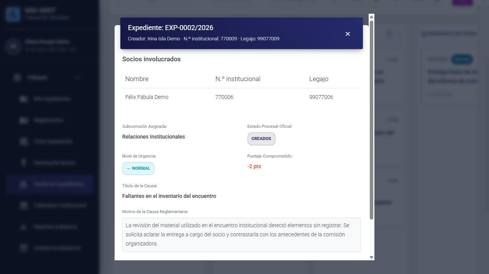

# Portabilidad y presentación — PR #54

**Alcance:** RF77-18–21, CA77-13–14 y TS77.60–64 de la [spec 005](../../specs/005-mysql-seed-g57-g60/spec.md). Autorización del usuario del 12/10/2026. Base de esta ampliación: `0f2080c3aa222dae6f18eb9468389d35c27e77b2`. La PR continúa hacia `main`, sin merge.

## Problemas corregidos

- El inicio de los contenedores no preparaba ni cargaba el catálogo. Ahora `demo-setup` ejecuta ambos comandos protegidos y la SPA espera su terminación correcta.
- Mis Expedientes dependía de la colección en memoria del tablero y de coincidencias de nombre. Ahora consulta la colección propia del servidor, incluidos los participantes secundarios.
- La sesión en memoria podía sobrevivir al logout de otra pestaña. Ahora se cancelan las consultas, se descartan respuestas anteriores y se vuelve al login. Una cuenta sin identidad institucional muestra puntos no disponibles.
- Los títulos y motivos del catálogo contenían claves técnicas. Ahora hay 17 textos de presentación para causas y solicitudes; el detalle identifica al creador y a todos los involucrados.
- Solicitudes creadas mezclaba estado y urgencia en una celda. Ahora son columnas distintas. El foco inicial del detalle queda en el cierre de la cabecera y no oculta al creador.

## Instalación desde cero

Se copió exclusivamente el contenido versionado y los archivos nuevos de esta ampliación a un checkout de prueba sin `.git`, `.env`, dependencias del host ni helpers de esta sesión. Las imágenes se construyeron con los Dockerfiles del repositorio; MySQL comenzó con volumen vacío y cero tablas. Se modificaron sólo nombres de recursos, puertos loopback y origen CORS para coexistir con la demo del usuario: 3308/8003/4203.

Antes del inicio válido, una ejecución con adaptador incorrecto rechazó la preparación: cero tablas conservadas, `demo-setup` con salida 1 y frontend creado pero sin arrancar. Con la configuración correcta, el setup finalizó con salida 0 antes de iniciarse Angular.

| Comprobación | Copia limpia | Demo existente |
|---|---:|---:|
| Socios institucionales | 20 | 20 |
| Expedientes del catálogo | 15 | 15 |
| Expedientes adicionales de UAT | 0 | 1 |
| Solicitudes T01 del catálogo | 4 | 4 |
| Solicitudes adicionales de UAT | 0 | 1 |
| Asientos / respaldos resolutivos | 12 / 11 | 12 / 11 |
| Tablas | 52 | 52 |
| Referencias de propiedad después de actualizar | 272 | 287 |
| Último número operativo de 2026 | 15 | 16 |

Los quince expedientes del catálogo se distribuyen en **3 creados, 2 justificando, 3 en revisión, 1 pendiente de firma, 2 pendientes de envío y 4 emitidos**. La causa de UAT agrega un creado en la instalación existente. Estas altas locales no se exportan como fixtures.

La repetición del arranque dejó idénticas las huellas de las 52 tablas y la secuencia. El comando para cualquier otra máquina está en la [guía de carga](GUIA_CARGA_DEMO_SCRUM-77.md#inicio-recomendado-desde-una-copia-limpia); no requiere scripts temporales de esta verificación.

## Conservación de la demo existente

La actualización protegida reconoció quince motivos técnicos originales. Modificó solamente ese campo de las causas owned y agregó quince eventos de auditoría y sus quince referencias. Todos los demás campos de las dieciséis causas, la UAT, las personas, las cuentas, las T01, sus snapshots, las resoluciones y el libro mayor quedaron idénticos. No hubo cambios de esquema ni de numeración. Una segunda ejecución dejó las 52 tablas completas sin cambios.

Las T01 heredadas no se reescribieron: su consulta presenta los títulos aprobados sólo cuando cada campo coincide con el placeholder original y su propiedad está acreditada. Los textos editados por el usuario y la evidencia formal se conservan. Coincidir en un título humano con otra causa no modifica la propiedad de una fila ya registrada.

[Resumen de conservación](evidencias/pr54/conservacion-portabilidad.json).

## HTTP y navegador

Se ejecutaron **227 controles HTTP reales en cada entorno**, contrastados con MySQL: 183 respuestas 200, 7 rechazos 401, 16 ausencias de identidad 404 y 21 denegaciones 403 esperadas. Se verificaron los veinte historiales, las nueve cuentas institucionales habilitadas, las cinco referencias locales, los involucrados de las colecciones propias y el creador/título/motivo de los quince detalles. Las consultas no cambiaron ninguna de las 52 tablas.

- [Instalación limpia](evidencias/pr54/http-instalacion-limpia.json).
- [Actualización conservando UAT](evidencias/pr54/http-actualizacion-local.json).
- [Verificador reproducible](evidencias/scrum77-ampliacion/verificar_http.py).

En navegador se comprobó login directo a Mis Expedientes sin visitar el tablero, recarga autenticada, saldo +2 de 99077001, cero de 99077005, -1 del Junior 99077018 y puntos no disponibles de la cuenta clásica 74907, sin un aviso de autenticación engañoso. El logout desde una segunda pestaña limpió datos/detalles y llevó ambas al login.

Solicitudes creadas presentó las dos columnas y los títulos aprobados. El tablero presentó quince títulos breves y los seis estados. En EXP-0002/2026, el creador Irina Isla Demo se distinguió del involucrado Félix Fábula Demo; el caso compartido identificó a ambos participantes. Los números institucionales y legajos aparecen etiquetados por separado.

Se comprobó el detalle a 1280×720 y 360×800: cabecera visible desde la apertura, cierre superior enfocado, Escape y foco devuelto a la tarjeta. La página móvil tuvo ancho y scrollWidth de 360 px; la tabla de participantes conserva su desplazamiento interno. Se restauró el viewport habitual al finalizar.

Sólo en la instalación desechable se presentó y corrigió un T03 durante el plazo abierto, usando el POST existente. Tras recargar, el texto corregido persistió y el saldo siguió en +2. Se generó un descargo con dos eventos de auditoría y se mantuvieron resolución, libro mayor y numeración. La demo del usuario no recibió ese descargo.

[Solicitudes en escritorio](evidencias/pr54/portability-solicitudes-desktop.jpg) · [Detalle móvil](evidencias/pr54/portability-detalle-mobile.jpg).

## Pruebas y revisión

TDD acreditó fallos antes de implementar arranque protegido, consulta propia, sesiones, columnas, títulos, foco, presentación y preservación. La auditoría agregó casos de identidad no positiva, motivo multipárrafo, anexos editados, etiquetas humanas coincidentes y alteración de la auditoría. La primera regresión encontró una diferencia entre `ValidationError` y el `CommandError` esperado al rechazar una colisión; se restauró el contrato y el test anterior permaneció intacto.

- Backend focal final: 27 pruebas verdes, 138,95 s, incluidos estados avanzados, actualización, metadatos y HTTP.
- Backend completo sobre MySQL con el usuario restringido de CI: **1173 pruebas verdes**, cero errores y cero omisiones, 788,56 s. Incluye los diez controles Compose con configuración real saneada y hashes fuente. Cobertura **94,11 %** en los 27 módulos de negocio declarados, 3041 sentencias y 179 sin cubrir.
- Frontend final: 402 pruebas verdes, cero errores; build `01b8629428101b11` correcto, 9589 ms.
- Ruff global y formato de 174 archivos, `manage.py check` y ausencia de nuevas migraciones: correctos.
- Auditoría independiente de código, configuración, permisos y conservación: aprobada sin hallazgos abiertos.
- Publicación y CI del nuevo commit: pendientes de su resultado final.

Persisten los avisos heredados de Bootstrap y dos archivos TypeScript sin uso. El lint frontend mantiene el builder TSLint heredado ausente; Karma, compilación y controles backend se verifican por separado. No se agregaron dependencias ni cambios de esquema.

Se contrastaron las Notas del PO al inicio, durante el desarrollo y al finalizar: múltiples involucrados, descargo editable durante el plazo, puntos sólo respaldados y seis estados. Las notas, el seguimiento macro y las reglas de clasificación/facultades permanecen intactos; esta ampliación no cierra otras US fuera de su alcance.
