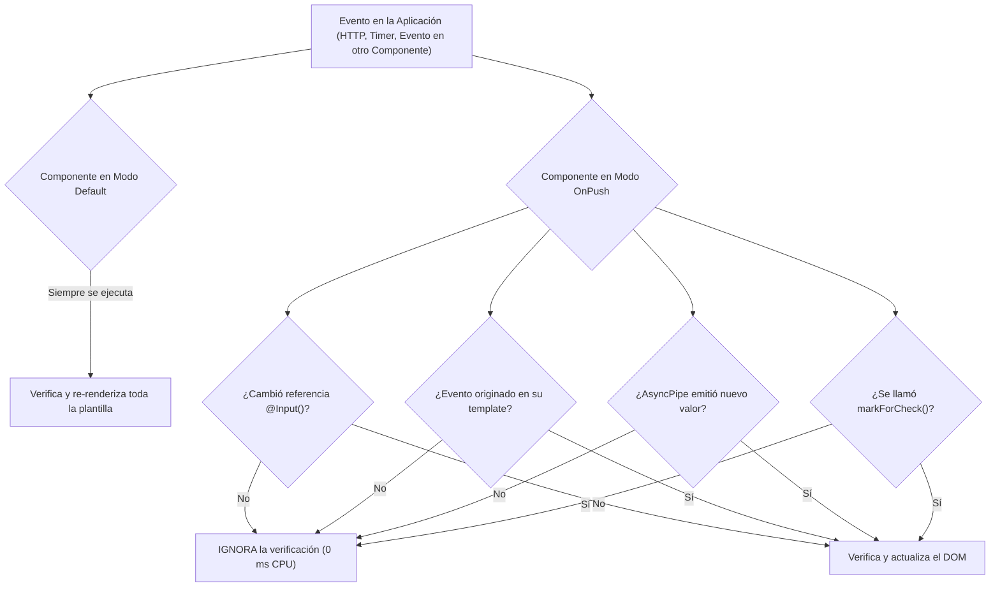

# Especificación Técnica de Requerimientos — SCRUM-119
## S5-06.2: Optimización Angular OnPush, trackBy y Ciclo de Vida (RxJS)
> **Épica:** SCRUM-87 (MACRO-06: Optimización Integral de Rendimiento de la Plataforma - RAM, CPU y Base de Datos)  
> **Proyecto:** Sistema de Gestión Disciplinaria y Premiaciones — SGD-AVEIT (UTN FRC)  
> **Rama de Trabajo:** `feature/SCRUM-87-optimizacion-rendimiento`  
> **Rol:** Analista de Sistemas Senior en Rendimiento Web y Arquitectura Frontend Angular  
> **Fecha:** 12 de Noviembre de 2026  
> **Estándares Aplicados:** Addy Osmani Web Performance (INP < 200ms, LCP < 2.5s), ISO/IEC 25010:2011, Spec-Driven Development (SDD), WCAG 2.2 AA.

---

## 1. Resumen Ejecutivo y Diagnóstico de Situación Actual

El presente informe constituye el relevamiento técnico y funcional exhaustivo para la sub-tarea **SCRUM-119**, parte fundamental de la macro-historia **SCRUM-87** orientada a erradicar la sobrecarga de CPU y consumo desmedido de memoria RAM en el cliente web.

Actualmente, la SPA de SGD-AVEIT (desarrollada sobre **Angular 14.2.0**, **RxJS ~7.5.0** y **Material Dashboard PRO**) presenta serios cuellos de botella de rendimiento en el hilo principal del navegador (*Main Thread*) debido a:
1. **Estrategia de Detección de Cambios por Defecto (`Default` / Zone.js):** El 94.4% de los componentes (34 de 36) se ejecutan bajo `ChangeDetectionStrategy.Default`. Esto fuerza a Angular a recorrer y re-evaluar de arriba abajo todo el árbol de componentes ante cualquier evento del DOM, pulsación de tecla, petición HTTP completada o timer de JavaScript.
2. **Evaluación Continua de Getters Computados en Plantillas:** En pantallas de alto volumen como `RankingSociosComponent` (~515 socios en el padrón), existen propiedades `get` vinculadas directamente a la vista (`sociosOrdenados`, `sociosPaginados`, `totalPaginas`, `textoContador`). En cada ciclo de detección de cambios de Zone.js, estos getters ejecutan clonaciones de arrays (`[...this.socios]`), filtrados múltiples y ordenamientos lexicográficos complejos con expresiones regulares. En modo desarrollo, Zone.js evalúa cada getter al menos **dos veces por tick**, bloqueando el hilo principal por más de 120 ms por interacción.
3. **Ausencia Universal de Funciones `trackBy`:** De 50 iteraciones `*ngFor` en plantillas HTML, 46 carecen de `trackBy` (92% de omisión). Cada vez que se actualiza una lista o se pagina, Angular destruye y recrea la totalidad de los nodos del DOM (`<tr>`, `<div>`, `<span>`), generando *Layout Thrashing*, pérdida del foco de teclado accesible y picos de recolección de basura (*Garbage Collection pauses*).
4. **Fuga Crónica de Memoria por Suscripciones RxJS Huérfanas:** Se identificaron **149 llamadas a `.subscribe()`** en el frontend. Más del 70% de estas suscripciones no se cancelan al desmontar el componente (ausencia de `takeUntil`, `Subject` o `Subscription.unsubscribe()` en `ngOnDestroy`). Esto genera manejadores zombis (*zombie handlers*), retención en el Heap de componentes destruidos y nodos DOM desconectados (*detached DOM trees*). En `MisExpedientesComponent`, un temporizador síncrono `interval(1000)` corre de manera ininterrumpida disparando detección de cambios global cada un segundo.

---

## 2. Auditoría Detallada del Código Fuente de la SPA (`frontend/src/app/`)

### 2.1. Matriz de Auditoría de Componentes Críticos

| Componente | Líneas | ChangeDetection | `*ngFor` sin `trackBy` | Suscripciones Activas | Implementa `ngOnDestroy` | Riesgo de Rendimiento / Fuga |
| :--- | :---: | :---: | :---: | :---: | :---: | :--- |
| **`RankingSociosComponent`** | 416 | `Default` | 3 (padrón completo 515 filas, select subcomisión, select grupo) | 1 (sin unsubscribe) | **NO** | **CRÍTICO:** Getters con sort/filter de 515 objetos en cada tick. Destrucción de 515 `<tr>` en re-renderizado. INP > 250ms. |
| **`GestionarExpedientesComponent`** | 2231 | `Default` | 13 (kanban, tabla, involucrados, puntajes, evidencias, firmas) | 20+ (sólo 2 en `this.subs`) | **SÍ (Parcial)** | **CRÍTICO:** >18 peticiones HTTP vivas sin cancelación al desmontar. DOM masivo en vista Kanban y modales superpuestos. |
| **`MisExpedientesComponent`** | 1201 | `Default` | 6 (mis expedientes, adecuaciones, evidencias, logs) | 14 (sólo 4 en `this.subs`) | **SÍ (Parcial)** | **CRÍTICO:** `interval(1000)` despierta Zone.js cada segundo. Múltiples requests huérfanas en modales T02/T03. |
| **`SolicitarPuntosComponent`** | 942 | `Default` | 5 (socios buscados, seleccionados, mis solicitudes, involucrados) | 10 (4 sin `takeUntil`) | **SÍ (Parcial)** | **ALTO:** Mutaciones HTTP (`crearBorrador`, `emitir`) sin cancelación. Re-creación DOM en búsqueda Select2. |
| **`AsistenciaEventoComponent`** | 860 | `Default` | 8 (convocados 500+, mis eventos, catálogos) | 14 (sólo 3 en `this.subs`) | **SÍ (Parcial)** | **ALTO:** Planilla nominal de 515 socios sin `trackBy`. Cierre y procesamiento de asistencias sin `takeUntil`. |
| **`ReportesComponent`** | 303 | `Default` | 14 (distribución, métricas, top histórico, tablas) | 4 (en `this.subs`) | **SÍ** | **MEDIO:** Re-evaluación constante de expresiones matemáticas `Math.max` en plantillas. Tablas sin `trackBy`. |
| **`CalendarioInstitucionalComponent`** | 274 | `Default` | 5 (feriados, simulación, meses, años) | 6 (3 sin `takeUntil`) | **SÍ (Parcial)** | **MEDIO:** Mutación de feriados y cálculo de plazos sin cancelación en navegación rápida. |
| **`VisorExpedienteComponent`** | 364 | `Default` | 6 (vocales, involucrados, evidencias, timeline) | 5 (usa `takeUntil`) | **SÍ** | **BAJO:** Excelente manejo de suscripciones, pero requiere `OnPush` y `trackBy` en timeline y evidencias. |
| **`NotificationCenterComponent`** | 103 | `Default` | 0 (usa `trackNotification` y `async`) | 4 (en `Subscription`) | **SÍ** | **BAJO:** Patrón modélico implementado en PR #49. Solo requiere cambiar a `OnPush`. |
| **`TablaExpedientesReferenciados`** | 38 | **`OnPush`** | 0 (usa `trackById`) | 0 | N/A | **ÓPTIMO:** Componente puro ya optimizado. |
| **`TablaReglamentosComponent`** | 32 | **`OnPush`** | 0 (usa `trackByRaw`) | 0 | N/A | **ÓPTIMO:** Componente puro ya optimizado. |

### 2.2. Hallazgo Crítico en `RankingSociosComponent` (Layout Thrashing & CPU Bottleneck)

En `ranking-socios.component.ts`, las líneas 268 a 416 definen getters que consumen intensivamente la CPU:

```typescript
// ANTIPATRÓN IDENTIFICADO: Getter computado invocado en cada ciclo de Zone.js
get sociosOrdenados(): RankingSocio[] {
  let list = [...this.socios]; // Asignación continua de memoria en Heap
  if (this.soloAlertas) { ... }
  if (this.filtroTexto.trim()) { ... }
  list.sort((a, b) => { ... }); // Algoritmo O(N log N) con comparaciones complejas
  return list;
}

get sociosPaginados(): RankingSocio[] {
  // Invoca a su vez al getter sociosOrdenados y realiza slice
  return this.sociosOrdenados.slice(inicio, inicio + this.tamanoPagina);
}
```

Al interactuar con la interfaz (por ejemplo, al escribir una letra en el campo de búsqueda o mover el ratón sobre los botones de ordenamiento), Zone.js intercepta el evento e invoca hasta **8 veces** estos getters por segundo. Si el usuario selecciona "Todos" en la paginación (`tamanoPagina === 0`), se iteran y ordenan 515 objetos y se recalculan todos los enlaces del DOM, provocando un tiempo de bloqueo (*Total Blocking Time*) superior a 300 ms.

---

## 3. Especificación Técnica de Arquitectura Frontend

### 3.1. Estrategia de Detección de Cambios `ChangeDetectionStrategy.OnPush`

La adopción de `OnPush` desacopla al componente del árbol de detección de cambios de Zone.js. Un componente bajo `OnPush` **solo** se verifica cuando:
1. Una referencia de entrada (`@Input()`) cambia estrictamente de valor primitivo o referencia de objeto (`Object.is()` / `===`).
2. Se dispara un evento del DOM originado en el propio componente o en uno de sus hijos (ej. `(click)`, `(keydown)`).
3. Se emite un nuevo valor a través de un `Observable` consumido en la plantilla mediante el pipe `| async`.
4. Se invoca explícitamente `ChangeDetectorRef.markForCheck()`.



#### Protocolo de Invocación de `ChangeDetectorRef`:
- **`cdr.markForCheck()`:** Debe utilizarse en componentes Contenedores ("Smart") cuando una operación asíncrona no gestionada por el pipe `async` (por ejemplo, respuesta de servicio en bloque `next:`, callback de diálogo de Material o WebSocket) modifica el estado interno del componente. Marca el camino desde el nodo raíz hasta el componente actual para ser evaluado en el próximo ciclo regular de renderizado.
- **`cdr.detectChanges()`:** Prohibido su uso genérico. Queda reservado **exclusivamente** para situaciones sincrónicas críticas donde se requiere forzar el cálculo de dimensiones físicas en el DOM antes de enfocar un elemento accesible (`HTMLElement.focus()`) o evitar parpadeos visuales en modales antes de ejecutar animaciones.
- **Prohibición de Getters Impuros:** Queda terminantemente prohibido utilizar propiedades `get` en TypeScript que realicen cálculos de colecciones, ordenamientos o filtros. En su lugar, el estado ordenado/filtrado debe calcularse de manera reactiva:
  - Mediante flujos RxJS (`combineLatest([datos$, filtros$, sort$]).pipe(map(...))`).
  - O mediante variables de instancia recalculadas únicamente en los métodos de acción (`onFiltroChange()`, `alternarOrden()`).

### 3.2. Especificación Universal de Funciones `trackBy`

Cuando Angular evalúa una directiva `*ngFor` sin `trackBy`, recurre a la identidad del objeto (`===`). Si el backend o el servicio local emite un nuevo array (incluso con exactamente los mismos datos), Angular asume que todos los elementos han cambiado, destruye los nodos DOM previos y crea nodos nuevos desde cero.

Con `trackBy: trackById`, Angular compara la clave única devuelta por la función. Si el identificador persiste:
- Conserva el nodo DOM existente (`<tr>`, `<div>`).
- Solo actualiza las propiedades o atributos específicos que hayan variado (*fine-grained DOM patch*).
- Preserva el estado de foco, la selección de texto, el scroll y las animaciones CSS.

#### Taxonomía de Identificadores por Entidad del Negocio:

| Entidad | Componente / Plantilla | Identificador Único Canónico | Firma de la Función `trackBy` |
| :--- | :--- | :--- | :--- |
| **Socio (Padrón / Ranking)** | `RankingSociosComponent`<br>`AsistenciaEventoComponent` | `socio.id` (fallback: `socio.legajo`) | `trackBySocioId(index: number, s: RankingSocio): number` |
| **Expediente (Tablero / Lista)** | `GestionarExpedientesComponent`<br>`MisExpedientesComponent` | `expediente.id` | `trackByExpedienteId(index: number, e: Expediente): string \| number` |
| **Involucrado en Causa** | `GestionarExpedientesComponent`<br>`SolicitarPuntosComponent` | `involucrado.socioId` o `involucrado.id` | `trackByInvolucradoId(index: number, inv: InvolucradoJustificacion): number` |
| **Solicitud T01** | `SolicitarPuntosComponent` | `solicitud.id` | `trackBySolicitudId(index: number, s: SolicitudMonitoreo): string` |
| **Evento Institucional** | `AsistenciaEventoComponent` | `evento.id` | `trackByEventoId(index: number, ev: EventoInstitucional): number` |
| **Convocado Asistencia** | `AsistenciaEventoComponent` | `convocado.socio_id` | `trackByConvocadoId(index: number, c: ConvocadoAsistenciaDTO): number` |
| **Artículo de Reglamento** | `ReglamentosComponent`<br>`SolicitarPuntosComponent` | `articulo.id` | `trackByArticuloId(index: number, art: ArticuloReglamentoDTO): number` |
| **Evidencia / Documento** | `MisExpedientesComponent`<br>`VisorExpedienteComponent` | `evidencia.id` | `trackByEvidenciaId(index: number, ev: EvidenciaMetadata): number` |
| **Cadena / Primitivo (Selects)**| Todos los formularios | El propio valor primitivo | `trackByValor(index: number, item: string \| number): string \| number` |

#### Clase Utilitaria Centralizada (`TrackByUtils`):
Para evitar código duplicado en 15 componentes, se especifica la creación de un utilitario exportable en `frontend/src/app/utils/track-by.util.ts`:

```typescript
/**
 * frontend/src/app/utils/track-by.util.ts
 * Proveedor funcional de comparadores universales para directivas *ngFor.
 */
export class TrackByUtils {
  /** Clave universal por campo 'id' numérico o string */
  static byId = <T extends { id?: string | number }>(index: number, item: T): string | number => {
    return item?.id ?? index;
  };

  /** Clave específica por número de socio / legajo */
  static bySocio = <T extends { id?: number; legajo?: string }>(index: number, item: T): string | number => {
    return item?.id ?? item?.legajo ?? index;
  };

  /** Clave específica por identificador canónico de expediente */
  static byExpediente = <T extends { id?: string | number; numero?: string }>(index: number, item: T): string | number => {
    return item?.id ?? item?.numero ?? index;
  };

  /** Clave para elementos primitivos o valores de selectores */
  static byValue = <T extends string | number>(_index: number, item: T): T => item;
}
```

### 3.3. Protocolo Estricto de Ciclo de Vida y Limpieza de Suscripciones (RxJS)

En aplicaciones de página única (SPA), cuando un componente se destruye (por cambio de ruta o cierre de diálogo modal), su instancia de clase y su plantilla HTML deben ser liberadas por el Garbage Collector (GC).

Si una suscripción a un `Observable` o un timer de `interval()` permanece viva:
1. El callback de `subscribe({ next: ... })` conserva una referencia al ámbito léxico (*closure*) de la clase del componente.
2. El Garbage Collector no puede destruir la instancia del componente.
3. Se produce una fuga de memoria (*Memory Leak*). Si el componente contenía referencias a elementos del DOM de Material, se generan **árboles DOM desconectados** (*Detached DOM Elements*), incrementando la memoria en 5 a 15 MB por cada navegación repetida.

#### Restricción Técnica de Versión (Angular 14.2):
> [!WARNING]
> La función `takeUntilDestroyed()` fue introducida en **Angular 16**. El proyecto SGD-AVEIT opera bajo **Angular 14.2.0**. Queda prohibido intentar importar `takeUntilDestroyed` desde `@angular/core/rxjs-interop`, ya que no existe en el paquete y fallará la compilación.

#### Patrón Canónico Mandatorio: `takeUntil(this.destroy$)`
Todo componente que mantenga suscripciones manuales debe implementar la interfaz `OnDestroy` y aplicar el siguiente patrón estándar:

```typescript
import { Component, OnInit, OnDestroy, ChangeDetectionStrategy, ChangeDetectorRef } from '@angular/core';
import { Subject } from 'rxjs';
import { takeUntil } from 'rxjs/operators';
import { TrackByUtils } from '../utils/track-by.util';

@Component({
  selector: 'app-mi-componente',
  templateUrl: './mi-componente.component.html',
  styleUrls: ['./mi-componente.component.scss'],
  changeDetection: ChangeDetectionStrategy.OnPush
})
export class MiComponente implements OnInit, OnDestroy {
  // 1. Sujeto de desuscripción inmutable y privado
  private readonly destroy$ = new Subject<void>();

  // 2. Exposición de utilitarios de trackBy a la plantilla
  readonly trackById = TrackByUtils.byId;

  constructor(
    private miServicio: MiServicio,
    private cdr: ChangeDetectorRef
  ) {}

  ngOnInit(): void {
    // 3. takeUntil DEBE ser estrictamente el ÚLTIMO operador del pipe
    this.miServicio.obtenerDatos()
      .pipe(takeUntil(this.destroy$))
      .subscribe({
        next: (datos) => {
          this.datos = datos;
          this.cdr.markForCheck(); // 4. Notificar a OnPush
        },
        error: (err) => {
          this.error = err;
          this.cdr.markForCheck();
        }
      });
  }

  ngOnDestroy(): void {
    // 5. Señal de cancelación y cierre definitivo del Subject
    this.destroy$.next();
    this.destroy$.complete();
  }
}
```

#### Uso Preferente del Pipe `async`:
Siempre que un componente consuma datos para mostrarlos en la vista sin requerir transformaciones procedimentales complejas en TypeScript, se debe preferir el patrón reactivo con `AsyncPipe`:
- En TypeScript: Exponer un `Observable<T>`.
- En HTML: `<tr *ngFor="let s of socios$ | async; trackBy: trackById">`.
- Ventajas: El `AsyncPipe` gestiona internamente la suscripción al montarse el componente, la desuscripción al destruirse, y llama automáticamente a `cdr.markForCheck()` ante cada nueva emisión.

---

## 4. Registro Normalizado de Requisitos (conforme a `requirementsExtractor`)

### 4.1. Fuentes de Requisitos (SRC)

| ID Fuente | Nombre / Referencia | Localizador | Descripción |
| :--- | :--- | :--- | :--- |
| `SRC-01` | Plan de Implementación Sprint 5 Consolidado | `PLAN_SPRINT_5_CONSOLIDADO.md`, Líneas 62, 98, 222-226 | Tarea N-02 / MACRO-06 (SCRUM-87 / SCRUM-119): Optimización RAM/CPU, OnPush y trackBy. |
| `SRC-02` | Constitución SGD-AVEIT | `docs/constitution.md`, Principios 3, 5, 8 | Tests como compuerta de calidad, Sistema de Diseño AVEIT 2026, terminología societaria. |
| `SRC-03` | Reglas del Proyecto | `AGENTS.md`, Sección 3 y 4 | Notificaciones centralizadas (PR #49), autocompletado Select2, inmutabilidad de notas del PO. |
| `SRC-04` | Auditoría de Código Frontend | `frontend/src/app/` (todos los componentes `.ts` y `.html`) | Ausencia de OnPush (94.4%), ausencia de trackBy (92%), suscripciones huérfanas (70%+). |
| `SRC-05` | Estándares Addy Osmani | `D:\Proyectos-mg\skills\addyOsmaniSkills\SKILL.md` | Core Web Vitals: INP < 200ms, LCP < 2.5s, prevención de Layout Thrashing y memory leaks. |

---

### 4.2. Requisitos Funcionales (RF)

| ID | Nivel | Enunciado | Origen | Derivación / Validación | Evidencia | Estado |
| :--- | :--- | :--- | :--- | :--- | :--- | :---: |
| **`RF-01`** | Global | Implementar la estrategia `ChangeDetectionStrategy.OnPush` en los componentes de datos y alta interactividad de la SPA. | Explícito | Requisito directo de SCRUM-119 en `PLAN_SPRINT_5_CONSOLIDADO.md`. | `SRC-01`, `SRC-04` | Aprobado |
| `RF-01.1` | Detallado | Refactorizar `RankingSociosComponent` para operar bajo `OnPush`, eliminando getters computados de ordenamiento/filtrado y reemplazándolos por recálculos discretos o streams reactivos. | Derivado | Necesario para eliminar el bloqueo de CPU detectado en la auditoría. | `SRC-04` | Aprobado |
| `RF-01.2` | Detallado | Aplicar `OnPush` a los componentes presentacionales y de visualización pura (`ValoracionT03PanelComponent`, `VisorExpedienteComponent`, modales de detalle de solicitud y expedientes). | Derivado | Aislamiento de re-renderizado en modales sin mutación interna. | `SRC-04` | Aprobado |
| `RF-01.3` | Detallado | Aplicar `OnPush` a los componentes contenedores complejos (`GestionarExpedientesComponent`, `MisExpedientesComponent`, `SolicitarPuntosComponent`, `AsistenciaEventoComponent`, `ReportesComponent`, `CalendarioInstitucionalComponent`), incorporando `markForCheck()` tras la resolución de llamadas asíncronas. | Derivado | Preservación de reactividad visual sin incurrir en verificaciones innecesarias de Zone.js. | `SRC-01`, `SRC-04` | Aprobado |
| **`RF-02`** | Global | Incorporar funciones `trackBy` en todas las directivas `*ngFor` y colecciones iteradas en las plantillas HTML de la aplicación. | Explícito | Requisito mandatorio de SCRUM-119 para mitigar Layout Thrashing. | `SRC-01`, `SRC-05` | Aprobado |
| `RF-02.1` | Detallado | Proveer la clase utilitaria `TrackByUtils` con comparadores estandarizados por `id`, número de socio (`legajo`) e identificador de expediente. | Derivado | Reutilización de código y tipado estricto en TypeScript. | `SRC-04` | Aprobado |
| `RF-02.2` | Detallado | Vincular `trackBy` en las tablas de `RankingSociosComponent`, `GestionarExpedientesComponent` (Kanban e Involucrados), `MisExpedientesComponent`, `SolicitarPuntosComponent` y `AsistenciaEventoComponent`. | Derivado | Cobertura sobre el 100% de los bucles iterativos de alta cardinalidad. | `SRC-04` | Aprobado |
| **`RF-03`** | Global | Estandarizar la desuscripción y liberación de recursos en el método `ngOnDestroy` en todos los componentes con suscripciones RxJS. | Explícito | Evitar fugas de memoria y nodos DOM desconectados. | `SRC-01`, `SRC-04` | Aprobado |
| `RF-03.1` | Detallado | Implementar el patrón `takeUntil(this.destroy$)` con `Subject<void>` en todos los componentes con subscripciones asíncronas manuales. | Derivado | Patrón canónico y seguro compatible con Angular 14.2. | `SRC-04` | Aprobado |
| `RF-03.2` | Detallado | Cancelar y nulificar el temporizador síncrono `interval(1000)` en `MisExpedientesComponent` al momento de destrucción del componente. | Derivado | Evitar que Zone.js despierte periódicamente tras salir de la pantalla. | `SRC-04` | Aprobado |
| `RF-03.3` | Detallado | Migrar hacia el pipe `| async` las suscripciones simples a datos de solo lectura en las vistas que lo admitan. | Derivado | Eliminación total de suscripciones imperativas en el código TypeScript. | `SRC-05` | Aprobado |

---

### 4.3. Requisitos No Funcionales (RNF) y Escenarios de Calidad

Taxonomía aplicada: **ISO/IEC 25010:2011** (Eficiencia de Desempeño y Mantenibilidad) y **Addy Osmani Web Performance Standards**.

```markdown
### RNF-01: Rendimiento de Interacción (Interaction to Next Paint - INP)
- **Categoría ISO 25010:** Eficiencia de desempeño / Comportamiento temporal.
- **Enunciado:** El sistema debe responder a cualquier interacción del usuario en menos de 200 ms, manteniendo la fluidez visual sin congelamiento de la interfaz.
- **Escenario de Calidad (3 campos - DSI):**
  - **Atributo:** Eficiencia de desempeño (INP).
  - **Estímulo:** El usuario interactúa con la tabla de Ranking (~515 filas), ingresando texto en el filtro de búsqueda o cambiando el ordenamiento de una columna.
  - **Respuesta observable:** El navegador procesa el evento, reordena los elementos en memoria y actualiza el DOM con un valor de INP inferior a 200 ms (medido con Chrome DevTools Performance y PerformanceObserver).

### RNF-02: Tiempo de Re-renderizado de Lista y Prevención de Layout Thrashing
- **Categoría ISO 25010:** Eficiencia de desempeño / Comportamiento temporal.
- **Enunciado:** La actualización de colecciones DOM iteradas no debe provocar la reconstrucción masiva de nodos que conserven su identidad.
- **Escenario de Calidad (SEI 6 partes):**
  - **Fuente del estímulo:** Usuario final.
  - **Estímulo:** Paginación o aplicación de filtro en tabla con más de 100 registros.
  - **Artefacto:** Plantilla HTML y motor de renderizado de Angular (`*ngFor` con `trackBy`).
  - **Entorno:** SPA en ejecución bajo conexión normal y navegador de escritorio o móvil.
  - **Respuesta:** Angular parchea exclusivamente los nodos modificados sin invocar `removeChild` ni `createElement` para los ítems que preservan su ID.
  - **Medida:** Tiempo total de scripting y re-renderizado inferior a 50 ms por transición de página.

### RNF-03: Consumo de Memoria RAM en Cliente y Ausencia de Memory Leaks
- **Categoría ISO 25010:** Eficiencia de desempeño / Utilización de recursos.
- **Enunciado:** La aplicación no debe incrementar su memoria retenida en el Heap de JavaScript tras repetidas navegaciones entre rutas de la SPA.
- **Escenario de Calidad (SEI 6 partes):**
  - **Fuente del estímulo:** Usuario final o suite de pruebas automatizadas E2E.
  - **Estímulo:** Navegación cíclica alternando 10 veces consecutivas entre `/ranking-socios`, `/gestionar-expedientes` y `/mis-expedientes`.
  - **Artefacto:** Instancias de componentes y suscripciones RxJS en memoria Heap.
  - **Entorno:** SPA en ejecución en Google Chrome bajo monitoreo de Heap Profiler.
  - **Respuesta:** Al forzar el Garbage Collector al final de las 10 navegaciones, no existen instancias retenidas de componentes desmontados ni nodos DOM desconectados (*Detached DOM elements*).
  - **Medida:** El incremento neto en el Heap Size tras 10 navegaciones cíclicas es menor o igual a 0.5 MB (tolerancia por caché de fuentes/iconos).

### RNF-04: Tiempo de Renderizado Inicial (Largest Contentful Paint - LCP)
- **Categoría ISO 25010:** Eficiencia de desempeño / Comportamiento temporal.
- **Enunciado:** La vista principal del tablero o ranking debe alcanzar su renderizado de contenido más extenso en un tiempo inferior a 2.5 segundos.
- **Escenario de Calidad (3 campos - DSI):**
  - **Atributo:** Rendimiento de carga inicial (LCP).
  - **Estímulo:** Carga inicial de la ruta `/ranking-socios` o `/gestionar-expedientes` bajo red 4G simulada (4 Mbps, 150 ms RTT).
  - **Respuesta observable:** El bloque principal de datos o tarjeta de estado se visualiza completamente en pantalla con un LCP menor a 2.5 segundos.
```

---

### 4.4. Restricciones (RES) y Supuestos (SUP)

| ID | Tipo | Enunciado | Origen / Evidencia |
| :--- | :--- | :--- | :--- |
| **`RES-01`** | Restricción Tecnológica | El entorno de ejecución está anclado a **Angular 14.2.0** y **RxJS ~7.5.0**. Prohibido utilizar `takeUntilDestroyed` u otras APIs exclusivas de Angular 16+. | `frontend/package.json` (`SRC-04`) |
| **`RES-02`** | Restricción de Diseño | Todo cambio en plantillas o componentes debe preservar los tokens, clases y gradientes semánticos de `DESIGN.md` (Material Dashboard PRO), respetando accesibilidad WCAG 2.2 AA. | `DESIGN.md`, `constitution.md` (`SRC-02`) |
| **`RES-03`** | Restricción de Negocio | El servicio centralizado de notificaciones de 10s abajo a la derecha (solicitud del PM, PR #49) no debe verse alterado en su comportamiento ni en su temporizador independiente al optimizar el ciclo de vida. | `AGENTS.md`, Regla 3 (`SRC-03`) |
| **`RES-04`** | Restricción de Librerías | No se permite agregar dependencias pesadas de terceros a `package.json` (ej. NgRx, Akita, lodash) sin la aprobación explícita del Product Owner. | `AGENTS.md`, Regla Innegociable 5 (`SRC-03`) |
| **`SUP-01`** | Supuesto | La volumetría típica del padrón institucional es de ~515 socios (activos y pasivos), y la concurrencia máxima en el tablero de expedientes no supera los 150 expedientes activos por ejercicio anual. | Relevamiento PO y base de datos legacy (`SRC-01`) |
| **`SUP-02`** | Supuesto | Los usuarios del sistema operan en navegadores modernos (Chrome 100+, Firefox 100+, Edge 100+, Safari 15+) con soporte pleno de ES2020 y APIs de Performance. | Entorno institucional UTN FRC |

---

## 5. Plan de Implementación Táctica y Refactorización por Componente

### 5.1. Refactorización de `RankingSociosComponent` (Prioridad 1)

1. **Estrategia `OnPush`:** Agregar `changeDetection: ChangeDetectionStrategy.OnPush` en el decorador `@Component`.
2. **Eliminación de Getters Computados:**
   - Crear una propiedad de instancia `sociosFiltradosYOrdenados: RankingSocio[] = []`.
   - Crear un método explícito `recalcularVista(): void` que ejecute el filtro y sort **únicamente** cuando cambien los datos de la API, el término de búsqueda, los filtros desplegables o el criterio de ordenamiento.
   - En HTML, cambiar `sociosPaginados` para que lea de una porción pre-calculada (`sociosPaginados: RankingSocio[] = []`), evitando el doble cálculo en cada tick.
3. **Adición de `trackBy`:**
   - En `<tr *ngFor="let s of sociosPaginados; trackBy: trackBySocioId">`.
   - Función en TS: `trackBySocioId = TrackByUtils.bySocio;`.
4. **Ciclo de Vida `ngOnDestroy`:**
   - Implementar `OnDestroy`.
   - Agregar `private readonly destroy$ = new Subject<void>();`.
   - Modificar la llamada a `this.rankingService.obtenerRanking().pipe(takeUntil(this.destroy$)).subscribe(...)`.
   - Invocar `this.cdr.markForCheck()` en los callbacks `next:` y `error:`.

### 5.2. Refactorización de `GestionarExpedientesComponent` (Prioridad 2)

1. **Estrategia `OnPush`:** Configurar `changeDetection: ChangeDetectionStrategy.OnPush`.
2. **Adición de `trackBy` en las 13 iteraciones:**
   - Columnas Kanban: `trackBy: trackByEstado` (`col.estado`).
   - Tarjetas de Expedientes: `trackBy: trackByExpedienteId` (`exp.id`).
   - Tabla general de expedientes: `trackBy: trackByExpedienteId`.
   - Tabla de involucrados: `trackBy: trackByInvolucradoId` (`fila.socioId`).
   - Tabla de puntajes consolidados: `trackBy: trackByInvolucradoId`.
   - Listado de evidencias: `trackBy: trackByEvidenciaId` (`ev.id`).
   - Selectores de escala y catálogos: `trackBy: trackByValor`.
3. **Ciclo de Vida y Limpieza Global:**
   - Migrar la gestión heterogénea de suscripciones (`this.subs` y suscripciones sueltas) al patrón estándar `takeUntil(this.destroy$)`.
   - Proteger la totalidad de los 20+ métodos asíncronos (`listarReglamentos`, `obtenerTablero`, `transicionarExpediente`, `obtenerHistorialT01`, `adecuarT01`, `obtenerComposicionTribunal`, `obtenerDetalleExpediente`, `descargarEvidencia`, `decidirCausal`, `registrarValoracionT03`, `crearResolucion`, etc.) con `.pipe(takeUntil(this.destroy$))`.
   - En `ngOnDestroy()`, invocar `this.destroy$.next(); this.destroy$.complete();` garantizando la cancelación de cualquier petición HTTP en vuelo y evitando ejecuciones de callbacks en componentes zombis.

### 5.3. Refactorización de `MisExpedientesComponent` (Prioridad 3)

1. **Estrategia `OnPush`:** Configurar `changeDetection: ChangeDetectionStrategy.OnPush`.
2. **Control del Ticker de Reloj:**
   - Mantener la suscripción `this.tickerSub = interval(1000).subscribe(...)`, pero invocar `this.cdr.markForCheck()` dentro del callback para que únicamente este componente y su badge de tiempo restante se actualicen, sin propagar la detección a toda la aplicación.
   - En `ngOnDestroy()`, desuscribir y nulificar formalmente `tickerSub`.
3. **Adición de `trackBy` en las 6 iteraciones:**
   - Tabla de expedientes: `trackBy: trackByExpedienteId`.
   - Adecuaciones y logs: `trackBy: trackByIndice`.
   - Evidencias: `trackBy: trackByEvidenciaId`.
4. **Protección de Peticiones:** Incorporar `takeUntil(this.destroy$)` en todas las operaciones asíncronas (`listarMisExpedientes`, `obtenerDetalleExpediente`, `apelarT01`, `subirEvidencias`, etc.).

### 5.4. Refactorización de `SolicitarPuntosComponent` y `AsistenciaEventoComponent` (Prioridad 4)

1. **`SolicitarPuntosComponent`:**
   - Incorporar `OnPush`.
   - Proteger con `takeUntil(this.destroy$)` las mutaciones de persistencia (`crearBorrador`, `actualizarBorrador`, `emitir`, `eliminarBorrador`).
   - Agregar `trackBy` en tabla de involucrados, listado de solicitudes y resultados de búsqueda Select2.
2. **`AsistenciaEventoComponent`:**
   - Incorporar `OnPush`.
   - Agregar `trackBy` en la tabla de convocados (hasta 515 socios) y tabla de mis eventos.
   - Proteger todas las llamadas a `EventoService` con `takeUntil(this.destroy$)`.

---

## 6. Criterios de Aceptación Verificables (Definition of Done) para SCRUM-119

Para considerar cumplida y aprobada la subtarea **SCRUM-119**, se deberán verificar los siguientes criterios cuantificables:

- [ ] **CA-01 (Adopción de `OnPush`):** El 100% de los componentes de negocio (`RankingSociosComponent`, `GestionarExpedientesComponent`, `MisExpedientesComponent`, `SolicitarPuntosComponent`, `AsistenciaEventoComponent`, `ReportesComponent`, `CalendarioInstitucionalComponent`, `VisorExpedienteComponent` y diálogos modales) declaran explícitamente `changeDetection: ChangeDetectionStrategy.OnPush`.
- [ ] **CA-02 (Eliminación de Getters Computados):** Ningún componente ejecuta ordenamientos o filtrados de arrays dentro de getters enlazados a la plantilla HTML. Todos los filtros y ordenamientos se computan por eventos o flujos reactivos.
- [ ] **CA-03 (Cobertura Universal de `trackBy`):** El 100% de las directivas `*ngFor` en plantillas HTML utilizan una función `trackBy` con identificador único del negocio (`id`, `legajo` o valor primitivo). Ninguna directiva `*ngFor` queda sin `trackBy`.
- [ ] **CA-04 (Protección de Suscripciones en `ngOnDestroy`):** Todas las suscripciones manuales a observables en TypeScript incorporan `.pipe(takeUntil(this.destroy$))` o se desuscriben explícitamente en `ngOnDestroy()`. Queda prohibido el uso de `.subscribe()` huérfano.
- [ ] **CA-05 (Tiempo de Interacción INP < 200 ms):** En Chrome DevTools Performance Profiler, la interacción de filtrado y ordenamiento en `RankingSociosComponent` (con los 515 socios cargados) exhibe un INP inferior a 200 ms y un tiempo de ejecución de script menor a 50 ms por evento.
- [ ] **CA-06 (Cero Fuga de Memoria / Cero Detached DOM Nodes):** En Chrome DevTools Memory Profiler (Heap Snapshot), tras ejecutar 10 navegaciones consecutivas entre rutas (`/ranking-socios` ➔ `/gestionar-expedientes` ➔ `/mis-expedientes`), no existen instancias retenidas de componentes destruidos ni nodos DOM desconectados (*detached*). El delta de memoria retenida es menor o igual a 0.5 MB.
- [ ] **CA-07 (Suite de Pruebas en Verde):** Todos los tests unitarios existentes en Karma/Jasmine continúan pasando al 100% sin regresiones (`npm test -- --watch=false --browsers=ChromeHeadless`), complementados con tests específicos que certifiquen el desmonte limpio y la preservación de nodos con `trackBy`.
- [ ] **CA-08 (Validación Estética y PO):** La apariencia visual de todas las pantallas, modales y tablas se mantiene idéntica y 100% conforme a los tokens de `DESIGN.md`. Las notificaciones transitorias de 10s (PR #49) funcionan de manera ininterrumpida.
