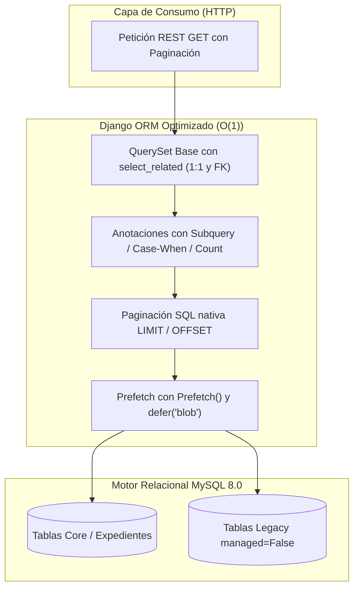

# Relevamiento de Requerimientos — SCRUM-120: Optimización Django ORM y Eliminación de N+1

> **Épica:** SCRUM-87 (MACRO-06: Optimización Integral de Rendimiento de la Plataforma - RAM, CPU y Base de Datos)  
> **Subtarea:** SCRUM-120: S5-06.3 - Optimización Django ORM y eliminación de N+1  
> **Autor:** Analista de Sistemas Senior (Arquitectura de Base de Datos, Persistencia y Optimización Django ORM)  
> **Fecha:** 12 de Noviembre de 2026  
> **Rama:** `feature/SCRUM-87-optimizacion-rendimiento`  
> **Estado:** Relevado y presentado formalmente  

---

## 1. Resumen Ejecutivo y Marco de Referencia

El presente relevamiento técnico constituye la especificación formal de requerimientos para la subtarea **SCRUM-120**, enmarcada en la macro-actividad **MACRO-06 (SCRUM-87)** del Sprint 5 Consolidado de SGD-AVEIT.

La directiva rectora del Product Owner y la disciplina técnica del proyecto exigen una plataforma web con alta eficiencia en el uso de recursos computacionales (RAM, CPU y Base de Datos MySQL 8.0). La auditoría de persistencia revela que múltiples endpoints del backend sufren de degradación de rendimiento producto de:
1. **Patrones de consulta N+1** en serializadores con campos calculados (`SerializerMethodField`), en particular en el cálculo de totales de asistencia en eventos institucionales, fechas de emisión en expedientes referenciados (antecedentes), y datos de autoría procesal.
2. **Saturación innecesaria de memoria RAM** por carga masiva de campos binarios (`BinaryField` de hasta 5 MB en `EvidenciaDescargo`) en consultas de listado que únicamente requieren metadatos descriptivos.
3. **Falta de prefetch acoplado y proyecciones subóptimas** que generan consultas repetitivas al iterar colecciones.

Este documento establece el diagnóstico exhaustivo con evidencia de código, la arquitectura de carga optimizada, las restricciones normativas del esquema legacy de MySQL (Regla Innegociable 6 de `AGENTS.md`), los escenarios de calidad verificables y la suite de pruebas automatizadas con límites estrictos de consultas $O(1)$ mediante `django_assert_num_queries`.

---

## 2. Auditoría Forense de Consultas SQL y Detección de Patrones N+1

La auditoría sobre los módulos `backend/expedientes/`, `backend/ranking/`, `backend/padron/` y `backend/socios/` arrojó los siguientes hallazgos críticos de persistencia:

### 2.1. Hallazgo Crítico 1: N+1 Multiplicativo ($3N$) en Eventos Institucionales (`EventoInstitucionalSerializer`)
- **Ubicación:** `backend/expedientes/serializers/evento_serializers.py`, líneas 330–345.
- **Vista asociada:** `EventoInstitucionalViewSet` (`backend/expedientes/views/evento_views.py:63-67`).
- **Código detectado:**
  ```python
  def get_total_convocados(self, obj: EventoInstitucional) -> int:
      return obj.asistencias.count()

  def get_total_presentes(self, obj: EventoInstitucional) -> int:
      return obj.asistencias.filter(
          estado_asistencia__in=[
              EstadoAsistenciaEventoEnum.PRESENTE,
              EstadoAsistenciaEventoEnum.JUSTIFICADO,
              EstadoAsistenciaEventoEnum.TARDE_LEVE,
              EstadoAsistenciaEventoEnum.TARDE_GRAVE,
          ]
      ).count()

  def get_total_ausentes(self, obj: EventoInstitucional) -> int:
      return obj.asistencias.filter(estado_asistencia=EstadoAsistenciaEventoEnum.AUSENTE).count()
  ```
- **Evidencia y Diagnóstico:**  
  Aunque el ViewSet define `prefetch_related("asistencias__socio")`, la invocación de `.count()` y `.filter(...).count()` sobre el related manager `obj.asistencias` **ignora completamente la caché prefetcheada** y emite sentencias `SELECT COUNT(*)` individuales directamente al motor MySQL.
- **Impacto Cuantitativo:**  
  Para una página estándar de 20 eventos, se emiten:
  - 1 query para listar eventos.
  - 1 query para prefetch de asistencias.
  - **$20 \times 3 = 60$ consultas SQL adicionales** para los conteos.  
  Total: **62 consultas SQL** para responder a 20 registros. Si la lista contiene 50 eventos, se disparan **152 consultas SQL**.

---

### 2.2. Hallazgo Crítico 2: Carga Masiva de Binarios BLOB en RAM (`EvidenciaDescargo.contenido_blob`)
- **Ubicación:** `backend/expedientes/views/__init__.py:137-147` y `backend/expedientes/serializers/__init__.py:605-622`.
- **Modelo:** `EvidenciaDescargo` (`backend/expedientes/models.py:505-507`), donde `contenido_blob = models.BinaryField()`.
- **Código detectado:**
  ```python
  EXPEDIENTE_LIST_PREFETCH = (
      "socios",
      "cambios_estado",
      "descargos__socio",
      "descargos__decisiones_causal__autor",
      "descargos__valoraciones_t03__autor",
      "descargos__valoraciones_t03__antecedentes",
      "evidencias__socio",  # <-- Prefetch no diferido
      "solicitud_t01",
      "resoluciones",
  )
  ```
- **Evidencia y Diagnóstico:**  
  En los endpoints de listado (`ExpedienteCollectionView` en `/api/v1/expedientes/` y `MisExpedientesView` en `/api/v1/expedientes/mis-expedientes/`), el serializador `ExpedienteListSerializer.get_evidencias` delega en `EvidenciaMetadataSerializer`. Dicho serializador expone exclusivamente metadatos (`id`, `nombre_original`, `extension`, `mime_type`, `tamanio_bytes`, `sha256_hash`, `es_vigente`, `created_at`), **sin tocar jamás el campo `contenido_blob`**.  
  Sin embargo, al no usar `defer("contenido_blob")`, el prefetch `"evidencias__socio"` descarga la totalidad de los binarios (hasta 5 MB por archivo) desde MySQL y los retiene en el heap de Python en memoria RAM.
- **Impacto Cuantitativo:**  
  Un listado de 30 expedientes con 2 evidencias adjuntas promedio de 2 MB cada una satura innecesariamente **120 MB de memoria RAM del proceso Django/Gunicorn** por solicitud HTTP, generando presión severa sobre el Garbage Collector y degradando el tiempo de respuesta (TTFB).

---

### 2.3. Hallazgo Crítico 3: N+1 en Resolución de Antecedentes y Emisión (`build_expedientes_referenciados_detalle`)
- **Ubicación:** `backend/expedientes/services/t03_valuation_service.py:120-130, 288-306`.
- **Consumidores:** `ExpedienteListSerializer` (línea 762), `MisSolicitudesT01Serializer` (línea 1718), `ResolucionSerializer` (línea 99).
- **Código detectado:**
  ```python
  def build_expedientes_referenciados_detalle(ids: list[int] | None) -> list[dict]:
      if not ids:
          return []
      found_map = {
          exp.id: exp
          for exp in Expediente.objects.select_related("solicitud_t01").filter(
              pk__in=ids, estado=EstadoExpedienteEnum.EMITIDO
          )
      }
      ordered_items = []
      for pk in ids:
          if pk in found_map:
              exp = found_map[pk]
              lookup = AntecedentLookup(expediente=exp, fecha_emision=_emission_date(exp))
              ordered_items.append(lookup)
      return AntecedenteT03Serializer(ordered_items, many=True).data
  ```
  Donde `_emission_date(exp)` ejecuta:
  ```python
  last_emission = (
      CambioEstadoExpediente.objects.filter(
          expediente=expediente, estado_nuevo=EstadoExpedienteEnum.EMITIDO
      )
      .order_by("-fecha_hora", "-id")
      .values_list("fecha_hora", flat=True)
      .first()
  )
  ```
- **Evidencia y Diagnóstico:**  
  Por cada expediente o solicitud listada que posea antecedentes vinculados, se dispara una consulta `SELECT` para recuperar los expedientes referenciados y, dentro del bucle, **una consulta adicional por cada antecedente** a la tabla `expedientes_cambioestado` para determinar su fecha de emisión.
- **Impacto Cuantitativo:**  
  Para una lista de 20 solicitudes T01 donde 10 tienen 2 antecedentes cada una, se generan $10 \text{ consultas a } \text{Expediente} + 20 \text{ consultas a } \text{CambioEstadoExpediente} = \mathbf{30\text{ consultas SQL adicionales}}$.

---

### 2.4. Hallazgo Crítico 4: Catálogo de Antecedentes con $N+1$ Completo (`AntecedenteT03View`)
- **Ubicación:** `backend/expedientes/services/t03_valuation_service.py:201-202`.
- **Vista asociada:** `AntecedenteT03View` (`GET /api/v1/expedientes/antecedentes/?catalogo=1`).
- **Código detectado:**
  ```python
  qs = qs.order_by("-updated_at", "-id")[:100]
  return [AntecedentLookup(expediente=exp, fecha_emision=_emission_date(exp)) for exp in qs]
  ```
- **Evidencia y Diagnóstico:**  
  La consulta recupera hasta 100 antecedentes emitidos, y mediante un list comprehension ejecuta `_emission_date(exp)` para cada elemento.
- **Impacto Cuantitativo:**  
  El endpoint ejecuta exactamente **101 consultas SQL** ($1\text{ inicial} + 100\text{ por cada registro}$). Complejidad de consultas: $O(N)$ puro.

---

### 2.5. Hallazgo Secundario 5: Consultas Repetitivas de Actor en `_obtener_creador_expediente`
- **Ubicación:** `backend/expedientes/serializers/__init__.py:140-146`.
- **Código detectado:**
  ```python
  socio_actor = Socio.objects.filter(legajo=actor_limpio).first()
  ```
- **Diagnóstico:**  
  Cuando un expediente no se origina en una solicitud T01 y su primer cambio de estado fue realizado por un usuario cuyo legajo no está precargado en el expediente ni en el contexto (por ejemplo, al renderizar el tablero en `build_board_payload` donde `serializer_context` inicia vacío), se dispara un `SELECT` a la tabla `socios_socio` por cada expediente procesado.

---

### 2.6. Hallazgo Secundario 6: Consultas en Bucle en Métricas de Subcomisiones (`ReportesService`)
- **Ubicación:** `backend/expedientes/services/reportes_service.py:294-301`.
- **Código detectado:**
  ```python
  for s in socios_qs[:15]:
      pts_ciclo_val = float(s.pts_ciclo or Decimal("0.00"))
      try:
          pg = PuntajeGeneral.objects.filter(socio_id=int(s.user.username)).first()
          pts_totales_val = float(pg.puntos) if pg else pts_ciclo_val
      except Exception:
          pts_totales_val = pts_ciclo_val
  ```
- **Diagnóstico:**  
  Dispara **15 consultas SQL individuales** contra `tribunal_puntajegeneral` dentro de un bucle `for`, en lugar de realizar una única consulta batch o anotación ORM.

---

## 3. Estrategia Técnica de Carga Optimizada

Para erradicar de raíz la totalidad de las consultas N+1 y acotar la latencia de persistencia a complejidad constante $O(1)$ por petición, se define el siguiente estándar de arquitectura de acceso a datos:



### 3.1. Reglas Canónicas para `select_related` (1:1 y Claves Foráneas Directas)
Se debe aplicar obligatoriamente `select_related` en toda relación forward singular para resolver los datos mediante `INNER JOIN` o `LEFT OUTER JOIN` en la misma sentencia SQL:
1. `Expediente.objects.select_related("socio", "socio__subcomision", "solicitud_t01", "solicitud_t01__solicitante")`.
2. `AsistenciaEvento.objects.select_related("socio", "socio__subcomision", "expediente_generado")`.
3. `Resolucion.objects.select_related("expediente", "created_by", "issued_by")`.
4. `Socio.objects.select_related("subcomision", "user")`.

### 3.2. Reglas Canónicas para `prefetch_related` con Objetos `Prefetch`
Toda relación Many-to-Many o reversa (1:N) debe resolverse mediante `prefetch_related`. Cuando la relación requiera filtrado, ordenamiento específico o exclusión de columnas pesadas, **está estrictamente prohibido usar strings simples**, debiendo emplearse `django.db.models.Prefetch`:
1. **Evidencias diferidas (eliminación de carga BLOB):**
   ```python
   Prefetch(
       "evidencias",
       queryset=EvidenciaDescargo.objects.defer("contenido_blob").select_related("socio"),
   )
   ```
2. **Socios implicados con subcomisión:**
   ```python
   Prefetch(
       "socios",
       queryset=Socio.objects.select_related("subcomision"),
   )
   ```
3. **Descargos vigentes con valoraciones y decisiones:**
   ```python
   Prefetch(
       "descargos",
       queryset=DescargoExpediente.objects.filter(es_vigente=True).select_related("socio").prefetch_related(
           "decisiones_causal__autor",
           "valoraciones_t03__autor",
           "valoraciones_t03__antecedentes",
       ),
   )
   ```

### 3.3. Resolución de Métricas y Agregaciones en BD (Anotaciones Condicionales)
Para erradicar los `obj.asistencias.count()` del serializador de eventos, los totales deben anotarse a nivel de QuerySet en una única consulta:
```python
EventoInstitucional.objects.annotate(
    total_convocados_calc=Count("asistencias", distinct=True),
    total_presentes_calc=Count(
        "asistencias",
        filter=Q(
            asistencias__estado_asistencia__in=[
                EstadoAsistenciaEventoEnum.PRESENTE,
                EstadoAsistenciaEventoEnum.JUSTIFICADO,
                EstadoAsistenciaEventoEnum.TARDE_LEVE,
                EstadoAsistenciaEventoEnum.TARDE_GRAVE,
            ]
        ),
        distinct=True,
    ),
    total_ausentes_calc=Count(
        "asistencias",
        filter=Q(asistencias__estado_asistencia=EstadoAsistenciaEventoEnum.AUSENTE),
        distinct=True,
    ),
)
```
En el serializador `EventoInstitucionalSerializer`:
```python
def get_total_convocados(self, obj: EventoInstitucional) -> int:
    if hasattr(obj, "total_convocados_calc"):
        return obj.total_convocados_calc
    # Fallback en memoria si ya fue prefetcheado sin reconsultar SQL
    return len(obj.asistencias.all()) if hasattr(obj, "_prefetched_objects_cache") and "asistencias" in obj._prefetched_objects_cache else obj.asistencias.count()
```

### 3.4. Anotación de Fechas de Emisión para Catálogo y Antecedentes
En lugar del bucle `_emission_date`, la fecha de emisión se calcula directamente en la consulta principal mediante una subconsulta correlacionada indexada:
```python
subquery_emision = Subquery(
    CambioEstadoExpediente.objects.filter(
        expediente=OuterRef("pk"),
        estado_nuevo=EstadoExpedienteEnum.EMITIDO,
    )
    .order_by("-fecha_hora", "-id")
    .values("fecha_hora")[:1]
)

qs = qs.annotate(
    fecha_emision_calc=Coalesce(subquery_emision, F("updated_at"))
)
```

---

## 4. Evaluación de Proyecciones y Optimización de Memoria (`only` vs `defer`)

Conforme a las directrices de `ormMaster`, el uso indiscriminado de `only()` en modelos con serializadores amplios presenta un alto riesgo operativo: si un serializador accede a un atributo no incluido en la proyección de `only()`, Django ORM dispara silenciosamente una consulta `SELECT` diferida (*deferred fetch*) por cada campo y por cada instancia, transformando una optimización en un ataque de N+1 oculto.

Por lo tanto, la política de proyecciones para SGD-AVEIT se formula bajo los siguientes principios:

| Caso de Uso / Modelo | Mecanismo Aprobado | Justificación Técnica | Riesgo a Prevenir |
| :--- | :---: | :--- | :--- |
| **`EvidenciaDescargo` en listados** | `defer("contenido_blob")` | El campo binario puede medir hasta 5 MB. Su exclusión reduce el consumo de RAM de 150 MB a < 500 KB en peticiones de listado. | Nunca usar `defer` sobre campos leídos por `EvidenciaMetadataSerializer`. |
| **`EvidenciaDescargo` en descarga de archivo** | Consulta directa sin `defer` | El endpoint de descarga (`EvidenciaDownloadView`) requiere imperativamente el contenido binario para emitir la respuesta HTTP. | Ninguno. |
| **Expedientes en Tablero Kanban** | Proyección estándar + `select_related` | Los campos `motivo`, `vistos`, `considerandos` son textuales pero livianos en conjunto (< 2 KB). Se preservan para evitar deferred fetches en la tarjeta. | Evitar `only()` excesivo que rompa getters dinámicos. |
| **Consultas de Verificación (`exists`)** | `.values('pk')[:1]` o `.exists()` | Emplea sentencias `SELECT 1 ... LIMIT 1` sin materializar instancias completas. | Evitar `len(qs) > 0` que materializa todo el queryset. |

---

## 5. Respeto Ineludible al Esquema Legacy de Base de Datos MySQL (Regla Innegociable 6)

> [!IMPORTANT]
> **Cumplimiento de la Regla Innegociable N° 6 de `AGENTS.md`:**  
> *"En cualquier solución o desarrollo que interactúe con la base de datos, la prioridad absoluta e ineludible es respetar los nombres de las tablas, columnas y relaciones del sistema legacy preexistente. Solo tras evaluar exhaustivamente y confirmar que un comportamiento requerido no se encuentra modelado en dicho esquema, se podrá considerar o proponer la aplicación de un ALTER TABLE o la creación de nuevas tablas."*

Para dar cumplimiento irrestricto a este principio constitucional:
1. **Inmutabilidad del Padrón y Puntajes Legados:**  
   Las tablas `socio_lista`, `socio_estudio`, `socio_email`, `socio_tiposubcomision`, `socio_estado`, `socio_estadoHistorial`, `tribunal_puntajegeneral` y `tribunal_puntajeaplicado` mantienen `managed = False`.
2. **Cero mutaciones DDL:**  
   La erradicación de consultas N+1 se resuelve exclusivamente mediante optimizaciones del plan de acceso de Django ORM (`select_related`, `Prefetch`, `Subquery`, `Coalesce`, `Case/When`, `Count`).
3. **Cero sentencias `UPDATE`/`DELETE` manuales en saldos:**  
   La sumatoria de puntos continúa consumiendo el historial transaccional inmutable (`PuntajeAplicado` y libro mayor).
4. **Preservación de identificadores de columna:**  
   Se respeta el mapeo de nombres camelCase preexistentes (`nroSocio`, `nroLegajo`, `codSubcomision`, `anoSocial`, `puntajeAplicado`, `idPuntajeGeneral`).

---

## 6. Registro Normalizado de Requisitos (requirementsExtractor)

### 6.1. Fuentes y Alcance
- **SRC-01:** `PLAN_SPRINT_5_CONSOLIDADO.md` — Subtarea `SCRUM-120: S5-06.3` (Optimización Django ORM y eliminación de N+1).
- **SRC-02:** `AGENTS.md` — Reglas innegociables 3 (Cero UPDATE manuales en saldo) y 6 (Prioridad y respeto al esquema legacy de BD).
- **SRC-03:** Código fuente existente en `backend/expedientes/`, `backend/ranking/`, `backend/padron/`.
- **SRC-04:** Documento complementario `docs/gestion-proyecto/relevamiento_scrum_118_paginacion.md`.

---

### 6.2. Requisitos Funcionales (RF)

| ID | Nivel / Padre | Enunciado | Origen | Derivación / Validación | Evidencia | Estado |
| :--- | :--- | :--- | :---: | :--- | :---: | :---: |
| **RF-ORM-01** | Global | Optimizar la carga de grafos de objetos en todos los endpoints de listado mediante `select_related` y `prefetch_related` explícitos. | Explícito | Requerido para garantizar escalabilidad horizontal del backend. | SRC-01 §3 | Aprobado |
| **RF-ORM-02** | Detallado / RF-ORM-01 | Anotar las agregaciones de totales de asistencia (`total_convocados`, `total_presentes`, `total_ausentes`) en el QuerySet de `EventoInstitucionalViewSet`. | Derivado | Elimina 3 consultas SQL por cada evento listado en `/api/v1/expedientes/eventos/`. | SRC-03 (evento_serializers.py:330) | Aprobado |
| **RF-ORM-03** | Detallado / RF-ORM-01 | Diferir la carga del campo `contenido_blob` en el prefetch de evidencias de `ExpedienteCollectionView` y `MisExpedientesView`. | Derivado | Previene la descarga masiva de archivos binarios de hasta 5 MB en serializadores de metadatos. | SRC-03 (models.py:505) | Aprobado |
| **RF-ORM-04** | Detallado / RF-ORM-01 | Calcular la fecha de emisión de antecedentes emitidos mediante `Subquery` indexada sobre `CambioEstadoExpediente`. | Derivado | Reduce de 101 consultas a 1 consulta en `AntecedenteT03View` y evita N+1 en antecedentes vinculados. | SRC-03 (t03_valuation_service.py:202) | Aprobado |
| **RF-ORM-05** | Detallado / RF-ORM-01 | Asegurar la precarga de subcomisiones en relaciones Many-to-Many de socios implicados (`socios__subcomision`). | Derivado | Previene consultas individuales al formatear involucrados en las tablas de expedientes. | SRC-03 (serializers/__init__.py:196) | Aprobado |
| **RF-ORM-06** | Detallado / RF-ORM-01 | Batching de consultas a `tribunal_puntajegeneral` en la tabla de socios por subcomisión de `ReportesService`. | Derivado | Elimina 15 consultas individuales en bucle en `obtener_metricas_subcomision`. | SRC-03 (reportes_service.py:298) | Aprobado |

---

### 6.3. Requisitos No Funcionales (RNF) y Escenarios de Calidad (qualityScenarioSpecifier)

Clasificación según taxonomía ISO/IEC 25010:2011 (Eficiencia de Desempeño y Mantenibilidad):

| ID | Categoría | Enunciado / Métrica | Alcance | Origen | Evidencia | Estado |
| :--- | :--- | :--- | :--- | :---: | :---: | :---: |
| **RNF-ORM-01** | Comportamiento temporal / Eficiencia | En cualquier endpoint de colección paginada (tamaño $k=20$), el tiempo de ejecución en BD de la totalidad de las consultas SQL no debe superar los **50 ms** en percentil 95 (P95). | Backend REST | Explícito | SRC-01 §4.4 | Aprobado |
| **RNF-ORM-02** | Utilización de recursos / Capacidad | El consumo de memoria RAM por worker de Gunicorn durante la serialización de listados de expedientes no debe incrementarse en más de **5 MB** respecto al estado base del proceso. | Backend / Gunicorn | Derivado | Hallazgo 2.2 | Aprobado |
| **RNF-ORM-03** | Complejidad de consultas / Escalabilidad | El número de sentencias SQL emitidas por cualquier endpoint de listado paginado debe ser estrictamente constante **$O(1)$**, independiente del número total de registros $N$ almacenados en la base de datos. | Transversal Backend | Explícito | SRC-01 §4.4 | Aprobado |

#### Escenarios de Calidad Formales (Formato de Cátedra: Atributo — Estímulo — Respuesta — Medición)

```
[ESC-CAL-01] Complejidad Constante de Consultas en Listado de Expedientes
- Atributo: Eficiencia de Desempeño / Comportamiento temporal (ISO 25010 §4.2.1).
- Estímulo: Un usuario con rol TD solicita la lista paginada de expedientes (/api/v1/expedientes/gestion/?page=1&page_size=20) en una base de datos con 500 expedientes y 1.200 descargos/evidencias.
- Entorno: Carga operativa normal con contenedor MySQL 8.0 local.
- Respuesta: El sistema recupera la página y serializa los datos resolviendo todas las relaciones foráneas, involucrados, descargos, resoluciones y evidencias mediante queries agrupadas.
- Medida: El número total de consultas SQL registradas por CaptureQueriesContext es exactamente C <= 8 sentencias SQL, y no varía si la BD crece de 50 a 500 expedientes (O(1)).
```

```
[ESC-CAL-02] Eliminación de N+1 en Eventos Institucionales
- Atributo: Eficiencia de Desempeño / Utilización de recursos (ISO 25010 §4.2.2).
- Estímulo: Un usuario autenticado solicita el listado de eventos institucionales (/api/v1/expedientes/eventos/?page=1&page_size=20) donde cada evento posee entre 10 y 50 asistencias registradas.
- Entorno: Entorno de ejecución estándar Docker Compose.
- Respuesta: El sistema computa los totales de convocados, presentes y ausentes a través de anotaciones condicionales en la consulta principal y prefetch acoplado.
- Medida: El número de consultas SQL para devolver los 20 eventos con sus totales no supera las 3 consultas (1 COUNT de paginación + 1 SELECT con agregaciones + 1 prefetch de asistencias), erradicando las 60 consultas individuales previas.
```

```
[ESC-CAL-03] Optimización de Catálogo de Antecedentes
- Atributo: Eficiencia de Desempeño / Capacidad (ISO 25010 §4.2.3).
- Estímulo: Se consulta el catálogo completo de antecedentes emitidos (/api/v1/expedientes/antecedentes/?catalogo=1) recuperando los 100 antecedentes más recientes.
- Entorno: Base de datos con historial procesal completo.
- Respuesta: El sistema utiliza una Subquery correlacionada para derivar la fecha de emisión del último cambio de estado hacia EMITIDO.
- Medida: Se ejecuta exactamente UNA (1) única consulta SQL para los 100 antecedentes (reducción del 99% frente a las 101 consultas del estado anterior).
```

---

### 6.4. Reglas de Negocio (RN), Restricciones (RES) y Supuestos (SUP)

| ID | Tipo | Enunciado | Origen | Evidencia |
| :--- | :---: | :--- | :---: | :---: |
| **RN-ORM-01** | RN | El cálculo de saldos y puntajes de socios debe conservar la aritmética decimal exacta (`DecimalField` con precisión a 2 decimales) sin conversiones flotantes que induzcan errores de redondeo. | Explícito | `constitution.md` |
| **RN-ORM-02** | RN | Las evidencias con causal médica sólo deben ser visibles y prefetcheadas para los roles autorizados (TD, CD, ADMIN o titular imputado). | Explícito | S4-01 / SCRUM-51 |
| **RES-ORM-01** | RES | Prohibición absoluta de alterar DDL, agregar migraciones o modificar esquemas de tablas legacy con `managed = False` (Regla Innegociable 6 de `AGENTS.md`). | Explícito | `AGENTS.md` |
| **RES-ORM-02** | RES | Prohibición absoluta de ejecutar sentencias `UPDATE` o `DELETE` manuales sobre tablas transaccionales de puntos (Regla Innegociable 3 de `AGENTS.md`). | Explícito | `AGENTS.md` |
| **SUP-ORM-01** | SUP | Se asume que la paginación server-side estándar de `SCRUM-118` fijará un `page_size` predeterminado de 20 elementos (máximo 100) en todos los endpoints de colección. | Derivado | `relevamiento_scrum_118_paginacion.md` |
| **SUP-ORM-02** | SUP | Se asume que el motor de base de datos MySQL 8.0 cuenta con los índices existentes en claves primarias y foráneas según `sistema_actual_legado_schema.sql`. | Explícito | `padron/models.py` |

---

## 7. Protocolo de Verificación y Testing Automatizado (backendTesting)

Para certificar cuantitativamente el cumplimiento de la política $O(1)$ y evitar regresiones futuras en la suite de integración continua, se implementará un protocolo formal basado en `pytest`, `CaptureQueriesContext` y el fixture `django_assert_num_queries`.

### 7.1. Matriz de Umbrales de Consultas SQL por Endpoint

| Endpoint REST | Método | Parámetros de Prueba | Consultas Actuales (AS-IS) | Límite Máximo Permitido (TO-BE) | Desglose de Consultas Aprobadas |
| :--- | :---: | :--- | :---: | :---: | :--- |
| `/api/v1/ranking/` | GET | `?page=1&page_size=20` | 1 | **2** | 1 `COUNT(*)` de paginación + 1 `SELECT` con Subqueries de saldos. |
| `/api/v1/expedientes/gestion/` | GET | `?page=1&page_size=20` | ~15 - 45 | **<= 8** | 1 `COUNT(*)` + 1 `SELECT expedientes` + prefetch prefijado (socios, cambios_estado, descargos, decisiones, evidencias diferidas, resoluciones). |
| `/api/v1/expedientes/eventos/` | GET | `?page=1&page_size=20` | **62** | **3** | 1 `COUNT(*)` + 1 `SELECT eventos` anotados + 1 `prefetch asistencias__socio`. |
| `/api/v1/expedientes/antecedentes/` | GET | `?catalogo=1` | **101** | **1** | 1 `SELECT` con `Subquery` de fecha de emisión. |
| `/api/v1/expedientes/mis-expedientes/` | GET | `?page=1&page_size=20` | ~12 - 25 | **<= 8** | Igual a gestión con filtro `Q(socio=s) \| Q(socios=s)`. |
| `/api/v1/expedientes/solicitudes-t01/mis-solicitudes/` | GET | `?page=1&page_size=20` | ~10 - 30 | **<= 3** | 1 `COUNT(*)` + 1 `SELECT solicitudes` + 1 prefetch de socios involucrados. |

---

### 7.2. Especificación de Pruebas Automatizadas en Pytest

Se diseñarán los siguientes tests en `backend/tests/expedientes/test_orm_performance.py`:

```python
import pytest
from django.test.utils import CaptureQueriesContext
from django.db import connection
from rest_framework import status
from socios.models import Role

@pytest.mark.django_db
def test_eventos_listing_queries_are_constant(api_client, make_socio, create_evento_con_asistencias, django_assert_num_queries):
    """Verifica que el listado de eventos no ejecute consultas N+1 por los conteos de asistencias."""
    user_td = make_socio(legajo="79001", role=Role.TD).user
    api_client.force_authenticate(user=user_td)

    # 1. Creamos 2 eventos con 10 asistencias cada uno
    for i in range(2):
        create_evento_con_asistencias(titulo=f"Evento Base {i}", cant_asistencias=10)

    with CaptureQueriesContext(connection) as ctx:
        res = api_client.get("/api/v1/expedientes/eventos/?page=1&page_size=20")
    assert res.status_code == status.HTTP_200_OK
    baseline_queries = len(ctx.captured_queries)

    # 2. Agregamos 5 eventos adicionales con 20 asistencias cada uno
    for i in range(5):
        create_evento_con_asistencias(titulo=f"Evento Extra {i}", cant_asistencias=20)

    # El número de consultas debe mantenerse IDÉNTICO (O(1))
    with django_assert_num_queries(baseline_queries):
        res2 = api_client.get("/api/v1/expedientes/eventos/?page=1&page_size=20")
    assert res2.status_code == status.HTTP_200_OK


@pytest.mark.django_db
def test_antecedentes_catalogo_single_query(api_client, make_socio, create_expediente_emitido, django_assert_num_queries):
    """Verifica que el catálogo de antecedentes no ejecute 100 consultas para resolver la fecha de emisión."""
    user = make_socio(legajo="79002", role=Role.TD).user
    api_client.force_authenticate(user=user)

    for i in range(25):
        create_expediente_emitido(numero=f"EXP-{100+i}/2026")

    # Debe ejecutarse en exactamente UNA consulta SQL
    with django_assert_num_queries(1):
        res = api_client.get("/api/v1/expedientes/antecedentes/?catalogo=1")
    assert res.status_code == status.HTTP_200_OK
    assert len(res.json()) >= 25
    assert all("fecha_emision" in item for item in res.json())


@pytest.mark.django_db
def test_expedientes_listing_defers_binary_blob(api_client, make_socio, create_expediente_con_evidencia):
    """Verifica que el listado de expedientes no cargue el contenido_blob de EvidenciaDescargo."""
    user_td = make_socio(legajo="79003", role=Role.TD).user
    api_client.force_authenticate(user=user_td)

    # Creamos un expediente con un archivo adjunto simulado de 2 MB
    create_expediente_con_evidencia(tamanio_bytes=2 * 1024 * 1024)

    with CaptureQueriesContext(connection) as ctx:
        res = api_client.get("/api/v1/expedientes/gestion/?page=1&page_size=20")
    assert res.status_code == status.HTTP_200_OK

    # Inspeccionamos las consultas SQL capturadas: ninguna debe seleccionar contenido_blob
    for query_info in ctx.captured_queries:
        sql = query_info["sql"].lower()
        if "expedientes_evidenciadescargo" in sql:
            assert "contenido_blob" not in sql, "El campo binario contenido_blob fue seleccionado indebidamente en el listado."
```

---

## 8. Criterios de Aceptación Verificables (DoD) para SCRUM-120

Para dar por concluida la subtarea SCRUM-120, se deben satisfacer al 100% los siguientes criterios de aceptación:

- [ ] **CA-120.1 (Eventos sin N+1):** El endpoint `GET /api/v1/expedientes/eventos/` no emite consultas SQL adicionales para los métodos `get_total_convocados`, `get_total_presentes` ni `get_total_ausentes`. Su ejecución resuelve los conteos a través de anotaciones en el QuerySet base o en memoria prefetcheada, manteniendo $Q \le 3$ consultas totales por llamada paginada.
- [ ] **CA-120.2 (Exclusión de BLOB en listados):** Los endpoints de listado de causas (`/api/v1/expedientes/`, `/api/v1/expedientes/gestion/`, `/api/v1/expedientes/mis-expedientes/`) configuran explícitamente `Prefetch("evidencias", queryset=EvidenciaDescargo.objects.defer("contenido_blob").select_related("socio"))`. La inspección de queries SQL confirma que `contenido_blob` no figura en ninguna cláusula `SELECT` de listado.
- [ ] **CA-120.3 (Catálogo de Antecedentes en 1 Query):** El endpoint `GET /api/v1/expedientes/antecedentes/?catalogo=1` resuelve la fecha de emisión del último estado emitido mediante `Subquery` correlacionada indexada, reduciendo de 101 a exactamente **1 consulta SQL** la obtención de los 100 registros.
- [ ] **CA-120.4 (Involucrados y Subcomisiones Precargadas):** En los serializadores de expedientes y solicitudes T01, las relaciones Many-to-Many de `socios` incluyen `select_related("subcomision")` en el prefetch, erradicando consultas secundarias de subcomisión por cada involucrado serializado.
- [ ] **CA-120.5 (Reportes por Subcomisión Batch):** En `ReportesService.obtener_metricas_subcomision`, la recuperación de puntajes de la nómina de socios se realiza en una única consulta batch contra `tribunal_puntajegeneral` eliminando las 15 consultas en bucle.
- [ ] **CA-120.6 (Preservación del Esquema Legacy):** Se confirma que no se ha modificado ninguna tabla del padrón institucional (`socio_*`) ni de ranking histórico (`tribunal_*`). Todas las tablas mantienen `managed = False` y la base de datos conserva su integridad estructural.
- [ ] **CA-120.7 (Tests Automatizados de Rendimiento en Verde):** La suite de pruebas `test_orm_performance.py` y las suites existentes de ranking y expedientes pasan en verde (`pytest -q`), validando mediante `django_assert_num_queries` que el número de consultas permanece constante $O(1)$ ante incrementos de volumen de datos.
