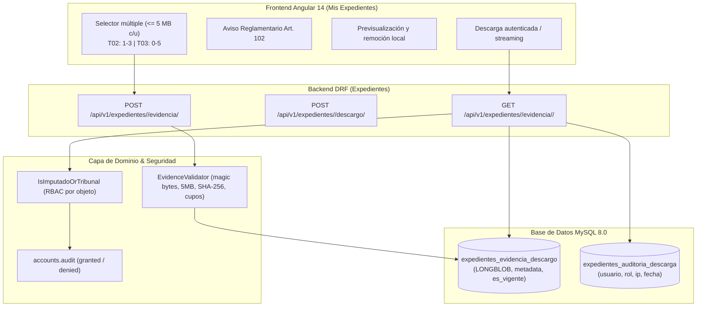

# Plan Técnico — Spec 005: Adjuntar y Custodiar Evidencia Protegida (SCRUM-48 / S3-04)

## Arquitectura de Solución y Flujo de Datos

---

## Componentes Técnicos

### 1. Dominio Puro (`backend/expedientes/domain/evidence_validator.py`)
- Módulo sin acoplamiento a frameworks para validación exhaustiva:
  - Magic bytes:
    - PDF: `b"%PDF"`
    - JPEG: `b"\xFF\xD8\xFF"`
    - PNG: `b"\x89PNG\r\n\x1a\n"`
  - Límite de tamaño: 5.242.880 bytes (5 MB).
  - Sanitización de nombre de archivo contra path traversal (`os.path.basename`, sustitución de caracteres ilegales).
  - Cálculo de hash SHA-256.
  - Validación de cupos: T02 (1 a 3), T03 (0 a 5).

### 2. Modelos ORM (`backend/expedientes/models.py`)
- `EvidenciaDescargo`:
  - `id`: UUIDField primario.
  - `expediente`: ForeignKey a `Expediente`.
  - `descargo`: ForeignKey opcional a `DescargoExpediente`.
  - `socio`: ForeignKey a `socios.Socio`.
  - `contenido_blob`: `models.BinaryField` (MySQL LONGBLOB).
  - `nombre_original`, `extension`, `mime_type`, `tamanio_bytes`, `sha256_hash`, `es_vigente`, `created_at`.
- `AuditoriaDescargaEvidencia`:
  - `id`: UUIDField primario.
  - `evidencia`: ForeignKey a `EvidenciaDescargo`.
  - `usuario`, `rol`, `ip_address`, `user_agent`, `fecha_hora`.
- Migración de esquema Django con soporte MySQL.

### 3. Servicios y API REST (`backend/expedientes/`)
- `EvidenceService`:
  - `save_evidence(...)`: valida bytes, calcula hash, persiste en base de datos.
  - `get_evidence_stream(...)`: recupera bytes, asienta auditoría en `AuditoriaDescargaEvidencia` y log de seguridad.
  - `mark_previous_versions_non_current(...)`: ante corrección en plazo de descargo, marca las evidencias previas del socio con `es_vigente = False`.
- `EvidenciaUploadView`:
  - `POST /api/v1/expedientes/<pk>/evidencia/`: recibe archivos `multipart/form-data`, valida cupos y estado procesal (`justificando` y en plazo), serializa y persiste en BD.
- `EvidenciaDownloadView`:
  - `GET /api/v1/expedientes/<pk>/evidencia/<uuid:evidencia_id>/`: protegido por `IsImputadoOrTribunal`, valida existencia, emite `FileResponse` con `Content-Type`, `Content-Disposition: inline; filename="..."` y `X-Content-Type-Options: nosniff`.
- Integración en `PresentarDescargoView`: vincula o actualiza las evidencias aportadas con el descargo formal individual.

### 4. Frontend Angular (`frontend/src/app/`)
- `ExpedienteApiService`:
  - `subirEvidencias(expedienteId, files: File[])`: envía `FormData`.
  - `descargarEvidencia(expedienteId, evidenciaId)`: descarga con autenticación y retorna `Blob`.
- `MisExpedientesComponent`:
  - Selector múltiple de comprobantes con previsualización, conteo y remoción local.
  - Advertencia visible del Art. 102 en modal de descargo.
  - Control de cupos en cliente (3 para T02, 5 para T03) y tamaño <= 5 MB.
  - Listado de comprobantes aportados en modal de detalle de causa con botón de descarga.
  - Notificaciones de 10s con el servicio centralizado.
