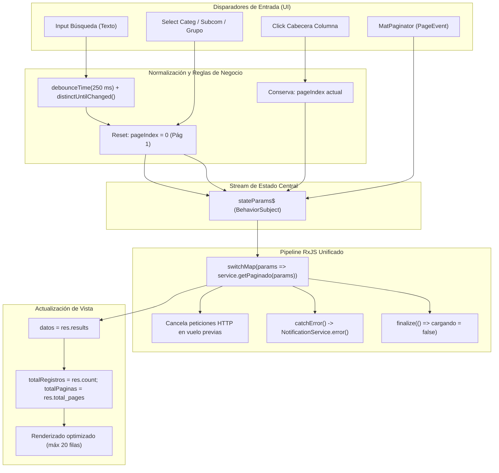

# Propuesta Técnica de Arquitectura Frontend — SCRUM-118: Paginación Server-Side Estandarizada con MatPaginator

> **Épica:** SCRUM-87 (MACRO-06: Optimización Integral de Rendimiento de la Plataforma - RAM, CPU y Base de Datos)  
> **Subtarea:** SCRUM-118 (S5-06.1 - Paginación server-side en Backend y Frontend)  
> **Rol:** Dev Frontend Senior (Arquitectura SPA Angular, RxJS y Material Design)  
> **Fecha:** 12 de Noviembre de 2026  
> **Estado:** Borrador de Arquitectura y Especificación Técnica Frontend  
> **Destinatarios:** Tech Lead Orchestrator SCRUM-118, Dev Backend Senior, DBA Senior, Scrum Master  

---

## 1. Introducción, Diagnóstico y Objetivos de Rendimiento

### 1.1. Diagnóstico del Estado Actual en Frontend
En la arquitectura actual de la aplicación Angular (`frontend/src/app/`), los listados de datos principales operan bajo un modelo de carga total en memoria (*in-memory client-side processing*):
1. **Ranking de Socios (`RankingSociosComponent`):** Recibe la totalidad del padrón (~515 registros) en una única llamada HTTP a `/api/v1/ranking/`. El filtrado, ordenamiento global y cálculo de cortes de página se realizan íntegramente en el *main thread* de JavaScript mediante *getters* reactivos (`sociosOrdenados`, `sociosPaginados`). Cada pulsación de tecla en el buscador dispara un recálculo y reordenamiento de 515 elementos, generando bloqueos perceptibles del hilo principal. La paginación visual actual se implementa mediante botones HTML ad-hoc (`&laquo;`, `&lsaquo; Anterior`, etc.) en lugar del componente canónico de Angular Material.
2. **Gestionar Expedientes (`GestionarExpedientesComponent`):** En la vista de tabla exploradora (`vistaActual === 'tabla'`), se renderiza la lista completa de expedientes sin paginación alguna (`<tr *ngFor="let exp of expedientesFiltrados">`). A medida que el histórico de causas disciplinarias crece, el número de nodos DOM escala linealmente, provocando *layout thrashing* durante el desplazamiento vertical y degradando la interactividad.
3. **Mis Expedientes (`MisExpedientesComponent`):** Procesa y ordena arrays planos en el cliente, careciendo de paginador.
4. **Mis Solicitudes T01 (`SolicitarPuntosComponent`):** Filtra y pagina localmente sin sincronización server-side de páginas.
5. **Eventos Institucionales (`AsistenciaEventoComponent`):** Procesa listas completas sin fragmentación.

### 1.2. Objetivos de Rendimiento Cuantificables (Directivas Addy Osmani)
La implementación de la paginación server-side estándar con `MatPaginator` persigue las siguientes metas estrictas de rendimiento:
- **LCP (Largest Contentful Paint) < 2.0 s:** Reducción del tamaño del payload transferido por solicitud de listado de ~220 KB a menos de 30 KB por página (reducción $\ge 85\%$).
- **INP (Interaction to Next Paint) < 150 ms:** Al limitar el renderizado a bloques fijos de 10, 20 o 50 filas, la cantidad de nodos DOM creados por vista de tabla se reduce drásticamente, erradicando caídas de fotogramas durante la navegación entre páginas y la alternancia de filtros.
- **CLS (Cumulative Layout Shift) < 0.05:** Altura predecible y reservada en contenedores de tabla y barra de pie fija con `MatPaginator`, evitando saltos visuales al recibir datos asíncronos.
- **Memoria Heap de JavaScript:** Eliminación de retención innecesaria de objetos en memoria cliente para colecciones no visibles.

---

## 2. Interfaces y Modelos Canónicos TypeScript

Para garantizar tipado estricto (`strict: true`), desacople de capas y reutilización transversal en todos los módulos de la aplicación, se centralizan los contratos en `frontend/src/app/models/paginated-response.model.ts`.

### 2.1. Interfaz Genérica de Respuesta Envolvente (`PaginatedResponse<T>`)
Alineada rigurosamente con el contrato REST canónico de Django REST Framework acordado con el Dev Backend Senior:

```typescript
// frontend/src/app/models/paginated-response.model.ts

/**
 * Envolvente JSON canónica para respuestas de colecciones paginadas server-side (DRF).
 * Cumple con el estándar definido en SCRUM-118 y relevamiento de requerimientos.
 */
export interface PaginatedResponse<T> {
  /** Cantidad total de registros que coinciden con los filtros aplicados en la base de datos. */
  count: number;
  /** Cantidad total de páginas calculadas por el backend según el page_size vigente. */
  total_pages: number;
  /** Número de página actual devuelto (indexación en base 1). */
  current_page: number;
  /** Cantidad de elementos devueltos por página. */
  page_size: number;
  /** URL canónica para acceder a la página siguiente, o null si es la última página. */
  next: string | null;
  /** URL canónica para acceder a la página anterior, o null si es la primera página. */
  previous: string | null;
  /** Colección de elementos tipados correspondientes a la página actual. */
  results: T[];
}
```

### 2.2. Parámetros Canónicos de Solicitud (`PaginationParams` y Extensiones de Dominio)

```typescript
// frontend/src/app/models/paginated-response.model.ts

/** Dirección de ordenamiento compatible con Angular Material y DRF. */
export type SortDirection = 'asc' | 'desc' | '';

/** Parámetros base comunes para cualquier consulta paginada al backend. */
export interface PaginationParams {
  /** Número de página solicitado (base 1). Valor por defecto: 1. */
  page?: number;
  /** Tamaño de página solicitado. Valores permitidos: 1 a 100. Valor por defecto: 20. */
  page_size?: number;
  /** Término de búsqueda general para filtrado por texto libre. */
  search?: string;
  /** Clave de ordenamiento según convención DRF (e.g. 'saldo', '-saldo', 'apellido,nombre'). */
  ordering?: string;
}

/** Parámetros específicos para la consulta paginada del Ranking Oficial de Socios. */
export interface RankingPaginationParams extends PaginationParams {
  /** Filtro de categoría estatutaria. */
  categoria?: 'ACTIVO' | 'PASIVO' | '';
  /** Filtro por denominación de subcomisión. */
  subcomision?: string;
  /** Filtro por grupo asignado (e.g. 'G57', 'SIN_GRUPO'). */
  grupo?: string;
  /** Flag para restringir la consulta a socios en límite crítico o alerta preventiva (saldo <= -7). */
  solo_alertas?: boolean;
}

/** Parámetros específicos para la consulta paginada de Expedientes Disciplinarios. */
export interface ExpedientePaginationParams extends PaginationParams {
  /** Filtro por estado del expediente según ciclo de vida canónico. */
  estado?: string;
  /** Filtro por nivel de urgencia ('baja' | 'normal' | 'urgente'). */
  urgencia?: string;
  /** Filtro por legajo o identificador de socio involucrado. */
  socio?: string;
  /** Rango temporal: fecha de creación desde (ISO string YYYY-MM-DD). */
  fecha_desde?: string;
  /** Rango temporal: fecha de creación hasta (ISO string YYYY-MM-DD). */
  fecha_hasta?: string;
}

/** Parámetros específicos para Mis Solicitudes T01. */
export interface SolicitudPaginationParams extends PaginationParams {
  /** Filtro por estado de la solicitud ('DRAFT' | 'ISSUED' | 'REJECTED'). */
  estado?: string;
}

/** Parámetros específicos para Eventos Institucionales. */
export interface EventoPaginationParams extends PaginationParams {
  categoria?: string;
  tipo?: string;
  estado?: string;
  modo_convocatoria?: string;
  mis_eventos?: boolean;
}
```

### 2.3. Deprecación y Unificación de Modelos Locales Redundantes
Actualmente existe una definición parcial de `PaginatedResponse<T>` en `frontend/src/app/services/socio-api.service.ts` (líneas 22-27) que carece de `total_pages`, `current_page` y `page_size`. Se procede a:
1. Eliminar la interfaz local en `socio-api.service.ts`.
2. Importar la interfaz canónica desde `../models/paginated-response.model`.
3. Mantener retrocompatibilidad garantizando que `next` y `previous` continúen presentes.

---

## 3. Integración en el Sistema de Diseño AVEIT y Módulo de Internacionalización

### 3.1. Configuración de Módulos Angular Material
Para habilitar el uso de `<mat-paginator>` en los componentes de administración y vistas generales, se importa `MatPaginatorModule` en `frontend/src/app/layouts/admin-layout/admin-layout.module.ts`:

```typescript
// En frontend/src/app/layouts/admin-layout/admin-layout.module.ts
import { MatPaginatorModule } from '@angular/material/paginator';

@NgModule({
  imports: [
    // ...otros módulos preexistentes
    MatPaginatorModule,
  ],
  // ...
})
export class AdminLayoutModule {}
```

### 3.2. Proveedor de Internacionalización en Español Rioplatense (`AveitPaginatorIntl`)
Para desterrar etiquetas en inglés por defecto ("Items per page", "Next page", etc.) y dar cumplimiento estricto a las normas de comunicación institucional en español rioplatense (establecidas en `AGENTS.md` y `docs/constitution.md`), se implementa una clase personalizada derivada de `MatPaginatorIntl`:

```typescript
// frontend/src/app/utils/aveit-paginator-intl.ts
import { Injectable } from '@angular/core';
import { MatPaginatorIntl } from '@angular/material/paginator';

@Injectable()
export class AveitPaginatorIntl extends MatPaginatorIntl {
  override itemsPerPageLabel = 'Filas por página:';
  override nextPageLabel = 'Página siguiente';
  override previousPageLabel = 'Página anterior';
  override firstPageLabel = 'Primera página';
  override lastPageLabel = 'Última página';

  override getRangeLabel = (page: number, pageSize: number, length: number): string => {
    if (length === 0 || pageSize === 0) {
      return `0 de ${length}`;
    }
    const safeLength = Math.max(length, 0);
    const startIndex = page * pageSize;
    // Si el índice de inicio supera la longitud total
    const endIndex = startIndex < safeLength 
      ? Math.min(startIndex + pageSize, safeLength) 
      : startIndex + pageSize;
    return `${startIndex + 1} – ${endIndex} de ${safeLength}`;
  };
}
```

Registro del proveedor global en `AdminLayoutModule` (o `AppModule`):
```typescript
providers: [
  { provide: MatPaginatorIntl, useClass: AveitPaginatorIntl }
]
```

### 3.3. Estilizado SCSS y Soporte de Temas Claro/Oscuro (`DESIGN.md`)
El componente `<mat-paginator>` debe respetar estrictamente los tokens institucionales del **AVEIT Design System 2026** definidos en `DESIGN.md`. Se incorpora la siguiente especificación SCSS en `frontend/src/assets/scss/core/_aveit-tribunal.scss`:

```scss
// ==========================================================================
// Integración Canónica de MatPaginator (AVEIT Design System 2026)
// ==========================================================================

.mat-paginator-aveit {
  background-color: var(--color-surface-card);
  color: var(--color-text-secondary);
  border-top: 1px solid var(--color-border-main);
  border-bottom-left-radius: 8px;
  border-bottom-right-radius: 8px;
  font-family: 'Montserrat', sans-serif;
  font-size: 13px;

  .mat-paginator-container {
    padding: 8px 16px;
    min-height: 52px;
    justify-content: space-between;
    flex-wrap: wrap;
    gap: 12px;
  }

  .mat-paginator-page-size {
    align-items: center;

    .mat-paginator-page-size-label {
      font-size: 13px;
      font-weight: 500;
      color: var(--color-text-secondary);
      margin-right: 8px;
    }

    .mat-form-field-wrapper {
      padding-bottom: 0;
    }

    .mat-form-field-underline {
      display: none; // Aspecto limpio sin subrayado residual
    }

    .mat-select-value {
      font-weight: 600;
      color: var(--color-text-primary);
    }
  }

  .mat-paginator-range-label {
    font-size: 13px;
    font-weight: 600;
    font-variant-numeric: tabular-nums;
    color: var(--color-text-primary);
    margin: 0 16px;
  }

  .mat-paginator-navigation-first,
  .mat-paginator-navigation-previous,
  .mat-paginator-navigation-next,
  .mat-paginator-navigation-last {
    color: var(--color-primary);
    border-radius: 4px;
    transition: background-color 0.2s ease, transform 0.1s ease;

    &:hover:not([disabled]) {
      background-color: rgba(110, 157, 220, 0.15); // Acento hover
    }

    &:focus-visible {
      outline: 2px solid var(--color-border-focus);
      outline-offset: 2px;
    }

    &[disabled] {
      color: var(--color-border-main);
      opacity: 0.45;
      cursor: not-allowed;
    }
  }
}

// Adaptación automática a Modo Oscuro
[data-theme="dark"] .mat-paginator-aveit {
  background-color: var(--color-dark-surface-card);
  color: var(--color-dark-text-secondary);
  border-top-color: var(--color-dark-border-main);

  .mat-paginator-page-size-label {
    color: var(--color-dark-text-secondary);
  }

  .mat-select-value,
  .mat-paginator-range-label {
    color: var(--color-dark-text-primary);
  }

  .mat-paginator-navigation-first,
  .mat-paginator-navigation-previous,
  .mat-paginator-navigation-next,
  .mat-paginator-navigation-last {
    color: var(--color-accent);

    &:hover:not([disabled]) {
      background-color: rgba(110, 157, 220, 0.25);
    }

    &[disabled] {
      color: var(--color-dark-border-main);
    }
  }
}
```

---

## 4. Adaptación de Servicios Frontend

Todos los servicios frontend que consultan colecciones deben admitir los parámetros de paginación `page` y `page_size`, además de los filtros específicos y la cadena de ordenamiento (`ordering`), retornando el observable envolvente `Observable<PaginatedResponse<T>>`.

### 4.1. Adaptación de `RankingService` (`frontend/src/app/services/ranking.service.ts`)

```typescript
import { Injectable } from '@angular/core';
import { HttpClient, HttpParams } from '@angular/common/http';
import { Observable } from 'rxjs';
import { RankingSocio } from '../ranking-socios/ranking-socio.model';
import { PaginatedResponse, RankingPaginationParams } from '../models/paginated-response.model';
import { environment } from '../../environments/environment';

@Injectable({ providedIn: 'root' })
export class RankingService {
  private readonly apiUrl = `${environment.apiUrl}/ranking/`;

  constructor(private http: HttpClient) {}

  /**
   * Obtiene la nómina de socios paginada desde el backend con metadatos completos.
   * La posición (ranking) es computada de forma inmutable en el backend sobre el padrón general.
   */
  obtenerRankingPaginado(params?: RankingPaginationParams): Observable<PaginatedResponse<RankingSocio>> {
    let httpParams = new HttpParams();

    if (params) {
      if (params.page != null) {
        httpParams = httpParams.set('page', params.page.toString());
      }
      if (params.page_size != null) {
        httpParams = httpParams.set('page_size', params.page_size.toString());
      }
      if (params.search && params.search.trim()) {
        httpParams = httpParams.set('search', params.search.trim());
      }
      if (params.categoria) {
        httpParams = httpParams.set('categoria', params.categoria);
      }
      if (params.subcomision && params.subcomision.trim()) {
        httpParams = httpParams.set('subcomision', params.subcomision.trim());
      }
      if (params.grupo && params.grupo.trim()) {
        httpParams = httpParams.set('grupo', params.grupo.trim());
      }
      if (params.solo_alertas) {
        httpParams = httpParams.set('solo_alertas', 'true');
      }
      if (params.ordering && params.ordering.trim()) {
        httpParams = httpParams.set('ordering', params.ordering.trim());
      }
    }

    return this.http.get<PaginatedResponse<RankingSocio>>(this.apiUrl, { params: httpParams });
  }

  /**
   * Método de compatibilidad transitoria hacia atrás (retrocompatibilidad).
   * Devuelve la lista plana solicitando pagination=false o mapeando los resultados.
   */
  obtenerRanking(): Observable<RankingSocio[]> {
    const params = new HttpParams().set('pagination', 'false');
    return this.http.get<RankingSocio[]>(this.apiUrl, { params });
  }
}
```

### 4.2. Adaptación de `ExpedienteApiService` (`frontend/src/app/services/expediente-api.service.ts`)

```typescript
import { PaginatedResponse, ExpedientePaginationParams, SolicitudPaginationParams } from '../models/paginated-response.model';

// En ExpedienteApiService:

/**
 * Consulta la colección general de expedientes con paginación server-side.
 */
listarExpedientes(params?: ExpedientePaginationParams): Observable<PaginatedResponse<ExpedienteListDTO>> {
  let httpParams = new HttpParams();

  if (params) {
    if (params.page != null) httpParams = httpParams.set('page', params.page.toString());
    if (params.page_size != null) httpParams = httpParams.set('page_size', params.page_size.toString());
    if (params.search && params.search.trim()) httpParams = httpParams.set('search', params.search.trim());
    if (params.estado && params.estado.trim()) httpParams = httpParams.set('estado', params.estado.trim());
    if (params.urgencia && params.urgencia.trim()) httpParams = httpParams.set('urgencia', params.urgencia.trim());
    if (params.socio && params.socio.trim()) httpParams = httpParams.set('socio', params.socio.trim());
    if (params.fecha_desde) httpParams = httpParams.set('fecha_desde', params.fecha_desde);
    if (params.fecha_hasta) httpParams = httpParams.set('fecha_hasta', params.fecha_hasta);
    if (params.ordering && params.ordering.trim()) httpParams = httpParams.set('ordering', params.ordering.trim());
  }

  return this.http.get<PaginatedResponse<ExpedienteListDTO>>(`${this.baseUrl}/`, { params: httpParams });
}

/**
 * Consulta las causas disciplinarias del socio autenticado con paginación server-side.
 */
listarMisExpedientes(params?: ExpedientePaginationParams): Observable<PaginatedResponse<ExpedienteListDTO>> {
  let httpParams = new HttpParams();
  if (params) {
    if (params.page != null) httpParams = httpParams.set('page', params.page.toString());
    if (params.page_size != null) httpParams = httpParams.set('page_size', params.page_size.toString());
    if (params.estado && params.estado.trim()) httpParams = httpParams.set('estado', params.estado.trim());
    if (params.ordering && params.ordering.trim()) httpParams = httpParams.set('ordering', params.ordering.trim());
  }
  return this.http.get<PaginatedResponse<ExpedienteListDTO>>(`${this.baseUrl}/mis-expedientes/`, { params: httpParams });
}

/**
 * Consulta las solicitudes T01 del usuario con paginación server-side.
 */
listarMisSolicitudes(params?: SolicitudPaginationParams): Observable<PaginatedResponse<SolicitudMonitoreo>> {
  let httpParams = new HttpParams();
  if (params) {
    if (params.page != null) httpParams = httpParams.set('page', params.page.toString());
    if (params.page_size != null) httpParams = httpParams.set('page_size', params.page_size.toString());
    if (params.search && params.search.trim()) httpParams = httpParams.set('search', params.search.trim());
    if (params.estado && params.estado.trim()) httpParams = httpParams.set('estado', params.estado.trim());
    if (params.ordering && params.ordering.trim()) httpParams = httpParams.set('ordering', params.ordering.trim());
  }
  return this.http.get<PaginatedResponse<SolicitudMonitoreo>>(`${this.baseUrl}/solicitudes-t01/mis-solicitudes/`, { params: httpParams });
}
```

### 4.3. Adaptación de `EventoService` (`frontend/src/app/services/evento.service.ts`)

```typescript
import { PaginatedResponse, EventoPaginationParams } from '../models/paginated-response.model';

// En EventoService:
getEventosPaginados(filtros?: EventoPaginationParams): Observable<PaginatedResponse<EventoInstitucional>> {
  let params = new HttpParams();
  if (filtros) {
    if (filtros.page != null) params = params.set('page', filtros.page.toString());
    if (filtros.page_size != null) params = params.set('page_size', filtros.page_size.toString());
    if (filtros.search && filtros.search.trim()) params = params.set('search', filtros.search.trim());
    if (filtros.categoria) params = params.set('categoria', filtros.categoria);
    if (filtros.tipo) params = params.set('tipo', filtros.tipo);
    if (filtros.estado) params = params.set('estado', filtros.estado);
    if (filtros.modo_convocatoria) params = params.set('modo_convocatoria', filtros.modo_convocatoria);
    if (filtros.mis_eventos) params = params.set('mis_eventos', 'true');
    if (filtros.ordering) params = params.set('ordering', filtros.ordering);
  }
  return this.http.get<PaginatedResponse<EventoInstitucional>>(`${this.baseUrl}/`, { params });
}
```

---

## 5. Arquitectura Reactiva de Controladores y Vistas (Patrones RxJS)

Para asegurar un flujo unidireccional y predecible de datos (*reactive state machine*) sin condiciones de carrera (*race conditions*), se establece un patrón reactivo unificado basado en `BehaviorSubject` y operadores de canalización.

### 5.1. Diagrama de Flujo Reactivo de Estado



### 5.2. Reglas Innegociables de Sincronización de Estado
1. **Invariante 1 — Reseteo Forzoso a Página 1 ante Cambios de Filtro:**
   Siempre que el usuario modifique un filtro de texto (`filtroTexto`), un selector desplegable (`filtroCategoria`, `filtroSubcomision`, `filtroGrupo`, `filtroEstado`) o cambie de pestaña (tab), el índice de página DEBE resetearse a `0` (`pageIndex = 0`, `page = 1`). Esto previene estados inconsistentes donde la página solicitada quede fuera del nuevo rango total de páginas devuelto.
2. **Invariante 2 — Conservación y Delegación de Ordenamiento al Backend:**
   Al hacer clic en una columna ordenable, el ordenamiento NO se realiza en memoria local sobre la página visualizada. La clave y dirección de ordenamiento (`ordering`, e.g. `-saldo` o `apellido`) se envían como parámetro al backend, permitiendo que la base de datos ordene todo el conjunto de registros antes de aplicar la ventana de paginación (`LIMIT`/`OFFSET`). El paginador conserva el tamaño de página y opcionalmente retorna a la primera página si la lógica de negocio lo estipula.
3. **Invariante 3 — Cancelación de Peticiones Obsoletas con `switchMap`:**
   El operador `switchMap` garantiza que si el usuario escribe rápidamente o cambia de página mientras una petición HTTP se encuentra en tránsito de red, la llamada previa sea abortada inmediatamente por el navegador, eliminando cualquier inconsistencia de datos tardíos (*stale responses*).
4. **Invariante 4 — Limpieza de Recursos contra Fugas de Memoria:**
   Todos los componentes deben implementar `OnDestroy` con un `Subject<void> destroy$` y encadenar `takeUntil(this.destroy$)` en sus suscripciones de larga duración.

---

## 6. Especificación Detallada por Pantalla y Componente

### 6.1. Pantalla: Ranking Oficial de Socios (`RankingSociosComponent`)

#### 6.1.1. Controlador TypeScript Refactorizado (`ranking-socios.component.ts`)

```typescript
import { Component, OnInit, OnDestroy } from '@angular/core';
import { PageEvent } from '@angular/material/paginator';
import { MatDialog } from '@angular/material/dialog';
import { BehaviorSubject, Subject, of } from 'rxjs';
import { debounceTime, distinctUntilChanged, switchMap, catchError, finalize, takeUntil } from 'rxjs/operators';

import { RankingService } from '../services/ranking.service';
import { NotificationService } from '../services/notification.service';
import { RankingSocio } from './ranking-socio.model';
import { RANKING_THRESHOLDS } from './ranking-thresholds';
import { ExpedientesSocioDialogComponent } from './expedientes-socio-dialog/expedientes-socio-dialog.component';
import { PaginatedResponse, RankingPaginationParams } from '../models/paginated-response.model';

export type RankingColumnaOrden = 'posicion' | 'socio' | 'legajo' | 'categoria' | 'grupo' | 'subcomision' | 'saldo';

@Component({
  selector: 'app-ranking-socios',
  templateUrl: './ranking-socios.component.html',
  styleUrls: ['./ranking-socios.component.scss']
})
export class RankingSociosComponent implements OnInit, OnDestroy {
  // Datos devueltos por el backend para la página visible
  socios: RankingSocio[] = [];
  totalRegistros = 0;
  totalPaginas = 1;

  // Estado de Paginación canónica
  paginaActual = 1; // Base 1 para DRF
  tamanoPagina = 20; // Valor por defecto canónico (RN-PAG-01)
  opcionesTamano = [10, 20, 50, 100];

  // Estado de Filtros
  filtroTexto = '';
  filtroCategoria: 'ACTIVO' | 'PASIVO' | '' = '';
  filtroSubcomision = '';
  filtroGrupo = '';
  soloAlertas = false;

  // Catálogos auxiliares
  subcomisiones: string[] = [];
  grupos: string[] = [];

  // Estado de Ordenamiento
  sortKey: RankingColumnaOrden | null = null;
  sortDir: 'asc' | 'desc' = 'asc';

  // Control de interfaz
  cargando = false;
  error: string | null = null;

  // Streams reactivos
  private readonly paramsSubject$ = new BehaviorSubject<RankingPaginationParams>({
    page: 1,
    page_size: 20
  });
  private readonly destroy$ = new Subject<void>();

  constructor(
    public rankingService: RankingService,
    public dialog: MatDialog,
    private notifications: NotificationService
  ) {}

  ngOnInit(): void {
    // Pipeline reactivo principal de carga paginada
    this.paramsSubject$.pipe(
      debounceTime(150),
      distinctUntilChanged((prev, curr) => JSON.stringify(prev) === JSON.stringify(curr)),
      switchMap(params => {
        this.cargando = true;
        this.error = null;
        return this.rankingService.obtenerRankingPaginado(params).pipe(
          catchError(err => {
            const mensaje = 'No se pudo cargar el ranking de socios. Intentá nuevamente.';
            this.error = mensaje;
            this.notifications.error(mensaje);
            return of({
              count: 0,
              total_pages: 0,
              current_page: 1,
              page_size: this.tamanoPagina,
              next: null,
              previous: null,
              results: []
            } as PaginatedResponse<RankingSocio>);
          }),
          finalize(() => {
            this.cargando = false;
          })
        );
      }),
      takeUntil(this.destroy$)
    ).subscribe(res => {
      this.socios = res.results;
      this.totalRegistros = res.count;
      this.totalPaginas = res.total_pages;
      this.paginaActual = res.current_page;
    });

    // Carga inicial de catálogos de filtro (una sola vez o cacheado)
    this.cargarCatalogosFiltros();
  }

  ngOnDestroy(): void {
    this.destroy$.next();
    this.destroy$.complete();
  }

  /**
   * Manejador estándar del evento de paginación emitido por <mat-paginator>.
   */
  onCambioPagina(event: PageEvent): void {
    this.paginaActual = event.pageIndex + 1; // Conversión base 0 a base 1
    this.tamanoPagina = event.pageSize;
    this.emitirParametrosActuales();
  }

  /**
   * Reacciona ante cambios en el input de búsqueda de texto (con reseteo de página).
   */
  onFiltroTextoChange(texto: string): void {
    this.filtroTexto = texto;
    this.paginaActual = 1; // Invariante 1: Reset a pág 1
    this.emitirParametrosActuales();
  }

  /**
   * Reacciona ante cambios en los selects desplegables (con reseteo de página).
   */
  onFiltroSelectChange(): void {
    this.paginaActual = 1; // Invariante 1: Reset a pág 1
    this.emitirParametrosActuales();
  }

  /**
   * Alterna la pestaña entre Vista General y Alertas Preventivas.
   */
  setTab(tab: 'general' | 'alertas'): void {
    this.soloAlertas = tab === 'alertas';
    this.paginaActual = 1;
    this.emitirParametrosActuales();
  }

  /**
   * Restablece todos los filtros a su estado inicial.
   */
  limpiarFiltros(): void {
    this.filtroTexto = '';
    this.filtroCategoria = '';
    this.filtroSubcomision = '';
    this.filtroGrupo = '';
    this.soloAlertas = false;
    this.paginaActual = 1;
    this.emitirParametrosActuales();
  }

  /**
   * Alterna el ordenamiento por cabecera y delega el ordenamiento al backend.
   */
  alternarOrden(columna: RankingColumnaOrden): void {
    if (this.sortKey !== columna) {
      this.sortKey = columna;
      this.sortDir = columna === 'saldo' ? 'desc' : 'asc';
    } else {
      if (columna === 'saldo') {
        if (this.sortDir === 'desc') {
          this.sortDir = 'asc';
        } else {
          this.sortKey = null;
          this.sortDir = 'asc';
        }
      } else {
        if (this.sortDir === 'asc') {
          this.sortDir = 'desc';
        } else {
          this.sortKey = null;
          this.sortDir = 'asc';
        }
      }
    }
    this.paginaActual = 1;
    this.emitirParametrosActuales();
  }

  private emitirParametrosActuales(): void {
    const params: RankingPaginationParams = {
      page: this.paginaActual,
      page_size: this.tamanoPagina,
      search: this.filtroTexto.trim() || undefined,
      categoria: this.filtroCategoria || undefined,
      subcomision: this.filtroSubcomision || undefined,
      grupo: this.filtroGrupo || undefined,
      solo_alertas: this.soloAlertas || undefined,
      ordering: this.construirCadenaOrdenamiento()
    };
    this.paramsSubject$.next(params);
  }

  private construirCadenaOrdenamiento(): string | undefined {
    if (!this.sortKey) return undefined;
    const prefijo = this.sortDir === 'desc' ? '-' : '';
    switch (this.sortKey) {
      case 'saldo': return `${prefijo}saldo`;
      case 'socio': return `${prefijo}apellido,${prefijo}nombre`;
      case 'legajo': return `${prefijo}legajo`;
      case 'categoria': return `${prefijo}categoria`;
      case 'grupo': return `${prefijo}grupo`;
      case 'subcomision': return `${prefijo}subcomision`;
      default: return undefined;
    }
  }

  private cargarCatalogosFiltros(): void {
    // Carga ligera de grupos y subcomisiones disponibles en backend
    this.grupos = ['G55', 'G56', 'G57', 'G58', 'G59', 'G60', 'SIN_GRUPO'];
    this.subcomisiones = [
      'Comunicaciones', 'Cómputos', 'Deportes', 'Extensión Universitaria',
      'Finanzas', 'Prensa y Difusión', 'Relaciones Públicas', 'Tesorería'
    ];
  }

  abrirExpedientesSocio(socio: RankingSocio): void {
    if (!socio) return;
    this.dialog.open(ExpedientesSocioDialogComponent, {
      width: '100%',
      maxWidth: '700px',
      data: {
        legajo: socio.legajo,
        nombreSocio: `${socio.nombre} ${socio.apellido}`.trim(),
        saldo: socio.saldo
      }
    });
  }

  getBadgeClase(socio: RankingSocio): string {
    if (socio.saldo <= RANKING_THRESHOLDS.cese) return 'badge-mat-danger';
    if (socio.saldo <= RANKING_THRESHOLDS.alerta) return 'badge-mat-warning';
    return 'badge-mat-success';
  }

  getRowClass(s: RankingSocio): string {
    if (s.saldo <= RANKING_THRESHOLDS.cese) return 'row-cese';
    if (s.saldo <= RANKING_THRESHOLDS.alerta) return 'row-alerta';
    return '';
  }

  getIconoOrden(columna: RankingColumnaOrden): string {
    if (this.sortKey !== columna) return 'swap_vert';
    return this.sortDir === 'asc' ? 'arrow_upward' : 'arrow_downward';
  }
}
```

#### 6.1.2. Plantilla HTML Refactorizada (`ranking-socios.component.html`)
Se reemplaza el footer manual y la iteración `sociosPaginados` por la colección directa `socios` y el componente canónico `<mat-paginator>`:

```html
<!-- Reemplazo en la tabla de ranking-socios.component.html -->
<tbody *ngIf="!cargando && socios.length > 0">
  <tr *ngFor="let s of socios"
      (click)="abrirExpedientesSocio(s)"
      tabindex="0"
      role="button"
      [attr.aria-label]="'Consultar legajo y expedientes de ' + s.nombre + ' ' + (s.apellido || '')"
      class="socio-row-clickable"
      [ngClass]="getRowClass(s)">
    <td class="font-weight-bold text-muted tabular-nums">#{{ s.posicion }}</td>
    <td>
      <div class="font-weight-bold text-dark">{{ s.nombre }} {{ s.apellido }}</div>
    </td>
    <td class="tabular-nums">{{ s.legajo }}</td>
    <td>
      <span class="badge-mat" [ngClass]="s.categoria === 'ACTIVO' ? 'badge-mat-active' : 'badge-mat-passive'">
        {{ s.categoria }}
      </span>
    </td>
    <td class="tabular-nums">{{ s.grupo || 'Sin grupo' }}</td>
    <td>{{ s.subcomision || 'Sin Subcomisión' }}</td>
    <td class="text-right font-weight-bold tabular-nums" [ngClass]="s.saldo >= 0 ? 'text-success' : 'text-danger'">
      {{ s.saldo > 0 ? '+' : '' }}{{ s.saldo | number:'1.2-2' }}
    </td>
    <td class="text-center">
      <button type="button"
              class="btn btn-sm btn-outline-primary"
              (click)="$event.stopPropagation(); abrirExpedientesSocio(s)"
              aria-label="Ver expedientes">
        <i class="material-icons" style="font-size: 16px;">folder_open</i>
        Expedientes
      </button>
    </td>
  </tr>
</tbody>

<!-- Pie de Tabla con MatPaginator Canónico -->
<div class="card-footer p-0">
  <mat-paginator
    class="mat-paginator-aveit"
    [length]="totalRegistros"
    [pageSize]="tamanoPagina"
    [pageSizeOptions]="opcionesTamano"
    [pageIndex]="paginaActual - 1"
    (page)="onCambioPagina($event)"
    showFirstLastButtons
    aria-label="Navegación del Ranking de Socios">
  </mat-paginator>
</div>
```

---

### 6.2. Pantalla: Gestionar Expedientes (`GestionarExpedientesComponent`)

#### 6.2.1. Integración en la Tabla Exploradora (`vistaActual === 'tabla'`)
En `GestionarExpedientesComponent`, se mantiene intacto el Tablero Kanban de 6 estados (que continúa alimentándose del endpoint de tablero `/expedientes/board/`), mientras que la vista de **Tabla Exploradora** se desacopla para consumir el endpoint paginado `/api/v1/expedientes/`:

```html
<!-- En gestionar-expedientes.component.html (bajo la tabla exploradora) -->
<div class="card-footer p-0" *ngIf="vistaActual === 'tabla'">
  <mat-paginator
    class="mat-paginator-aveit"
    [length]="totalExpedientes"
    [pageSize]="tamanoPaginaExpedientes"
    [pageSizeOptions]="[10, 20, 50, 100]"
    [pageIndex]="paginaActualExpedientes - 1"
    (page)="onCambioPaginaExpedientes($event)"
    showFirstLastButtons
    aria-label="Navegación de la tabla de expedientes">
  </mat-paginator>
</div>
```

Controlador TypeScript en `gestionar-expedientes.component.ts`:
```typescript
// Variables de control de paginación para la tabla exploradora
totalExpedientes = 0;
paginaActualExpedientes = 1;
tamanoPaginaExpedientes = 20;

onCambioPaginaExpedientes(event: PageEvent): void {
  this.paginaActualExpedientes = event.pageIndex + 1;
  this.tamanoPaginaExpedientes = event.pageSize;
  this.cargarExpedientesTablaPaginada();
}

cargarExpedientesTablaPaginada(): void {
  this.cargando = true;
  this.expedienteApi.listarExpedientes({
    page: this.paginaActualExpedientes,
    page_size: this.tamanoPaginaExpedientes,
    search: this.filtroTexto?.trim() || undefined,
    estado: this.filtroEstado || undefined,
    urgencia: this.filtroUrgencia || undefined,
    ordering: this.columnaOrden ? (this.ordenAscendente ? this.columnaOrden : `-${this.columnaOrden}`) : undefined
  }).pipe(
    catchError(err => {
      this.notifications.error('Error al cargar la lista paginada de expedientes.');
      return of({ count: 0, results: [], total_pages: 0, current_page: 1, page_size: 20, next: null, previous: null });
    }),
    finalize(() => this.cargando = false),
    takeUntil(this.destroy$)
  ).subscribe(res => {
    this.expedientesTabla = res.results.map(dto => this.mapearDtoAExpediente(dto));
    this.totalExpedientes = res.count;
  });
}
```

---

### 6.3. Pantalla: Mis Expedientes (`MisExpedientesComponent`)
En `MisExpedientesComponent`, se incorpora `<mat-paginator>` al pie de la tabla de causas personales:
- Se agregan las propiedades `totalMisExpedientes = 0`, `paginaActual = 1`, `tamanoPagina = 20`.
- Al conmutar de pestaña (`setFiltroTab('todos' | 'en_tramite' | 'resueltos')`), se ejecuta mandatoriamente `this.paginaActual = 1` y se re-consulta `/api/v1/expedientes/mis-expedientes/?page=1&page_size=20&estado=...`.
- Se mantiene la suscripción al temporizador `interval(1000)` para la cuenta regresiva del descargo sin que interfiera con la paginación.

---

### 6.4. Pantalla: Solicitar Puntos (`SolicitarPuntosComponent` - Pestaña Mis Solicitudes)
En `SolicitarPuntosComponent`:
- La pestaña "Mis Solicitudes T01" incorpora `<mat-paginator>` con `[pageSizeOptions]="[10, 20, 50]"`.
- Los controles `busquedaControl.valueChanges` y `estadoFiltro.valueChanges` resetean `paginaActual = 1`.
- Se elimina la ordenación y filtrado en memoria sobre `misSolicitudesOrdenadas`, alimentando la tabla directamente con los `results` devueltos por el backend.

---

## 7. Tratamiento de Errores y Feedback al Usuario (Cumplimiento PR #49)

En estricta conformidad con el estándar de feedback al usuario consolidado en el PR #49 y establecido en `AGENTS.md`:

1. **Notificaciones Transitorias Centralizadas:**
   - Todo fallo de red o error de servidor al paginar dispara un aviso mediante `NotificationService.error('...')`.
   - La notificación se renderiza abajo a la derecha de la pantalla, permanece visible durante exactamente 10 segundos, cuenta con botón accesible de cierre manual `(X)` y se desvanece de forma suave.
   - **Prohibición Absoluta:** Queda terminantemente prohibido incluir banners de error transitorios dentro del cuerpo de la tabla o utilizar mecanismos legacy como `$.notify`.
2. **Tratamiento Específico de Error 404 (Página Fuera de Rango):**
   - Si el usuario solicita manualmente o mediante URL una página superior a `total_pages` (recibiendo `HTTP 404 Not Found` en formato RFC 9457), el interceptor o manejador del componente realiza un **fallback resiliente**:
     ```typescript
     catchError((err: HttpErrorResponse) => {
       if (err.status === 404 && this.paginaActual > 1) {
         // Auto-recuperación: Redirigir a la primera página válida
         this.paginaActual = 1;
         this.emitirParametrosActuales();
         this.notifications.warning('La página solicitada ya no contiene resultados. Regresando a la página 1.');
       } else {
         this.notifications.error('Error al recuperar datos paginados.');
       }
       return of(this.crearRespuestaVacia());
     })
     ```
3. **Estado Vacío Permanente:**
   - Cuando una consulta paginada retorna `count === 0`, la vista muestra el estado vacío institucional estándar con icono, mensaje explicativo claro y botón "Limpiar Filtros", sin alertas emergentes intrusivas.

---

## 8. Plan Integral de Pruebas Unitarias (Jasmine / Karma - `npm test`)

Para certificar la calidad y evitar regresiones en la suite de pruebas del frontend, se define una matriz de casos de prueba automatizados con Jasmine.

### 8.1. Matriz de Casos de Prueba Requeridos

| ID Test | Componente / Servicio | Comportamiento Evaluado | Resultado Esperado |
| :--- | :--- | :--- | :--- |
| **TEST-FE-PAG-01** | `RankingService` | Llamada a `obtenerRankingPaginado` con parámetros `page=2`, `page_size=50`, `search='Pérez'`, `ordering='-saldo'`. | `HttpClient.get` llamado con los `HttpParams` exactos serializados. |
| **TEST-FE-PAG-02** | `RankingSociosComponent` | Emisión del evento `(page)` desde `<mat-paginator>` con `pageIndex=2`, `pageSize=20`. | Incremento de `paginaActual` a 3 y emisión de petición HTTP con `page=3`. |
| **TEST-FE-PAG-03** | `RankingSociosComponent` | Modificación del filtro de texto `onFiltroTextoChange('Gómez')`. | `paginaActual` se resetea inmediatamente a 1 antes de despachar la petición. |
| **TEST-FE-PAG-04** | `RankingSociosComponent` | Modificación del selector de subcomisión o grupo. | `paginaActual` se resetea a 1. |
| **TEST-FE-PAG-05** | `RankingSociosComponent` | Clic en la cabecera de la columna `Saldo`. | Envío del parámetro `ordering='-saldo'` manteniendo el `pageSize` vigente. |
| **TEST-FE-PAG-06** | `RankingSociosComponent` | Disparo consecutivo de dos búsquedas rápidas (<100 ms). | El operador `switchMap` cancela la primera petición y solo procesa la última respuesta. |
| **TEST-FE-PAG-07** | `RankingSociosComponent` | Respuesta de error `HTTP 500` del backend. | Invocación de `NotificationService.error()` y asignación de array vacío en `socios`. |
| **TEST-FE-PAG-08** | `RankingSociosComponent` | Respuesta `HTTP 404` por página inexistente (`page=99`). | Auto-recuperación a `page=1` y notificación de advertencia. |
| **TEST-FE-PAG-09** | `GestionarExpedientesComponent` | Cambio de página en la tabla exploradora. | Ejecución de `listarExpedientes` con los parámetros correspondientes sin alterar el Tablero Kanban. |
| **TEST-FE-PAG-10** | `AveitPaginatorIntl` | Evaluación de etiquetas de rango `getRangeLabel(0, 20, 515)`. | Devuelve exactamente `'1 – 20 de 515'`. |

### 8.2. Especificación de Pruebas Jasmine para `RankingSociosComponent` (`ranking-socios.component.spec.ts`)

```typescript
import { ComponentFixture, TestBed, fakeAsync, tick } from '@angular/core/testing';
import { FormsModule } from '@angular/forms';
import { MatDialog } from '@angular/material/dialog';
import { MatPaginatorModule, PageEvent } from '@angular/material/paginator';
import { BrowserAnimationsModule } from '@angular/platform-browser/animations';
import { of, throwError } from 'rxjs';

import { RankingSociosComponent } from './ranking-socios.component';
import { RankingService } from '../services/ranking.service';
import { NotificationService } from '../services/notification.service';
import { PaginatedResponse } from '../models/paginated-response.model';
import { RankingSocio } from './ranking-socio.model';

describe('RankingSociosComponent - Paginación Server-Side (SCRUM-118)', () => {
  let component: RankingSociosComponent;
  let fixture: ComponentFixture<RankingSociosComponent>;
  let rankingServiceSpy: jasmine.SpyObj<RankingService>;
  let notificationServiceSpy: jasmine.SpyObj<NotificationService>;
  let dialogSpy: jasmine.SpyObj<MatDialog>;

  const mockPaginatedResponse: PaginatedResponse<RankingSocio> = {
    count: 515,
    total_pages: 26,
    current_page: 1,
    page_size: 20,
    next: 'http://api/ranking/?page=2&page_size=20',
    previous: null,
    results: [
      {
        id: '1',
        legajo: '1001',
        nombre: 'Carlos',
        apellido: 'Alonso',
        categoria: 'ACTIVO',
        subcomision: 'Cómputos',
        grupo: 'G57',
        saldo: 10,
        saldoHistorico: 10,
        saldoPuntajeGeneral: 10,
        diferencia: 0,
        reconciliado: true,
        posicion: 1
      }
    ]
  };

  beforeEach(async () => {
    rankingServiceSpy = jasmine.createSpyObj('RankingService', ['obtenerRankingPaginado', 'obtenerRanking']);
    notificationServiceSpy = jasmine.createSpyObj('NotificationService', ['error', 'warning', 'info', 'success']);
    dialogSpy = jasmine.createSpyObj('MatDialog', ['open']);

    rankingServiceSpy.obtenerRankingPaginado.and.returnValue(of(mockPaginatedResponse));

    await TestBed.configureTestingModule({
      imports: [
        FormsModule,
        MatPaginatorModule,
        BrowserAnimationsModule
      ],
      declarations: [RankingSociosComponent],
      providers: [
        { provide: RankingService, useValue: rankingServiceSpy },
        { provide: NotificationService, useValue: notificationServiceSpy },
        { provide: MatDialog, useValue: dialogSpy }
      ]
    }).compileComponents();

    fixture = TestBed.createComponent(RankingSociosComponent);
    component = fixture.componentInstance;
  });

  it('debe inicializar y solicitar la primera página con page_size=20 por defecto', fakeAsync(() => {
    fixture.detectChanges();
    tick(200);

    expect(rankingServiceSpy.obtenerRankingPaginado).toHaveBeenCalledWith(jasmine.objectContaining({
      page: 1,
      page_size: 20
    }));
    expect(component.socios.length).toBe(1);
    expect(component.totalRegistros).toBe(515);
  }));

  it('debe reaccionar a onCambioPagina actualizando la página y consultando al backend', fakeAsync(() => {
    fixture.detectChanges();
    tick(200);

    const pageEvent: PageEvent = {
      pageIndex: 2, // Página 3 en base 1
      pageSize: 50,
      length: 515
    };

    component.onCambioPagina(pageEvent);
    tick(200);

    expect(component.paginaActual).toBe(3);
    expect(component.tamanoPagina).toBe(50);
    expect(rankingServiceSpy.obtenerRankingPaginado).toHaveBeenCalledWith(jasmine.objectContaining({
      page: 3,
      page_size: 50
    }));
  }));

  it('debe resetear paginaActual a 1 cuando se modifica el filtro de texto', fakeAsync(() => {
    fixture.detectChanges();
    tick(200);

    component.paginaActual = 4; // Usuario estaba en pág 4
    component.onFiltroTextoChange('Martínez');
    tick(200);

    expect(component.paginaActual).toBe(1);
    expect(rankingServiceSpy.obtenerRankingPaginado).toHaveBeenCalledWith(jasmine.objectContaining({
      page: 1,
      search: 'Martínez'
    }));
  }));

  it('debe resetear paginaActual a 1 cuando se modifica un filtro desplegable', fakeAsync(() => {
    fixture.detectChanges();
    tick(200);

    component.paginaActual = 3;
    component.filtroCategoria = 'PASIVO';
    component.onFiltroSelectChange();
    tick(200);

    expect(component.paginaActual).toBe(1);
    expect(rankingServiceSpy.obtenerRankingPaginado).toHaveBeenCalledWith(jasmine.objectContaining({
      page: 1,
      categoria: 'PASIVO'
    }));
  }));

  it('debe delegar el ordenamiento al backend enviando ordering=-saldo', fakeAsync(() => {
    fixture.detectChanges();
    tick(200);

    component.alternarOrden('saldo');
    tick(200);

    expect(rankingServiceSpy.obtenerRankingPaginado).toHaveBeenCalledWith(jasmine.objectContaining({
      page: 1,
      ordering: '-saldo'
    }));
  }));

  it('debe notificar mediante NotificationService.error cuando el backend responde error', fakeAsync(() => {
    rankingServiceSpy.obtenerRankingPaginado.and.returnValue(throwError(() => new Error('Error 500')));
    fixture.detectChanges();
    tick(200);

    expect(notificationServiceSpy.error).toHaveBeenCalledWith(
      'No se pudo cargar el ranking de socios. Intentá nuevamente.'
    );
    expect(component.socios).toEqual([]);
    expect(component.totalRegistros).toBe(0);
  }));
});
```

---

## 9. Desglose de Tareas de Implementación (TDD - `< 30 min`)

En cumplimiento de la Regla Innegociable 4 de `AGENTS.md`, la ejecución de la subtarea frontend de `SCRUM-118` se desglosa en unidades atómicas estrictas guiadas por pruebas:

1. **Tarea FE-118-01: Creación de Modelos e Interfaces Canónicas (15 min)**
   - Crear `frontend/src/app/models/paginated-response.model.ts` con `PaginatedResponse<T>`, `PaginationParams` y parámetros derivados.
   - Refactorizar `socio-api.service.ts` eliminando la interfaz duplicada.
2. **Tarea FE-118-02: Configuración de Internacionalización y SCSS de MatPaginator (20 min)**
   - Implementar `AveitPaginatorIntl` en `frontend/src/app/utils/aveit-paginator-intl.ts`.
   - Incorporar reglas de estilo en `_aveit-tribunal.scss` para Modo Claro y Modo Oscuro.
   - Importar `MatPaginatorModule` y registrar el proveedor en `AdminLayoutModule`.
   - Crear unit test para `AveitPaginatorIntl`.
3. **Tarea FE-118-03: Adaptación de Servicios Frontend con TDD (25 min)**
   - Escribir tests unitarios en `ranking.service.spec.ts` y `expediente-api.service.spec.ts`.
   - Implementar `obtenerRankingPaginado()` en `RankingService`.
   - Implementar `listarExpedientes()`, `listarMisExpedientes()` y `listarMisSolicitudes()` en `ExpedienteApiService`.
4. **Tarea FE-118-04: Implementación Reactiva y Plantilla en Ranking de Socios (30 min)**
   - Escribir suite de pruebas en `ranking-socios.component.spec.ts` (pruebas de emisión, reseteo a pág 1, ordenamiento, errores).
   - Reemplazar getters locales por `paramsSubject$` y pipeline RxJS en `RankingSociosComponent`.
   - Actualizar `ranking-socios.component.html` integrando `<mat-paginator>`.
   - Ejecutar `npm test` y verificar cobertura en verde.
5. **Tarea FE-118-05: Integración de Paginador en Tabla Exploradora de Expedientes (30 min)**
   - Crear tests para paginación en `gestionar-expedientes.component.spec.ts`.
   - Incorporar `<mat-paginator>` en la vista de tabla de `gestionar-expedientes.component.html`.
   - Vincular controlador y asegurar desacople con el Tablero Kanban de 6 estados.
6. **Tarea FE-118-06: Paginación en Mis Expedientes y Solicitar Puntos (25 min)**
   - Incorporar `<mat-paginator>` en `mis-expedientes.component.html` y `solicitar-puntos.component.html`.
   - Sincronizar eventos de página con los servicios respectivos.
   - Ejecutar suite completa `npm test` garantizando 0 regresiones.

---

## 10. Resumen de Criterios de Aceptación (DoD) Frontend

- [ ] **CA-FE-01:** `MatPaginatorModule` importado y configurado en `AdminLayoutModule` con proveedor de internacionalización en español rioplatense (`AveitPaginatorIntl`).
- [ ] **CA-FE-02:** Modelo genérico `PaginatedResponse<T>` y `PaginationParams` centralizados y consumidos unívocamente en toda la aplicación.
- [ ] **CA-FE-03:** `RankingSociosComponent` renderiza `<mat-paginator>` al pie de tabla, consumiendo `/api/v1/ranking/?page=X&page_size=Y`, respetando `posicion` computada por el backend y eliminando los botones ad-hoc previos.
- [ ] **CA-FE-04:** `GestionarExpedientesComponent` renderiza `<mat-paginator>` en su vista de tabla exploradora sin alterar el comportamiento de las columnas del Tablero Kanban.
- [ ] **CA-FE-05:** Todo cambio de filtro de texto o selector desplegable resetea invariablemente la paginación a la página 1 (`pageIndex = 0`).
- [ ] **CA-FE-06:** El ordenamiento por cabeceras de tabla se transmite al backend mediante el parámetro `ordering`, reflejando un orden global sobre la base de datos y no un corte local sobre la página.
- [ ] **CA-FE-07:** Todo error HTTP se canaliza mediante `NotificationService.error(...)` (abajo a la derecha, 10s, accesible, sin banners invasivos en formularios ni tablas).
- [ ] **CA-FE-08:** Suite de pruebas unitarias de frontend (`npm test`) pasando en verde con 0 fallos.
