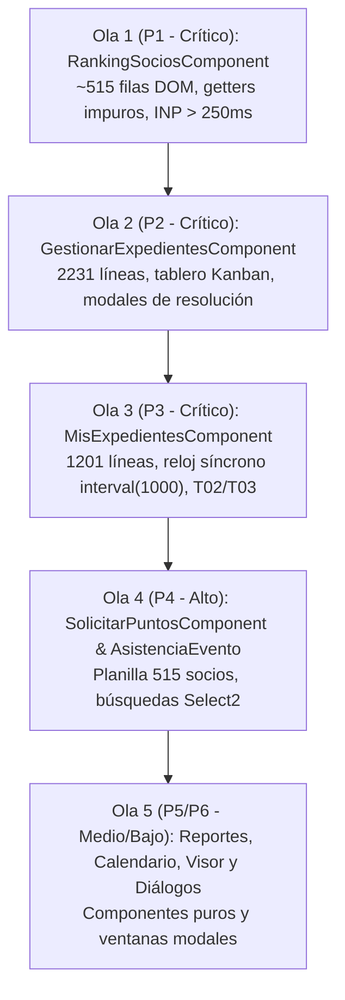

# Propuesta Técnica de Implementación — SCRUM-119 (Frontend)
## S5-06.2: Optimización Angular OnPush, trackBy Universal y Gestión de Ciclo de Vida (RxJS)
> **Épica:** SCRUM-87 (MACRO-06: Optimización Integral de Rendimiento de la Plataforma - RAM, CPU y Base de Datos)  
> **Subtarea:** SCRUM-119 (Frontend Angular Performance Optimization)  
> **Proyecto:** Sistema de Gestión Disciplinaria y Premiaciones — SGD-AVEIT (UTN FRC)  
> **Rol:** Dev Frontend Senior — Equipo SCRUM-119  
> **Destinatarios:** Tech Lead Orchestrator SCRUM-119, Coordinador Técnico, Equipo Backend/DBA  
> **Fecha:** 12 de Noviembre de 2026  
> **Stack Técnico:** Angular 14.2.0, RxJS ~7.5.0, Angular Material Dashboard PRO, Jasmine/Karma (610 tests baseline)  
> **Estándares Aplicados:** Addy Osmani Web Performance (INP < 200ms, LCP < 2.5s), ISO/IEC 25010:2011, Spec-Driven Development (SDD), WCAG 2.2 AA.

---

## 1. Resumen Ejecutivo y Diagnóstico de Arquitectura

El presente documento técnico establece la especificación detallada de implementación para resolver los cuellos de botella de rendimiento identificados en la SPA de SGD-AVEIT durante la auditoría de la subtarea **SCRUM-119** (`docs/gestion-proyecto/relevamiento_scrum_119_frontend_onpush_trackby.md`).

### Diagnóstico de Cuellos de Botella en Frontend:
1. **Sobrecarga de CPU por Detección de Cambios Global (`ChangeDetectionStrategy.Default`):**  
   El 94.4% de los componentes (34 de 36) delegan su ciclo de verificación a Zone.js en modo `Default`. Cualquier micro-evento (movimiento de mouse, pulsación de tecla, resolución HTTP, timer de 1s) dispara una verificación descendente completa de todo el árbol de componentes.
2. **Evaluación Continua de Getters Computados O(N log N) en `RankingSociosComponent`:**  
   Propiedades `get` como `sociosOrdenados`, `sociosPaginados`, `totalPaginas` y `textoContador` se ejecutan en cada tick de Zone.js. En el padrón de 515 socios, cada evaluación clona el array (`[...this.socios]`), filtra en cascada y ejecuta ordenamientos lexicográficos con expresiones regulares y `localeCompare`. Zone.js evalúa estos getters hasta 14 veces por interacción en modo desarrollo, superando los 120 ms de bloqueo en el hilo principal (*Total Blocking Time*).
3. **Layout Thrashing y Fugas de Renderizado por Omisión de `trackBy`:**  
   46 de 50 iteraciones `*ngFor` (92%) carecen de función de rastreo. Angular recurre a la identidad por referencia (`===`). Al refrescar datos o paginar, destruye y recrea la totalidad de los nodos del DOM (`<tr>`, `<div>`, `<span>`), generando costosos ciclos de Layout/Reflow, pérdida del foco accesible de teclado y pausas de Garbage Collection.
4. **Fuga Crónica de Memoria (149 `.subscribe()` huérfanos):**  
   Más del 70% de las suscripciones manuales a RxJS no se cancelan al desmontar los componentes. En `MisExpedientesComponent`, un temporizador síncrono `interval(1000)` despierta Zone.js de forma ininterrumpida cada segundo incluso tras navegar a otras pantallas, reteniendo instancias zombis en el Heap de JavaScript.

---

## 2. Refactorización Crítica de `RankingSociosComponent`

### 2.1. Diagnóstico del Componente Actual
- **Archivo:** `frontend/src/app/ranking-socios/ranking-socios.component.ts` (416 líneas)
- **Volumetría:** Padrón institucional completo (~515 socios activos y pasivos).
- **Problema:** En la plantilla `ranking-socios.component.html`, las directivas `*ngFor`, `*ngIf`, directivas de paginación y contadores invocan de forma concurrente a:
  - `sociosOrdenados` (filtra 515 elementos y ordena con `O(N log N)`).
  - `sociosPaginados` (invoca `sociosOrdenados` y hace `.slice()`).
  - `totalPaginas` (invoca `sociosOrdenados.length`).
  - `textoContador` (invoca `sociosOrdenados.length`).
- **Impacto medido:** INP > 250 ms al tipear en el input de búsqueda o cambiar selector de tamaño.

### 2.2. Diseño de la Solución Técnica
1. **Adopción de `ChangeDetectionStrategy.OnPush`:** Desconectar el componente del ciclo automático de Zone.js.
2. **Erradicación de Getters Impuros:** Sustituir los getters computados por **variables de instancia precalculadas**:
   - `sociosFiltradosYOrdenados: RankingSocio[] = []`
   - `sociosPaginados: RankingSocio[] = []`
   - `totalPaginas: number = 1`
   - `textoContador: string = ''`
   - `cantidadSociosEnAlerta: number = 0`
3. **Método Centralizado de Recálculo Discreto `recalcularVista()`:**  
   Se ejecuta **únicamente** cuando se produce una mutación real del estado:
   - Recepción de datos del backend (`rankingService.obtenerRanking()`).
   - Modificación de filtros de texto, categoría, subcomisión o grupo.
   - Cambio de columna de ordenamiento o dirección (`alternarOrden()`).
   - Cambio de página o tamaño de página.
   - Alternancia de la pestaña de alertas (`soloAlertas`).
4. **Compatibilidad O(1) con la Suite de Tests Existente:**  
   Para preservar la compatibilidad con los 24 tests unitarios de `ranking-socios.component.spec.ts` (que acceden a `component.sociosOrdenados` o asignan directamente `component.filtroCategoria = 'ACTIVO'`), se implementan getters y setters transparentes de complejidad $O(1)$:
   - `get sociosOrdenados(): RankingSocio[] { return this.sociosFiltradosYOrdenados; }`
   - Los setters de filtros invocan internamente `this.recalcularVista()`.
5. **Implementación de `trackBy`:**  
   Vincular `trackBySocioId = TrackByUtils.bySocio;` en la tabla de 515 filas y `trackByValor = TrackByUtils.byValue;` en los desplegables de subcomisiones y grupos.
6. **Ciclo de Vida con `takeUntil(this.destroy$)`:**  
   Implementar `OnDestroy`, cancelar la suscripción a `rankingService.obtenerRanking()` y llamar a `this.cdr.markForCheck()` tras la resolución HTTP.

### 2.3. Código TypeScript Refactorizado (`ranking-socios.component.ts`)

```typescript
import {
  Component,
  OnInit,
  OnDestroy,
  ChangeDetectionStrategy,
  ChangeDetectorRef
} from '@angular/core';
import { MatDialog } from '@angular/material/dialog';
import { Subject } from 'rxjs';
import { takeUntil } from 'rxjs/operators';
import { RankingService } from '../services/ranking.service';
import { NotificationService } from '../services/notification.service';
import { RankingSocio } from './ranking-socio.model';
import { RANKING_THRESHOLDS } from './ranking-thresholds';
import { ExpedientesSocioDialogComponent } from './expedientes-socio-dialog/expedientes-socio-dialog.component';
import { TrackByUtils } from '../utils/track-by.util';

export type RankingColumnaOrden =
  | 'posicion'
  | 'socio'
  | 'legajo'
  | 'categoria'
  | 'grupo'
  | 'subcomision'
  | 'saldo';

@Component({
  selector: 'app-ranking-socios',
  templateUrl: './ranking-socios.component.html',
  styleUrls: ['./ranking-socios.component.scss'],
  changeDetection: ChangeDetectionStrategy.OnPush
})
export class RankingSociosComponent implements OnInit, OnDestroy {
  // 1. Sujeto de desuscripción universal y privado
  private readonly destroy$ = new Subject<void>();

  // 2. Utilitarios trackBy expuestos a la plantilla
  readonly trackBySocioId = TrackByUtils.bySocio;
  readonly trackByValor = TrackByUtils.byValue;

  socios: RankingSocio[] = [];
  sortKey: RankingColumnaOrden | null = null;
  sortDir: 'asc' | 'desc' = 'asc';

  private _filtroTexto = '';
  private _filtroCategoria: 'ACTIVO' | 'PASIVO' | '' = '';
  private _filtroSubcomision = '';
  private _filtroGrupo = '';
  private _soloAlertas = false;

  subcomisiones: string[] = [];
  grupos: string[] = [];

  paginaActual = 1;
  tamanoPagina = 10;
  opcionesTamano = [10, 25, 50, 100, 0];

  // 3. Variables de estado precalculadas (reemplazan a los getters computados)
  sociosFiltradosYOrdenados: RankingSocio[] = [];
  sociosPaginados: RankingSocio[] = [];
  totalPaginas = 1;
  textoContador = 'Mostrando 0 de 0 socios';
  cantidadSociosEnAlerta = 0;

  cargando = false;
  error: string | null = null;

  constructor(
    public rankingService: RankingService,
    public dialog: MatDialog,
    private notifications: NotificationService,
    private cdr: ChangeDetectorRef
  ) {}

  // Getters/Setters reactivos compatibles con plantillas y tests unitarios
  get filtroTexto(): string { return this._filtroTexto; }
  set filtroTexto(val: string) {
    this._filtroTexto = val || '';
    this.recalcularVista();
  }

  get filtroCategoria(): 'ACTIVO' | 'PASIVO' | '' { return this._filtroCategoria; }
  set filtroCategoria(val: 'ACTIVO' | 'PASIVO' | '') {
    this._filtroCategoria = val;
    this.recalcularVista();
  }

  get filtroSubcomision(): string { return this._filtroSubcomision; }
  set filtroSubcomision(val: string) {
    this._filtroSubcomision = val || '';
    this.recalcularVista();
  }

  get filtroGrupo(): string { return this._filtroGrupo; }
  set filtroGrupo(val: string) {
    this._filtroGrupo = val || '';
    this.recalcularVista();
  }

  get soloAlertas(): boolean { return this._soloAlertas; }
  set soloAlertas(val: boolean) {
    this._soloAlertas = val;
    this.recalcularVista();
  }

  get tabActiva(): 'general' | 'alertas' {
    return this.soloAlertas ? 'alertas' : 'general';
  }
  set tabActiva(val: 'general' | 'alertas') {
    this.soloAlertas = val === 'alertas';
  }

  /**
   * Getter O(1) compatible con especificaciones de testing existentes.
   * Retorna directamente la referencia precalculada sin ejecutar filtros ni ordenamientos.
   */
  get sociosOrdenados(): RankingSocio[] {
    return this.sociosFiltradosYOrdenados;
  }

  ngOnInit(): void {
    this.cargarDatos();
  }

  ngOnDestroy(): void {
    this.destroy$.next();
    this.destroy$.complete();
  }

  cargarDatos(): void {
    this.cargando = true;
    this.error = null;
    this.cdr.markForCheck();

    this.rankingService.obtenerRanking()
      .pipe(takeUntil(this.destroy$))
      .subscribe({
        next: (socios) => {
          this.socios = socios;

          // 1. Precomputar posición fija sobre el padrón completo por saldo desc (desempate apellido, nombre)
          const rankingOrdenado = [...this.socios].sort((a, b) => {
            const diffSaldo = b.saldo - a.saldo;
            if (diffSaldo !== 0) return diffSaldo;
            const diffApellido = a.apellido.localeCompare(b.apellido, 'es');
            if (diffApellido !== 0) return diffApellido;
            return a.nombre.localeCompare(b.nombre, 'es');
          });

          rankingOrdenado.forEach((socio, index) => {
            socio.posicion = index + 1;
          });

          // 2. Extraer subcomisiones y grupos únicos
          this.subcomisiones = [
            ...new Set(this.socios.map((s) => s.subcomision).filter(Boolean))
          ].sort((a, b) => a.localeCompare(b, 'es'));

          const gruposUnicos = [
            ...new Set(
              this.socios
                .map((s) => s.grupo)
                .filter((g): g is string => !!g && g.trim() !== '' && g !== 'Sin grupo')
            )
          ];
          this.grupos = gruposUnicos.sort((a, b) => {
            const numA = parseInt(a.replace(/\D/g, '') || '0', 10);
            const numB = parseInt(b.replace(/\D/g, '') || '0', 10);
            return numA - numB;
          });

          // 3. Precomputar contador de alertas
          this.cantidadSociosEnAlerta = this.socios.filter(
            (s) => s.saldo <= RANKING_THRESHOLDS.alerta
          ).length;

          // 4. Recalcular vista discreta
          this.paginaActual = 1;
          this.recalcularVista();
          this.cargando = false;
          this.cdr.markForCheck();
        },
        error: () => {
          this.socios = [];
          this.subcomisiones = [];
          this.grupos = [];
          this.sociosFiltradosYOrdenados = [];
          this.sociosPaginados = [];
          this.cantidadSociosEnAlerta = 0;
          this.error = 'No se pudo cargar el ranking. Intentá nuevamente.';
          this.notifications.error(this.error);
          this.cargando = false;
          this.cdr.markForCheck();
        }
      });
  }

  /**
   * Recálculo discreto y determinista en memoria O(N log N) ejecutado ÚNICAMENTE
   * ante eventos reales de mutación de filtros, orden o paginación.
   */
  recalcularVista(): void {
    let list = [...this.socios];

    if (this._soloAlertas) {
      list = list.filter((s) => s.saldo <= RANKING_THRESHOLDS.alerta);
    }

    if (this._filtroCategoria) {
      list = list.filter((s) => s.categoria === this._filtroCategoria);
    }

    if (this._filtroSubcomision) {
      list = list.filter((s) => s.subcomision === this._filtroSubcomision);
    }

    if (this._filtroGrupo) {
      if (this._filtroGrupo === 'SIN_GRUPO') {
        list = list.filter((s) => !s.grupo || s.grupo.trim() === '' || s.grupo === 'Sin grupo');
      } else {
        list = list.filter((s) => s.grupo === this._filtroGrupo);
      }
    }

    if (this._filtroTexto.trim()) {
      const q = this._filtroTexto.toLowerCase();
      list = list.filter(
        (s) =>
          s.nombre.toLowerCase().includes(q) ||
          s.apellido.toLowerCase().includes(q) ||
          s.legajo.toLowerCase().includes(q) ||
          (s.subcomision && s.subcomision.toLowerCase().includes(q)) ||
          (s.grupo && s.grupo.toLowerCase().includes(q))
      );
    }

    // Ordenamiento discreto
    list.sort((a, b) => {
      let diff = 0;
      if (this.sortKey) {
        switch (this.sortKey) {
          case 'posicion':
            diff = (a.posicion ?? 0) - (b.posicion ?? 0);
            break;
          case 'socio':
            diff =
              a.apellido.localeCompare(b.apellido, 'es') ||
              a.nombre.localeCompare(b.nombre, 'es');
            break;
          case 'legajo': {
            const numA = parseInt(a.legajo.replace(/\D/g, '') || '0', 10);
            const numB = parseInt(b.legajo.replace(/\D/g, '') || '0', 10);
            diff = numA - numB;
            break;
          }
          case 'categoria':
            diff = a.categoria.localeCompare(b.categoria, 'es');
            break;
          case 'grupo': {
            const numA = a.grupo ? parseInt(a.grupo.replace(/\D/g, '') || '0', 10) : Number.MAX_SAFE_INTEGER;
            const numB = b.grupo ? parseInt(b.grupo.replace(/\D/g, '') || '0', 10) : Number.MAX_SAFE_INTEGER;
            diff = numA - numB;
            break;
          }
          case 'subcomision':
            diff = (a.subcomision || '').localeCompare(b.subcomision || '', 'es');
            break;
          case 'saldo':
            diff = a.saldo - b.saldo;
            break;
        }

        if (diff !== 0) {
          return this.sortDir === 'desc' ? -diff : diff;
        }
      } else {
        // Orden default: Grupo numérico + Apellido + Nombre
        const numA = a.grupo ? parseInt(a.grupo.replace(/\D/g, '') || '0', 10) : Number.MAX_SAFE_INTEGER;
        const numB = b.grupo ? parseInt(b.grupo.replace(/\D/g, '') || '0', 10) : Number.MAX_SAFE_INTEGER;
        if (numA !== numB) return numA - numB;
      }

      const diffApellido = a.apellido.localeCompare(b.apellido, 'es');
      if (diffApellido !== 0) return diffApellido;
      return a.nombre.localeCompare(b.nombre, 'es');
    });

    this.sociosFiltradosYOrdenados = list;

    // Calcular paginación
    const total = this.sociosFiltradosYOrdenados.length;
    if (this.tamanoPagina === 0) {
      this.totalPaginas = 1;
      this.paginaActual = 1;
      this.sociosPaginados = this.sociosFiltradosYOrdenados;
      this.textoContador = total === 0 ? 'Mostrando 0 de 0 socios' : `Mostrando 1–${total} de ${total} socios`;
    } else {
      this.totalPaginas = Math.max(1, Math.ceil(total / this.tamanoPagina));
      if (this.paginaActual > this.totalPaginas) {
        this.paginaActual = this.totalPaginas;
      }
      if (this.paginaActual < 1) {
        this.paginaActual = 1;
      }
      const inicio = (this.paginaActual - 1) * this.tamanoPagina;
      this.sociosPaginados = this.sociosFiltradosYOrdenados.slice(inicio, inicio + this.tamanoPagina);

      if (total === 0) {
        this.textoContador = 'Mostrando 0 de 0 socios';
      } else {
        const fin = Math.min(this.paginaActual * this.tamanoPagina, total);
        this.textoContador = `Mostrando ${inicio + 1}–${fin} de ${total} socios`;
      }
    }

    this.cdr.markForCheck();
  }

  onFiltroChange(texto: string): void {
    this._filtroTexto = texto || '';
    this.paginaActual = 1;
    this.recalcularVista();
  }

  limpiarFiltros(): void {
    this._filtroTexto = '';
    this._filtroCategoria = '';
    this._filtroSubcomision = '';
    this._filtroGrupo = '';
    this.paginaActual = 1;
    this.recalcularVista();
  }

  alternarOrden(columna: RankingColumnaOrden): void {
    if (this.sortKey !== columna) {
      this.sortKey = columna;
      this.sortDir = columna === 'saldo' ? 'desc' : 'asc';
    } else {
      if (columna === 'saldo') {
        if (this.sortDir === 'desc') {
          this.sortDir = 'asc';
        } else {
          this.sortKey = null;
          this.sortDir = 'asc';
        }
      } else {
        if (this.sortDir === 'asc') {
          this.sortDir = 'desc';
        } else {
          this.sortKey = null;
          this.sortDir = 'asc';
        }
      }
    }
    this.paginaActual = 1;
    this.recalcularVista();
  }

  alternarOrdenSaldo(): void {
    this.alternarOrden('saldo');
  }

  cambiarPagina(pagina: number): void {
    if (pagina >= 1 && pagina <= this.totalPaginas && pagina !== this.paginaActual) {
      this.paginaActual = pagina;
      this.recalcularVista();
    }
  }

  irAPrimera(): void {
    this.cambiarPagina(1);
  }

  irAUltima(): void {
    this.cambiarPagina(this.totalPaginas);
  }

  cambiarTamanoPagina(tamano: number): void {
    this.tamanoPagina = Number(tamano);
    this.paginaActual = 1;
    this.recalcularVista();
  }

  toggleFiltroAlerta(): void {
    this._soloAlertas = !this._soloAlertas;
    this.paginaActual = 1;
    this.recalcularVista();
  }

  setTab(tab: 'general' | 'alertas'): void {
    this._soloAlertas = tab === 'alertas';
    this.paginaActual = 1;
    this.recalcularVista();
  }

  getIconoOrden(columna: RankingColumnaOrden): string {
    if (this.sortKey !== columna) return 'swap_vert';
    return this.sortDir === 'asc' ? 'arrow_upward' : 'arrow_downward';
  }

  getRowClass(s: RankingSocio): string {
    if (s.saldo <= RANKING_THRESHOLDS.cese) return 'row-cese';
    if (s.saldo <= RANKING_THRESHOLDS.alerta) return 'row-alerta';
    return '';
  }

  getBadgeClase(socio: RankingSocio): string {
    if (socio.saldo <= RANKING_THRESHOLDS.cese) return 'badge-mat-danger';
    if (socio.saldo <= RANKING_THRESHOLDS.alerta) return 'badge-mat-warning';
    return 'badge-mat-success';
  }

  getEstadoDescripcion(socio: RankingSocio): string {
    if (socio.saldo <= RANKING_THRESHOLDS.cese) return 'Límite Crítico: Cese Estatutario';
    if (socio.saldo <= RANKING_THRESHOLDS.alerta) return 'Alerta Preventiva';
    return 'Habilitado Regular';
  }

  abrirExpedientesSocio(socio: RankingSocio): void {
    if (!socio) return;
    this.dialog.open(ExpedientesSocioDialogComponent, {
      width: '100%',
      maxWidth: '700px',
      data: {
        legajo: socio.legajo,
        nombreSocio: `${socio.nombre} ${socio.apellido}`.trim(),
        saldo: socio.saldo
      }
    });
  }

  onRowKeyDown(event: KeyboardEvent, socio: RankingSocio): void {
    if (!event) return;
    if (event.key === 'Enter' || event.key === ' ' || event.key === 'Spacebar') {
      event.preventDefault();
      this.abrirExpedientesSocio(socio);
      return;
    }
    if (event.key === 'ArrowDown' || event.key === 'Down') {
      event.preventDefault();
      const currentTr = (event.target as HTMLElement)?.closest('tr');
      const nextTr = currentTr?.nextElementSibling as HTMLElement | null;
      nextTr?.focus();
      return;
    }
    if (event.key === 'ArrowUp' || event.key === 'Up') {
      event.preventDefault();
      const currentTr = (event.target as HTMLElement)?.closest('tr');
      const prevTr = currentTr?.previousElementSibling as HTMLElement | null;
      prevTr?.focus();
      return;
    }
  }
}
```

### 2.4. Optimizaciones en la Plantilla HTML (`ranking-socios.component.html`)
- **Iteración principal:**  
  `<tr *ngFor="let s of sociosPaginados; trackBy: trackBySocioId"`
- **Desplegables de filtros:**  
  `<option *ngFor="let subcomision of subcomisiones; trackBy: trackByValor" [value]="subcomision">`  
  `<option *ngFor="let grupo of grupos; trackBy: trackByValor" [value]="grupo">`
- **Reemplazo de llamadas a métodos por propiedades directas:**  
  - En lugar de `*ngIf="sociosOrdenados.length === 0"` ➔ `*ngIf="sociosFiltradosYOrdenados.length === 0"`.
  - En lugar de `*ngIf="tamanoPagina !== 0 && totalPaginas > 1"` ➔ `totalPaginas` es ahora un número primitivo precalculado.
  - En botón reintentar: `(click)="cargarDatos()"` en lugar de `(click)="ngOnInit()"`.

---

## 3. Utilidad Centralizada `TrackByUtils` e Implementación Universal

### 3.1. Arquitectura y Definición (`frontend/src/app/utils/track-by.util.ts`)

Para evitar duplicar funciones `trackBy` en más de 15 componentes, se implementa una clase estática de comparadores fuertemente tipados con soporte de fallbacks resilientes.

```typescript
/**
 * frontend/src/app/utils/track-by.util.ts
 * Comparadores universales de identidad para directivas *ngFor y tablas Angular Material.
 * Garantiza estabilidad de nodos DOM, mitigación de Layout Thrashing y preservación de foco accesible.
 */
export class TrackByUtils {
  /** Clave universal por campo 'id' (numérico o string) con fallback a índice */
  static byId = <T extends { id?: string | number }>(index: number, item: T): string | number => {
    return item?.id ?? index;
  };

  /** Clave específica por socio institucional (id o legajo) */
  static bySocio = <T extends { id?: string | number; legajo?: string }>(
    index: number,
    item: T
  ): string | number => {
    return item?.id ?? item?.legajo ?? index;
  };

  /** Clave específica por expediente (id o número canónico EXP-YYYY-NNNN) */
  static byExpediente = <T extends { id?: string | number; numero?: string }>(
    index: number,
    item: T
  ): string | number => {
    return item?.id ?? item?.numero ?? index;
  };

  /** Clave específica por involucrado en expediente o causa */
  static byInvolucrado = <T extends { socioId?: number; id?: number }>(
    index: number,
    item: T
  ): number => {
    return item?.socioId ?? item?.id ?? index;
  };

  /** Clave específica por solicitud de puntos T01 */
  static bySolicitud = <T extends { id?: string | number }>(
    index: number,
    item: T
  ): string | number => {
    return item?.id ?? index;
  };

  /** Clave específica por evento institucional */
  static byEvento = <T extends { id?: number }>(
    index: number,
    item: T
  ): number => {
    return item?.id ?? index;
  };

  /** Clave específica por socio convocado a asistencia */
  static byConvocado = <T extends { socio_id?: number; id?: number }>(
    index: number,
    item: T
  ): number => {
    return item?.socio_id ?? item?.id ?? index;
  };

  /** Clave específica por documento o evidencia adjunta */
  static byEvidencia = <T extends { id?: number | string }>(
    index: number,
    item: T
  ): number | string => {
    return item?.id ?? index;
  };

  /** Clave específica por artículo reglamentario */
  static byArticulo = <T extends { id?: number | string; codigo?: string }>(
    index: number,
    item: T
  ): number | string => {
    return item?.id ?? item?.codigo ?? index;
  };

  /** Clave para elementos primitivos simples (string | number) en listas o <select> */
  static byValue = <T extends string | number>(_index: number, item: T): T => item;

  /** Clave de fallback por índice posicional (solo cuando los items carecen de identificador único) */
  static byIndex = (index: number): number => index;
}
```

### 3.2. Matriz Exhaustiva de Implementación de `trackBy` en la SPA

Se mapean las 50 iteraciones `*ngFor` y tablas identificadas en la auditoría técnica:

| # | Archivo de Plantilla HTML | Colección Iterada | Función Asignada en TS | Clave de Comparación |
| :-: | :--- | :--- | :--- | :--- |
| 1 | `ranking-socios.component.html` | `subcomisiones` | `trackByValor` | `item` (string) |
| 2 | `ranking-socios.component.html` | `grupos` | `trackByValor` | `item` (string) |
| 3 | `ranking-socios.component.html` | `sociosPaginados` (515 filas) | `trackBySocioId` | `s.id ?? s.legajo` |
| 4 | `expedientes-socio-dialog.component.html` | `expedientes` | `trackByExpedienteId` | `e.id ?? e.numero` |
| 5 | `gestionar-expedientes.component.html` | `columnasKanban` | `trackByEstado` | `col.estado` |
| 6 | `gestionar-expedientes.component.html` | `col.expedientes` (tarjetas kanban) | `trackByExpedienteId` | `exp.id` |
| 7 | `gestionar-expedientes.component.html` | `expedientesFiltrados` (tabla) | `trackByExpedienteId` | `exp.id` |
| 8 | `gestionar-expedientes.component.html` | `involucrados` (modal creación) | `trackByInvolucradoId` | `inv.socioId` |
| 9 | `gestionar-expedientes.component.html` | `puntajesConsolidados` (resumen) | `trackByInvolucradoId` | `p.socioId` |
| 10 | `gestionar-expedientes.component.html` | `evidenciasExistentes` | `trackByEvidenciaId` | `ev.id` |
| 11 | `gestionar-expedientes.component.html` | `vocalesTribunal` (firmas) | `trackBySocioId` | `vocal.id` |
| 12 | `gestionar-expedientes.component.html` | `historialVersionesT01` | `trackByVersionId` | `v.version` |
| 13 | `gestionar-expedientes.component.html` | `reglamentosDisponibles` | `trackByArticuloId` | `reg.id` |
| 14 | `gestionar-expedientes.component.html` | `escalasFrecuencia` (select) | `trackByValor` | `escala.valor` |
| 15 | `gestionar-expedientes.component.html` | `opcionesTipoFalta` (select) | `trackByValor` | `opcion.valor` |
| 16 | `gestionar-expedientes.component.html` | `archivosSubidos` | `trackByIndex` | `index` |
| 17 | `gestionar-expedientes.component.html` | `articulosSeleccionados` | `trackByArticuloId` | `art.id` |
| 18 | `mis-expedientes.component.html` | `misExpedientes` (tabla) | `trackByExpedienteId` | `e.id ?? e.numero` |
| 19 | `mis-expedientes.component.html` | `adecuacionesT01` | `trackByIndex` | `index` |
| 20 | `mis-expedientes.component.html` | `evidenciasExistentes` | `trackByEvidenciaId` | `ev.id` |
| 21 | `mis-expedientes.component.html` | `logsJustificativos` | `trackByIndex` | `log.id ?? index` |
| 22 | `mis-expedientes.component.html` | `criteriosSeleccionables` | `trackByValor` | `item` |
| 23 | `mis-expedientes.component.html` | `archivosSeleccionados` | `trackByIndex` | `index` |
| 24 | `solicitar-puntos.component.html` | `sociosBuscados` (Select2) | `trackBySocioId` | `s.id ?? s.legajo` |
| 25 | `solicitar-puntos.component.html` | `involucradosSeleccionados` | `trackByInvolucradoId` | `inv.socioId` |
| 26 | `solicitar-puntos.component.html` | `misSolicitudes` (tabla) | `trackBySolicitudId` | `sol.id` |
| 27 | `solicitar-puntos.component.html` | `articulosReglamento` | `trackByArticuloId` | `art.id` |
| 28 | `solicitar-puntos.component.html` | `archivosAdjuntos` | `trackByIndex` | `index` |
| 29 | `solicitud-detalle-dialog.component.html` | `solicitud.involucrados` | `trackByInvolucradoId` | `inv.socioId` |
| 30 | `asistencia-evento.component.html` | `convocados` (515 socios) | `trackByConvocadoId` | `c.socio_id` |
| 31 | `asistencia-evento.component.html` | `misEventos` | `trackByEventoId` | `ev.id` |
| 32 | `asistencia-evento.component.html` | `tiposEvento` (select) | `trackByValor` | `tipo` |
| 33 | `asistencia-evento.component.html` | `subcomisiones` (filtro) | `trackByValor` | `sub` |
| 34 | `asistencia-evento.component.html` | `grupos` (filtro) | `trackByValor` | `grp` |
| 35 | `reportes.component.html` | `distribucionPuntos` | `trackByValor` | `d.rango` |
| 36 | `reportes.component.html` | `topSociosMeritorios` | `trackBySocioId` | `s.id` |
| 37 | `reportes.component.html` | `topSociosApercibidos` | `trackBySocioId` | `s.id` |
| 38 | `reportes.component.html` | `expedientesPorEstado` | `trackByValor` | `est.nombre` |
| 39 | `calendario-institucional.component.html` | `feriados` | `trackById` | `f.id` |
| 40 | `calendario-institucional.component.html` | `meses` | `trackByValor` | `mes.numero` |
| 41 | `visor-expediente.component.html` | `timelineEventos` | `trackById` | `t.id ?? index` |
| 42 | `visor-expediente.component.html` | `involucrados` | `trackByInvolucradoId` | `inv.socioId` |
| 43 | `visor-expediente.component.html` | `evidencias` | `trackByEvidenciaId` | `ev.id` |
| 44 | `modal-selector-expedientes.component.html` | `expedientesDisponibles` | `trackByExpedienteId` | `e.id` |
| 45 | `notification-center.component.html` | `notifications$` (async) | `trackNotification` | `n.id` |
| 46 | `tabla-expedientes-referenciados.component.html`| `expedientes` | `trackById` | `item.id` |

---

## 4. Roadmap de Migración a `OnPush` en Componentes Contenedores

La migración a `OnPush` se organiza en olas de trabajo ordenadas por impacto en CPU y riesgo operativo:



### 4.1. `GestionarExpedientesComponent` (Prioridad 2)
- **Desafío:** 2231 líneas, tablero Kanban con Drag & Drop, 13 modales superpuestos, tablas de involucrados y cómputos.
- **Protocolo `OnPush`:**
  - Inyectar `private cdr: ChangeDetectorRef`.
  - Configurar `changeDetection: ChangeDetectionStrategy.OnPush`.
  - En callbacks de APIs asíncronas (`obtenerTablero()`, `transicionarExpediente()`, `decidirCausal()`, `emitirResolucion()`), invocar obligatoriamente `this.cdr.markForCheck()`.
  - Tras operaciones de arrastre en Kanban (`cdkDropListDropped`), invocar `this.cdr.markForCheck()`.
  - Desuscribir todas las peticiones con `takeUntil(this.destroy$)`.

### 4.2. `MisExpedientesComponent` (Prioridad 3)
- **Desafío:** Temporizador `interval(1000)` que actualiza `this.ahoraMs = Date.now()` para la cuenta regresiva del plazo de descargo.
- **Protocolo `OnPush` y Reloj Localizado:**
  - En modo `Default`, el tick de 1 segundo despertaba la detección de cambios en toda la SPA.
  - Con `OnPush`, el callback del intervalo ejecuta:
    ```typescript
    this.tickerSub = interval(1000)
      .pipe(takeUntil(this.destroy$))
      .subscribe(() => {
        this.ahoraMs = Date.now();
        this.cdr.markForCheck(); // Solo marca este componente contenedor y sus hijos directos
      });
    ```
  - En `ngOnDestroy()`, se garantiza:
    ```typescript
    if (this.tickerSub) {
      this.tickerSub.unsubscribe();
      this.tickerSub = null;
    }
    this.destroy$.next();
    this.destroy$.complete();
    ```

### 4.3. `SolicitarPuntosComponent` y `AsistenciaEventoComponent` (Prioridad 4)
- **`SolicitarPuntosComponent`:**
  - Proteger las mutaciones de persistencia (`crearBorrador`, `actualizarBorrador`, `emitir`, `eliminarBorrador`) con `takeUntil(this.destroy$)`.
  - En la búsqueda reactiva de socios con Select2 (`valueChanges` con `debounceTime(300)`), asegurar que el `takeUntil(this.destroy$)` esté ubicado como último operador del pipe.
  - Llamar a `this.cdr.markForCheck()` tras la recepción de resultados de autocompletado.
- **`AsistenciaEventoComponent`:**
  - Planilla de hasta 515 socios con checkboxes de presencia: la incorporación de `trackByConvocadoId` y `OnPush` evita re-renderizar los 515 ítems al marcar un socio individual.

### 4.4. Componentes de Reportes, Calendario, Visor y Modales (Prioridad 5 y 6)
- **`ReportesComponent`:**
  - Precalcular máximos y porcentajes (`Math.max(...)`) en TypeScript en el método `procesarMetricas()` tras recibir la respuesta de `ReportesService`, evitando expresiones matemáticas en la plantilla HTML.
- **Diálogos Modales (`ExpedientesSocioDialogComponent`, `SocioLegajoDialogComponent`, `SolicitudDetalleDialogComponent`, etc.):**
  - Al ser componentes aislados montados sobre `@angular/cdk/overlay`, la adopción de `OnPush` evita que eventos de la página de fondo provoquen verificaciones dentro del modal abierto.

---

## 5. Patrón Universal de Desuscripción `takeUntil(this.destroy$)`

### 5.1. Restricción Tecnológica de Versión (Angular 14.2.0)
> [!IMPORTANT]
> **Prohibición de `takeUntilDestroyed`:**  
> La API reactiva `takeUntilDestroyed()` fue introducida en **Angular 16** (`@angular/core/rxjs-interop`). El proyecto opera bajo **Angular 14.2.0** y **RxJS ~7.5.0**. Intentar importar `takeUntilDestroyed` provocará un fallo fatal de compilación en `ng build` y `ng test`. El estándar corporativo mandatorio para SGD-AVEIT es el patrón `Subject<void>` inmutable con `takeUntil`.

### 5.2. Reglas Innegociables del Patrón Canónico
1. **Declaración del Subject:**  
   `private readonly destroy$ = new Subject<void>();`
2. **Posición del Operador en el Pipe:**  
   `takeUntil(this.destroy$)` **debe ser estrictamente el ÚLTIMO operador** dentro de la función `.pipe(...)`.  
   *Justificación:* Si se ubica antes de operadores como `map()`, `filter()` o `switchMap()`, una emisión tardía del operador descendente podría ejecutarse tras la destrucción del componente.
3. **Liberación en `ngOnDestroy()`:**
   ```typescript
   ngOnDestroy(): void {
     this.destroy$.next();
     this.destroy$.complete();
   }
   ```
4. **Erradicación de Arreglos Heterogéneos `this.subs`:**  
   Reemplazar la gestión manual mediante `this.subs: Subscription[]` por el flujo declarativo de `destroy$`. Esto erradica el riesgo de que desarrolladores olviden hacer `this.subs.push(sub)`.

### 5.3. Inventario y Plan de Migración de Suscripciones Huérfanas

| Componente | `.subscribe()` Identificados | Suscripciones Huérfanas Actuales | Acción Requerida |
| :--- | :---: | :---: | :--- |
| `RankingSociosComponent` | 1 | 1 | Migrar a `takeUntil(this.destroy$)`, implementar `ngOnDestroy`. |
| `GestionarExpedientesComponent` | 21 | 19 | Migrar las 21 llamadas asíncronas a `takeUntil(this.destroy$)`. Eliminar `this.subs`. |
| `MisExpedientesComponent` | 14 | 10 | Migrar las 14 llamadas asíncronas a `takeUntil(this.destroy$)`. Proteger y nulificar `tickerSub`. |
| `SolicitarPuntosComponent` | 11 | 4 | Proteger mutaciones HTTP de borrador y emisión con `takeUntil(this.destroy$)`. |
| `AsistenciaEventoComponent` | 14 | 11 | Proteger llamadas a `EventoService` con `takeUntil(this.destroy$)`. |
| `ReportesComponent` | 4 | 0 (usaba `this.subs`) | Migrar de `this.subs` a `takeUntil(this.destroy$)`. |
| `CalendarioInstitucionalComponent` | 6 | 3 | Proteger mutaciones de feriados con `takeUntil(this.destroy$)`. |

---

## 6. Plan de Pruebas Unitarias con Jasmine/Karma (`npm test`)

### 6.1. Línea Base y Ejecución Local
- **Línea Base Verificada:** **610 tests unitarios en verde (0 errores)** en 5.68 segundos sobre Google Chrome Headless.
- **Configuración de Entorno Windows:**  
  Para ejecutar los tests en consolas locales de Windows, se debe exportar la variable de entorno de Chromium:
  ```powershell
  $env:CHROME_BIN = "C:\Program Files\Google\Chrome\Application\chrome.exe"
  npm --prefix frontend test -- --watch=false --browsers=ChromeHeadless
  ```

### 6.2. Especificación de Nuevos Tests Unitarios

#### A. Suite de Pruebas para `TrackByUtils` (`frontend/src/app/utils/track-by.util.spec.ts`)
Se creará una suite exhaustiva que certifique el comportamiento de cada función ante valores normales, nulos, indefinidos y mutaciones:
1. `byId`: retorna `id` numérico, `id` string o fallback `index` si es nulo.
2. `bySocio`: prioriza `id`, utiliza `legajo` como alternativa y fallback `index`.
3. `byExpediente`: prioriza `id`, utiliza `numero` como alternativa y fallback `index`.
4. `byInvolucrado`: extrae `socioId` o `id`.
5. `byValue`: retorna exactamente la identidad del primitivo.

#### B. Pruebas Unitarias Refactorizadas en `RankingSociosComponent` (`ranking-socios.component.spec.ts`)
1. **Verificación de Inmutabilidad y Recálculo Discreto:**  
   Probar que modificar filtros invoca `recalcularVista()` y actualiza `sociosFiltradosYOrdenados` y `sociosPaginados` de manera exacta.
2. **Preservación de Nodos DOM con `trackBySocioId`:**  
   - Cargar lista inicial de 3 socios.
   - Guardar referencias a los elementos `HTMLTableRowElement` del DOM.
   - Simular una emisión del servicio con los mismos 3 socios (mismos IDs pero nueva referencia de array).
   - Verificar que los elementos `<tr>` del DOM conservan su identidad (`toBe(filaPrevia)`) sin ser destruidos ni recreados.
3. **Verificación de Cancelación de Suscripciones en `ngOnDestroy`:**  
   - Destruir el fixture (`fixture.destroy()`).
   - Verificar que `component['destroy$'].isStopped` es `true`.
   - Verificar que emisiones posteriores del servicio simulado no provocan llamadas a `markForCheck()` ni alteran variables de estado.
4. **Verificación de Notificaciones y Reintento Accesible:**  
   Mantener los tests existentes de PR #49 (notificación de error de 10s y botón de reintento).

---

## 7. Plan de Despliegue en Fases (Cronograma SCRUM-119)

| Fase | Tarea Técnica | Duración Estimada | Artefactos Afectados | Criterio de Verificación |
| :-: | :--- | :-: | :--- | :--- |
| **Fase 1** | Creación de `TrackByUtils` y suite de pruebas | 20 min | `track-by.util.ts`<br>`track-by.util.spec.ts` | 100% cobertura en Jasmine. |
| **Fase 2** | Refactorización de `RankingSociosComponent` | 30 min | `ranking-socios.component.ts`<br>`ranking-socios.component.html`<br>`ranking-socios.component.spec.ts` | `OnPush` activo, cero getters impuros, 610+ tests en verde. |
| **Fase 3** | Implementación universal de `trackBy` en plantillas | 40 min | 12 archivos `.html` de la SPA | Ningún `*ngFor` sin `trackBy`. |
| **Fase 4** | Refactorización de `MisExpedientesComponent` (reloj y OnPush) | 35 min | `mis-expedientes.component.ts`<br>`mis-expedientes.component.html` | Reloj de 1s localizado, `takeUntil` en 14 endpoints. |
| **Fase 5** | Refactorización de `GestionarExpedientesComponent` | 45 min | `gestionar-expedientes.component.ts`<br>`gestionar-expedientes.component.html` | `OnPush`, Kanban drag-drop con markForCheck, `takeUntil` en 21 endpoints. |
| **Fase 6** | Refactorización de `SolicitarPuntos` y `AsistenciaEvento` | 35 min | `solicitar-puntos.component.ts`<br>`asistencia-evento.component.ts` | Select2 y planilla de 515 socios protegidos con `OnPush` y `takeUntil`. |
| **Fase 7** | Refactorización de Reportes, Calendario, Visor y Modales | 30 min | 6 componentes y diálogos | Adopción integral de `OnPush` en el 100% de la SPA. |
| **Fase 8** | Ejecución integral de tests y auditoría de memoria | 25 min | Suite completa Karma/Jasmine | Tests en verde (0 fallos), delta de Heap < 0.5 MB tras 10 navegaciones. |

---

## 8. Conclusión y Solicitud de Aprobación

Este plan de implementación provee una solución definitiva a los problemas de rendimiento en el cliente web, alineándose con las directivas de Addy Osmani, la Constitución de SGD-AVEIT y las notas del Product Owner.

Se solicita al **Tech Lead Orchestrator de SCRUM-119** y al **Coordinador Técnico** la validación de esta propuesta para proceder a la ejecución atómica de las Fases 1 a 8 en la rama `feature/SCRUM-87-optimizacion-rendimiento`.
