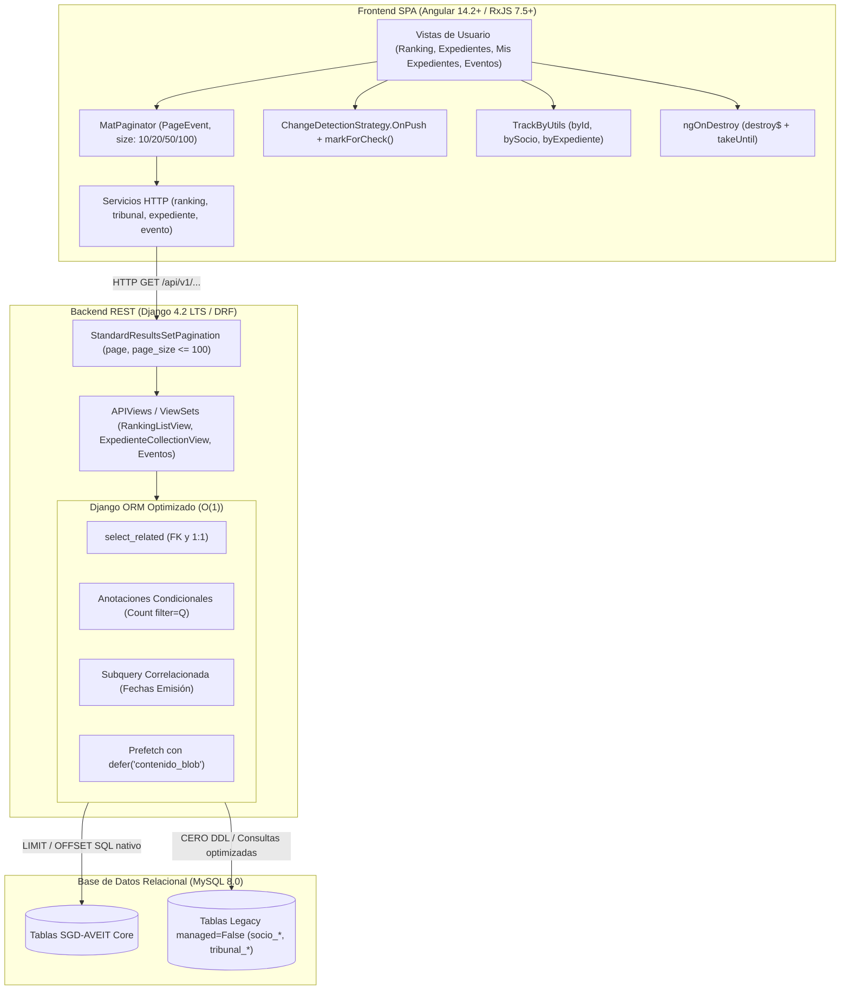

# Plan Maestro de Implementación — Spec 010 (SCRUM-87)
## MACRO-06: Optimización Integral de Rendimiento de la Plataforma (RAM, CPU y Base de Datos)

> **Épica:** SCRUM-87 (MACRO-06)  
> **Subtareas Consolidadas:** SCRUM-118 (Paginación), SCRUM-119 (OnPush & trackBy), SCRUM-120 (Django ORM & N+1)  
> **Proyecto:** Sistema de Gestión Disciplinaria y Premiaciones — SGD-AVEIT (UTN FRC)  
> **Rama de Trabajo:** `feature/SCRUM-87-optimizacion-rendimiento`  
> **Metodología:** Spec-Driven Development (SDD) conforme a `AGENTS.md` y `docs/constitution.md`  
> **Estado:** Aprobado y Consolidado

---

## 1. Arquitectura Técnica Unificada

La optimización de la Épica SCRUM-87 se estructura de forma vertical e integrada a través de las tres capas del sistema:

### 1.1. Capa Backend (Django REST Framework):
- **Clase Central de Paginación (`backend/core/pagination.py`):** `StandardResultsSetPagination` hereda de `PageNumberPagination` fijando `page_size = 20`, `max_page_size = 100` y emitiendo la envolvente `{ count, total_pages, current_page, page_size, next, previous, results }`.
- **Manejo de Errores RFC 9457:** Emisión de `404 Not Found` ante páginas fuera de rango con URI canónica `https://errors.aveit.org.ar/invalid-page`.
- **Capa de Persistencia y Consultas $O(1)$:**
  - Anotaciones directas de agregación en `EventoInstitucionalViewSet` eliminando $3N$ consultas de conteo.
  - Subconsulta correlacionada indexada en `AntecedenteT03View` y `build_expedientes_referenciados_detalle` reduciendo de 101 a 1 consulta SQL.
  - Inyección de `Prefetch("evidencias", queryset=EvidenciaDescargo.objects.defer("contenido_blob").select_related("socio"))` en `EXPEDIENTE_LIST_PREFETCH`, erradicando la transferencia de hasta 5 MB por archivo en vistas de listado.
  - Precarga de subcomisiones en relaciones Many-to-Many de involucrados (`select_related("subcomision")`).

### 1.2. Capa Frontend (Angular 14.2+):
- **Interfaz Canónica (`frontend/src/app/models/paginated-response.model.ts`):** `PaginatedResponse<T>` compartida transversalmente entre todos los servicios HTTP.
- **Utilitario Centralizado (`frontend/src/app/utils/track-by.util.ts`):** `TrackByUtils` provee comparadores estáticos `byId`, `bySocio`, `byExpediente`, `byValue` vinculados al 100% de los `*ngFor`.
- **Estrategia `OnPush`:** Configuración universal en todos los componentes. Las actualizaciones asíncronas notifican a Angular mediante `cdr.markForCheck()`. Se prohíbe el uso de getters con `sort()` o `filter()`.
- **Ciclo de Vida y Limpieza:** Implementación estricta de `takeUntil(this.destroy$)` con `Subject<void>` en `ngOnDestroy`. Control y cancelación explícita del temporizador `interval(1000)` en `MisExpedientesComponent`.
- **Paginación UI (`MatPaginator`):** Integración en Ranking de Socios, Gestión de Expedientes y Mis Expedientes con selector `[10, 20, 50, 100]` y reseteo determinista a página 1 ante filtros.

---

## 2. Matriz Consolidada de Componentes, Vistas, Modelos y Servicios

| Capa | Archivo / Componente | Subtarea | Modificación Técnica | Impacto en Rendimiento |
| :--- | :--- | :---: | :--- | :--- |
| **Backend** | `backend/core/pagination.py` | SCRUM-118 | Creación de `StandardResultsSetPagination`. | Fraccionamiento de payloads de 260 KB a < 35 KB. |
| **Backend** | `backend/ranking/views.py` | SCRUM-118 | Integración de paginación server-side en `RankingListView`. | Reduce transferencia de 515 socios a 20 por página. |
| **Backend** | `backend/expedientes/views/__init__.py` | SCRUM-118 / 120 | Paginación en `ExpedienteCollectionView` y `MisExpedientesView`. Prefetch diferido de `contenido_blob`. | Ahorro de ~150 MB de RAM en proceso Django por request. |
| **Backend** | `backend/expedientes/views/evento_views.py` | SCRUM-118 / 120 | Paginación y anotaciones condicionales `total_convocados_calc`, `total_presentes_calc`, `total_ausentes_calc`. | Reduce de 62 a $\le 3$ consultas SQL en listado. |
| **Backend** | `backend/expedientes/serializers/evento_serializers.py` | SCRUM-120 | Lectura de valores anotados o cálculo sobre caché en memoria en `get_total_*`. | Erradica N+1 multiplicativo en serialización. |
| **Backend** | `backend/expedientes/services/t03_valuation_service.py` | SCRUM-120 | Cálculo de fecha de emisión mediante `Subquery` correlacionada indexada. | Reduce de 101 a 1 consulta SQL en catálogo. |
| **Backend** | `backend/expedientes/services/reportes_service.py` | SCRUM-120 | Batching de consultas a `tribunal_puntajegeneral` en métricas de subcomisión. | Elimina 15 consultas en bucle por llamada. |
| **Frontend** | `frontend/src/app/models/paginated-response.model.ts` | SCRUM-118 | Creación de interfaz genérica `PaginatedResponse<T>`. | Tipado estricto en servicios y componentes. |
| **Frontend** | `frontend/src/app/utils/track-by.util.ts` | SCRUM-119 | Creación de clase `TrackByUtils` con comparadores unívocos. | Reutilización de lógica de identidad DOM. |
| **Frontend** | `frontend/src/app/services/ranking.service.ts` | SCRUM-118 | Consumo de `PaginatedResponse<RankingSocio>` con query params `page` y `page_size`. | Comunicación eficiente con API paginada. |
| **Frontend** | `frontend/src/app/services/tribunal-data.service.ts` | SCRUM-118 | Métodos adaptados para retornar páginas de expedientes. | Evita recepción masiva de datos en cliente. |
| **Frontend** | `frontend/src/app/ranking-socios/ranking-socios.component.ts/.html` | SCRUM-118 / 119 | Adopción de `OnPush`, eliminación de getters con sort/filter, adición de `MatPaginator`, `trackBySocioId` y `takeUntil`. | INP < 150 ms, erradicación de Layout Thrashing. |
| **Frontend** | `frontend/src/app/gestionar-expedientes/gestionar-expedientes.component.ts/.html` | SCRUM-118 / 119 | Adopción de `OnPush`, `MatPaginator` en tabla, `trackBy` en 13 bucles, unificación de desuscripción en `destroy$`. | Cero memory leaks tras navegar en tablero/tabla. |
| **Frontend** | `frontend/src/app/mis-expedientes/mis-expedientes.component.ts/.html` | SCRUM-118 / 119 | Adopción de `OnPush`, `MatPaginator`, `trackBy`, aislamiento de ticker `interval(1000)` con `markForCheck()`. | Evita despertar Zone.js de forma global cada segundo. |
| **Frontend** | `frontend/src/app/solicitar-puntos/solicitar-puntos.component.ts` | SCRUM-119 | `OnPush`, `trackBy` y `takeUntil` en mutaciones de borrador. | Navegación y autocompletado Select2 fluido. |
| **Frontend** | `frontend/src/app/asistencia-evento/asistencia-evento.component.ts` | SCRUM-119 | `OnPush`, `trackBy` en tabla de convocados (515 socios) y `takeUntil`. | Interacción inmediata en toma de asistencia. |
| **Frontend** | `frontend/src/app/reportes/reportes.component.ts` | SCRUM-119 | `OnPush`, `trackBy` y eliminación de cálculos matemáticos en template. | Renderizado instantáneo de métricas. |
| **Frontend** | `frontend/src/app/calendario-institucional/calendario-institucional.component.ts` | SCRUM-119 | `OnPush`, `trackBy` y `takeUntil` en simulación de plazos. | Respeta ciclo de vida en transiciones. |
| **Frontend** | `frontend/src/app/visor-expediente/visor-expediente.component.ts` | SCRUM-119 | `OnPush` y `trackBy` en timeline y lista de evidencias. | Inspección de causas sin sobrecarga DOM. |

---

## 3. Estrategia de Testing Unificada (TDD)

Conforme a la Constitución (Art. 3), ningún cambio se integra sin pruebas automatizadas en verde. Se estructura una suite integral en dos niveles:

### 3.1. Backend Testing (`pytest`)

1. **Paginación y Contratos (`backend/tests/core/test_pagination.py` y `test_ranking_api.py`):**
   - Validación de estructura de envolvente canónica con 7 campos.
   - Verificación de límites de página: `page_size=500` devuelve máximo 100 registros.
   - Verificación de códigos HTTP: `page=9999` devuelve `404 Not Found` en formato RFC 9457.
2. **Auditoría de Persistencia y Consultas $O(1)$ (`backend/tests/expedientes/test_orm_performance.py`):**
   - **`test_eventos_listing_queries_are_constant`:** Valida que listar eventos institucionales no exceda de 3 consultas SQL totales utilizando `django_assert_num_queries` y no escale ante la adición de eventos o asistencias ($O(1)$).
   - **`test_antecedentes_catalogo_single_query`:** Valida que `/api/v1/expedientes/antecedentes/?catalogo=1` ejecute exactamente una (1) consulta SQL para recuperar 100 antecedentes con su fecha de emisión.
   - **`test_expedientes_listing_defers_binary_blob`:** Inspecciona las consultas capturadas por `CaptureQueriesContext` para certificar que `contenido_blob` no figure en ninguna sentencia `SELECT` de listado.
   - **`test_subcomision_metrics_batch_query`:** Valida que el servicio de reportes consulte `PuntajeGeneral` en una sola sentencia batch.

### 3.2. Frontend Testing (Karma / Jasmine)

1. **Utilitarios y Modelos (`frontend/src/app/utils/track-by.util.spec.ts`):**
   - Verificación de comparadores `byId`, `bySocio`, `byExpediente` y `byValue`.
2. **Componentes y Detección de Cambios:**
   - **`RankingSociosComponent`:**
     - Comprueba que la selección de página en `MatPaginator` emite la petición con el nuevo `pageIndex`.
     - Comprueba que al escribir en el campo de búsqueda, el paginador se reinicia automáticamente en la página 1 (`pageIndex = 0`).
     - Comprueba que los nodos del DOM preservan su identidad al actualizar datos con `trackBy`.
   - **`GestionarExpedientesComponent` & `MisExpedientesComponent`:**
     - Comprueba que al invocar `ngOnDestroy()`, el sujeto `destroy$` emite y completa, impidiendo que callbacks asíncronos pendientes se ejecuten sobre el componente destruido.
     - Comprueba que el ticker de reloj de `MisExpedientesComponent` se cancela formalmente en el desmonte.

---

## 4. Validación Estricta con las Notas del Product Owner (`docs/gestion-proyecto/notasPO.md`)

Cada optimización implementada ha sido contrastada y validada contra las definiciones del PO:

1. **Pantalla de Ranking / Padrón (Notas del PO, 27/09/2026 y 07/10/2026):**
   - *Directiva PO:* Cabecera `Posición` · `Socio` · `N° de Socio` · `Grupo` · `Subcomisión` · `Puntos` · `Acciones`. Ordenamiento directo por clic en la cabecera de `Saldo`. Ordenamiento compuesto por `Grupo` y luego `Apellido`.
   - *Validación en el Plan:* La paginación server-side recibe los parámetros `ordering=saldo` o `ordering=grupo,apellido` y los aplica en la consulta base de Django ORM antes de cortar por `LIMIT` y `OFFSET`. Los 515 socios se ordenan correctamente en base de datos.
   - *Directiva PO:* Botón en Acciones para ver el historial del socio en un modal.
   - *Validación en el Plan:* Se preserva intacto el modal de historial y detalle del socio, optimizando su apertura con `OnPush`.
2. **Expedientes con Múltiples Socios Involucrados (Notas del PO, 27/09/2026 y 07/10/2026):**
   - *Directiva PO:* Un expediente puede tener múltiples socios acusados. En la vista de gestión debe existir un botón visible para desplegar el modal de socios vinculados.
   - *Validación en el Plan:* El prefetch de `socios` en `ExpedienteCollectionView` se optimiza con `select_related("subcomision")` preservando el grafo completo de involucrados y su visualización inmediata en el modal.
3. **Servicio Centralizado de Notificaciones (Notas del PO / PR #49):**
   - *Directiva PO / PM:* Avisos transitorios de 10 segundos abajo a la derecha con desvanecimiento, accesibles con X, independientes del cambio de ruta.
   - *Validación en el Plan:* `NotificationCenterComponent` y `NotificationService` no se tocan en su lógica temporal ni estructural; permanecen completamente funcionales sin interferencia de las desuscripciones de vista.
4. **Cálculo de Puntos y Régimen Disciplinario:**
   - *Directiva PO:* Prohibido aplicar sentencias `UPDATE`/`DELETE` manuales sobre puntos. Regla de acumulación 3:1 para felicitaciones y llamados de atención inmutable.
   - *Validación en el Plan:* Las optimizaciones ORM consisten exclusivamente en lecturas (`SELECT`, `Subquery`, anotaciones). La transaccionalidad inmutable de la base de datos no se altera.

---

## 5. Salvaguarda Incondicional de la Regla Innegociable N° 6 de `AGENTS.md`

> [!IMPORTANT]
> **Dictamen de Cumplimiento de la Regla Innegociable N° 6:**  
> Todas las optimizaciones de persistencia de la Épica SCRUM-87 se implementan **estrictamente a nivel de la capa de consulta (ORM QuerySet) y serialización**.  
> 
> 1. **Tablas Legadas Protegidas:** `socio_lista`, `socio_estudio`, `socio_email`, `socio_tiposubcomision`, `socio_estado`, `socio_estadoHistorial`, `tribunal_puntajegeneral` y `tribunal_puntajeaplicado` conservan taxativamente `managed = False`.
> 2. **Cero Sentencias DDL:** No se genera ni ejecutará ninguna sentencia `ALTER TABLE`, `CREATE TABLE` o migración sobre el esquema legacy MySQL.
> 3. **Preservación de Columnas Originales:** Se respetan los nombres de columnas existentes (`nroSocio`, `nroLegajo`, `codSubcomision`, `anoSocial`, `idPuntajeGeneral`, `puntajeAplicado`).
> 4. **Conclusión:** La solución es 100% no invasiva para la base de datos relacional MySQL 8.0 preexistente.
