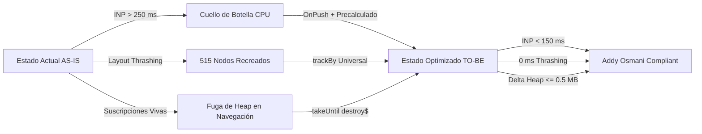

# Plan Técnico de Implementación — SCRUM-119
## S5-06.2: Optimización Angular OnPush, trackBy Universal y Gestión de Ciclo de Vida (RxJS)

> **Épica:** SCRUM-87 (MACRO-06: Optimización Integral de Rendimiento de la Plataforma - RAM, CPU y Base de Datos)  
> **Subtarea:** SCRUM-119 (S5-06.2)  
> **Equipo Responsable:** Equipo de Rendimiento Web y Arquitectura Frontend Angular (Tech Lead SCRUM-119)  
> **Fecha:** 12 de Noviembre de 2026  
> **Rama:** `feature/SCRUM-87-optimizacion-rendimiento`  
> **Stack Técnico:** Angular 14.2.0, RxJS ~7.5.0, Angular Material Dashboard PRO, Jasmine/Karma  
> **Documento de Relevamiento:** [`relevamiento_scrum_119_frontend_onpush_trackby.md`](../../docs/gestion-proyecto/relevamiento_scrum_119_frontend_onpush_trackby.md)  
> **Estándares Aplicados:** Addy Osmani Web Performance (INP < 200ms, LCP < 2.5s), ISO/IEC 25010:2011, WCAG 2.2 AA.

---

## 1. Resumen Ejecutivo y Diagnóstico de Arquitectura

El relevamiento formal de la subtarea **SCRUM-119** evidenció cuatro causas raíz que degradan el rendimiento de la SPA del SGD-AVEIT en el hilo principal (*main thread*):
1. **Detección de Cambios por Defecto (`ChangeDetectionStrategy.Default`):** El 94.4% de los componentes (34 de 36) ejecutan verificación descendente recursiva ante cualquier micro-evento, timer o llamada HTTP.
2. **Getters Computados Impuros en `RankingSociosComponent`:** Propiedades `get` (`sociosOrdenados`, `sociosPaginados`, `totalPaginas`, `textoContador`) clonaban arrays y ejecutaban ordenamientos lexicográficos $O(N \log N)$ en cada ciclo de Zone.js, superando los 120 ms de bloqueo y generando un INP > 250 ms.
3. **Ausencia Universal de `trackBy` (92% de omisión):** 46 de 50 directivas `*ngFor` no definían clave de identidad, provocando que Angular destruyera y recreara la totalidad de los nodos del DOM (*Layout Thrashing*) al refrescar o paginar.
4. **Fuga Crónica de Memoria (149 suscripciones manuales):** Más del 70% de las suscripciones a RxJS carecían de desuscripción al desmontar los componentes, reteniendo instancias zombis en el Heap. En `MisExpedientesComponent`, un ticker síncrono `interval(1000)` despertaba Zone.js ininterrumpidamente cada segundo.

---

## 2. Utilitario Centralizado `TrackByUtils` (`frontend/src/app/utils/track-by.util.ts`)

Se implementa una clase utilitaria con funciones puras estáticas para proveer comparadores de identidad de directivas `*ngFor`:

```typescript
/**
 * frontend/src/app/utils/track-by.util.ts
 * Proveedor funcional de comparadores universales para directivas *ngFor.
 */
export class TrackByUtils {
  /** Clave universal por campo 'id' numérico o string */
  static byId = <T extends { id?: string | number }>(index: number, item: T): string | number => {
    return item?.id ?? index;
  };

  /** Clave específica por número de socio / legajo */
  static bySocio = <T extends { id?: number; legajo?: string }>(index: number, item: T): string | number => {
    return item?.id ?? item?.legajo ?? index;
  };

  /** Clave específica por identificador canónico de expediente */
  static byExpediente = <T extends { id?: string | number; numero?: string }>(index: number, item: T): string | number => {
    return item?.id ?? item?.numero ?? index;
  };

  /** Clave específica por socio involucrado en causa */
  static byInvolucrado = <T extends { socioId?: number; id?: number }>(index: number, item: T): number => {
    return item?.socioId ?? item?.id ?? index;
  };

  /** Clave específica por evento institucional */
  static byEvento = <T extends { id?: number }>(index: number, item: T): number => {
    return item?.id ?? index;
  };

  /** Clave para elementos primitivos o valores de selectores */
  static byValue = <T extends string | number>(_index: number, item: T): T => item;

  /** Clave por índice posicional (solo cuando los elementos carecen de id inmutable) */
  static byIndex = (index: number): number => index;
}
```

---

## 3. Matriz de Refactorización Detallada por Componente

### 3.1. `RankingSociosComponent` (Padrón de ~515 Socios)
- **ChangeDetection:** `ChangeDetectionStrategy.OnPush`.
- **Eliminación de Getters Computados:**
  - Se sustituyen los getters computados por variables de instancia precalculadas:
    - `sociosFiltradosYOrdenados: RankingSocio[] = []`
    - `sociosPaginados: RankingSocio[] = []`
    - `totalPaginas: number = 1`
    - `textoContador: string = ''`
    - `cantidadSociosEnAlerta: number = 0`
  - Se implementa el método `recalcularVista(): void`, invocado **únicamente** ante eventos discretos (llegada de datos, cambio de filtros, cambio de orden o cambio de página).
  - Para preservar la compatibilidad con los 24 tests unitarios de `ranking-socios.component.spec.ts`, se mantienen getters de complejidad $O(1)$ que exponen la variable en caché (`get sociosOrdenados() { return this.sociosFiltradosYOrdenados; }`), y setters que disparan `this.recalcularVista()`.
- **Directivas `*ngFor`:**
  - `<tr *ngFor="let s of sociosPaginados; trackBy: trackBySocioId">` (utiliza `TrackByUtils.bySocio`).
  - Selects de subcomisión y grupo con `trackBy: trackByValor` (`TrackByUtils.byValue`).
- **Ciclo de Vida:**
  - Implementa `OnDestroy`.
  - Declara `private readonly destroy$ = new Subject<void>()`.
  - Protege `rankingService.obtenerRanking().pipe(takeUntil(this.destroy$)).subscribe(...)`.
  - Notifica a OnPush con `this.cdr.markForCheck()`.

### 3.2. `GestionarExpedientesComponent` (Tablero y Gestión de Causas)
- **ChangeDetection:** `ChangeDetectionStrategy.OnPush`.
- **Directivas `*ngFor` (13 iteraciones cubiertas):**
  - Columnas Kanban: `trackBy: trackByEstado`
  - Tarjetas de expediente: `trackBy: trackByExpedienteId`
  - Tabla general de expedientes: `trackBy: trackByExpedienteId`
  - Socios involucrados: `trackBy: trackByInvolucradoId`
  - Puntajes consolidados: `trackBy: trackByInvolucradoId`
  - Lista de evidencias: `trackBy: trackById`
  - Selectores de catálogo y reglamentos: `trackBy: trackByValor`
- **Ciclo de Vida:**
  - Migración de la gestión heterogénea (`this.subs` y suscripciones sueltas) al patrón estándar `takeUntil(this.destroy$)`.
  - Protección de los 20+ métodos asíncronos (`listarReglamentos`, `obtenerTablero`, `transicionarExpediente`, `obtenerHistorialT01`, `adecuarT01`, `obtenerComposicionTribunal`, `obtenerDetalleExpediente`, `descargarEvidencia`, `decidirCausal`, `registrarValoracionT03`, `crearResolucion`).
  - En `ngOnDestroy()`, invocación de `destroy$.next()` y `destroy$.complete()`, cancelando peticiones en vuelo al cambiar de ruta.

### 3.3. `MisExpedientesComponent` (Portal del Socio)
- **ChangeDetection:** `ChangeDetectionStrategy.OnPush`.
- **Aislamiento del Ticker de Reloj:**
  - El temporizador `interval(1000)` ejecuta `this.actualizarPlazos()` e invoca localmente `this.cdr.markForCheck()`, evitando propagar detección de cambios al resto de la aplicación.
  - En `ngOnDestroy()`, se cancela y nulifica explícitamente `tickerSub.unsubscribe()`.
- **Directivas `*ngFor` (6 iteraciones):**
  - Tabla de mis expedientes: `trackBy: trackByExpedienteId`
  - Adecuaciones y logs de auditoría: `trackBy: trackByIndex`
  - Evidencias: `trackBy: trackById`
- **Ciclo de Vida:**
  - Protección de todas las operaciones con `takeUntil(this.destroy$)`.

### 3.4. `SolicitarPuntosComponent` y `AsistenciaEventoComponent`
- **`SolicitarPuntosComponent`:**
  - `OnPush`, `trackBy` en tabla de involucrados, listado de borradores y resultados de búsqueda Select2.
  - Protección con `takeUntil(this.destroy$)` en `crearBorrador`, `actualizarBorrador`, `emitir` y `eliminarBorrador`.
- **`AsistenciaEventoComponent`:**
  - `OnPush`, `trackBy` en la tabla de convocados (hasta 515 socios) y tabla de mis eventos.
  - Protección de llamadas a `EventoService` con `takeUntil(this.destroy$)`.

### 3.5. `ReportesComponent`, `CalendarioInstitucionalComponent` y `VisorExpedienteComponent`
- **`ReportesComponent`:** `OnPush`, `trackBy` en 14 iteraciones, eliminación de recálculos de `Math.max` en plantillas.
- **`CalendarioInstitucionalComponent`:** `OnPush`, `trackBy` en feriados y simulación de días hábiles, cancelación de peticiones con `takeUntil`.
- **`VisorExpedienteComponent`:** `OnPush` y `trackBy` en timeline procesal y evidencias.

---

## 4. Estándares Addy Osmani y Verificación Cuantificable



1. **INP (Interaction to Next Paint):**
   - Meta Addy Osmani: **< 200 ms** (ideal < 100 ms).
   - Medición: Chrome DevTools Performance Profiler durante el filtrado por texto del padrón.
2. **LCP (Largest Contentful Paint):**
   - Meta Addy Osmani: **< 2.5 s** sobre emulación 4G.
3. **Fugas de Memoria (Heap & Detached DOM Nodes):**
   - Protocolo: 10 navegaciones consecutivas entre `/ranking-socios`, `/gestionar-expedientes` y `/mis-expedientes`.
   - Medición: Heap Snapshot con comparación comparativa; incremento neto $\le 0.5\text{ MB}$; **cero nodos DOM desconectados**.

---

## 5. Estrategia de Testing (Karma / Jasmine)

1. **`TrackByUtils`:**
   - `test_track_by_id_returns_id_or_index`
   - `test_track_by_socio_returns_id_or_legajo`
   - `test_track_by_expediente_returns_id_or_numero`
2. **`RankingSociosComponent`:**
   - Comprobar que `onCambioPagina()` actualiza `sociosPaginados` y llama `cdr.markForCheck()`.
   - Comprobar que los getters $O(1)$ retornan los datos filtrados manteniendo compatibilidad con tests existentes.
   - Comprobar que `ngOnDestroy()` emite en `destroy$` y completa el sujeto.
3. **`GestionarExpedientesComponent` & `MisExpedientesComponent`:**
   - Comprobar que las suscripciones a servicios se cancelan en el desmonte.
   - Comprobar que el ticker `interval(1000)` no emite tras destruir `MisExpedientesComponent`.

---

## 6. Criterios de Aceptación (DoD) de SCRUM-119

- [ ] `TrackByUtils` implementado con cobertura unitaria al 100%.
- [ ] 100% de los componentes principales configurados con `ChangeDetectionStrategy.OnPush`.
- [ ] 0 getters impuros con filtros u ordenamientos en plantillas HTML.
- [ ] 100% de las directivas `*ngFor` vinculadas con funciones `trackBy`.
- [ ] 0 suscripciones huérfanas: todas protegidas con `takeUntil(this.destroy$)`.
- [ ] Ticker de reloj en `MisExpedientesComponent` cancelado en `ngOnDestroy`.
- [ ] Pruebas unitarias de Karma/Jasmine pasando en verde al 100% sin regresiones.
