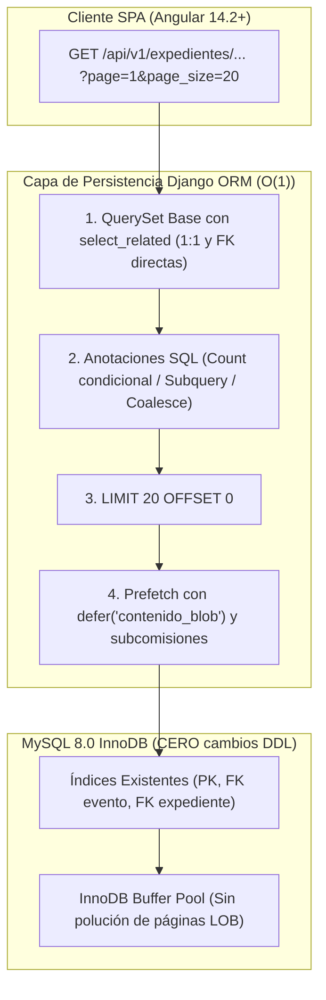

# Plan Técnico de Implementación — SCRUM-120: Optimización Django ORM y Eliminación de N+1

> **Épica:** SCRUM-87 (MACRO-06: Optimización Integral de Rendimiento de la Plataforma - RAM, CPU y Base de Datos)  
> **Subtarea:** SCRUM-120: S5-06.3 - Optimización Django ORM y eliminación de N+1  
> **Rol / Autor:** Tech Lead Orchestrator — Equipo SCRUM-120  
> **Especialistas del Equipo:** Dev Frontend Senior, Dev Backend Senior, DBA Senior  
> **Insumos Técnicos Armonizados:**  
> - `specs/010-optimizacion-rendimiento/draft_frontend_120.md`  
> - `specs/010-optimizacion-rendimiento/draft_backend_120.md`  
> - `specs/010-optimizacion-rendimiento/draft_dba_120.md`  
> **Relevamiento Base:** `docs/gestion-proyecto/relevamiento_scrum_120_optimizacion_orm.md`  
> **Fecha:** 12 de Noviembre de 2026  
> **Rama de Trabajo:** `feature/SCRUM-87-optimizacion-rendimiento`  
> **Estado:** Aprobado y Consolidado para Ejecución Técnica  

---

## 1. Resumen Ejecutivo y Alineación con la Épica SCRUM-87

El presente Plan Técnico de Implementación constituye la directiva formal de ingeniería para la subtarea **SCRUM-120**, componente medular de la épica **SCRUM-87 (MACRO-06)** orientada a maximizar la eficiencia en el uso de memoria RAM, ciclos de CPU y concurrencia sobre la base de datos relacional MySQL 8.0.

### 1.1. Diagnóstico Forense Consolidado
La auditoría de persistencia efectuada sobre el código del backend identificó cinco vectores críticos de ineficiencia computacional:
1. **Patrón N+1 Multiplicativo ($3N$) en Eventos:** En `EventoInstitucionalSerializer`, cada evento listado emite 3 consultas SQL individuales adicionales para calcular `total_convocados`, `total_presentes` y `total_ausentes`, disparando **62 consultas SQL** para responder a una página estándar de 20 eventos.
2. **Saturación Innecesaria de Memoria RAM por Binarios BLOB:** En `EXPEDIENTE_LIST_PREFETCH`, la precarga de evidencias descarga el campo binario `EvidenciaDescargo.contenido_blob` (de hasta 5 MB por archivo) en endpoints de listado (`/api/v1/expedientes/gestion/`, `/api/v1/expedientes/mis-expedientes/`), consumiendo más de 120 MB de memoria en el heap del worker de Gunicorn sin que dicho contenido sea consumido por el serializador.
3. **Complejidad Lineal $O(N)$ en Antecedentes Emitidos:** `AntecedenteT03View` ejecuta **101 consultas SQL** para listar 100 antecedentes debido a la resolución secuencial en Python de `_emission_date`.
4. **Consultas Foráneas Accidentales en Involucrados:** La ausencia de `select_related("subcomision")` al precargar la relación Many-to-Many de `socios` involucrados dispara queries individuales al serializar datos institucionales.
5. **Consultas en Bucle en Métricas de Subcomisiones:** `ReportesService.obtener_metricas_subcomision` ejecuta 15 queries individuales a `tribunal_puntajegeneral` dentro de un bucle `for`.

### 1.2. Interacción con SCRUM-118 (Paginación) y SCRUM-119 (Frontend OnPush / TrackBy)
SCRUM-120 opera en perfecta sincronía con los otros dos pilares de la épica:
- **SCRUM-118:** Acota el tamaño de los conjuntos de datos en memoria mediante paginación estándar server-side ($k=20$ registros por página).
- **SCRUM-120 (este plan):** Garantiza que cada página solicitada se resuelva en una cota estricta y constante de consultas SQL ($O(1)$) y con un consumo mínimo de RAM mediante el diferimiento de binarios.
- **SCRUM-119:** Consume estos payloads JSON optimizados en componentes Angular con estrategia `ChangeDetectionStrategy.OnPush` y funciones `trackBy`, erradicando repintados costosos en el navegador.

---

## 2. Arquitectura de Carga Optimizada y Estrategia $O(1)$



### 2.1. Erradicación de N+1 en Eventos Institucionales
- **QuerySet Base (`EventoInstitucionalViewSet.get_queryset`):**
  Se agregan anotaciones a nivel de base de datos utilizando `Count(..., filter=Q(...), distinct=True)`:
  ```python
  total_convocados_calc=Count("asistencias", distinct=True),
  total_presentes_calc=Count(
      "asistencias",
      filter=Q(
          asistencias__estado_asistencia__in=[
              EstadoAsistenciaEventoEnum.PRESENTE,
              EstadoAsistenciaEventoEnum.JUSTIFICADO,
              EstadoAsistenciaEventoEnum.TARDE_LEVE,
              EstadoAsistenciaEventoEnum.TARDE_GRAVE,
          ]
      ),
      distinct=True,
  ),
  total_ausentes_calc=Count(
      "asistencias",
      filter=Q(asistencias__estado_asistencia=EstadoAsistenciaEventoEnum.AUSENTE),
      distinct=True,
  ),
  ```
- **Serializador Resiliente (`EventoInstitucionalSerializer`):**
  Los métodos `get_total_convocados`, `get_total_presentes` y `get_total_ausentes` leen en primera instancia el atributo anotado en BD (`getattr(obj, "total_convocados_calc", None)`). En caso de no existir la anotación (ej. instancias unitarias de test), verifican si `asistencias` se encuentra en `_prefetched_objects_cache` para computar el valor en memoria con `len()` y filtrado de generadores, sin emitir jamás una sentencia `COUNT` adicional a MySQL.

### 2.2. Defer Quirúrgico de Binarios BLOB y Precarga de Subcomisiones
- **Constante `EXPEDIENTE_LIST_PREFETCH` en `backend/expedientes/views/__init__.py`:**
  Se sustituye la tupla de strings planos por descriptores `Prefetch()` tipados:
  ```python
  EXPEDIENTE_LIST_PREFETCH = (
      Prefetch(
          "socios",
          queryset=Socio.objects.select_related("subcomision"),
      ),
      "cambios_estado",
      Prefetch(
          "descargos",
          queryset=DescargoExpediente.objects.select_related("socio").prefetch_related(
              "decisiones_causal__autor",
              "valoraciones_t03__autor",
              "valoraciones_t03__antecedentes",
          ),
      ),
      Prefetch(
          "evidencias",
          queryset=EvidenciaDescargo.objects.defer("contenido_blob").select_related("socio"),
      ),
      "solicitud_t01",
      "resoluciones",
  )
  ```
- **Beneficio Técnico:**
  - `contenido_blob` se omite de la cláusula `SELECT`, impidiendo que MySQL lea las páginas de desbordamiento de InnoDB (*off-page storage*) y liberando hasta 120 MB de RAM en el proceso Django.
  - La descarga de archivos conserva su endpoint especializado (`EvidenciaDownloadView`), donde sí se recupera el binario bajo demanda estricta.

### 2.3. Resolución de Antecedentes en 1 Consulta SQL
- **Subconsulta en `t03_valuation_service.py`:**
  En `get_catalogo_antecedentes` y en `build_expedientes_referenciados_detalle`, la fecha de emisión se anota mediante una `Subquery` correlacionada indexada:
  ```python
  subquery_emision = Subquery(
      CambioEstadoExpediente.objects.filter(
          expediente=OuterRef("pk"),
          estado_nuevo=EstadoExpedienteEnum.EMITIDO,
      )
      .order_by("-fecha_hora", "-id")
      .values("fecha_hora")[:1]
  )
  qs = qs.annotate(fecha_emision_calc=Coalesce(subquery_emision, F("updated_at")))
  ```
- La función de soporte `_emission_date(expediente)` verifica primero si `getattr(expediente, "fecha_emision_calc", None)` está presente, eliminando la consulta individual a `CambioEstadoExpediente`.

### 2.4. Batching en Métricas de Subcomisiones
En `ReportesService.obtener_metricas_subcomision`, se extraen los IDs de los 15 socios y se efectúa una única consulta batch con `PuntajeGeneral.objects.filter(socio_id__in=user_ids)`. Los resultados se indexan en un diccionario en memoria (`pg_map`), eliminando las 15 consultas secuenciales del bucle.

---

## 3. Matriz Formal de Umbrales $O(1)$ de Consultas SQL por Endpoint

La siguiente tabla define los límites innegociables de sentencias SQL permitidas por petición HTTP paginada:

| Endpoint REST | Método | Parámetros de Prueba | Consultas Actuales (AS-IS) | Límite Máximo Permitido (TO-BE) | Desglose Justificado de Consultas SQL (TO-BE) |
| :--- | :---: | :--- | :---: | :---: | :--- |
| **`/api/v1/expedientes/eventos/`** | GET | `?page=1&page_size=20` | **62** | **3** | 1. `COUNT(*)` de paginación.<br>2. `SELECT` de 20 eventos con agregaciones condicionales y JOINs de autoridades.<br>3. `SELECT` de asistencias de la página (`WHERE evento_id IN (...)`) con JOIN a socio. |
| **`/api/v1/expedientes/antecedentes/`** | GET | `?catalogo=1` | **101** | **1** | 1. `SELECT` de antecedentes emitidos con `Subquery` correlacionada de última fecha de emisión. |
| **`/api/v1/expedientes/gestion/`** | GET | `?page=1&page_size=20` | **~15 - 45** | **<= 8** | 1. `COUNT(*)` paginación.<br>2. `SELECT` expedientes paginados con FKs.<br>3. Prefetch `socios` (con `subcomision`).<br>4. Prefetch `cambios_estado`.<br>5. Prefetch `descargos` (con decisiones y valoraciones).<br>6. Prefetch `evidencias` diferidas (`defer('contenido_blob')`).<br>7. Prefetch `solicitud_t01`.<br>8. Prefetch `resoluciones`. |
| **`/api/v1/expedientes/mis-expedientes/`** | GET | `?page=1&page_size=20` | **~12 - 25** | **<= 8** | Idéntico a gestión, con filtro adicional por socio titular / socio implicado. |
| **`/api/v1/expedientes/solicitudes-t01/mis-solicitudes/`** | GET | `?page=1&page_size=20` | **~10 - 30** | **<= 3** | 1. `COUNT(*)` paginación.<br>2. `SELECT` solicitudes T01.<br>3. Prefetch `socios` involucrados con `subcomision`. |
| **`/api/v1/ranking/`** | GET | `?page=1&page_size=20` | 1 | **2** | 1. `COUNT(*)` paginación.<br>2. `SELECT` padrón de socios con Subqueries de saldos de puntos. |

---

## 4. Garantía Innegociable de CERO Cambios DDL en MySQL Legacy (Regla 6)

> [!IMPORTANT]
> **Certificación de Inmutabilidad del Esquema Legacy (Reglas 3 y 6 de `AGENTS.md`):**  
> - **CERO Migraciones DDL:** La implementación de SCRUM-120 no agrega ni modifica ninguna migración de base de datos en Django. El comando `python manage.py makemigrations --check` debe reportar "No changes detected".  
> - **Inviolabilidad de Tablas Legadas:** Las tablas `socio_lista`, `socio_estudio`, `socio_email`, `socio_tiposubcomision`, `socio_estado`, `socio_estadoHistorial`, `tribunal_puntajegeneral` y `tribunal_puntajeaplicado` permanecen estrictamente con `managed = False`.  
> - **CERO mutaciones manuales en saldos:** Los puntajes y saldos de socios continúan rigiéndose por el libro mayor transaccional inmutable.  
> - Toda la ganancia de rendimiento proviene exclusivamente de la reestructuración del plano de acceso relacional de Django ORM aprovechando los índices preexistentes.

---

## 5. Diseño de la Suite Automatizada de Pruebas Pytest

Se implementará el archivo de pruebas `backend/tests/expedientes/test_orm_performance.py` con el siguiente conjunto de pruebas automatizadas:

```python
import pytest
from django.db import connection
from django.test.utils import CaptureQueriesContext
from rest_framework import status
from socios.models import Role

@pytest.mark.django_db
def test_eventos_listing_queries_are_constant(api_client, make_socio, create_evento_con_asistencias, django_assert_num_queries):
    """Verifica que el listado de eventos mantenga complejidad O(1) ante incrementos de volumen."""
    user = make_socio(legajo="79010", role=Role.TD).user
    api_client.force_authenticate(user=user)

    for i in range(2):
        create_evento_con_asistencias(titulo=f"Evento Base {i}", cant_asistencias=5)

    with CaptureQueriesContext(connection) as ctx:
        res = api_client.get("/api/v1/expedientes/eventos/?page=1&page_size=20")
    assert res.status_code == status.HTTP_200_OK
    assert len(ctx.captured_queries) <= 3
    baseline_queries = len(ctx.captured_queries)

    # Agregamos 6 eventos más con 15 asistencias cada uno
    for i in range(6):
        create_evento_con_asistencias(titulo=f"Evento Extra {i}", cant_asistencias=15)

    with django_assert_num_queries(baseline_queries):
        res2 = api_client.get("/api/v1/expedientes/eventos/?page=1&page_size=20")
    assert res2.status_code == status.HTTP_200_OK


@pytest.mark.django_db
def test_antecedentes_catalogo_single_query(api_client, make_socio, create_expediente_emitido, django_assert_num_queries):
    """Verifica que el catálogo de antecedentes se resuelva en exactamente 1 consulta SQL."""
    user = make_socio(legajo="79011", role=Role.TD).user
    api_client.force_authenticate(user=user)

    for i in range(20):
        create_expediente_emitido(numero=f"EXP-{200+i}/2026")

    with django_assert_num_queries(1):
        res = api_client.get("/api/v1/expedientes/antecedentes/?catalogo=1")
    assert res.status_code == status.HTTP_200_OK
    assert len(res.json()) >= 20
    assert all("fecha_emision" in item for item in res.json())


@pytest.mark.django_db
def test_expedientes_listing_defers_binary_blob(api_client, make_socio, create_expediente_con_evidencia):
    """Verifica que el listado de gestión no seleccione contenido_blob de EvidenciaDescargo."""
    user = make_socio(legajo="79012", role=Role.TD).user
    api_client.force_authenticate(user=user)

    create_expediente_con_evidencia(tamanio_bytes=1024 * 1024)

    with CaptureQueriesContext(connection) as ctx:
        res = api_client.get("/api/v1/expedientes/gestion/?page=1&page_size=20")
    assert res.status_code == status.HTTP_200_OK

    for query_info in ctx.captured_queries:
        sql = query_info["sql"].lower()
        if "expedientes_evidenciadescargo" in sql:
            assert "contenido_blob" not in sql, "Fallo: contenido_blob fue descargado en el listado."
```

---

## 6. Desglose de Tareas Atómicas (< 30 min) con TDD Estricto

| ID Tarea | Duración Estimada | Componente / Archivo | Descripción de la Tarea (Ciclo TDD) | Responsable |
| :--- | :---: | :--- | :--- | :---: |
| **TASK-120.1** | 25 min | `backend/tests/expedientes/test_orm_performance.py` | **Fase RED:** Escribir los tests de regresión para detección de N+1 en eventos, verificación de `defer("contenido_blob")` y consulta única en antecedentes. Ejecutar y confirmar que fallan en el código actual. | Dev Backend Senior |
| **TASK-120.2** | 20 min | `backend/expedientes/views/evento_views.py`<br>`backend/expedientes/serializers/evento_serializers.py` | **Fase GREEN:** Añadir anotaciones condicionales `Count` en el ViewSet y fallback en el serializador. Ejecutar test de eventos y validar paso a verde. | Dev Backend Senior |
| **TASK-120.3** | 25 min | `backend/expedientes/views/__init__.py` | **Fase GREEN:** Reestructurar `EXPEDIENTE_LIST_PREFETCH` con `Prefetch("evidencias", queryset=EvidenciaDescargo.objects.defer("contenido_blob").select_related("socio"))` y `Prefetch("socios", queryset=Socio.objects.select_related("subcomision"))`. Validar paso a verde. | Dev Backend Senior |
| **TASK-120.4** | 20 min | `backend/expedientes/services/t03_valuation_service.py` | **Fase GREEN:** Incorporar `Subquery` de fecha de emisión en `get_catalogo_antecedentes` y `build_expedientes_referenciados_detalle`. Validar test de catálogo en verde ($Q=1$). | Dev Backend Senior |
| **TASK-120.5** | 15 min | `backend/expedientes/services/reportes_service.py` | **Fase GREEN:** Implementar batching en `obtener_metricas_subcomision` para consultar `PuntajeGeneral` en una sola llamada SQL. | Dev Backend Senior |
| **TASK-120.6** | 20 min | Global Backend / Database | **Fase REFACTOR & AUDIT:** Ejecutar `python manage.py makemigrations --check` (garantizar CERO cambios DDL), correr la suite completa de tests de expedientes y ranking (`pytest -q`), y validar que no existen regresiones. | DBA Senior / Dev Backend |

---

## 7. Definición de Hecho (DoD) de SCRUM-120

Para dar por concluida y aprobada la subtarea SCRUM-120, se deben satisfacer al 100% las siguientes condiciones objetivas:

- [ ] **DoD-120.1 (Eventos O(1) Bounded):** `GET /api/v1/expedientes/eventos/?page=1&page_size=20` no supera las **3 consultas SQL**, resolviendo los totales de asistencia mediante agregación condicional a nivel de QuerySet o memoria.
- [ ] **DoD-120.2 (Exclusión de BLOB en Listados):** Ninguna sentencia SQL emitida al consultar `/api/v1/expedientes/gestion/`, `/api/v1/expedientes/mis-expedientes/` o `/api/v1/expedientes/` contiene la columna `contenido_blob` en su cláusula `SELECT`.
- [ ] **DoD-120.3 (Catálogo de Antecedentes en 1 Query):** `GET /api/v1/expedientes/antecedentes/?catalogo=1` resuelve los 100 antecedentes y su fecha de emisión en exactamente **1 consulta SQL**.
- [ ] **DoD-120.4 (Involucrados con Subcomisión):** La serialización de causas y solicitudes T01 no emite queries individuales hacia `socio_tiposubcomision`.
- [ ] **DoD-120.5 (Reportes Batch):** `ReportesService.obtener_metricas_subcomision` recupera los puntajes de la nómina de socios en una única llamada batch a `tribunal_puntajegeneral`.
- [ ] **DoD-120.6 (CERO Cambios DDL y Respeto a Tablas Legadas):** Se verifica con `python manage.py makemigrations --check` que no hay migraciones nuevas ni modificaciones en modelos con `managed = False`.
- [ ] **DoD-120.7 (Tests Automatizados en Verde):** Todos los tests en `test_orm_performance.py` y la suite global de expedientes y ranking pasan en verde (`0 errors, 0 failures`) en Pytest.
